# AWS生成式AI实战：00：🧭 聊天机器人前端教程总览

在本节课中，我们将一起学习如何为已经构建好的聊天机器人后端补上前端界面。学习目标很明确：使用 Streamlit 这个简单的 Python 库，把后端函数接到网页界面上，并完成标题、会话记忆、聊天输入框、聊天响应和本地运行验证。对于初学者来说，可以把这个过程理解成“给已经会干活的后端，装上一个能点、能输入、能显示结果的网页外壳”。  

上一节我们已经完成了后端部分，本节先建立整体认识。后端已经构建完成，现在需要构建前端。如果是在组织中为某个团队构建聊天机器人，那么通常会有专门的前端团队来负责这个应用的前端。不过在本教程中，我们使用 Streamlit，因为它足够简单，适合快速把聊天机器人跑起来。  

接下来我们看看为什么选择 Streamlit。Streamlit 是一个非常简单的 Python 库，可以用来构建前端，并且它提供了大量开箱即用的代码。Streamlit 文档中说明，Streamlit 是一个开源 Python 库，可以轻松创建和分享面向机器学习与数据科学的漂亮自定义应用，只需少量代码就可以构建并部署强大的数据应用。因此，我们将使用 Streamlit 来构建前端。  

以下是本教程会覆盖的主要修改点，先建立一张“地图”：  

- 导入 Streamlit 和后端聊天机器人文件  
- 修改页面标题  
- 配置会话状态与记忆函数  
- 添加聊天历史并渲染聊天历史  
- 设置输入文本框与聊天响应函数  
- 本地运行聊天机器人并验证界面  

> 提示：原文强调代码中的“两个星号”标记。所有带有两个星号的位置，都是需要你根据后端函数或界面需求进行修改的位置。  

上一段我们建立了整体地图，下一节我们进入第一个具体步骤：导入 Streamlit 与后端文件。  

## AWS生成式AI实战：01：🧱 为什么用 Streamlit 构建聊天机器人前端

上一节我们了解了整体目标，本节来看看前端工具的选择。后端已经构建完成，现在需要构建前端。组织中的聊天机器人项目通常会有前端团队参与，但本教程使用 Streamlit 来快速搭建一个可运行的聊天机器人界面。Streamlit 是一个简单的 Python 库，允许构建前端，并且提供了大部分开箱即用的代码。  

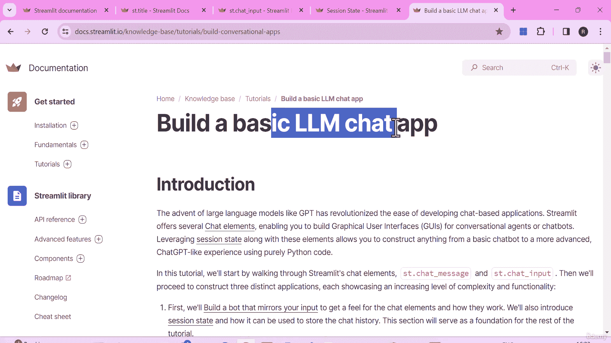

根据 Streamlit 文档，Streamlit 是一个开源 Python 库，可以轻松创建和分享漂亮的机器学习与数据科学自定义应用，只需少量代码即可构建和部署强大的数据应用。这正是我们构建前端要用的工具。它提供了大量开箱即用的代码，可以用来构建基础的大语言模型聊天应用，这些示例覆盖 OpenAI，也覆盖 Amazon Bedrock。  

原文作者还说明了源码来源和修改方式：作者拿到的源码由 Streamlit 和 AWS 提供，然后根据自己的需求进行了修改。接下来作者会快速走查可以做哪些修改，一方面可以定制前端，另一方面可以把已经写好的后端函数添加进去。需要特别关注代码中标记“两个星号”的位置，所有带两个星号的地方都是需要修改的代码行。这些修改大致分为两类：第一类是更新你已经写好的函数，第二类是修改聊天机器人的外观和感觉。  

以下是本节需要记住的两个修改方向：  

- 功能修改：把前端调用替换成你后端已经写好的函数  
- 外观修改：调整标题、输入框文字、界面组件等视觉与交互内容  

理解了工具和修改原则后，下一节我们开始看代码中的第一处修改：导入 Streamlit 和后端聊天机器人文件。  

## AWS生成式AI实战：02：🔌 导入 Streamlit 与后端聊天机器人文件

上一节我们说明了为什么使用 Streamlit，本节来看看代码的第一处关键修改。第一步需要导入 Streamlit，以及后端中的聊天机器人文件。原文中可以看到 `import streamlit as st`，这就是导入 Streamlit 的方式。接着需要导入后端文件，原文示例中导入的是后端文件名 `X5`，实际使用时它就是你后端聊天机器人文件的名称。导入时可以给这个文件起一个别名，例如 `demo`。  

以下是导入部分对应的核心代码：  

```python
import streamlit as st
import chatbot as demo  # 原文示例为 import X5；这里按你的后端文件名导入，demo 是别名
```

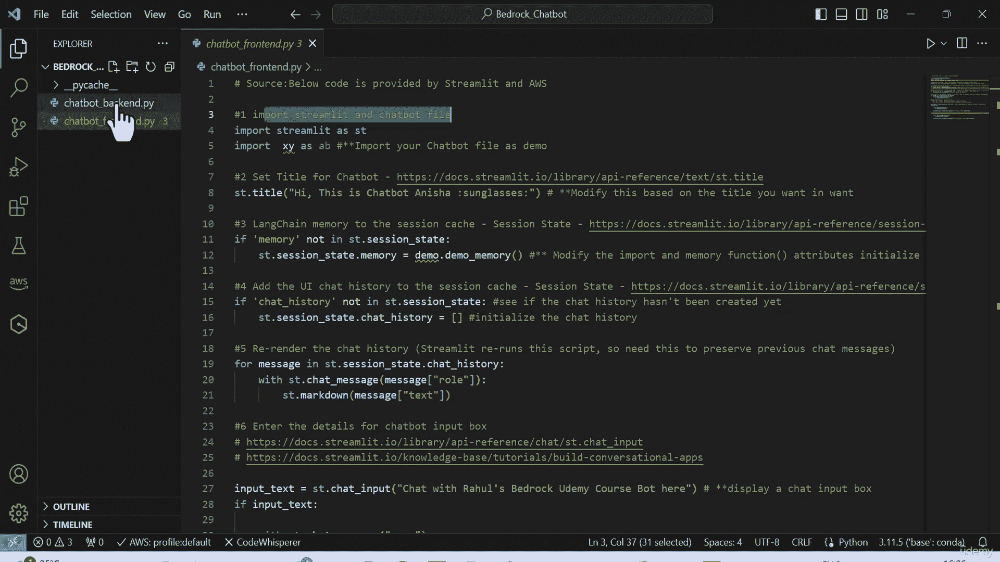

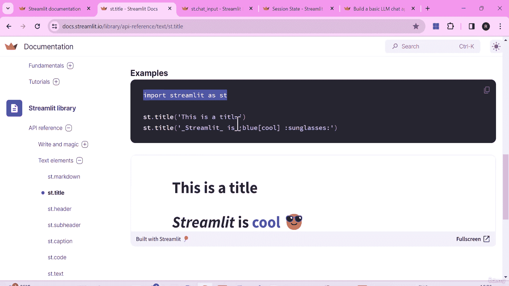

上面这段代码就是导入部分的核心。原文中带两个星号的位置，就是需要你修改的位置，主要是确认后端文件名和别名是否与你的项目一致。对于初学者来说，可以把 `demo` 理解成“给后端文件起的小名”，后面调用记忆函数和对话函数时，都会通过这个小名来访问。  

以下是导入部分需要检查的要点：  

- `streamlit` 是否以 `st` 为别名导入  
- 后端聊天机器人文件是否按实际文件名导入  
- 是否给后端文件设置了统一的别名，例如 `demo`  

导入完成之后，下一节我们处理页面标题，让聊天机器人打开时有一个清晰的名称。  

## AWS生成式AI实战：03：🏷️ 修改页面标题

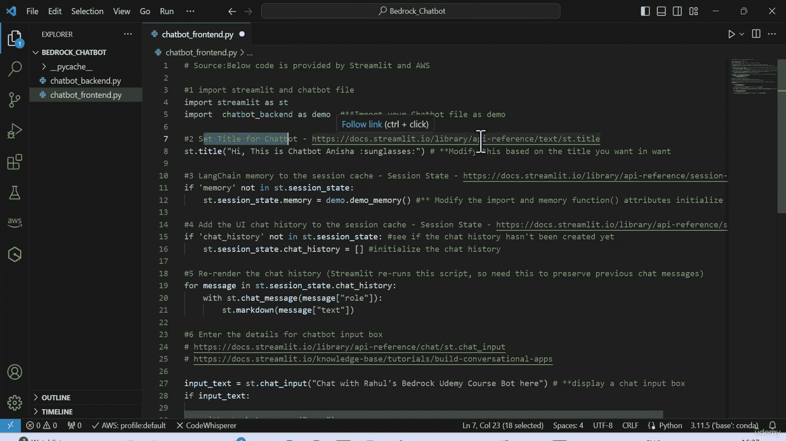

上一节我们完成了导入，本节来修改页面标题。原文说明，第二处可以修改的是标题，可以通过相关链接查看如何修改标题。修改方式使用 `st.title`，然后提供你想要的标题文字。原文示例中使用的标题是“Chatbot Anishia and sunglasses”，代码写作 `st.title`，并把这段标题文字作为参数传入。  

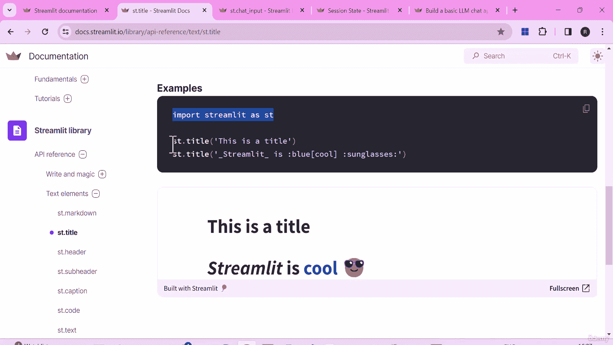

以下是设置页面标题的示例代码：  

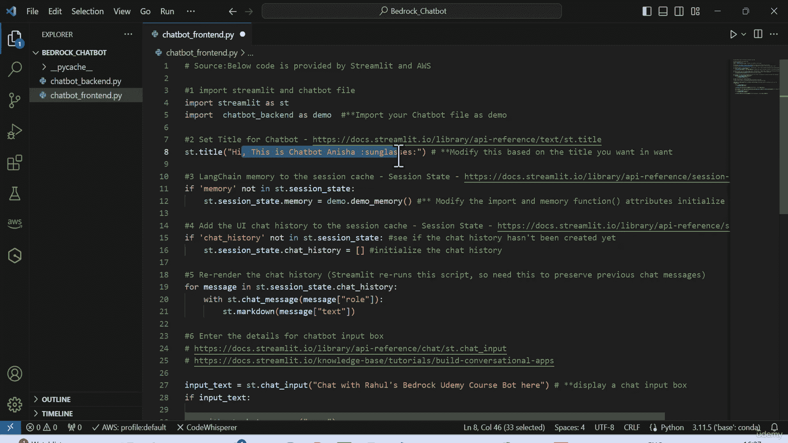

```python
st.title("Chatbot Anishia and sunglasses")
```


这段代码运行后，页面顶部就会显示这个标题。原文中的标题是一个示例，你可以把它替换成自己的聊天机器人名称。这个位置同样带有两个星号标记，说明它属于需要你根据项目需求修改的地方。对于初学者来说，可以把它理解成网页的“大标题”，用户一打开页面就会先看到它。  

以下是标题部分可以调整的内容：  

- 标题文字可以改成你的项目名称  
- 标题会显示在页面顶部  
- 修改时保留 `st.title` 的调用形式  

标题设置完成后，下一节我们进入会话状态与记忆函数的配置，这是让聊天机器人记住上下文的关键。  

## AWS生成式AI实战：04：🧠 配置会话状态与记忆函数

上一节我们设置了页面标题，本节来看看会话状态和记忆函数。原文说明，第三件事是需要为会话缓存提供内存，也就是处理聊天机器人的记忆。可以通过相关链接了解 Streamlit 中的 session state，以及 Streamlit 中如何处理会话状态。不过对于这段会话状态相关代码，你不需要修改，保持原样即可。唯一需要修改的是记忆函数的细节：也就是通过导入的后端别名，调用对应记忆函数。  

在本例中，后端聊天机器人文件被导入为 `demo`，记忆函数名称是 `demo_memory`，因此需要写成 `demo.demo_memory()`。原文表达的意思是：先写 `demo`，再点出你的记忆函数名称，然后把原来的占位内容替换成这个值。  

以下是记忆函数配置的核心代码：  

```python
memory = demo.demo_memory()
```

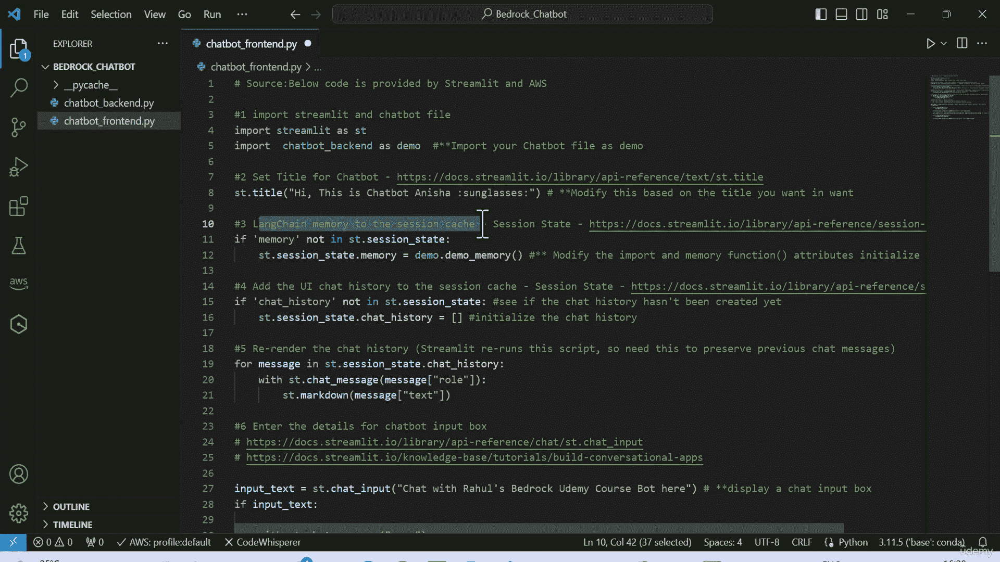

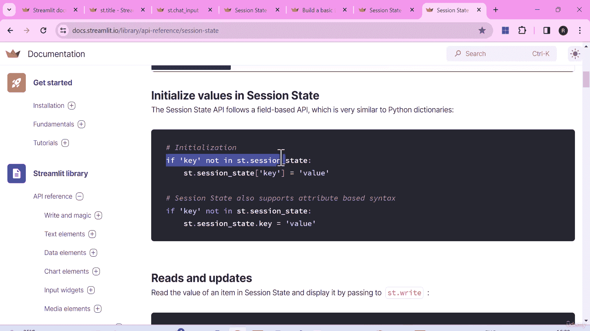

接下来还需要把 UI 聊天历史添加到会话缓存中，这部分同样不需要修改，保持原样即可。随后会再次渲染聊天历史，这部分也不需要修改。对于初学者来说，可以把 session state 理解成“这个浏览器会话自己的小抽屉”，聊天记录和状态可以临时放在里面；记忆函数则负责让聊天机器人知道之前的对话内容。  

以下是会话状态相关检查点：  

- 会话状态初始化代码保持原样  
- 记忆函数需要替换成 `demo.demo_memory` 这样的实际函数  
- UI 聊天历史加入会话缓存的部分不需要修改  
- 渲染聊天历史的部分不需要修改  

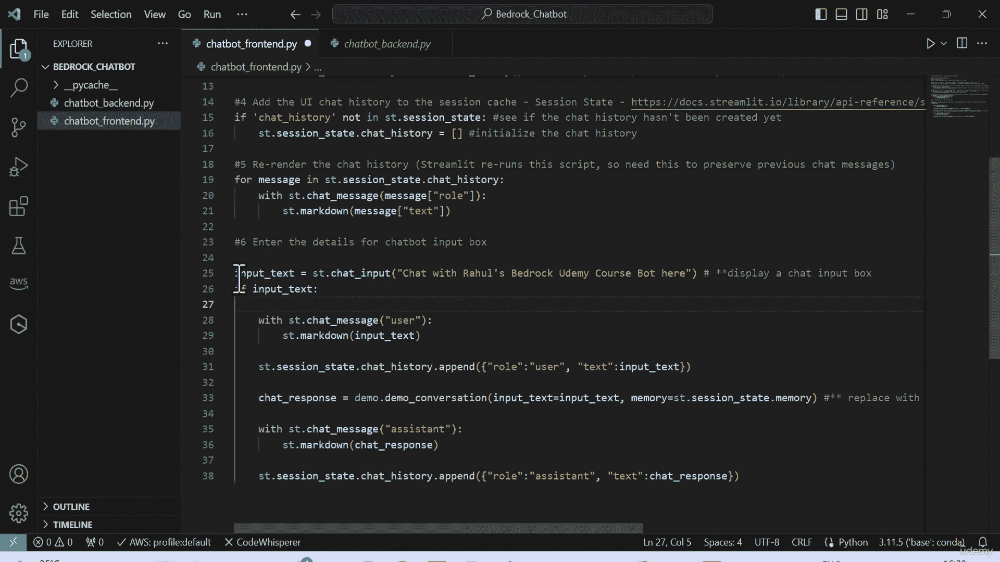

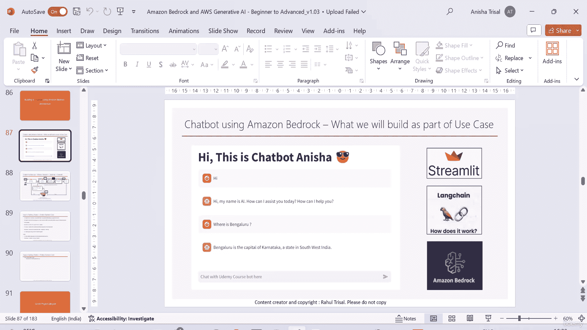

会话状态配置好后，下一节我们设置输入文本框和聊天响应函数，让用户能够真正输入问题并得到回答。  

## AWS生成式AI实战：05：💬 设置输入框与聊天响应函数

上一节我们完成了记忆与会话状态配置，本节来处理输入框和聊天响应。下一步需要提供输入文本框。原文示例中的输入框文字类似“chat with Udemy Co board here”，这个输入文本框的文字可以按需要修改，原文示例中写成了“chat with the algebraroomic”，你可以在这里改成自己想要的提示文字。这个位置也带有两个星号标记，属于需要修改的界面文字。其余部分保持原样即可。  

最后需要处理聊天响应部分。这里要把原来的响应调用替换成你为会话链编写的函数。原文示例中，将响应替换为 `demo_conversation`。因为后端文件已经导入为 `demo`，所以需要写成 `demo` 加上会话链函数名称。原文中的会话链函数名称是 `demo_conversation`。  

以下是聊天响应部分的核心代码示意：  

```python
response = demo.demo_conversation(...)
```

这段代码不需要再改其他内容。原文说明，这段代码由 AWS 和 Streamlit 提供，作者根据后端中已经写好的函数进行了修改，同时也修改了一些 UI 组件。如果你想添加更多数据元素，或者修改其他界面内容，可以使用 Streamlit 库提供的各种小部件。对于初学者来说，可以把 Streamlit 小部件理解成“网页上的积木”，例如文本框、按钮、标题和聊天消息区域，都可以通过现成组件拼出来。  

以下是前端控件可以扩展的方向：  

- 使用 Streamlit 组件增加新的输入控件  
- 使用 Streamlit 组件调整页面展示元素  
- 通过修改 UI 文字改变聊天机器人的外观  
- 通过替换函数名接入后端已有能力  

输入框和聊天响应都配置好后，下一节我们实际运行聊天机器人，看看界面是否能正常启动。  

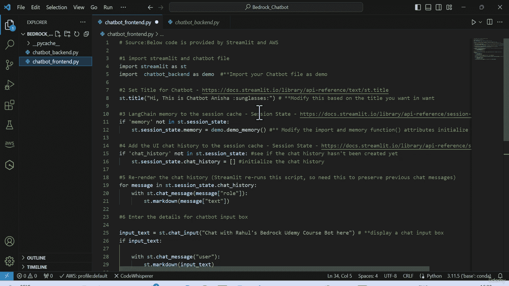

## AWS生成式AI实战：06：▶️ 本地运行并验证聊天机器人

上一节我们完成了输入框和响应函数配置，本节来运行聊天机器人并验证效果。原文说明，此时一切看起来都不错，可以运行聊天机器人看看是否工作。需要打开一个新的终端。为了让聊天机器人在本地运行，使用的命令是 `streamlit run` 加上前端文件名和 `.py` 后缀。  

以下是本地运行聊天机器人的核心命令：  

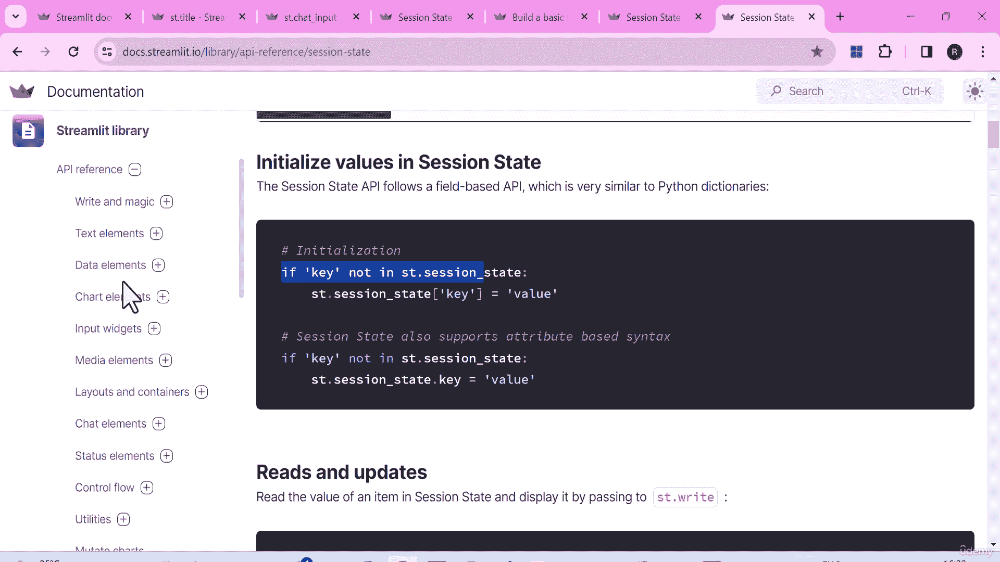

```bash
streamlit run 你的前端文件名.py
```

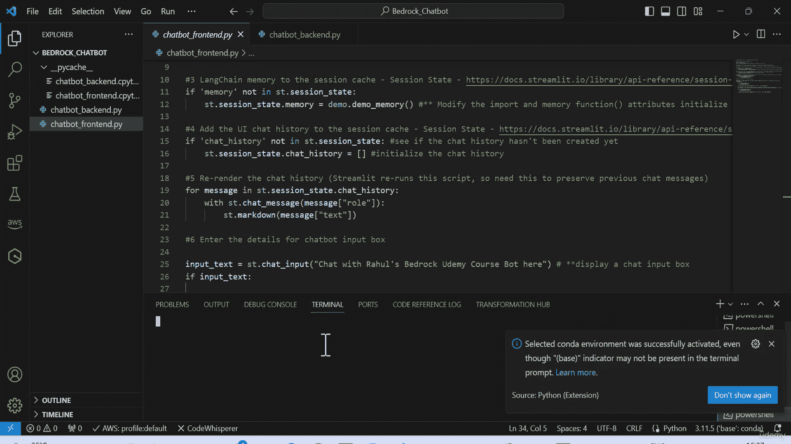

原文中执行时使用的文件名是 `shared_part_underscore_for_unend_not_fine.py` 这一类名称，实际使用时请替换成你自己的前端文件名。运行命令后，终端会给出一个 URL，并自动在浏览器中打开这个 URL。界面中会显示运行、停止和部署相关的控制项，启动需要一点时间。  

等待几分钟后，聊天机器人就会启动，页面中会显示我们在用户界面中提供的细节。回到页面可以看到之前设置的标题。继续向下查看，可以看到输入文本框，原文示例中显示的是类似“chat with Rahul 的 Bedrock 课程机器人”的文字。对于初学者来说，这一步的重点不是记住某个具体文件名，而是理解整个流程：终端运行 Streamlit 命令，浏览器打开本地地址，页面加载 UI，然后检查标题和输入框是否与配置一致。  

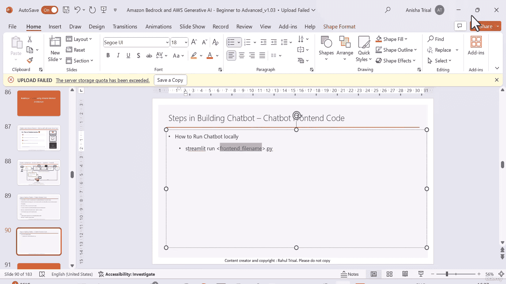

以下是运行后需要检查的项目：  

- 终端是否成功执行 `streamlit run` 命令  
- 浏览器是否自动打开本地 URL  
- 页面是否显示前面设置的标题  
- 页面下方是否显示聊天输入框  
- 输入框提示文字是否符合你的配置  

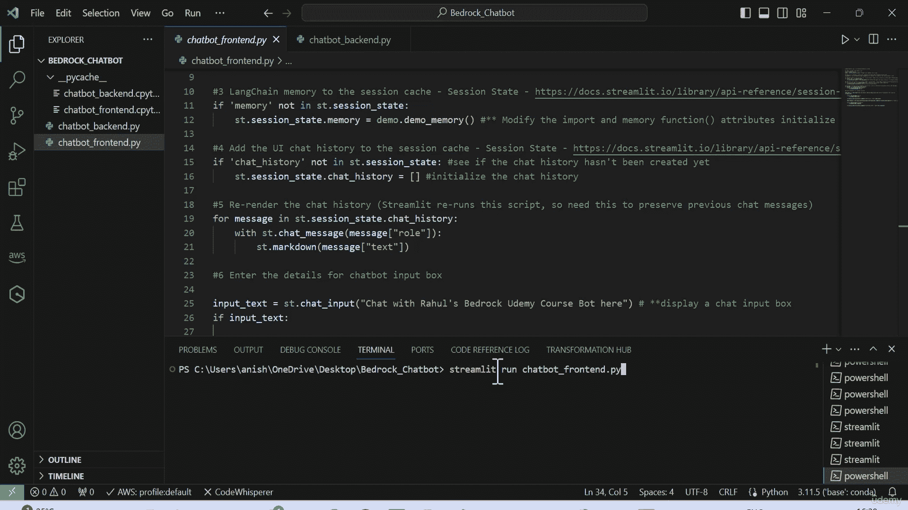

运行验证完成后，下一节我们对整个教程做一次总结，把前后流程串起来。  

## AWS生成式AI实战：07：✅ 课程总结

本节课中，我们一起学习了如何为已经构建好的聊天机器人后端添加 Streamlit 前端。我们首先理解了后端已经完成、现在需要前端，以及组织项目中的前端团队分工。随后了解了 Streamlit 是一个简单的 Python 库，提供大量开箱即用代码，可以用来构建基础的大语言模型聊天应用，示例覆盖 OpenAI 和 Amazon Bedrock。  

接着我们按步骤完成了前端定制：导入 Streamlit 和后端聊天机器人文件，并给后端文件设置别名；使用 `st.title` 修改页面标题；为会话缓存配置记忆函数，并保持 session state 和聊天历史渲染代码不变；设置输入文本框文字；把聊天响应替换为后端会话链函数；最后使用 `streamlit run 前端文件名.py` 在本地启动应用，并检查浏览器中的标题和输入框。  

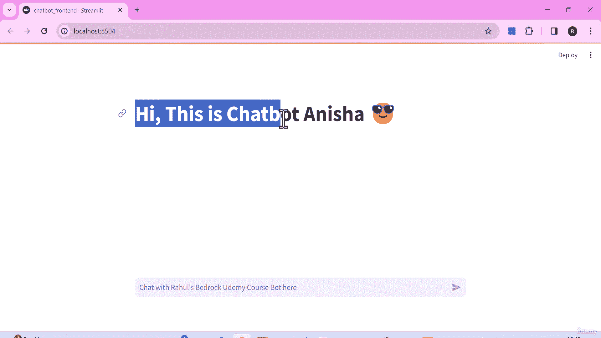

整个教程的核心可以概括为一段代码关系：  

```python
import streamlit as st
import chatbot as demo

st.title("你的聊天机器人标题")
memory = demo.demo_memory()
response = demo.demo_conversation(...)
```

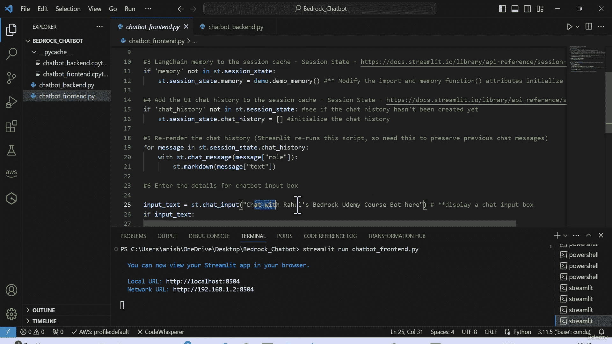

完成这些步骤后，你就拥有了一个可以本地运行的聊天机器人前端。后续如果希望增加更多界面元素，可以继续使用 Streamlit 提供的各种小部件进行扩展。  

