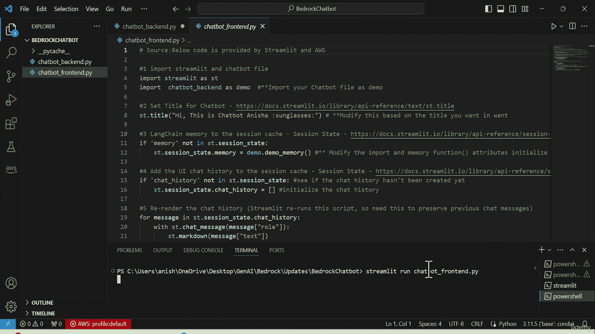
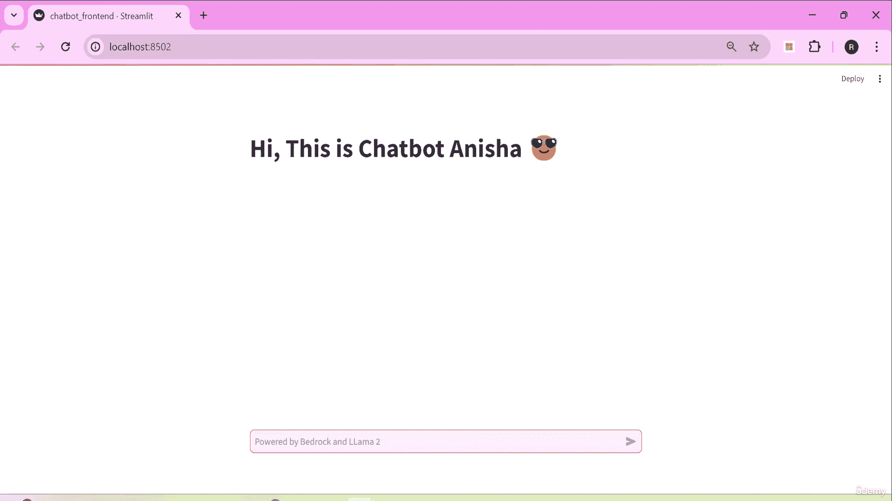
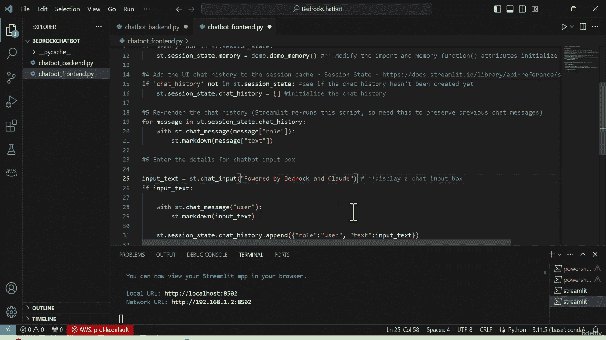
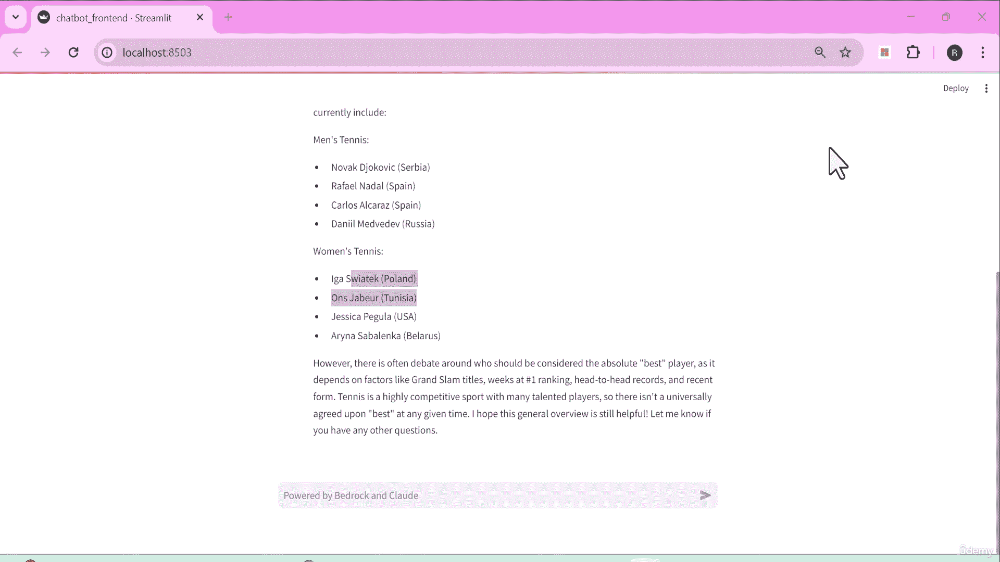

# 🚀 Udemy - Generative AI on AWS - Amazon Bedrock, RAG & KIRO [2026]：Part 1 p43-45：Chatbot 端到端演示


在本节课中我们将要学习如何完成一个聊天机器人的端到端演示。这个演示会把 Streamlit 前端、LangChain 和 Amazon Bedrock 连接起来，让我们在网页界面里输入问题，然后由后端模型返回回答。对于初学者来说，可以把它理解成一条很直白的链路：前端负责显示聊天框，LangChain 负责把请求组织好，Amazon Bedrock 负责调用模型生成回答。下面的公式可以帮助你记住整体结构。


```text
聊天机器人 = Streamlit 前端 + LangChain 编排 + Amazon Bedrock 模型
```


理解这个整体结构后，下面进入实际操作，先启动前端应用。


## 🧭 Udemy - Generative AI on AWS - Amazon Bedrock, RAG & KIRO [2026]：Part 1 p43-45：步骤一：启动前端应用


在概述之后，我们进入实际操作，先看看如何把 Streamlit 前端跑起来。操作位置在终端里，重点是点击终端、新建终端，然后输入运行命令并确认前端文件名。对初学者来说，这一步虽然不复杂，但要确保文件名拼写正确，否则页面不会正常启动。以下是启动前端应用的具体步骤。


1. 点击终端，然后选择新建终端。

2. 在终端中输入运行命令，并指定前端文件名 `chat_front_end.py`。




```bash
streamlit run chat_front_end.py
```


3. 运行这个命令。


命令运行后，可以看到界面已经启动。界面上显示这是 Chatbot Anisha，这是一个 Streamlit 前端。页面里还能看到 `powered by Bedrock and Llama2`。出现这个标识的原因是之前使用的是 Llama2，而现在可以改用 Claude 基础模型，因此可以对这个标识做一个快速修改。前端启动成功后，下一步就是调整界面中显示的模型标识。


## 🔧 Udemy - Generative AI on AWS - Amazon Bedrock, RAG & KIRO [2026]：Part 1 p43-45：步骤二：修改模型标识


上一节我们启动了 Streamlit 前端，本节中我们来看看如何把界面里的模型标识从 Llama2 改成 Claude。这个修改只是界面展示文字的调整，但它能帮助我们确认页面内容可以正常编辑和刷新。操作时先向下滚动，找到显示 `powered by Bedrock and Llama2` 的位置，然后把 Llama2 改成 Claude，保存后再刷新页面。以下是修改模型标识的操作顺序。


1. 向下滚动，找到页面中显示 `powered by Bedrock and Llama2` 的文字。

2. 把这段文字中的 Llama2 改成 Claude。

3. 保存修改。

4. 刷新页面，从这里刷新即可。


刷新后可以看到更改已经生效，页面显示为 `powered by Bedrock and Claude`。可以用下面的引用对比修改前后的展示效果。




修改前：




> powered by Bedrock and Llama2


修改后：


> powered by Bedrock and Claude


模型标识改好并刷新后，接下来就可以测试聊天功能。


## 💬 Udemy - Generative AI on AWS - Amazon Bedrock, RAG & KIRO [2026]：Part 1 p43-45：步骤三：测试聊天机器人


前面我们完成了界面修改，本节中我们来实际问几个问题，验证聊天机器人能否正常返回内容。测试从简单的问候开始，然后再问一个开放性问题，观察模型如何回答。这样既能确认基本对话是否通畅，也能看到模型面对没有唯一答案的问题时会怎么处理。以下是两个测试问题。


1. 先输入 `hi`。

2. 再输入 `Who is the best tennis player in the world?`。


可以先看第一个问题。


> hi


输入后可以看到收到了回复。回复内容是 `hello, it's nice to meet you as an AI assistant`，然后还会给出一些更多细节。接着问第二个问题。


> Who is the best tennis player in the world?


查看回复后可以看到，机器人表示自己没有确定答案。它在男子网球中提到 Novak Djokovic、Nadal 和其他一些人，在女子网球中也提到了一些球员。通过这两个问题，我们看到了聊天机器人的基本交互效果，接下来梳理整体组成。


## 🧠 Udemy - Generative AI on AWS - Amazon Bedrock, RAG & KIRO [2026]：Part 1 p43-45：步骤四：理解整体组成


上一节我们完成了对话测试，本节中我们来看看这个端到端演示由哪些部分组成。简单说，就是用 Amazon Bedrock 提供模型能力，用 LangChain 做连接和组织，用 Streamlit 做网页前端。这样组合起来，就能形成一个可以输入问题并显示回答的聊天机器人。以下是这个演示的三个核心组成部分。


1. Streamlit：负责前端页面和聊天输入框。

2. LangChain：负责把前端请求和模型调用串联起来。

3. Amazon Bedrock：负责调用基础模型并生成回答。


可以用下面的流程公式来理解一次对话是怎么走通的。


```text
用户输入 -> Streamlit 页面 -> LangChain 组织请求 -> Amazon Bedrock 调用模型 -> 返回回答 -> Streamlit 展示
```




这就是使用 Amazon Bedrock、LangChain 和 Streamlit 构建聊天机器人的方式。本节课中我们一起学习了如何启动 Streamlit 前端、修改模型标识、测试聊天机器人，并理解 Amazon Bedrock、LangChain 和 Streamlit 的整体配合方式。希望你喜欢这节课，下节课见，谢谢。
