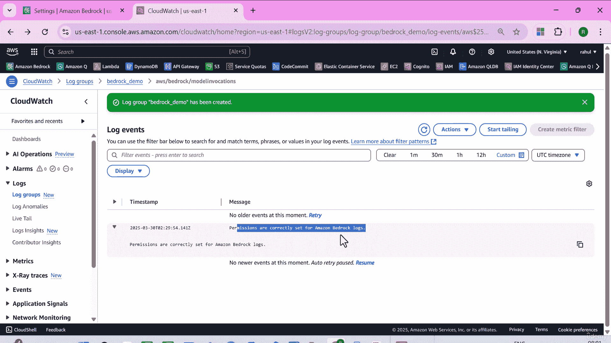
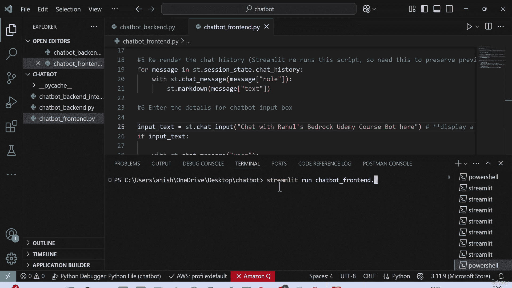
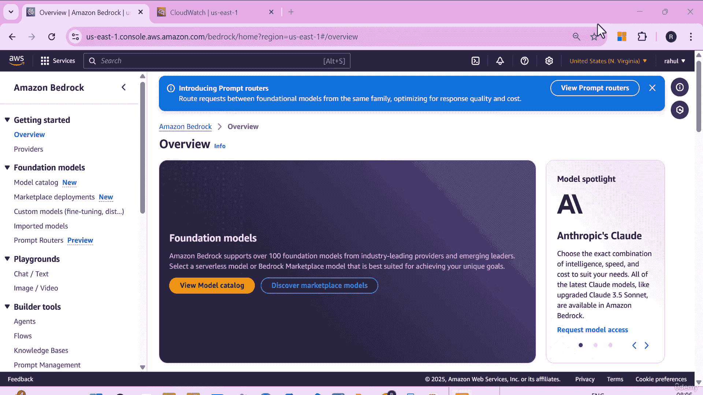
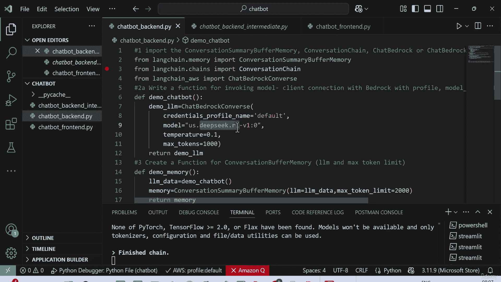
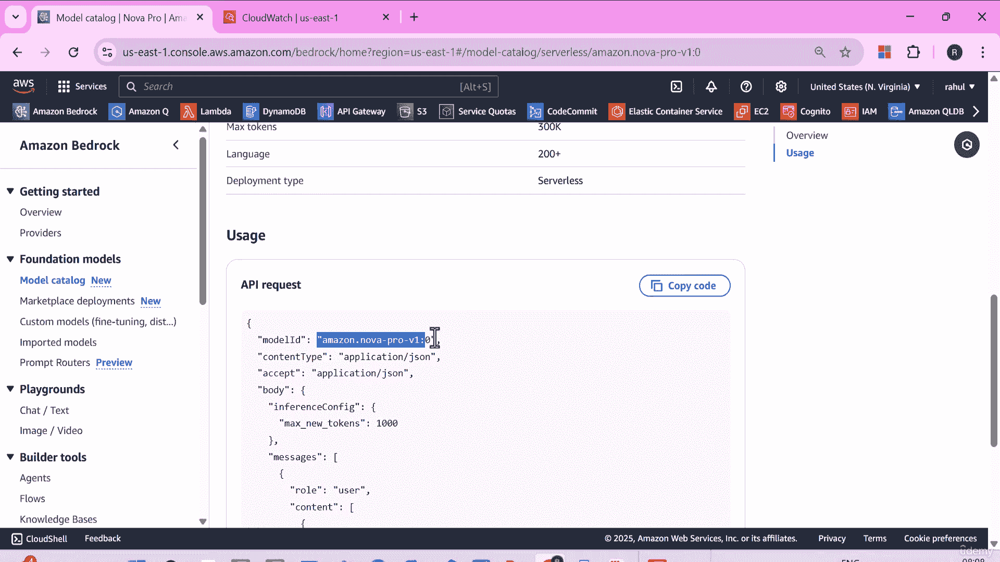
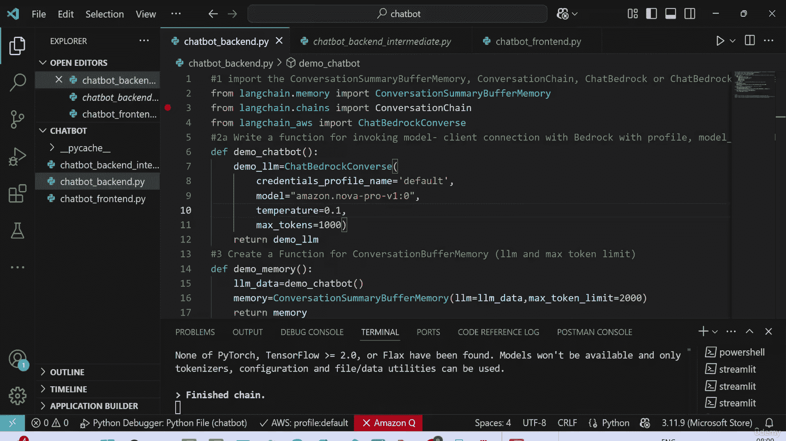
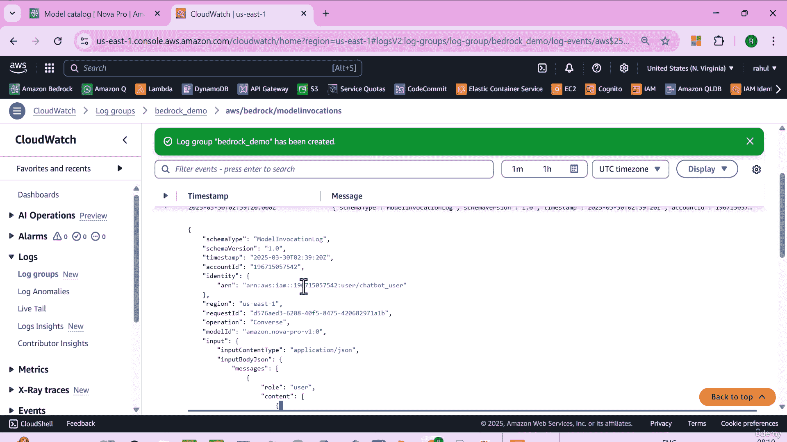

## 📊 AWS生成式AI实战：第44-46节：使用CloudWatch监控Bedrock

在本节课中我们将要学习如何为 Amazon Bedrock 启用日志记录，并利用 CloudWatch Logs 查看发送给大语言模型的提示词以及模型返回的响应。具体来说，我们会从 Bedrock 控制台开启模型调用日志，创建一个 CloudWatch 日志组，配置授权角色，然后通过聊天应用发起请求来验证日志是否被记录；最后还会看看只改一行模型 ID 就能切换模型，并确认新模型的调用同样会进入这套日志。整个流程的目标，是让你清楚知道“我问了什么、模型答了什么、用了多少 token、延迟多少”，这些信息都会成为后续排查和优化的重要依据。

上一部分我们介绍了 Bedrock 的基本调用，本节中我们来看看如何把调用过程记录到 CloudWatch Logs 中，并用一个实际请求验证日志内容。下面先从启用日志的入口开始。

### 🔍 AWS生成式AI实战：第44-46节：启用Bedrock模型调用日志

首先，我们需要进入 Amazon Bedrock 服务。在 AWS 控制台里搜索 `Amazon Bedrock`，就能找到并进入这个服务。进入之后，把页面一直向下滚动，找到并点击“设置”（Settings）区域；在这里可以看到“模型调用日志”（Model Invocation Logging）这个选项。点击它之后，系统会给出文本、图像、嵌入、视频等日志类型选项，我们需要选择把日志保存到哪里，可选 S3、CloudWatch Logs，或者两者都选。这里我们只选择 CloudWatch Logs，因为本节的目标就是用 CloudWatch 查看模型调用记录。

下面是启用日志时需要理解的几个核心对象，我们可以用一段简化的链路和公式来表示：

```text
Bedrock 模型调用请求/响应 → CloudWatch Logs 日志组 → 查看请求、响应、token、延迟等元数据
```

```text
模型调用日志 = 请求元数据 + 响应内容 + token统计 + 延迟与结束原因
```

在真正保存设置之前，我们还需要先创建一个 CloudWatch 日志组。因此，接下来我们转到 CloudWatch Logs 去创建日志组，然后再回到 Bedrock 填写日志组名称。

### 🗂️ AWS生成式AI实战：第44-46节：创建CloudWatch日志组



现在进入 CloudWatch Logs 的首页，找到“日志组”（Log Groups）并点击进入。这里我们需要新建一个日志组，所以点击“创建日志组”，给它起一个名字，例如 `bedrock_demo`。起名时可以先复制名称，避免后面填写时写错。同时可以把日志保留时间设置为大约一周，这样既能满足演示和排查需要，也不会让日志无限期堆积。设置完成后点击创建，CloudWatch 中就会出现一个名为 `bedrock_demo` 的日志组；我们可以在日志组列表里搜索并确认这个日志组就是刚刚创建的那一个。



创建好日志组之后，我们回到 Bedrock 的模型调用日志设置页面，把日志组名称填写为刚刚在 CloudWatch Logs 中创建的 `bedrock_demo`。这样一来，后续 Bedrock 产生的模型调用日志就会写入这个指定的日志组中。

接下来还需要选择授权方式，让 Bedrock 有权限把日志写入 CloudWatch。你可以使用已有的 IAM 角色，也可以新建一个角色；这里我们选择新建角色，并给它起一个名字，例如同样使用 `bedrock_demo` 作为角色名称。完成后保存设置，页面会提示设置已成功保存。此时我们可以看到“模型调用日志”已经启用，它的作用是收集账号中所有模型调用的元数据、请求和响应。

以下是启用后需要记住的日志覆盖范围：

- 无论请求来自聊天应用还是控制台，只要发送到 Bedrock 的某个模型并收到响应，相关信息都会记录到刚刚创建的 CloudWatch 日志组中。
- 刚启用时可能只会看到一条与权限配置相关的记录，暂时还不会看到我们发送给模型的提示词和响应，因为此时还没有发起新的模型调用。

完成这些配置后，本节中我们来看看实际发起一次请求，并回到日志组中确认请求和响应是否被完整记录。

### 💬 AWS生成式AI实战：第44-46节：发起请求并验证调用日志

现在进入聊天应用，启动聊天机器人并进入聊天界面，我们会获得一个可以访问的 URL。打开这个 URL 后，向模型提出一个问题，例如“中国的首都是哪里？”（What is the capital of China?）。提交问题后，可以看到模型返回了响应。接着回到 CloudWatch 的日志组，刷新日志页面，就能看到调用日志已经出现；如果字体太小，可以放大字体方便查看。

在日志内容中，我们可以看到几个关键字段：本次调用的 ARN、使用的模型（例如 DeepSeek）、操作类型（Converse API），以及消息角色和内容。之前我们使用 Converse API 时设置过消息角色为 `user`，这里就能看到对应的消息角色和内容。我们实际问的问题是“中国的首都是哪里？”，但日志中显示的提示词可能已经被系统扩充过，这些额外内容是由系统自动添加的；日志里也会保留我们真正提出的问题，因此可以清楚看到提示词增强（prompt augmentation）是怎么发生的。

以下是日志中常见的几类信息，它们对排查问题很有帮助：







- 请求消息：包括消息角色（如 `user`）和消息内容，以及系统自动补充的提示词内容。
- token 统计：包括使用了多少 token、输入 token 数量等。
- 模型响应：例如“中国的首都是北京，这是一座充满活力的城市”等回答内容。
- 推理文本：日志中还会展示模型为什么以这种方式回答，例如“用户问的是中国的首都，先回想正确答案”等推理说明。
- 结束原因与延迟：包括 stop 原因、turn 信息、延迟等运行细节。

可以看到，CloudWatch 日志不仅记录最终回答，还记录了请求、响应和性能相关的细节。接下来我们看看，如果想把模型从 DeepSeek 换成别的模型，需要改多少代码。



### 🔄 AWS生成式AI实战：第44-46节：只改模型ID切换模型

假设我们不想继续使用 DeepSeek，而是想换用另一个模型，并且希望只做一行代码改动。我们可以回到 Amazon Bedrock 服务，进入模型提供方（Providers）页面，例如选择 AWS 新推出的大语言模型 Amazon Nova。进入 Nova 页面后，我们选择使用 Nova Pro；这个模型表现不错，价格也比较便宜。页面中会给出请求示例，我们从中复制对应的模型 ID。

然后回到代码或请求配置中，把原来的模型 ID 替换为 Nova Pro 的模型 ID，并保存修改。这里唯一需要改变的就是模型 ID，不需要调整 temperature、max token 或其他配置。保存后再次发起请求，例如这次问“美国的首都是哪里？”（What is the capital of the USA?），模型会返回响应。然后回到 CloudWatch Logs，刷新日志并点击最新记录；此时日志条目应该会增加，例如从两条变成三条，最新的一条可能是 139 这条记录。

打开最新日志后，可以看到模型 ID 已经变成 Amazon Nova Pro。向下滚动查看问题与回答，问题是我们问的“美国的首都是哪里？”，回答是“美国的首都是华盛顿哥伦比亚特区”（Washington, D.C.）。日志中还会显示系统对问题做了哪些扩充，以及最终发送给模型的完整提示词。由此可以看到，切换模型只需要修改模型 ID，日志仍然会照常记录新的模型调用。



本节课中我们一起学习了如何为 Amazon Bedrock 启用模型调用日志，如何在 CloudWatch Logs 中创建日志组并配置授权角色，如何通过聊天应用发起请求来验证请求、响应、token、延迟等信息是否被记录，以及如何只修改模型 ID 就切换到 Amazon Nova Pro 并确认新调用同样进入日志。掌握这些内容后，你就可以用 CloudWatch 对 Bedrock 的调用过程进行观察和排查，为后续优化提示词、比较模型表现和理解调用成本打下基础。本节内容到这里就结束了，下一节课再见。

