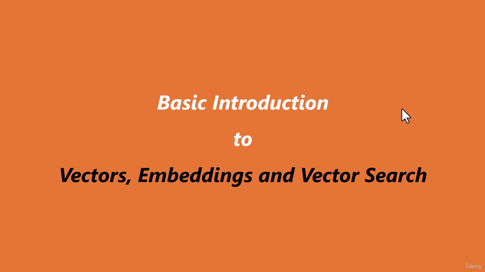
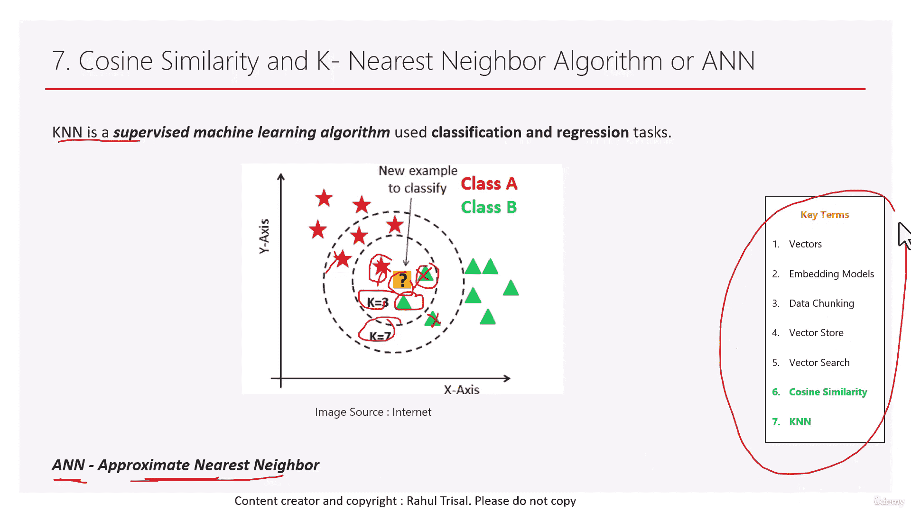

# Generative AI on AWS - Amazon Bedrock, RAG & KIRO [2026]：Part 1 第45-47讲：🔍 可选讲座：向量、嵌入、向量数据库与搜索概述

本节课是一节选学内容，我们将要学习向量（Vector）、嵌入（Embedding）、向量数据库（Vector DB）和向量搜索（Vector Search）的基础概念。如果你已经对这些术语非常熟悉，那么完全可以跳过本节课；但如果你还不太了解，就请你认真往下看，因为后面我们在构建 RAG 解决方案时，会一直用到这些概念。换句话说，这些都是后续学习的关键基础词，值得花一点时间搞明白。

## 1️⃣ 为什么需要向量？

先从一个最普通的场景说起。假设你去一家零售店，买了一些苹果和几本书，然后走到收银台结账。收银员很快就能算出你该付多少钱，因为商品和价格都可以存放在关系型数据库里，这些都属于结构化数据，计算起来非常容易。

但假如你在刷 Instagram 的时候，看到一款很好看的挂钟，而你想要的其实是颜色不同的另一款。这时，你该怎么去找一张相似的、但颜色是黑色的挂钟图片呢？这件事就不像结构化数据那么容易了。接下来的内容，我们就是要研究：当数据是非结构化的时候，如何进行图像搜索或者数据搜索。这才是向量技术真正要解决的难题。



## 2️⃣ 什么是向量？

要搞懂非结构化搜索，第一步就是理解向量。先看定义：向量是单词、句子和文档的数学表示。换句话说，单词、句子或文档都可以被表达成一组数字，也就是一个数字列表。你可以把它想象成给每个文本内容发了一张“数字身份证”。

为了方便理解，我们来看一个具体例子。假设我们要把单词 `apple`（苹果）表示成一个向量。真实的向量可能有成百上千个维度，但为了讲清楚原理，这里只看两个维度：第一个维度是“它是不是水果？”，如果是就记作 `1`，不是就记作 `-1`；第二个维度是“价格”，假设每个苹果的价格是 `4`。那么，这两个维度就可以写成向量的形式，也就是一个数字列表：

```python
apple = (1, 4)
```

我们还可以把这个向量画到二维平面上：横轴表示“是不是水果”，纵轴表示“价格”。这样，苹果就会落在坐标 `(1, 4)` 的位置，非常直观。

接下来，我们再来看香蕉。香蕉使用同样的两个维度来描述：它是水果，所以第一个维度是 `1`；它的价格是 `2` 美元，所以第二个维度是 `2`。于是，香蕉就可以表示成：

```python
banana = (1, 2)
```

把它也画到同一张图上，因为它价格是 2，而且又是水果，所以它会落在 `(1, 2)` 附近，和苹果离得比较近。

现在，我们再尝试把其他物体也表示成向量。比如足球：它是水果吗？不是，所以第一个维度是 `-1`；它的价格是 `50` 美元，所以第二个维度是 `50`。于是，足球可以表示为：

```python
football = (-1, 50)
```

再比如网球拍：它同样不是水果，所以第一个维度是 `-1`；假设价格是 `40` 美元，所以第二个维度是 `40`。于是，网球拍可以表示为：

```python
tennis_racket = (-1, 40)
```

把这些点画在图上，它们都分布在二维空间的左侧区域。这里为了方便，我们只用二维来展示。但请你一定记住：在真实世界中，每个单词、句子或文档都可以被表示成几百维、几千维的向量，只不过我们无法直接画出来而已。

## 3️⃣ 用 Amazon Titan 嵌入模型生成向量

知道了向量的概念之后，我们还要知道：实际项目中，到底怎么把文字变成向量？这就要用到一种叫“嵌入模型”（Embedding Model）的工具。嵌入模型可以把单词或句子转换成几百维甚至几千维的向量。AWS 上提供了 Amazon Titan Embeddings 模型，它的任务就是把单词、句子或文档转换成向量。

举个例子，假设我们手上有一组词：`apple`、`banana`、`grapes` 等等。把这些词全部传给嵌入模型后，Amazon Titan Embeddings 会把它们转换成一个又一个向量。特别要注意，这个模型生成的向量维度是 `1536` 维。在之前的例子里，我们只用了二维，而 Titan 模型会把每个词都转换成 1536 个数字。虽然没法直接可视化 1536 维的图，但从概念上你可以想象：水果类的词会聚在一起，运动器材类的词也会根据维度相似度聚在一起。这就是“相似的东西在向量空间里离得近”的含义。

这里还有一个值得注意的词：`go`。`go` 既是一款很流行的棋盘游戏（和国际象棋有点类似），又是一种编程语言。那么问题来了：当模型遇到 `go` 这个词时，它到底应该归到运动器材那边，还是编程语言那边呢？这里最核心的一点是：嵌入模型并不是只看关键词本身，而是会结合这个词的含义和上下文来做判断，再把它和相似的东西聚在一起。关于这一点，后面的课程还会展开讲解。现在你只需要记住：这些嵌入模型可以生成词嵌入（Word Embedding）、句子嵌入（Sentence Embedding）以及文档嵌入（Document Embedding），也就是说，不管是单词、句子还是整篇文档，都可以被转换成向量。

这里再补充一个嵌入模型输出的实际感受。比如你想把 `fruit` 这个词变成向量，传给 Amazon Titan Embeddings 模型之后，你会看到一大串数字。在展示出来的部分中，大约能看到 100 个维度，而后面还有 1436 个数字，加起来恰好是完整的 1536 维向量。可以这样理解：每个词最终都会变成一长串数字，方便计算机去计算和处理。

## 4️⃣ 文本分割 / 数据分块

接下来，我们要看另一个重要概念：文本分割（Text Splitting），也叫数据分块（Data Chunking）。这是做什么用的呢？假设你有一个几十页的 PDF 文档，想把整篇文档转换成向量。这时候，你通常不能直接把整篇文档一次性丢给嵌入模型，而是要先进行文本分割或数据分块。具体的分割方式有很多种，可以按固定字符数来切，也可以按 token（词元）来切，甚至还可以按代码结构来切。

假设我们选择按字符数来分割：把文档切分成大约 200 个字符的固定片段。然后，每一段 200 个字符的内容都会单独传给 Amazon Titan Embeddings 模型，并转换成一个向量。用代码来示意的话，大致是这样：

```python
chunk_size = 200
chunks = [pdf_text[i:i+chunk_size] for i in range(0, len(pdf_text), chunk_size)]
vectors = [embedding_model.embed(chunk) for chunk in chunks]
```

简单来说，分块就是把长内容切成好几段，让嵌入模型可以逐段处理，最终得到多个向量。等到后面构建 RAG 时，这种分块操作会经常出现。

## 5️⃣ 向量存储

前面我们反复提到，通过 Amazon Titan Embeddings 可以把单词、句子或文档转换成 1536 维的向量。那么，这些向量到底存在哪里呢？在实际应用中，向量数量可能会达到几千、几百万甚至更多，所以我们肯定不能随便找个地方塞进去，而是需要使用专门的向量存储（Vector Store），也叫向量数据库（Vector Database）。

目前市面上常见的向量存储/向量数据库有下面这些，我们可以逐个了解一下：

- Facebook AI 相似性搜索（FAISS）：这是一个由 Facebook 维护的相似性搜索库，主要用来做高效的向量检索。

- Pinecone：这是一个比较传统的向量数据库，可以把嵌入模型生成的向量持久化存储下来，方便后续查询。

- Chroma DB：这也是一个常见的向量数据库，同样能够持久化保存嵌入向量，使用起来也比较方便。

简单区分一下：FAISS 更偏向高性能搜索库，而 Pinecone 和 Chroma DB 更偏向完整的向量数据库服务。无论哪一种，都能帮你保存成千上万个嵌入向量，方便后续做相似度计算。

## 6️⃣ 向量搜索：语义搜索

向量存放好之后，下一步自然就是搜索了。在向量数据库里，搜索并不是用 SQL 那样的精确匹配，而是运行某种相似性搜索。我们来看一个具体过程：假设一个用户提问：“哪种编程语言和 go 相似？”这句话会被传给 Amazon Titan Embeddings 模型，并转换成一个向量嵌入。

回到之前那张示意图：我们把词按照维度分成了水果、运动器材、编程语言等不同区域。如果只是做关键词搜索，那么出现 `go` 这个词时，系统既可能在运动器材区域找到 `go` 棋盘游戏，也可能在编程语言区域找到 Go 语言，结果并不确定。但现在我们做的不是关键词搜索，而是更像语义搜索（Semantic Search）。也就是说，系统会看这个问题的上下文和真实意图，然后基于这些信息去寻找相似的向量。在这个例子中，因为 Go 编程语言的向量维度和 Python 更接近，所以系统很可能返回的是“Go 编程语言”，而不是“Go 棋盘游戏”。

换句话说，向量搜索的核心是看语义，而不是看表面的字眼。这也是它能解决非结构化数据搜索问题的关键原因。

## 7️⃣ 相似度算法：余弦相似度

那向量搜索具体用什么样的算法来判断两个向量像不像呢？最常用的方法之一就是余弦相似度（Cosine Similarity）。

先回忆一下高中数学：在直角三角形里，`cos θ` 等于邻边除以斜边，也就是：

$$
\cos\theta = \frac{\text{邻边}}{\text{斜边}}
$$

把这个思路推广到向量上，余弦相似度就是计算两个向量之间的夹角所带来的余弦值。如果两个向量的方向非常接近，那么它们就会很相似；如果方向差得很远，就不相似。我们继续用前面二维的例子来说明：香蕉这个向量与横轴大约成 30 度角，苹果与横轴大约成 45 度角，所以香蕉和苹果之间的夹角大约是 15 度。另外，我们知道几个特殊的余弦值：`cos 0° = 1`，`cos 90° = 0`，`cos 180° = -1`（如果你不太明白为什么 `cos 0° = 1`，可以自己搜一搜，这里不展开）。那么，夹角 15 度时，`cos 15°` 大约等于 `0.96`。

看到这里，你应该对余弦相似度有了一个基本直觉。下面我们总结一下余弦相似度的判断规则，大概有这几种情况：

- 如果余弦值为 `1`，说明两个向量方向完全相同，也就是绝对相似。比如把一个苹果向量叠加到另一个苹果向量上，它们就是完全一致的。

- 如果余弦值为 `0.96`，说明两个向量方向非常接近，虽然不是绝对相似，但已经非常相似了。

- 如果余弦值为 `0`，说明两个向量不相关。比如苹果向量和 Go 编程语言向量之间的夹角大约是 90 度，它们一个是水果、一个是编程语言，几乎毫无关系，所以相似度很低。

- 如果余弦值为 `-1`，说明两个向量方向完全相反，也就是彻底不相似。

把向量 $A$ 和向量 $B$ 的余弦相似度写成公式，就是：

$$
\text{similarity} = \cos(\theta) = \frac{A \cdot B}{\|A\| \|B\|}
$$

总而言之，余弦相似度就是通过两个向量之间的夹角来计算它们的相似程度，夹角越小，越相似。

## 8️⃣ 相似度算法：KNN 与 ANN

除了余弦相似度，还有一个非常流行的算法叫做 K 最近邻（K-Nearest Neighbors，简称 KNN）。KNN 可以使用余弦相似度，也可以使用其他距离度量来判断不同向量的相似性。从机器学习分类来看，KNN 是一个有监督学习算法，非常擅长处理分类和回归任务，这些概念在之前的课程中你应该已经接触过了。

那么，KNN 是怎么工作的呢？我们通过一个例子来理解。假设有一个新的向量，同时已经有了一批现成的向量，它们大致分成两个簇，一个是星形簇，一个是三角形簇。我们可以给 KNN 设定一个 K 值，比如 `3` 或者 `7`。算法要做的事情，就是计算这个新向量和所有已有向量之间的相似度，然后找出距离最近的 K 个邻居。为了更清楚地说明，以下就是 KNN 判断一个向量属于哪个簇的基本步骤：

- 第一步，计算新向量与所有已有向量之间的夹角或距离，比如用余弦相似度。

- 第二步，选出其中相似度最高的 K 个向量，也就是最近的 K 个邻居。

- 第三步，让这 K 个邻居进行投票。如果 K=3，那么最近的 3 个邻居投票决定新向量属于三角形簇还是星形簇；如果 K=7，就由最近的 7 个邻居来投票。

- 第四步，得票最多的簇就是最终分类结果。

看到这里，你可能会觉得 KNN 挺好的。不过，KNN 有一个明显的问题：它需要和向量数据库里的每一个向量都计算一遍夹角。如果向量数量很多，计算量就会变得非常大，性能也会受到严重影响。所以，在实际工程中，我们很少直接使用标准 KNN，而更常使用 ANN（Approximate Nearest Neighbor，近似最近邻）。ANN 不需要遍历所有向量，而是用更聪明的方式快速找到接近最优的邻居，所以它比 KNN 快得多，也因此常常被用来做大规模相似性搜索。

## 📝 总结



本节课我们一起学习了向量、嵌入、向量数据库和向量搜索这几个核心概念。我们先是理解了为什么需要向量——因为非结构化数据不好直接用传统数据库处理，而向量可以把单词、句子和文档变成一组数字。接着，我们通过苹果、香蕉、足球等例子，直观感受了向量的表示方法，并了解了 Amazon Titan Embeddings 嵌入模型可以把文本转换成 1536 维的向量。然后，我们学习了文本分割/数据分块，知道了怎么把长文档切成小片段再向量化。之后，我们又认识了向量数据库（FAISS、Pinecone、Chroma DB），以及语义搜索的基本流程。最后，我们还讲解了余弦相似度、KNN 和 ANN 这些相似度计算算法。希望你现在已经清楚了这些关键术语，接下来我们就要利用它们去构建真正的 RAG 解决方案了，我们下节课再见。
