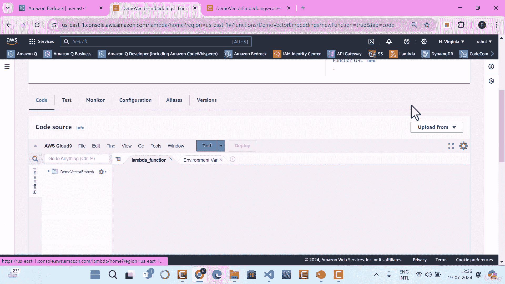
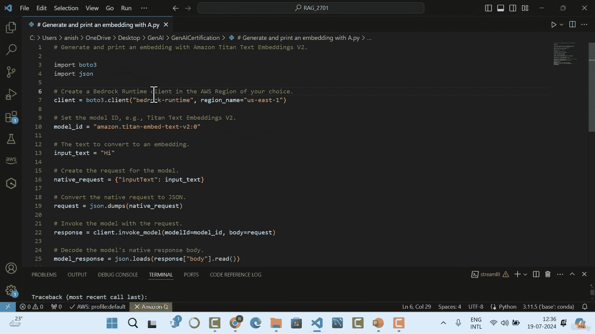
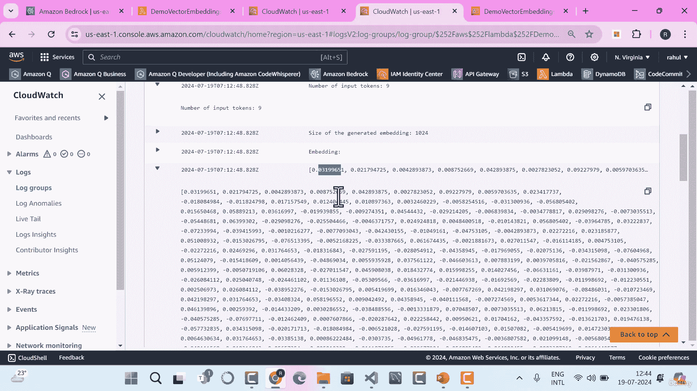

# 🧭 AWS生成式AI实战：第46-48节：向量与嵌入动手演示

在本节课中我们将要学习如何用 AWS Lambda 调用 Amazon Bedrock 上的 Amazon Titan Text Embeddings V2.0 模型，把一句话变成向量嵌入，并在 CloudWatch 中查看输入 token 数、嵌入维度和具体向量值。整节课是一个动手演示，目标是让你直观看到向量嵌入长什么样，以及嵌入模型如何把单词或句子转换成向量嵌入。

接下来，我们会先看整体架构，再进入控制台认识 Titan 嵌入模型，然后创建 Lambda 函数、配置权限、编写代码并运行测试，最后查看不同输入产生的向量变化。整个流程会尽量用大白话解释，让初学者也能跟上。

## 🎯 AWS生成式AI实战：第1节：演示目标与整体架构

上一段我们明确了本节课的动手目标，本节中我们来看看这个演示的整体架构和数据流向。这个演示会在 AWS 云里面创建一个 Lambda 函数，然后通过这个 Lambda 函数发送一些提示词。提示词可以是一句话，比如“Apple 的价格是多少”，也可以是一个单词、一个句子，或者几句话的组合。这个提示词会被发送到 Amazon Bedrock，Amazon Bedrock 在后台再把请求转给 Amazon Titan Embeddings。

在 Titan Embeddings 里面，我们特别会使用 Amazon Titan Embed Text 版本 2.0 模型，这是一个来自 Amazon 的嵌入模型。请求例如“Apple 的价格是多少”到达 Amazon Titan 嵌入模型之后，模型会为这段文本创建向量嵌入，然后把响应返回给 AWS Lambda 函数。

下面是这个演示要串起来的几个组成部分。

- AWS 云环境：所有资源都在 AWS 里面创建。

- AWS Lambda 函数：负责接收提示词并调用 Amazon Bedrock。

- Amazon Bedrock：负责把请求转发给嵌入模型。

- Amazon Titan Embed Text V2.0：负责把文本转换成向量嵌入。

- 返回结果：Lambda 函数收到模型生成的向量嵌入。

这里的核心概念可以先用一个公式表示，向量嵌入就是文本经过嵌入模型映射后得到的一组数字。

\[
\mathbf{v}=f_{\text{Titan Text Embed V2}}(\text{文本}),\quad \mathbf{v}\in\mathbb{R}^{1024}
\]

整体架构清楚之后，下一节我们进入 Amazon Bedrock 控制台，看看要使用的模型页面。

## 🧱 AWS生成式AI实战：第2节：认识Titan嵌入模型

上一节我们介绍了 Lambda 调用 Bedrock 的整体流程，本节中我们来看看 Amazon Bedrock 里面的 Titan 嵌入模型。我现在在 Amazon Bedrock 服务页面，接下来进入基础模型页面并点击进去，然后搜索 Titan embedding model。搜索之后可以看到 Titan Text Embedding Model 版本 2.0，点击这个模型并向下滚动，就能看到这就是我们后面要使用的 Amazon Titan Embed Text 版本 2.0 模型。

下面是这个模型页面里需要留意的几个属性。

- 模型名称：Amazon Titan Embed Text V2.0。

- 输出向量大小：模型会给出 1024 维的向量。

- 模型特点：轻量、高效，适合不同维度下的高准确率检索任务。

- 灵活嵌入尺寸：模型支持 1024、512 和 256 等嵌入尺寸。

模型页面里也有一段说明，可以用引用方式保留它的含义。

> Titan Text Embedding V2 是一个轻量、高效的模型，适合在不同维度下完成高准确率检索任务，并支持 1024、512 和 256 等灵活嵌入尺寸。

看到这些属性之后，我会把当前页面复制一份，方便后面回来查看模型信息。模型确认完成之后，下一节我们开始创建 AWS Lambda 函数。

## ⚙️ AWS生成式AI实战：第3节：创建Lambda函数

上一节我们认识了 Titan 嵌入模型和它的向量维度，本节中我们来看看如何创建 Lambda 函数。AWS Lambda 是 AWS 提供的一种计算服务，属于无服务器计算服务。如果你还不了解 Lambda，可以把它理解成一段按需运行、不需要自己管理服务器的代码。现在我在 AWS Lambda 函数首页，点击创建函数，把这个函数命名为 VictorEmbbeddings。

下面是创建 Lambda 函数时需要填写的几个关键配置。

- 函数名称：VictorEmbbeddings。

- 运行时：Python 3.11。

- 创建方式：创建一个新函数。

函数创建完成之后，我会做一些配置修改。点击配置，再进入常规配置并点击编辑，然后增加函数超时时间。Lambda 函数的默认超时时间是 3 秒，这里会改成更宽松的值，例如 1 分钟，因为函数可能需要做一些处理，还需要留出额外超时时间。修改完成后保存。

超时配置完成之后，Lambda 函数还需要访问 Amazon Bedrock 的权限，下一节我们来看看权限配置。



## 🔐 AWS生成式AI实战：第4节：配置Bedrock访问权限

上一节我们创建了 Lambda 函数并调整了超时时间，本节中我们来看看如何给 Lambda 函数配置访问 Amazon Bedrock 的权限。点击权限页面，可以看到 Lambda 已经创建了一个默认角色名称，接着点击添加权限并选择附加策略，然后给这个角色管理员访问权限。我知道在真实运营环境里可能不应该这样做，但在本次演示中，为了快速跑通流程，我们直接给管理员访问权限。



下面是权限配置过程中需要记住的几个点。

- 默认角色：Lambda 创建函数时会自动生成一个默认角色。

- 附加策略：通过“添加权限”给角色附加策略。

- 演示权限：本次演示给管理员访问权限，方便调用 Bedrock。

- 生产提醒：真实生产环境不建议直接使用管理员权限。

策略添加完成后，页面会显示策略已经成功附加到角色上，权限页面也会显示这个策略。权限准备好之后，下一节我们回到 Lambda 函数代码页面，开始编写和部署代码。

## 💻 AWS生成式AI实战：第5节：编写代码并部署

上一节我们给 Lambda 函数配置了访问 Bedrock 的权限，本节中我们来看看代码部分。回到 Lambda 函数页面并进入代码区域，我已经提前写好了代码，会直接复制粘贴进去，然后点击部署。下面快速说明代码在做什么：代码会建立与 Amazon Bedrock Runtime 的连接，然后指定要使用的模型，也就是前面讨论过的 Amazon Titan Embed Text 2.0，模型名称会在代码里给出。代码还会提供一段输入文本，原来输入的是“hi”，后面会改成别的句子。代码会打印你的输入，接着打印输入使用了多少个 token，然后再打印生成嵌入的大小，最后打印嵌入的具体值。

下面是这段代码的核心结构，方便初学者理解它做的事情。

```python
import json
import boto3

brt = boto3.client("bedrock-runtime")

def lambda_handler(event, context):
    model_id = "amazon.titan-embed-text-v2:0"
    input_text = "What is the cost of Apple"
    body = json.dumps({"inputText": input_text})
    resp = brt.invoke_model(modelId=model_id, body=body)
    result = json.loads(resp["body"].read())
    print("your input:", input_text)
    print("number of input tokens:", result.get("inputTextTokenCount"))
    print("size of generated embeddings:", len(result["embedding"]))
    print("embedding:", result["embedding"])
    return result
```

在控制台里我们已经看到，这个模型可以生成 1024、512 等尺寸的嵌入，所以代码里会打印生成嵌入的大小。这里还可以用公式理解计费逻辑，Bedrock 服务会根据消耗的 token 数量计费。

\[
\text{Bedrock费用}\propto \text{输入token数量}+\text{输出token数量}
\]

代码部署完成之后，我会把输入文本改成“What is the cost of Apple”，然后再次部署。下一节我们运行测试，并到 CloudWatch 查看日志里的向量嵌入值。

## 🧪 AWS生成式AI实战：第6节：运行测试并查看CloudWatch日志

上一节我们完成了代码编写和部署，本节中我们来看看如何运行测试并查看日志。点击测试后创建一个测试事件，名称写 test，其他内容保持默认，然后运行这个测试。运行之后，函数日志里会给出一些值，但从函数页面看不够清楚，所以我会进入 CloudWatch 日志查看。点击监控，再点击查看 CloudWatch 日志，当前页面是之前创建的 AWS Lambda demo vector embeddings，进入日志页面可以看到日志已经生成。

下面是运行测试和查看日志的几个步骤。

- 创建测试事件：事件名称写 test，保留默认内容。

- 运行测试：点击测试按钮执行 Lambda 函数。

- 打开 CloudWatch：通过监控页面进入 CloudWatch 日志。

- 查看日志内容：确认输入、token 数、嵌入大小和嵌入值。

在日志里可以看到 “your input”，因为代码里要求打印输入。示例输入文本是“What is the cost of Apple”。日志还显示输入 token 数量是 9，这一点后面会用到，因为 Bedrock 服务会根据消耗的 token 数量计费。日志还会显示生成嵌入的大小是 1024，这和前面在模型页面看到的一致。点击查看嵌入值之后，可以看到这个句子对应的一长串数字，这些数字大约有 1024 个维度，例如会出现 -6、9、3、6、1 这样的数值。

这里可以用引用形式展示日志中关键字段的含义。

> your input: What is the cost of Apple  
> number of input tokens: 9  
> size of generated embeddings: 1024

看到第一条输入的向量值之后，下一节我们把输入换一句话，观察向量嵌入会不会发生变化。

## 🔁 AWS生成式AI实战：第7节：修改输入观察向量变化

上一节我们查看了“What is the cost of Apple”的日志和向量值，本节中我们来看看换一句输入后会发生什么变化。我会把输入改成“What is the cost of Ferrari”，然后部署并测试。接着回到 CloudWatch，复制当前日志页面并查看新输入对应的向量嵌入。CloudWatch 是 AWS 的一个服务，很多其他 AWS 服务会把日志和指标发送到 CloudWatch，所以在这里查看 Lambda 日志很合适。

下面是观察输入变化时可以对比的几项内容。

- 输入文本：从“What is the cost of Apple”改成“What is the cost of Ferrari”。

- token 数量：新输入同样显示 9 个 token。

- 嵌入维度：生成嵌入的大小仍然是 1024。

- 向量值：新输入得到的是另一组数字，和原来的向量值不同。

对比旧输入时，可以看到“What is the cost of one Apple”对应的向量里会出现类似 -0、0、7、6、9 开头并以 6、9、3 结尾的值，而新输入“What is the cost of Ferrari”对应的是另一组值。这说明不同文本经过嵌入模型后，会映射成不同的向量表示。看到这里，下一节我们看看这些向量生成之后通常怎么使用。

## 🗂️ AWS生成式AI实战：第8节：向量嵌入的后续用途

上一节我们通过修改输入看到了向量值的变化，本节中我们来看看向量嵌入生成之后通常怎么用。创建好这些向量嵌入之后，常见的做法是把它们存储到一个向量库或向量存储中，然后通过查询向量库来得到相关结果。这个演示到这里就基本完成了。希望你通过这个演示已经对向量嵌入长什么样有了直观认识，也看到了嵌入模型如何把单词或句子转换成向量嵌入。

下面是生成向量之后常见的几个后续动作。

- 存储向量：把生成的向量嵌入保存到向量库。

- 查询向量库：用新的文本或向量去查询相似内容。

- 获取结果：从向量库中拿到相关的结果。

到这里，这个动手演示的主要流程就结束了。下一节我们将继续学习后面的内容，谢谢。

## 📌 AWS生成式AI实战：第9节：本节总结

本节课中我们一起学习了如何用 AWS Lambda 调用 Amazon Bedrock 上的 Amazon Titan Text Embeddings V2.0 模型，把一句话转换成向量嵌入，并在 CloudWatch 中查看输入 token 数、嵌入维度和具体向量值。我们还通过把输入从“What is the cost of Apple”改成“What is the cost of Ferrari”，观察了不同文本会生成不同向量值，并了解了向量嵌入后续可以存储到向量库并用于查询相关结果。



下节课我们将继续后面的内容，谢谢。

