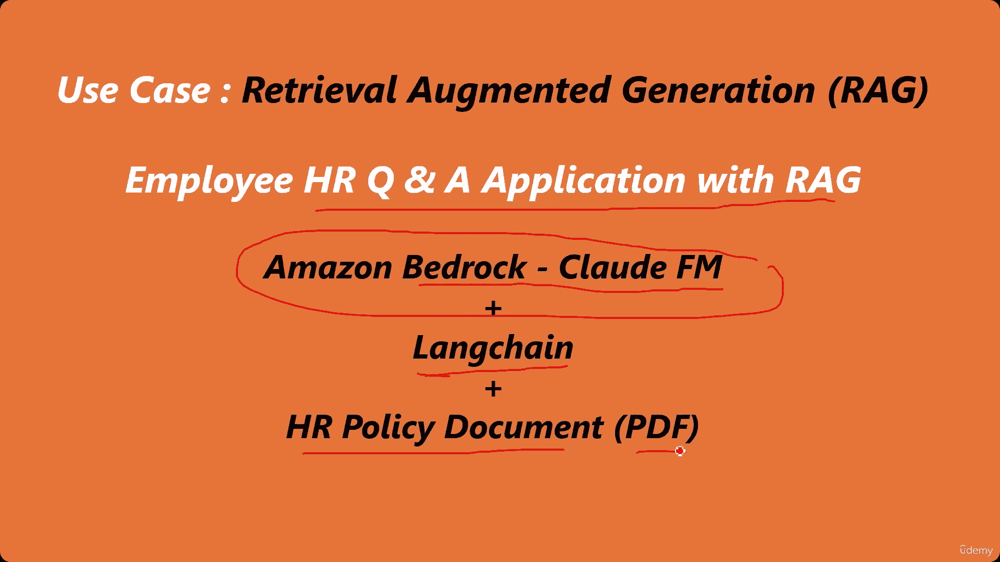
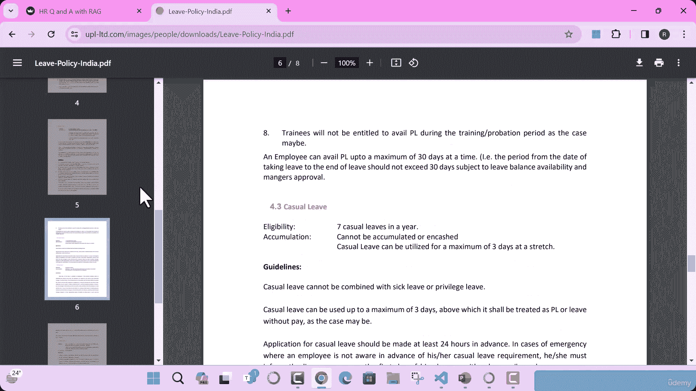
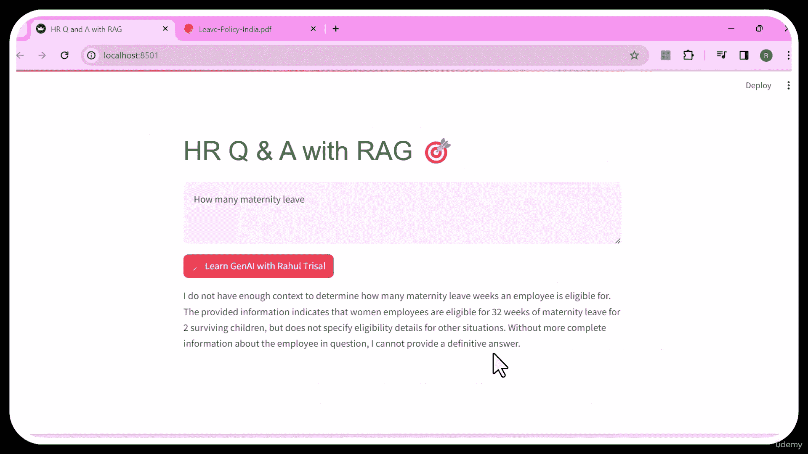

# 🚀 AWS生成式AI实战：01：课程概述与项目目标

本节课中我们将要学习如何用检索增强生成（RAG）构建一个员工HR问答应用。原文说明，本节会先构建一个RAG用例，也就是先做一个“员工HR问答”的完整示例，再逐步理解它背后的做法。对初学者来说，可以把RAG理解成“先查资料，再让模型根据资料回答”，这样模型就不只是凭记忆说话，而是会结合我们提供的内部文档来回答。本节先不进入架构细节，而是先说明最终要构建什么，让读者对目标有一个直观认识。

# 🧱 AWS生成式AI实战：02：技术栈与RAG核心思路

上一节我们明确了要做员工HR问答应用，本节我们来看看实现这个目标会用到的技术栈和RAG核心思路。原文提到，这个应用会使用Amazon Bedrock、Anthropic的Claude基础模型、LangChain，并且会把Bedrock上的云基础模型与内部数据源集成起来。

以下是本项目会用到的关键技术组件。原文逐一说明了这些组件的作用，这里用列表整理，方便初学者快速理解。

- 使用Amazon Bedrock作为云平台能力。

- 使用Anthropic的Claude基础模型来做编排，也就是让模型按流程组织回答。

- 使用LangChain来串联流程和集成组件。

- 把Amazon Bedrock上的云基础模型与内部数据源集成起来。

- 内部数据源是一份HR政策文档，原文说明这份文档会是PDF格式。

为了直观理解RAG，可以把核心流程写成下面这个公式。这个公式表达的是：先根据用户问题去HR政策文档里检索相关内容，再把问题和检索到的内容一起交给Claude生成答案。

```text
答案 = Claude生成模型(用户问题, 检索(用户问题, HR政策PDF))
```

下面用一段伪代码描述同样的思路。这样写更接近开发时的感觉，也能帮助初学者理解“检索”和“生成”是两步配合。

```python
question = "一年有多少天特权假？"
context = retrieve(question, hr_policy_pdf)
answer = claude.invoke(question, context)
```

这段伪代码的大白话含义是：用户先提问，系统先去HR政策PDF里找相关片段，再把问题和片段一起交给Claude，让Claude基于这些材料组织回答。原文强调用Claude做编排，用LangChain做集成，用Amazon Bedrock承载模型能力，目的就是把这个流程跑通。

# 📄 AWS生成式AI实战：03：数据源与界面预览

上一节我们介绍了技术栈和RAG核心思路，本节我们来看看数据源和界面预览。原文说明，在进入架构细节之前，先展示应用界面，并且此时还没有向应用提出任何问题。这个顺序有助于读者先看到最终效果，再理解内部实现。

原文接着解释了数据源的现实背景：在大型企业中，企业往往在地理上分布在不同地区或国家，每个地区或国家可能会有自己的政策文档，用来记录休假政策和其他HR政策。这些文档通常会以PDF形式发布，并上传到组织内网SharePoint的某个位置。

以下是数据源的具体情况。原文说明讲师没有SharePoint环境，所以通过谷歌搜索找到了一份名为UP的公司的政策文档，这份文档包含休假等细节，并被用作本项目的内部数据源。



- 大型企业按地区或国家维护HR政策文档。


- HR政策文档通常以PDF发布并上传到组织内网SharePoint。



- 讲师没有SharePoint，所以通过谷歌找到UP公司的政策文档。

- 这份UP公司政策文档包含休假等细节，作为本项目的内部数据源。

原文随后说明，接下来会对这个应用做一次快速演示。也就是说，界面和数据源都已经预览完毕，下一步就是看看应用如何回答问题。

# 💬 AWS生成式AI实战：04：HR问答演示

上一节我们预览了数据源和界面，本节我们来看看实际问答演示。原文先提出第一个问题：一年有多少天特权假。应用给出的回答是：基于较广的上下文，一年特权假的数量是21个工作日。

原文进一步说明，4.2节特权假下的资格部分写明，资格是一年21个工作日。讲师在政策文档中搜索后，可以看到“一年21个工作日”的内容，并说明所有员工在4.2节特权假部分都享有21个工作日。这个演示说明应用能够把回答和政策文档中的具体条款对应起来。

接着原文提出第二个问题：有多少天病假。应用正在运行，回答是：基于提供的上下文，员工每年有9天病假。讲师在文档中搜索“Sick”后，可以看到每年9天的内容。原文最后表示希望本课有用，下节课见，并表示感谢。

以下是演示中两个问题的对照关系。这个列表把原文中的问答结果集中呈现，便于读者复习。

- 一年有多少天特权假：回答为21个工作日，对应4.2节特权假资格部分。

- 有多少天病假：回答为每年9天，文档中搜索“Sick”可以看到每年9天。

# ✅ AWS生成式AI实战：05：本节总结

上一节我们完成了两个问答演示，本节我们来做收尾总结。本节课中我们一起学习了如何用RAG构建员工HR问答应用，了解了Amazon Bedrock、Anthropic的Claude基础模型和LangChain在其中的作用，也看到了HR政策PDF作为内部数据源的使用方式。



我们还通过界面预览和实际问答演示，看到了应用如何回答“一年有多少天特权假”和“有多少天病假”这两个问题，并验证了回答能够对应到政策文档中的具体内容。原文最后表达希望本课有用、下节课见并表示感谢，本节教程到这里结束。

