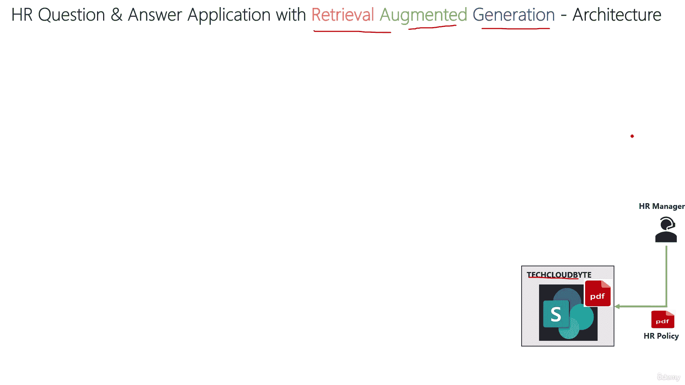
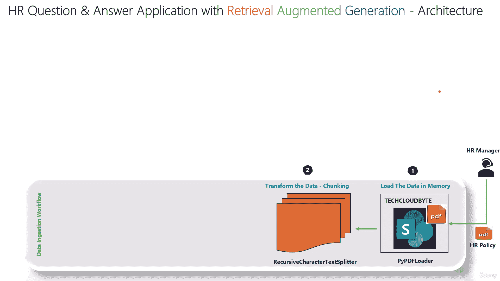
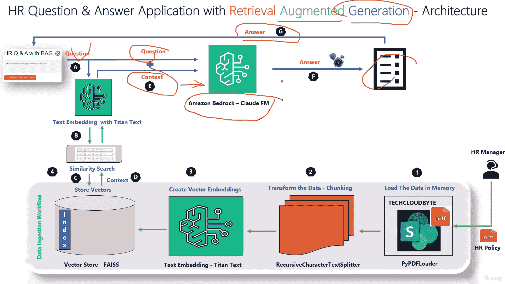

# 🧭 生成式 AI on AWS：第48-50讲：HR 问答应用与 RAG 架构

在本节课中，我们将要学习一个 HR 问答应用的 RAG 架构，并按照数据从上传到回答的完整链路，把架构中的每个环节拆开理解。这个用例会围绕一家名为 Tech Cloud Byte 的组织展开，HR 经理会把 HR 政策文档上传到组织内部的 SharePoint，随后系统需要让基础模型能够读取这份 PDF 数据，并基于它回答员工的问题。为了让初学者也能看懂，下面会用大白话解释每个步骤，同时用公式和代码把核心概念固定下来。

上一段已经交代了整体目标，接下来先看 RAG 这三个字母分别代表什么，因为后面的数据摄取和问答流程都围绕这三个词展开。

## 🧩 生成式 AI on AWS：第48-50讲：RAG 的三个关键词

RAG 由三个不同的词组成：Retrieval、Augmented 和 Generation，每一个词都描述一个独立的过程，本讲会沿着流程逐一解释。你可以先把它们记成一个简单公式，这个公式不是数学公式，而是理解架构的骨架。核心概念可以写成：

```
RAG = Retrieval + Augmented + Generation
```

上面的公式说明，RAG 不是一个单独动作，而是“检索、增强、生成”三个动作串起来的结果。接下来我们会先建立业务场景，再回到这三个词，看看它们在真实链路中分别落在哪个位置。

## 🏢 生成式 AI on AWS：第48-50讲：HR 政策文档场景



假设我们是 Tech Cloud Byte 这家组织的一员，组织里有一位 HR 经理，她要把 HR 政策文档上传到公司内部的 SharePoint。系统在回答员工提出的 HR 相关问题之前，基础模型必须先能够摄取这份 PDF 数据，而这份 PDF 就是 HR 政策文档。为了做到这一点，第一步需要创建一个数据摄取工作流，后面的检索和回答都依赖这个工作流产出的向量数据。

上一节说明了业务背景，本节中我们来看看这个数据摄取工作流具体怎么搭建。需要说明的是，本用例使用 LangChain 作为编排器，也可以使用 LlamaIndex，或者使用 AWS 提供的 Amazon Knowledge Bases 和 Agents。下面是数据摄取工作流的主要步骤，这些步骤会从加载文档一直走到建立索引。

- 加载数据：把 PDF 中的全部数据加载到内存中。

- 转换数据：把长文档切分成更小的块，也就是常说的分块。

- 创建向量嵌入：把每个小块转换成向量表示。

- 存储向量：把向量嵌入保存到向量存储中。

- 创建索引：为向量存储建立索引，方便后续搜索和检索。

这些步骤听起来比较多，但每一步都在为后面的相似度搜索做准备。接下来会按顺序展开每个步骤，让你看清数据是怎样从一份 PDF 变成可检索的向量。

### 📥 生成式 AI on AWS：第48-50讲：加载数据

在数据摄取工作流中，第一件事是把数据加载到内存，这里使用 LangChain 提供的 PyPDFLoader。这个 PyPDFLoader 会读取 PDF 文件，并把 PDF 里的全部数据加载到内存中，供后续处理使用。下面的代码展示了一个简化的加载动作：

```python
loader = PyPDFLoader("hr_policy.pdf")
documents = loader.load()
```

完成加载后，数据还只是原始文本，不能直接用于相似度检索。因此下一步需要对数据进行转换，也就是进入分块环节。



### ✂️ 生成式 AI on AWS：第48-50讲：转换数据与分块

下一步是转换数据，这个步骤有时也叫分块。假设我们有一份很长的 PDF 文档，系统会把它拆成单页，再拆成段落、行、字符，并持续拆分，直到可以创建向量嵌入。这样做的最终目标，是从较小的数据块中创建向量嵌入，而不是把整份长文档当成一个巨大的文本块。

分块时会使用 RecursiveCharacterTextSplitter，这个工具会把数据切分成一定数量的字符。例如可以把块大小设为 300 个字符，原文提到通常可以在 200 到 500 个字符之间选择。系统先创建第一个约 300 字符的块，再为这个块创建向量嵌入；然后取下一个约 300 字符的块，再为这一组字符创建另一个向量嵌入。除了按字符数拆分，也可以按代码、token 数量、字符等方式拆分，数据转换或分块有多种做法。核心概念可以用下面的代码表示：

```python
splitter = RecursiveCharacterTextSplitter(
    chunk_size=300,       # 原文示例，通常可在 200 到 500 之间
    chunk_overlap=0
)
chunks = splitter.split_documents(documents)
```

分块完成后，文本已经被切成适合生成向量的粒度。接下来就进入第三步，把这些文本块转换成向量嵌入。

### 🧮 生成式 AI on AWS：第48-50讲：创建向量嵌入

在完成分块后，第三步是为这些数据块创建向量嵌入，也就是为由 RecursiveCharacterTextSplitter 定义出的固定字符数文本块生成向量表示。AWS 提供了 Titan Text Embeddings 模型，可以用它从这些数据中创建向量嵌入；OpenAI 也有自己的方案来创建向量嵌入，而在 AWS 场景中使用 Titan 嵌入模型。创建嵌入的过程可以用下面的伪代码表示：

```python
embeddings = TitanTextEmbeddings()
vector_values = embeddings.embed_documents(chunks)
```

有了向量嵌入之后，系统还需要一个地方保存这些向量。下一节会说明向量存储和索引的作用。

### 🗄️ 生成式 AI on AWS：第48-50讲：存储向量与创建索引

创建向量嵌入之后，下一步是把这些向量嵌入存储到向量存储中。在本用例中，我们使用 FAISS，也就是 Facebook AI Similarity Search；也可以使用 Pinecone 这样的向量数据库，以及其他很多向量存储方案。把向量嵌入存入向量存储后，还需要创建索引，以便更容易地搜索和检索。

可以想象，向量嵌入的数量可能从几千到几百万不等，如果每次都直接遍历几百万条向量嵌入来做相似度搜索，过程会很有挑战。因此需要建立索引，让搜索和检索更高效。到这里，数据摄取工作流就完成了。接下来要理解这个工作流如何与 Amazon Bedrock 的基础模型集成，以及用户提问后系统如何一步步返回答案。

## 🔎 生成式 AI on AWS：第48-50讲：用户提问与检索

现在从用户视角，按照从左到右的顺序看整个问答流程。系统有一个 HR 问答用户界面，员工会在这里提出问题，例如“我一年有多少天年假”。问题提交后，会先送到 Titan Text Embeddings 模型，由这个模型为问题创建向量嵌入。随后系统拿着问题的向量嵌入，在向量存储中做相似度搜索，查找与问题相近的文本片段。

当系统根据用户问题匹配到相应的文本片段后，会得到一段响应，这段响应有时也称为上下文。前面提到 RAG 由 Retrieval、Augmented、Generation 三个关键词组成，这里正是 Retrieval 所在的位置。也就是说，从向量存储中检索出与 HR 员工问题匹配的上下文，这个动作就叫检索。核心概念可以用下面的代码描述：

```python
question_embedding = embeddings.embed_query(question)
context = vector_store.similarity_search(question_embedding)
```

到这里，Retrieval 的含义已经清楚。接下来系统会把检索到的上下文发送给基础模型，并同时发送用户最初提出的问题，让基础模型结合两者生成回答。

## 🧠 生成式 AI on AWS：第48-50讲：增强与生成

检索到的上下文会发送给基础模型，同时系统还会把用户最初提出的问题一起发送过去。也就是说，送入模型的内容包括用户问题和从向量存储中检索到的上下文，二者会一起发送给 Amazon Bedrock 的 Claude 基础模型，因为本用例使用的是 Anthropic 提供的 Claude 基础模型。这个把上下文和问题一起发送给 Amazon Bedrock 基础模型的过程，有时称为 Augmented，也就是 RAG 的第二个关键词，因为它用上下文增强了用户问题。核心概念可以写成：

```python
augmented_prompt = question + context
answer = bedrock_claude(augmented_prompt)
```

Amazon Bedrock 中的基础模型收到问题和上下文后，会生成一个答案，然后把答案返回给用户。基于问题和上下文生成答案，是 RAG 的第三部分，也就是 Generation，因为模型在生成响应。这个完整链路就是本用例要构建的架构，从数据摄取、向量存储、检索上下文，到增强问题并生成最终回答。

## ✅ 生成式 AI on AWS：第48-50讲：总结



本节课中我们一起学习了 HR 问答应用中的 RAG 架构。我们先把 RAG 拆成 Retrieval、Augmented、Generation 三个关键词，然后从 Tech Cloud Byte 的 HR 政策文档场景出发，走过数据摄取工作流：用 PyPDFLoader 加载 PDF，用 RecursiveCharacterTextSplitter 分块，用 Titan Text Embeddings 创建向量嵌入，用 FAISS 存储向量并建立索引。接着我们站在用户视角，看到问题如何被嵌入、如何在向量存储中检索上下文，以及上下文和问题如何一起送入 Amazon Bedrock 的 Claude 模型，最终生成答案返回给用户。希望这套链路能帮助你理解 RAG 的基本架构，并为后续实现打下基础。本讲内容到此结束，下一讲继续。

