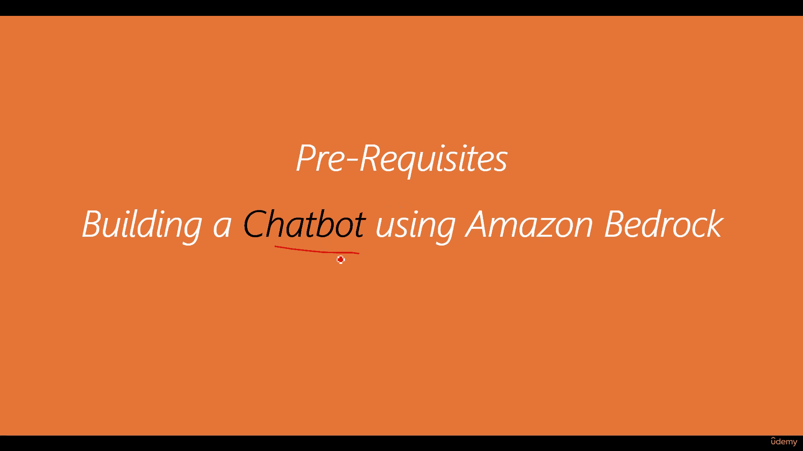
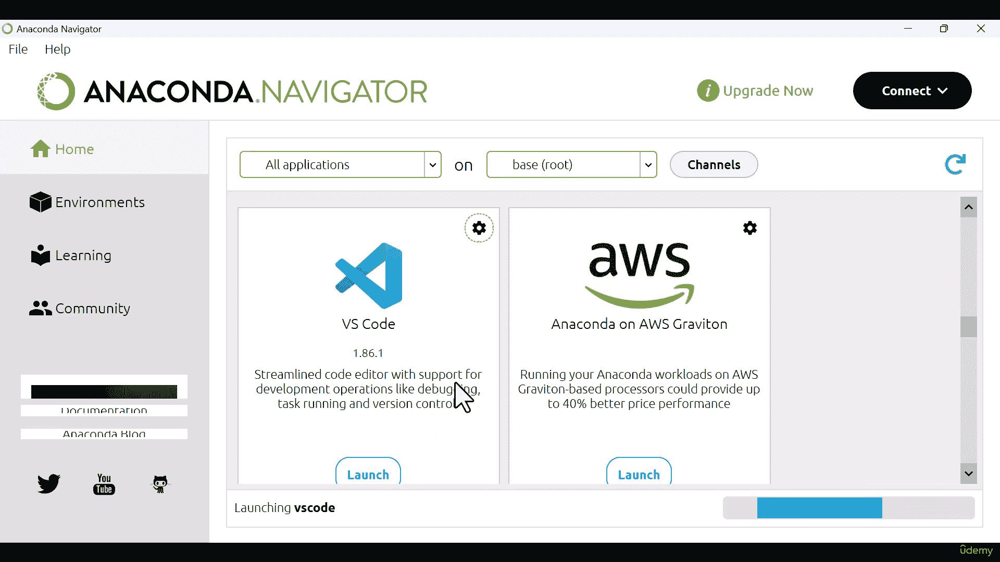
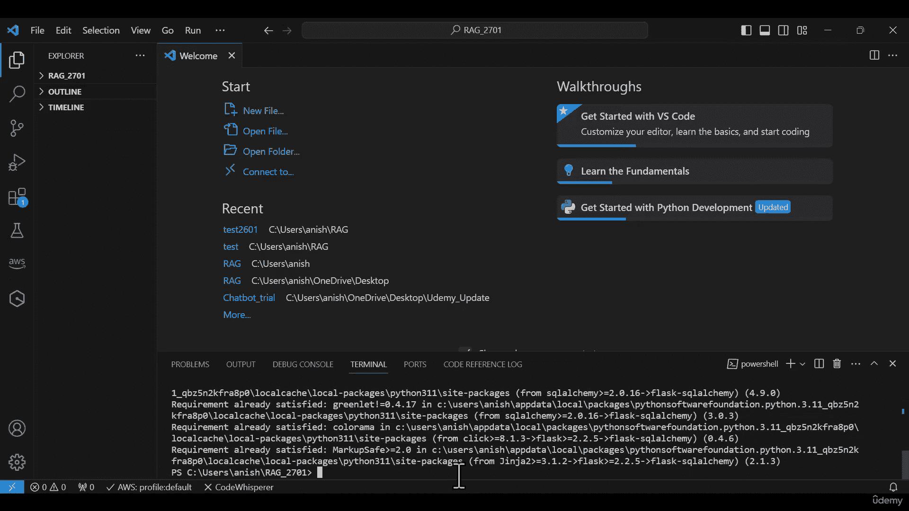
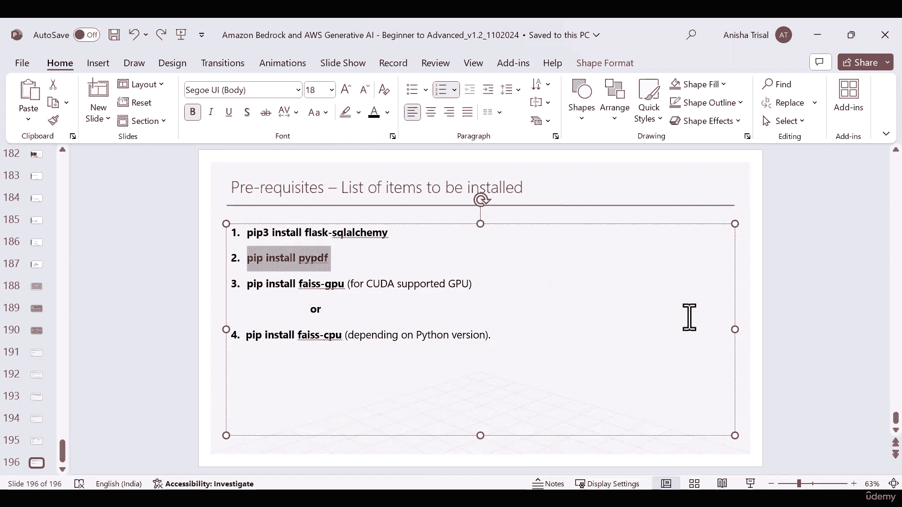
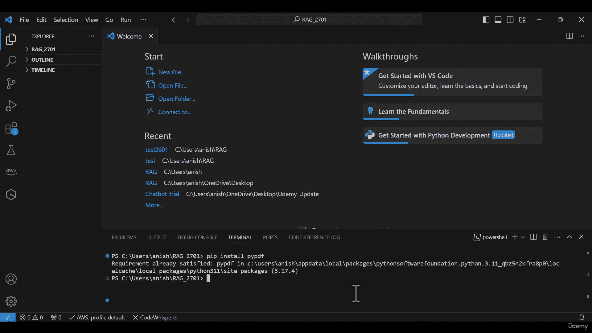
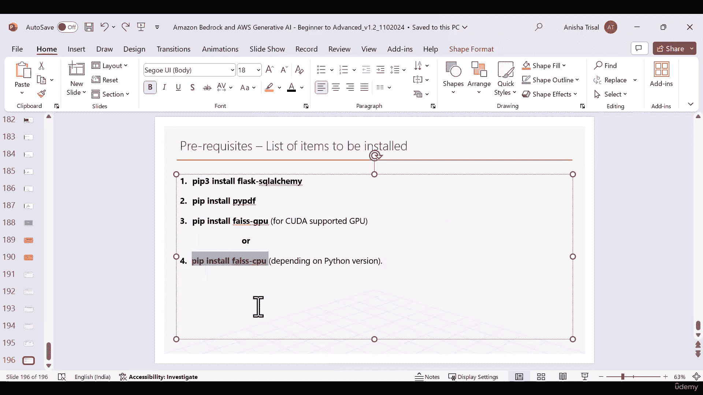
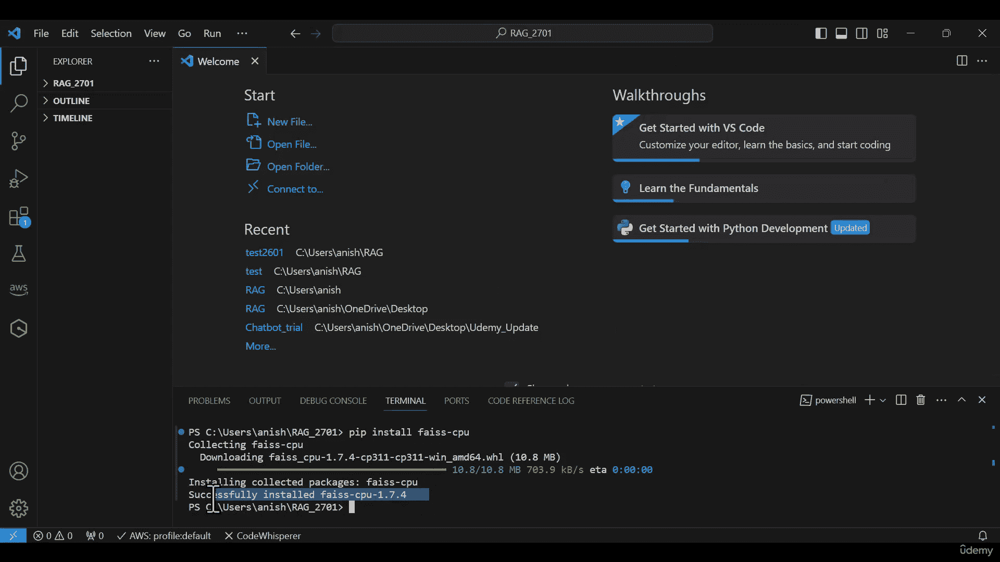
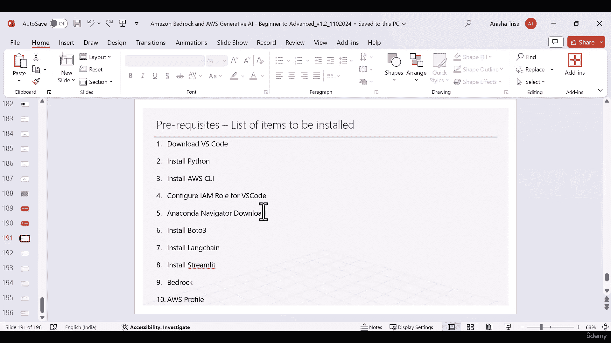

# 🧰 Udemy - AWS 生成式 AI 实战 - Amazon Bedrock、RAG 与 KIRO [2026]：第 49-51 节：编码前的 RAG 环境搭建

在本节课中，我们将要学习：在正式编写 RAG 用例代码之前，需要把 VS Code 里的开发环境准备好。这里的环境准备要从前面“聊天机器人用例”的基础继续做，接着再额外安装三个依赖。只有这些依赖都安装完成，后面的代码才能顺利运行。下面我们按步骤把这件事讲清楚。

## 🧱 一、先补齐聊天机器人用例的前置环境

上一节我们已经知道，要跟着实现这个 RAG 用例，需要先在 VS Code 中安装一些前置依赖。更准确地说，在开始写代码之前，你应该已经安装好聊天机器人用例中展示过的所有前置条件。这些条件不是本节临时新增的，而是前面课程已经要求完成的内容，所以本节会直接沿用。

如果你回到课程内容中查看，可以找到“聊天机器人环境搭建：编码前准备”这一讲。这一讲里高亮列出的所有前置依赖，都需要先安装完成。换句话说，本节会在那一讲的基础上继续补三个新依赖。你可以把环境准备理解成下面这个公式：

```text
RAG 环境就绪 = 聊天机器人前置依赖 + 本节新增的 3 个依赖
```

完成聊天机器人用例的前置安装后，还有三个依赖需要安装，然后才能继续往下走。下面我们逐个来看这三个依赖分别是什么，以及如何安装。

## 🐍 二、通过 Anaconda 打开 VS Code

在安装新增依赖之前，需要先打开你平时使用的开发环境。原文的做法是：先复制安装命令，然后打开 Anaconda Navigator，也就是你之前做各种安装时使用的那个入口，再通过 Anaconda 打开 VS Code。这样做的目的是让终端环境和你之前安装依赖时保持一致，避免因为 Python 环境不同而出现“命令找不到”或“包装错地方”的问题。

打开 VS Code 之后，就可以在终端里运行接下来的安装命令。这里要强调的是，命令要在 VS Code 的终端中执行，并且最好确认当前使用的 Python 环境就是前面配置好的那个环境。环境确认好以后，我们进入具体依赖的安装。

## 📦 三、安装三个新增依赖

前面已经完成了聊天机器人用例的前置安装，本节还需要再安装三个依赖。下面先给出这三个依赖的整体清单，再逐一说明安装方法。你可以把它们看成 RAG 编码前的最后三块拼图。

以下是本节需要新增安装的三个依赖：



- Flask 与 SQLAlchemy：用于后续 Web 服务和数据库相关操作。
- pypdf：用于处理 PDF 文件内容，这是 RAG 场景中常见的文档来源。
- FAISS：Facebook AI Similarity Search 向量存储，用于相似度检索。



### 1. 🧪 安装 Flask 与 SQLAlchemy

第一个要安装的是 Flask。原文中复制并运行的命令是安装 Flask 以及配套的 SQLAlchemy，常见写法如下：

```bash
pip install flask sqlalchemy
```



运行后可以看到安装过程，安装完成后终端会给出相应提示。原文在安装完成后还执行了清屏操作，目的是让终端输出更干净，方便继续执行下一条命令。这里你只需要确认命令没有报错，并且依赖已经成功安装即可。



### 2. 📄 安装 pypdf

第二个要安装的是 pypdf。原文这里说的是运行 `pip install pypdf`，字幕中显示成了类似“pped”的形式，按上下文理解应为 PDF 处理库 pypdf。安装命令如下：

```bash
pip install pypdf
```



原文在运行前按了 Ctrl+C 来中断当前终端里的输出，然后执行安装。执行后如果看到“Requirement already satisfied”之类的提示，说明这个包之前已经安装过，不需要重复安装。看到这类提示不用紧张，它表示环境里已经有这个依赖，可以继续下一步。

### 3. 🔍 安装 FAISS 向量存储

第三个要安装的是 Facebook AI 相似度搜索向量存储，也就是 FAISS。原文给出了两个可选命令：一个安装 CPU 版本，一个安装 GPU 版本。你可以根据自己的机器环境选择其中一个；如果其中一个命令报错，就换另一个再试。对应的命令如下：

```bash
pip install faiss-cpu
```

```bash
pip install faiss-gpu
```



原文实际运行的是 CPU 版本，安装过程没有报错，最后出现成功提示，类似“Successfully installed faiss-cpu-1.7.4”。这说明当前环境使用 CPU 版本可以正常工作。FAISS 的核心作用可以做向量相似度检索，可以用一个简单公式表示：

```text
相似度分数 = cosine(查询向量, 文档向量)
```

也就是说，RAG 会先把问题变成向量，再把文档变成向量，然后比较它们之间的相似程度，找出最相关的文档片段。FAISS 就是用来加速这类向量检索的工具，所以它在 RAG 环境里很关键。

## ✅ 四、安装完成后的检查

到这里，本节要求的三个新增安装就完成了。它们分别是 Flask 与 SQLAlchemy、pypdf，以及 FAISS。完成这些安装后，还需要再次确认：聊天机器人用例中要求的所有前置依赖都已经安装好了。原文也再次展示了那份前置依赖清单，并提醒你按前面课程的要求逐项核对。

以下是本节结束前建议做的检查项：

- 确认聊天机器人用例的前置依赖已经全部安装。
- 确认 `pip install flask sqlalchemy` 没有报错。
- 确认 `pip install pypdf` 已经满足或安装成功。
- 确认 `pip install faiss-cpu` 或 `pip install faiss-gpu` 至少有一个能正常工作。

这些检查做完以后，编码前的 RAG 环境就基本准备好了。原文最后说明，本节内容到这里结束，感谢观看，并表示下一讲再见。



## 🧾 总结



本节课中我们一起学习了 RAG 编码前的环境搭建流程：先确认聊天机器人用例的前置依赖已经安装完成，再通过 Anaconda 打开 VS Code，并在终端中额外安装 Flask 与 SQLAlchemy、pypdf 和 FAISS 三个依赖。安装 FAISS 时可以在 CPU 版本和 GPU 版本之间二选一，如果其中一个报错就尝试另一个。完成这些步骤后，就可以进入下一节开始写代码。

