# 🚀 生成式AI在AWS：Amazon Bedrock、RAG与KIRO（2026）：第50讲：HR问答RAG实战之数据加载（上）

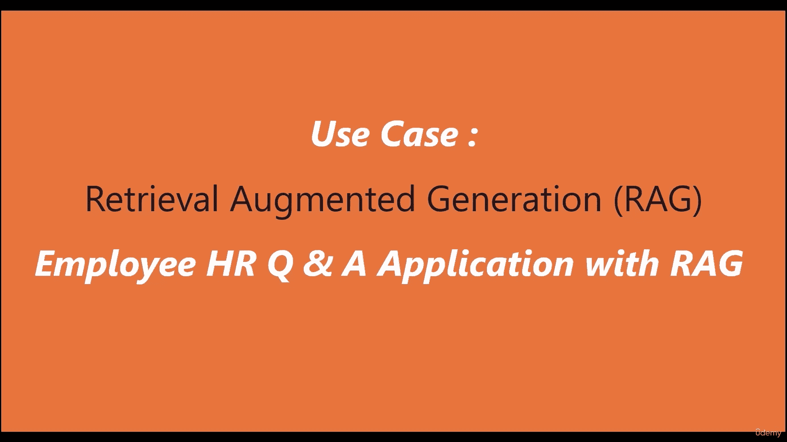

在本节课中，我们将要学习如何为“员工HR问答应用”做检索增强生成（RAG）里的数据加载实战。换句话说，这一讲不急着讨论复杂算法，而是先把外部HR政策文档读进程序内存，让后续的切分、向量化和问答检索有一个可靠的数据起点。对初学者来说，先把“文档从哪里来、怎么读进来、读进来后长什么样”这条链路跑通，比一开始追求完整功能更重要，因为数据加载是RAG应用的地基。

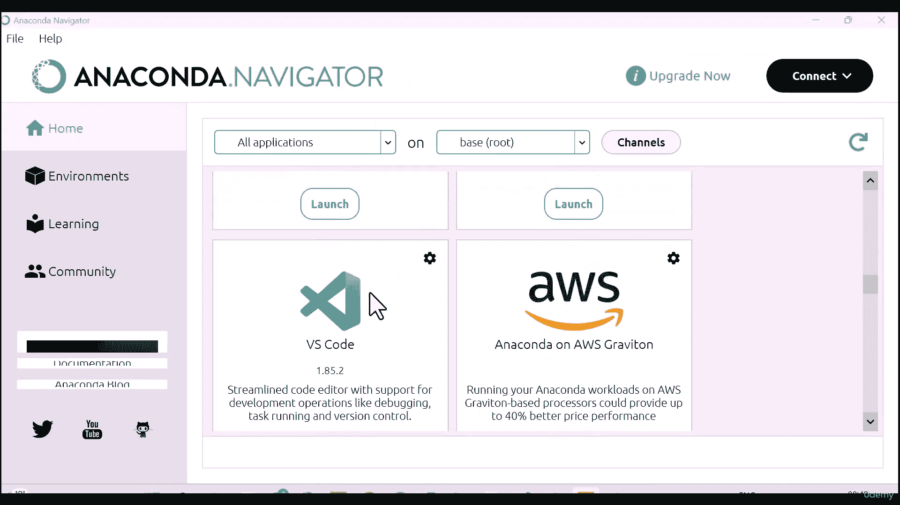

下面先用一个简化公式描述本讲的核心概念：数据加载就是把“外部数据源”转换成“程序可处理的文档对象列表”。

```text
PDF/URL  →  DocumentLoader  →  内存中的 Document 列表
```

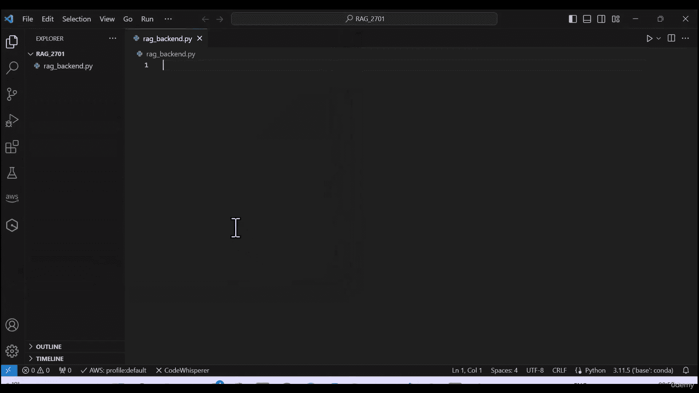

## 📌 生成式AI在AWS：Amazon Bedrock、RAG与KIRO（2026）：第50讲：环境准备与文件创建

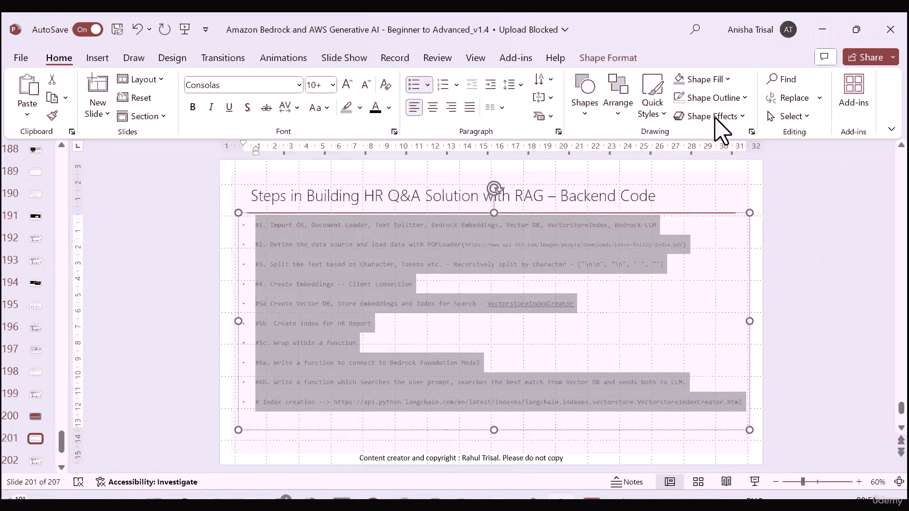

上一段我们明确了数据加载的目标，本节中我们来看看动手前需要准备哪些环境和文件。原文首先创建了一个空白文件夹，名称按原文记为 RAG2701（录音中也出现 Ra 270、rack 2701 等说法，可以理解为同一个练习文件夹）。接着打开 Anaconda Navigator，向下滚动并通过它启动 VS Code，也就是执行 launch 操作。VS Code 打开后，通过 File 菜单选择 Open Folder，打开刚才创建的空白文件夹。随后在这个空白文件夹里新建文件，文件名定为 rack_backend，原文还提到这个代码文件会同时承载 packet 与 rendered 相关代码（按上下文理解，就是后续后端代码文件）。

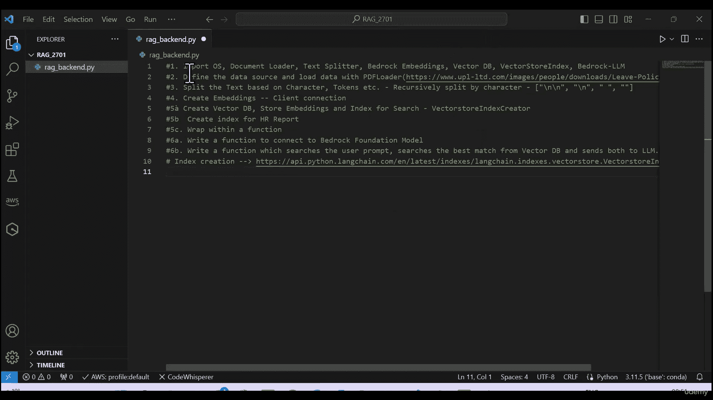

完成文件创建后，原文创建了一个“步骤列表”，用来指导后端代码的编写。这个步骤列表被复制到文件中，并且原文说明这些步骤应作为PPT的一部分提供。这里的关键不是列表本身多复杂，而是先把后续要做的动作列清楚，避免写着写着迷路。

下面是本小节中原文明确提到的工作环境准备动作清单。

- 创建空白文件夹 RAG2701。
- 打开 Anaconda Navigator。
- 在 Anaconda Navigator 中向下滚动并启动 VS Code。
- 在 VS Code 中通过 File → Open Folder 打开空白文件夹。
- 新建文件，命名为 rack_backend。
- 创建并复制一份写代码要遵循的步骤列表，放入当前文件。
- 说明这些步骤应作为PPT的一部分提供。

环境准备完成后，下一步自然就是理解整体流程。原文指出，编写这个后端代码基本上要遵循六个步骤，并且要从解决方案架构图里理解这六个步骤分别对应什么。因此，本节结尾先做一个过渡：文件和环境已经就位，下面进入六步流程的理解与第一步数据加载的定位。

## 🧭 生成式AI在AWS：Amazon Bedrock、RAG与KIRO（2026）：第50讲：六步流程与数据加载定位

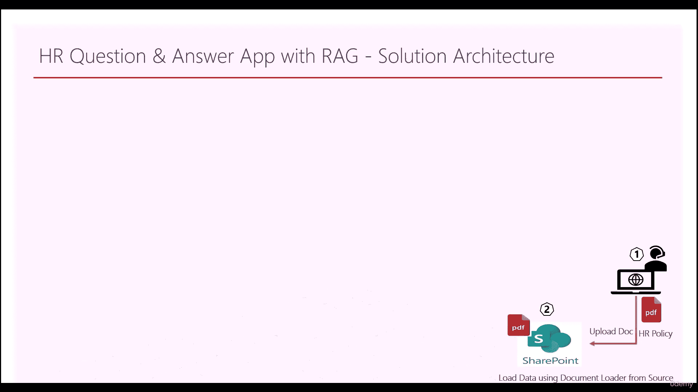

上一节我们准备好了文件夹、VS Code和 rack_backend 文件，本节中我们来看看原文如何从解决方案架构图理解六个步骤。原文描述了一个HR员工场景：HR员工创建了一份文档，用来强调组织的HR政策，尤其聚焦休假政策；当员工向基于问答的系统提问时，系统会从这份HR政策中检索答案。也就是说，问答系统并不是凭空回答，而是要先有一份可被检索的政策文档作为知识来源。

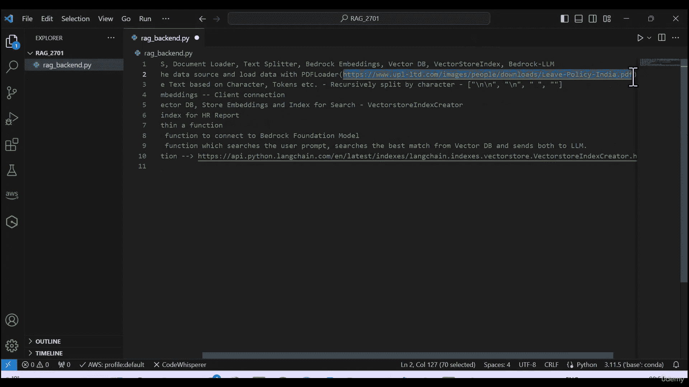

原文接着说明，第一步是HR会把这份HR政策文档上传到SharePoint，这份文档可以是PDF。这个描述是在讲真实企业里常见的数据来源。然后原文切换到本练习的做法：作者通过Google搜索，找到了一份已经上传到互联网上的HR文档，因此不实际使用SharePoint，而是直接使用互联网上的URL，把这个URL当作HR文档的来源。这个替换很实用，因为练习阶段不需要搭建SharePoint，只要有一个公开可访问的文档地址，就能把数据加载链路跑起来。


原文进一步解释：一旦有了URL或数据源，接下来就要使用 document loader 从数据源加载数据。这里的“加载”含义很直白，就是把数据读进内存。对初学者可以这样理解：document loader 像一个搬运工，把外部的PDF文件搬进Python程序里，变成后续代码可以操作的对象。原文还说明，这个URL是公开可用的，是一份来自名为 UL Limited 的公司的休假政策文档。

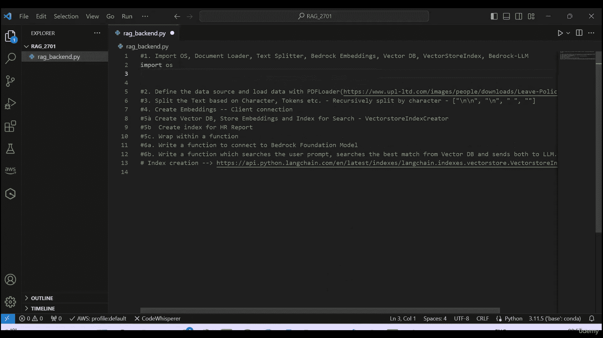

下面是原文在当前流程说明中给出的关键信息清单。

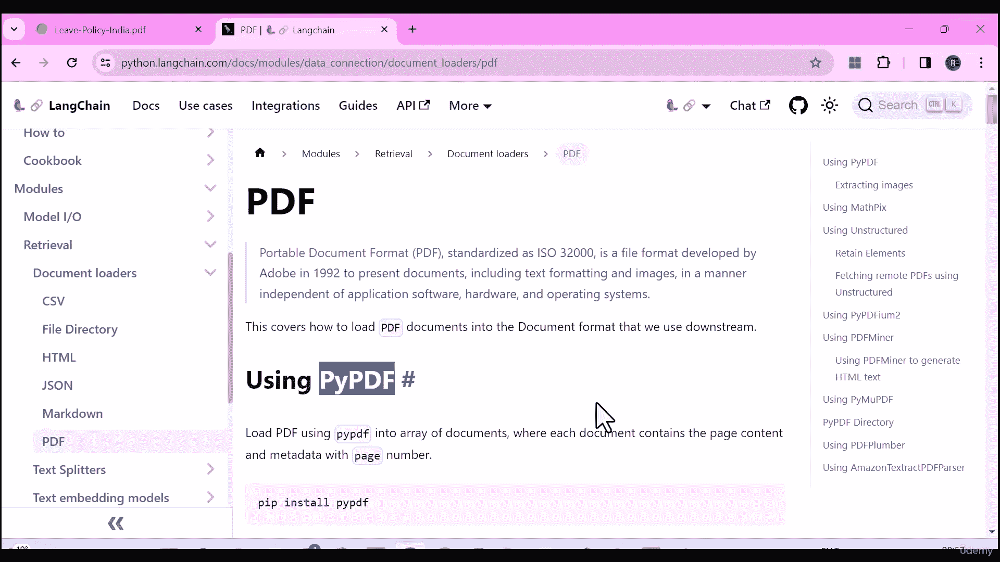

- 整体上，编写这个后端代码要遵循六个步骤。
- 要从解决方案架构图理解这六个步骤。
- 场景中有HR员工创建了强调组织HR政策的文档，尤其聚焦休假。
- 员工向问答系统提问时，系统从HR政策中检索答案。
- 真实做法中，HR会把PDF政策文档上传到SharePoint。
- 本练习中，作者通过Google找到互联网上的HR文档，用互联网URL代替SharePoint。
- 有了URL或数据源后，要用 document loader 从数据源加载数据。
- 加载的含义是把数据加载到内存。
- 使用的数据源是一份公开的、来自 UL Limited 的休假政策文档。


理解了“从外部URL加载到内存”这个定位后，接下来就进入实际编码。本节结尾做一个过渡：既然数据源已经确定，下面先导入必要的库，再编写PDF加载与测试代码。

## 🧑‍💻 生成式AI在AWS：Amazon Bedrock、RAG与KIRO（2026）：第50讲：导入库与模块名更新提醒

上一节我们确定了用公开URL作为数据源，本节中我们来看看代码层面要先导入什么。原文首先说，第一件事是导入 os，也就是在代码中写 `import os`。接着要导入 document loader。原文建议查看LangChain文档，可以看到有多种 document loader，分别面向CSV文件、PDF、Markdown等格式，本练习使用面向PDF的那一个，也就是 PyPDFLoader。原文解释，document loader 的作用是把文档加载到内存，在本例中就是把PDF加载到内存。

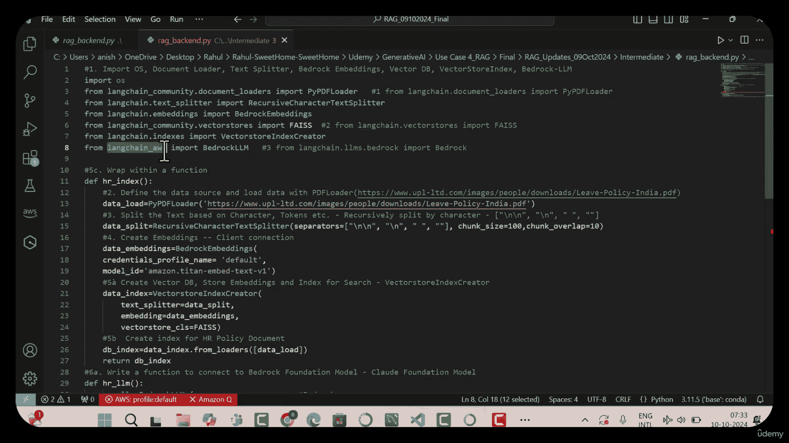

在开始编码前，原文给了一个快速提醒：LangChain更新了本用例中导入的若干模块名。原文说明，本用例结束时最终会写出一个完整代码文件，而在录制中导入的模块名包括旧名称和新名称的对应关系。这个提醒很重要，因为初学者如果照着旧教程写代码，可能会遇到导入失败的问题。

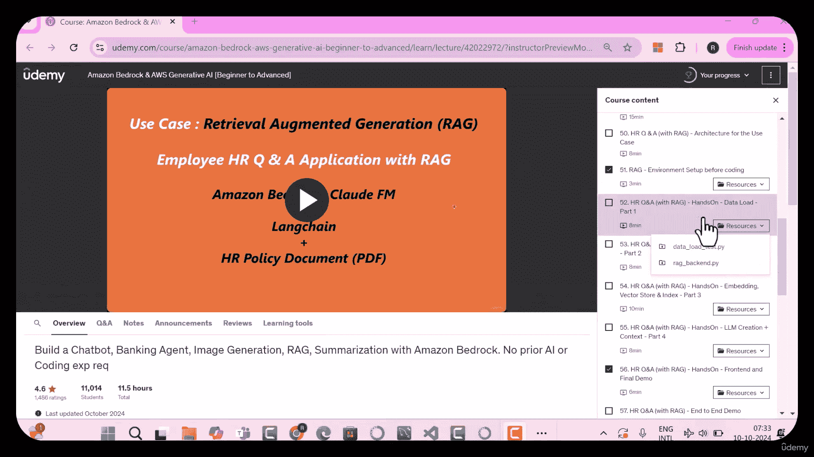

下面是原文给出的模块名更新对应关系清单。

- 旧名称 `langchain.document_loaders` 更新为 `langchain_community.document_loaders`。
- 旧名称 `langchain.vectorstore` 更新为 `langchain_community` 下的对应模块。
- 旧名称 `langchain.llms.bedrock` 更新为 `langchain_aws`。

> ⚠️ 原文强调：代码文件已经按最新模块名做了修改，附件反映最新变化；在需要修改的三四个地方还放了提示条，用来显示更新后的模块名。

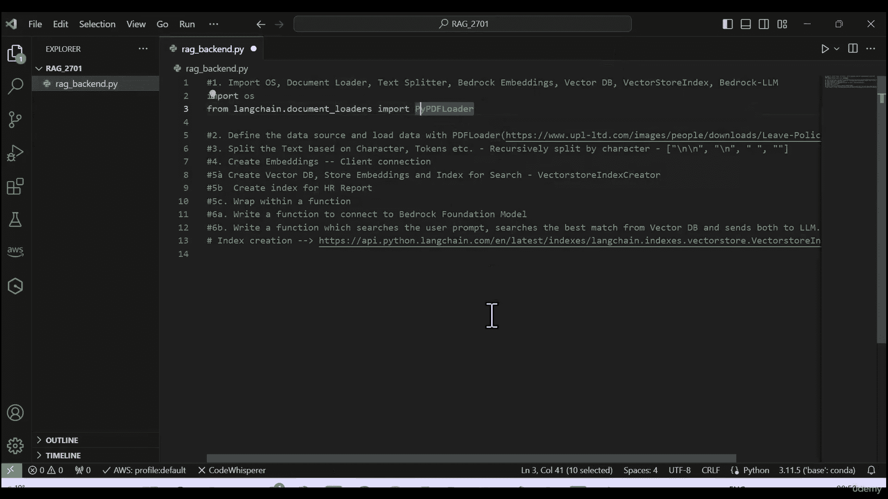

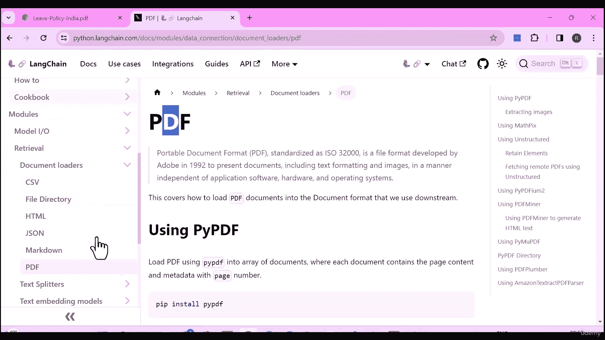

完成提醒说明后，原文开始正式写代码。代码中写的是从 `langchain.document_loaders` 导入 `PyPDFLoader`，这个加载器会把文档导入内存。原文还提到，如果想了解更多，可以查看LangChain关于这个加载器的文档。

下面是本小节涉及的导入代码示意，注意旧名与新名的差异。

```python
import os

from langchain.document_loaders import PyPDFLoader
# 新版模块名可写为：
# from langchain_community.document_loaders import PyPDFLoader
```

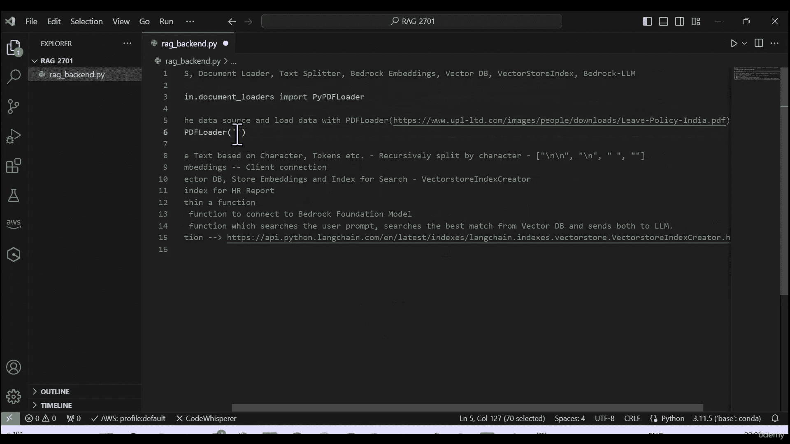

导入完成后，本节结尾自然过渡到下一步：下面要定义数据源URL，并把PDF真正加载到内存中测试。


## 🔗 生成式AI在AWS：Amazon Bedrock、RAG与KIRO（2026）：第50讲：定义数据源并加载PDF到内存

上一节我们导入了 os 和 PyPDFLoader，本节中我们来看看如何定义数据源并完成加载。原文说，下一步是定义数据源，在本例中就是使用前面展示的URL作为数据源。然后要把这份数据加载到内存。原文用一个变量来接收加载器，变量名可以叫 `data_loader`，并使用刚才导入的 `PyPDFLoader`。加载器需要传入文件路径，原文强调这里传入的是一个字符串；在本例中，源数据就是前面展示的URL，所以直接把URL复制过来放到这里即可。

也就是说，核心代码可以直白地写成：用PDF加载器接收URL，创建一个加载器对象。此时PDF还没有真正变成可检索文本，只是建立了“从哪个地址加载”的入口。接下来原文说要测试一下是否工作正常。测试方法是创建变量 `data_test`，使用 `data_loader` 的 `load_and_split` 方法。原文看到这个方法叫 load and split，于是就用它来做加载与切分测试。然后打印 `data_test` 的长度，并尝试检索某一页，看看是否能工作。

下面是本小节数据加载与测试的核心代码示意。

```python
url = "这里放入公开的UL Limited休假政策PDF的URL"

data_loader = PyPDFLoader(url)

data_test = data_loader.load_and_split()

print(len(data_test))
print(data_test[2])  # 原文先尝试检索第二页，后面又改成第0页测试
```

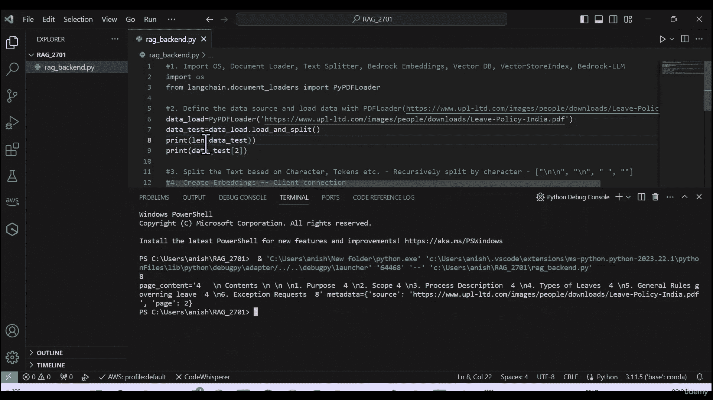

代码写好后，原文保存文件并运行，选择“Run without Debugging”。运行后程序给出了响应，可以看到加载结果的长度是8页。原文打开结果查看，确认这份PDF有8页；然后设置检索页码为2，查看第2页内容。由于索引从0、1、2开始，所以代码里的第2页实际上对应PDF里的第3页。原文查看后确认，这页内容基本是目录、目的、范围等，也就是目录页相关内容。

接着原文把索引改成0，再次保存并运行。输出仍然显示总页数为8，但内容发生了变化，变成休假政策以及一些元数据信息。原文查看第一页，看到 “Leave Policy India”，并认为这一页主要内容就是这些。由此原文确认加载功能工作正常。


下面是原文在测试阶段验证到的结果清单。

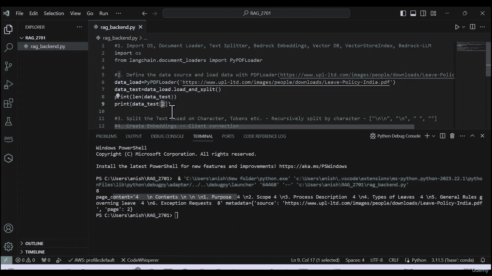

- 保存并运行代码后，程序正常返回响应。
- 加载结果长度为8页。
- 检索索引2时，对应PDF第3页，内容是目录、目的、范围等。
- 将索引改为0后，输出内容变化。
- 索引0对应的页面显示休假政策与元数据相关内容。
- 第一页可以看到 “Leave Policy India”。
- 数据加载与页面检索测试工作正常。

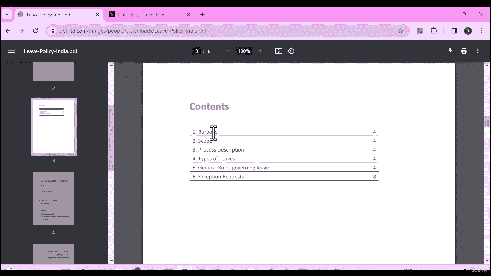

测试通过后，本节结尾做一个过渡：本讲的数据加载部分到这里基本完成，下一讲会处理数据转换。为了避免测试代码干扰主后端文件，原文还要做一次文件整理。

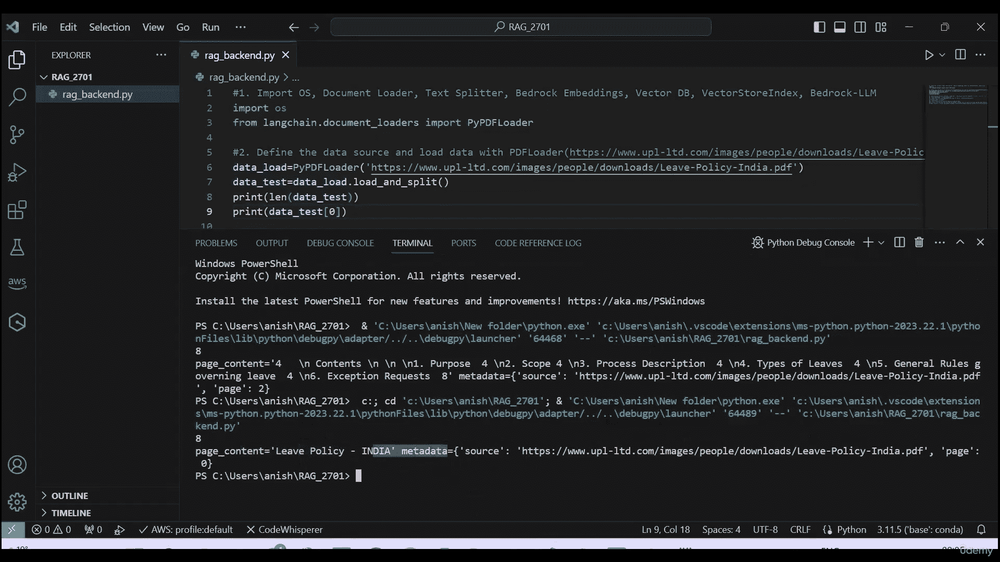

## 🗂️ 生成式AI在AWS：Amazon Bedrock、RAG与KIRO（2026）：第50讲：保存测试文件与课程收尾


上一节我们验证了PDF加载和按页检索都能工作，本节中我们来看看如何整理文件。原文说，这一讲的内容基本到这里，下一讲会看如何转换数据。作者准备把当前文件保存为数据加载测试文件，方便读者自己测试，因为不想把与“测试加载数据”相关的代码一直留在主文件里。于是把文件保存为 `data_load_test`，并说明这个文件会作为本讲材料提供。

同时，原文会继续在 rack_backend 中编写剩余代码，所以把测试相关内容从 rack_backend 中移除。整理之后会有两个文件：一个用于加载测试，一个是后端文件。原文最后说，下一讲在转换数据时再见，并表示感谢。

下面是本小节完成的文件整理清单。

- 将加载测试代码保存为 `data_load_test` 文件。
- 该测试文件会作为本讲材料提供，方便读者自行测试。
- 继续在 `rack_backend` 中编写剩余后端代码。
- 从 `rack_backend` 中移除加载测试相关代码。
- 最终保留两个文件：一个加载测试文件，一个后端文件。
- 下一讲将进入数据转换环节。

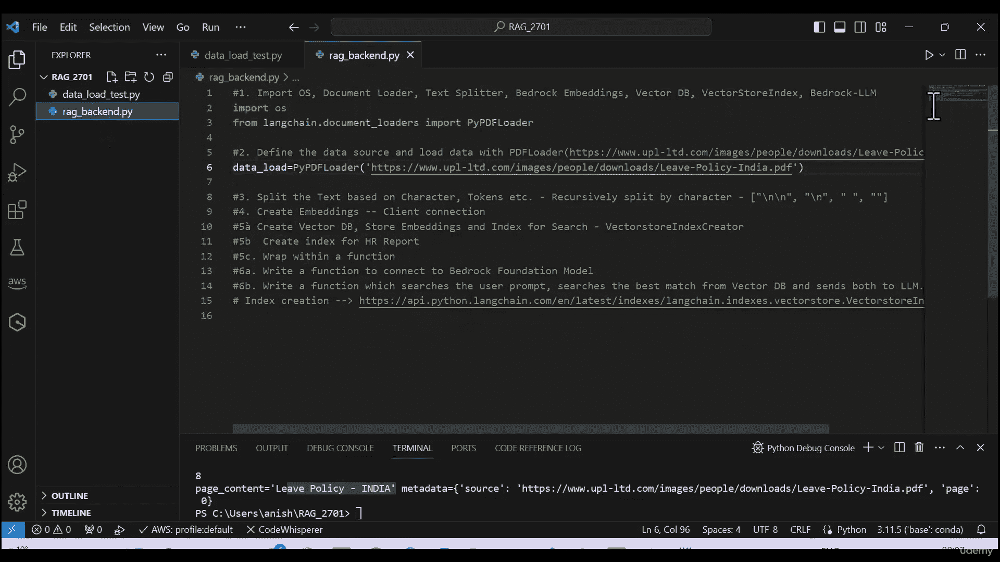

本节课中我们一起学习了HR问答RAG应用的数据加载实战上半部分：从创建练习文件夹和 `rack_backend` 文件开始，理解了六个步骤的整体流程，明确了用公开URL代替SharePoint作为数据源，使用 `PyPDFLoader` 把PDF加载到内存，并通过 `load_and_split`、打印长度和按页检索验证了加载结果。我们还记录了LangChain模块名更新提醒，最后把测试代码保存为独立文件，为下一讲的数据转换做好准备。

