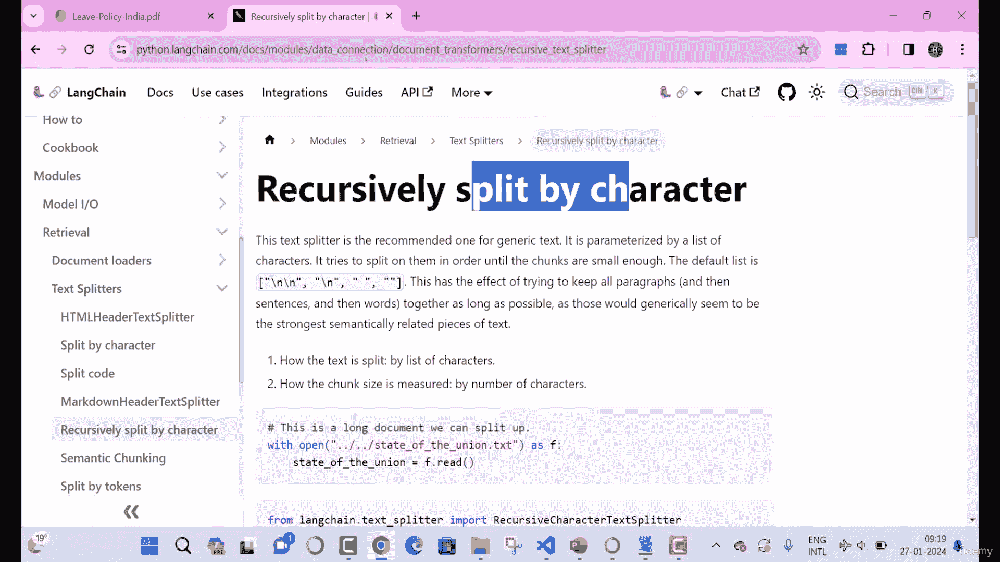
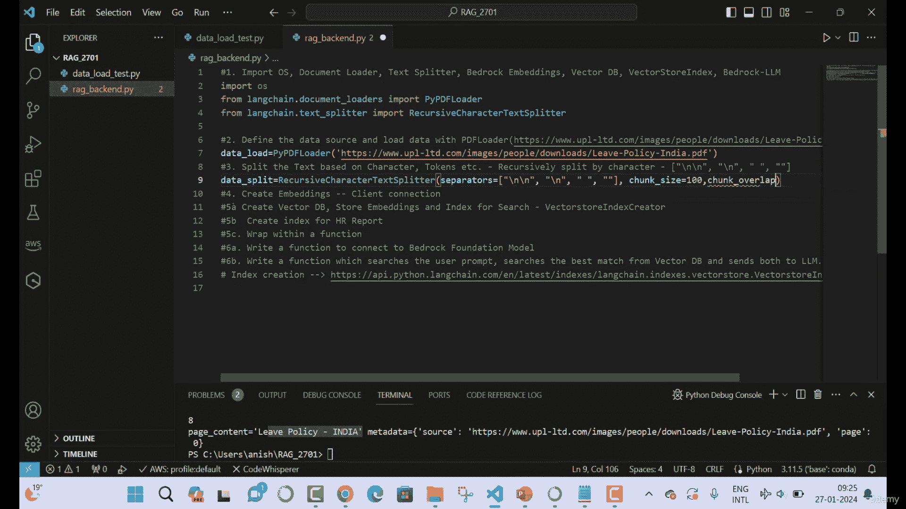
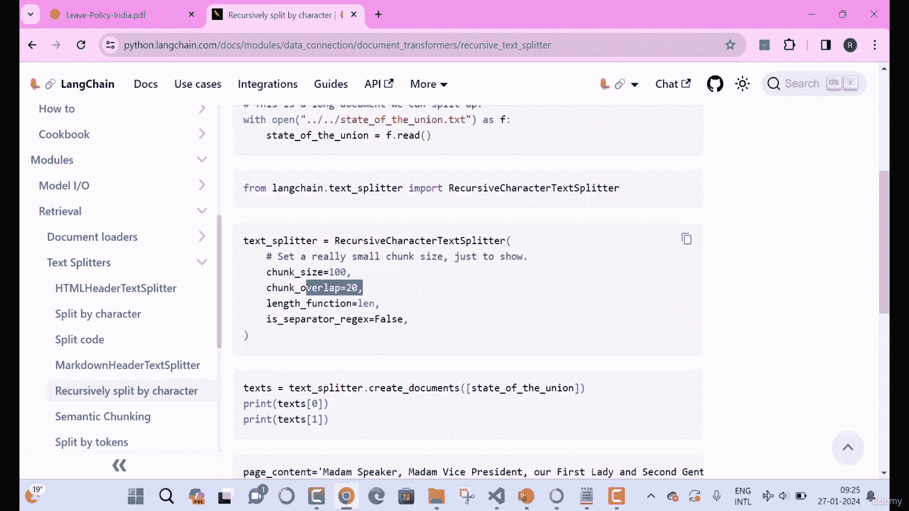
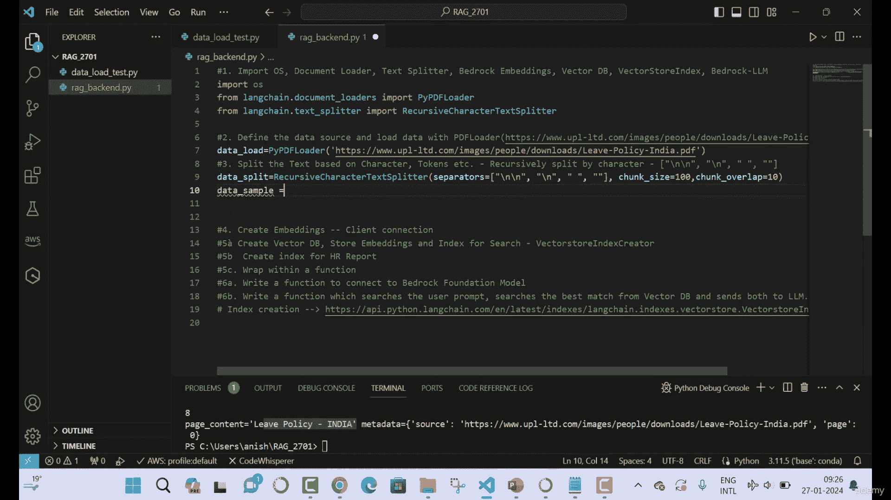
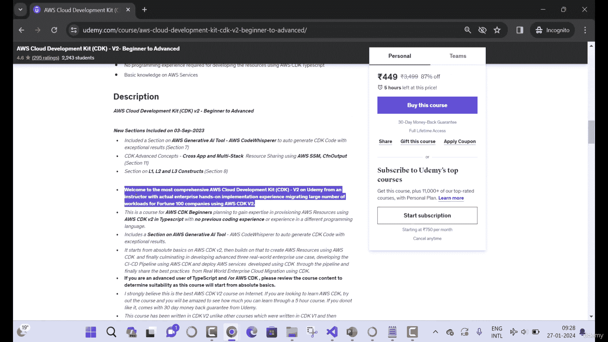
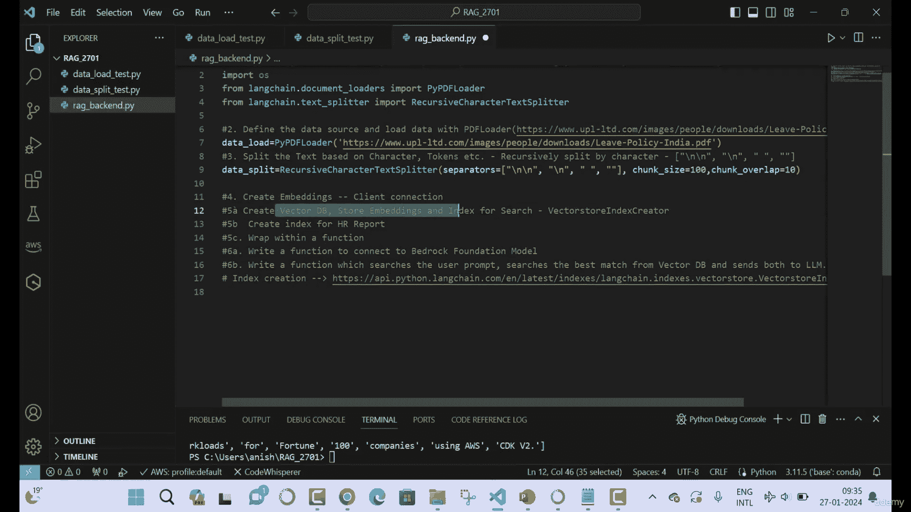

# 🧩 Udemy - 生成式AI on AWS - Amazon Bedrock、RAG与KIRO：第51-53节：HR问答RAG实战数据转换第二部分

在本节课中我们将要学习HR问答RAG实战中的数据转换第二部分，重点是把已经加载到内存里的PDF文本拆成更小的文本块，并配置文本拆分器、测试拆分效果，为后续创建嵌入和写入向量数据库做准备。上一讲已经完成了文档加载，本节继续沿着数据处理流程往前走，把“大段文本”变成“适合嵌入模型处理的小段文本”。

## 🗂️ Udemy - 生成式AI on AWS - Amazon Bedrock、RAG与KIRO：第51节：回顾数据加载并明确数据转换目标

上一节我们介绍了HR把HR政策文档上传到SharePoint，然后取出源URL，再使用文档加载器把PDF加载到内存中，本案例使用的是PyPDFLoader。本节中我们来看看第三步“转换数据”到底在做什么，以及为什么必须做这一步。

所谓转换数据，可以直白理解为：一页PDF里可能有很多文字，我们不会把整页直接交给后续流程，而是把它拆成段落、行，再拆成字符。这样做的原因是，最终目标是根据文本创建嵌入，所以需要先把文本切成更小的块，再对这些小块创建嵌入。核心过程可以用下面的公式表示：



\[
\text{PDF页面} \rightarrow \text{段落} \rightarrow \text{行} \rightarrow \text{字符} \rightarrow \text{文本块（chunks）}
\]

这里使用的工具是文本拆分器，具体方法是递归字符文本拆分器，也就是RecursiveCharacterTextSplitter。拆分方式不止一种，可以按token数量拆分，也可以按字符数量拆分。LangChain文档中可以看到按代码字符拆分等方式，本课采用递归按字符拆分。明确这个目标后，下一节我们就进入代码，看看如何导入拆分器并设置参数。

## 🧱 Udemy - 生成式AI on AWS - Amazon Bedrock、RAG与KIRO：第52节：导入文本拆分器并配置参数

上一节我们明确了数据转换的目标，本节中我们来看看具体代码怎么写。第一步是导入拆分器，代码如下：

```python
from langchain.text_splitter import RecursiveCharacterTextSplitter
```

导入之后，就可以实现`data_split`。下面是一个配置示例，核心参数包括分隔符列表、是否保留分隔符、文本块大小和文本块重叠：

```python
data_split = RecursiveCharacterTextSplitter(
    separators=["\n\n", "\n", " ", ""],
    keep_separator=True,
    chunk_size=100,
    chunk_overlap=10,
)
```



以下是拆分器需要配置的主要参数以及它们的作用。

- `separators`：这是一个列表，拆分器会按照列表中的分隔符依次尝试拆分，例如先按段落拆，再按行拆，再按字符拆。





- `keep_separator=True`：表示保留分隔符，避免拆分后丢失原有结构信息。



- `chunk_size`：告诉拆分器每个文本块大概允许多长，可以按字符数控制。原文中采用约100字符作为标准大小。

- `chunk_overlap`：表示相邻两个文本块之间保留多少重叠内容，本课设置为10，用于减少拆分造成的数据丢失。

> 这里的`chunk`可以理解为一段长度受控、可以交给嵌入模型处理的文本片段。

LangChain文档中还可以看到`chunk_size`、`chunk_overlap`以及长度函数等其他配置。参数确认后，下一节我们就用样本数据测试拆分效果。

## 🧪 Udemy - 生成式AI on AWS - Amazon Bedrock、RAG与KIRO：第53节：用样本数据测试拆分效果

前面已经完成拆分器配置，本节中我们来看看它是否真的能按预期工作。测试时先准备一段`sample`样本数据，可以从Udemy代码中复制一些数据点，粘贴到样本变量中。然后调用`split_text`方法，把样本数据传进去并打印结果，代码如下：

```python
chunks = data_split.split_text(data_sample)
print(chunks)
```

以下是测试拆分效果时的主要步骤，按顺序执行即可。

- 定义`data_sample`，放入从代码中复制出来的样本文本。

- 调用`data_split.split_text(data_sample)`，得到拆分后的文本块列表。

- 打印结果，观察每个元素是否大约为100字符，并确认输出是一个列表。

执行保存并运行后，可以看到输出被拆成列表，每个元素是一段文本块，长度大约为100字符，下一段再接下一段。随后把`chunk_size`改成10，把`chunk_overlap`改成1，再保存运行，可以看到文本被拆成更小的片段；如果某个单词本身超过10字符，这个片段仍可能比10字符长。之前使用100字符时，句子会更长。测试完成后，再把参数改回`chunk_size=100`、`chunk_overlap=10`，保存配置。测试代码会从主文件中移除，并作为单独文件提供给本课使用，主文件继续保留正式逻辑。下一讲将创建嵌入和向量数据库，并把嵌入存储到向量数据库中。



本节课中我们一起学习了RAG数据转换的第二部分：回顾了用PyPDFLoader加载PDF，理解了把PDF拆成段落、行、字符和文本块的原因，使用RecursiveCharacterTextSplitter配置了分隔符、文本块大小和重叠，并用样本数据验证了拆分效果，最后把测试代码移出主文件，为下一讲创建嵌入和向量数据库做好准备。
