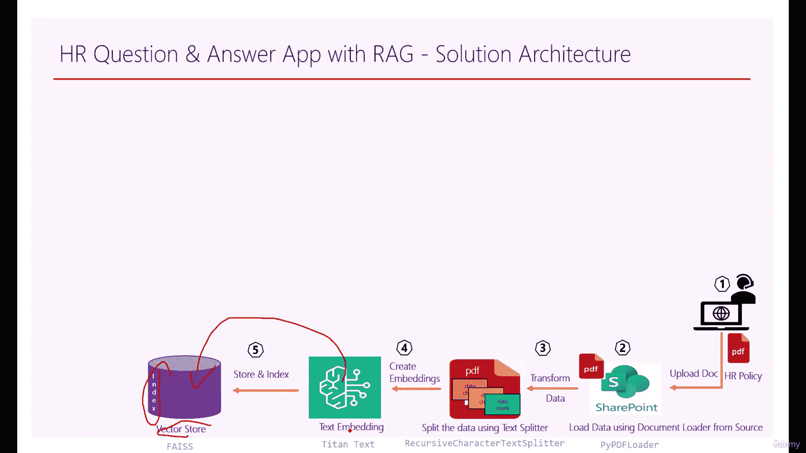
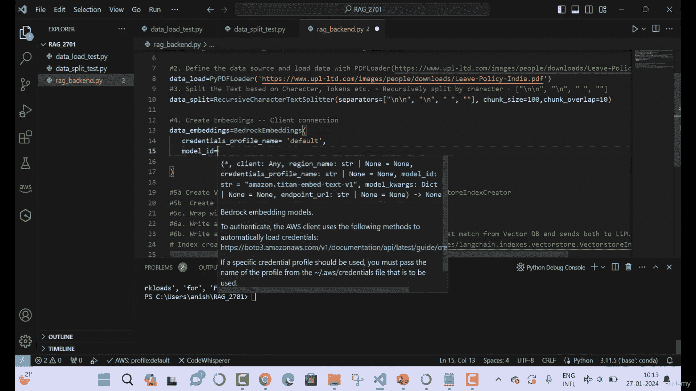
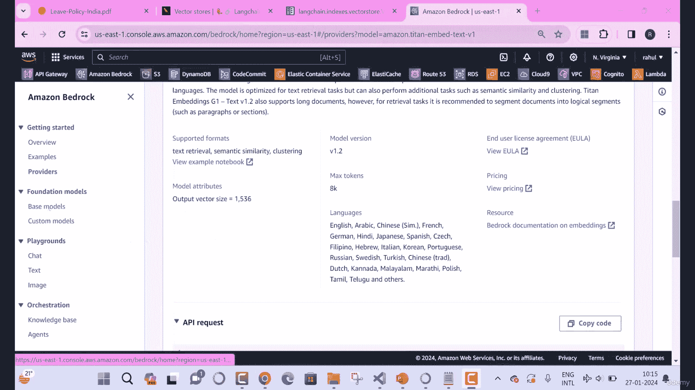
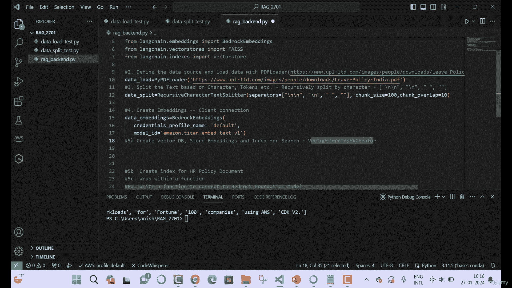
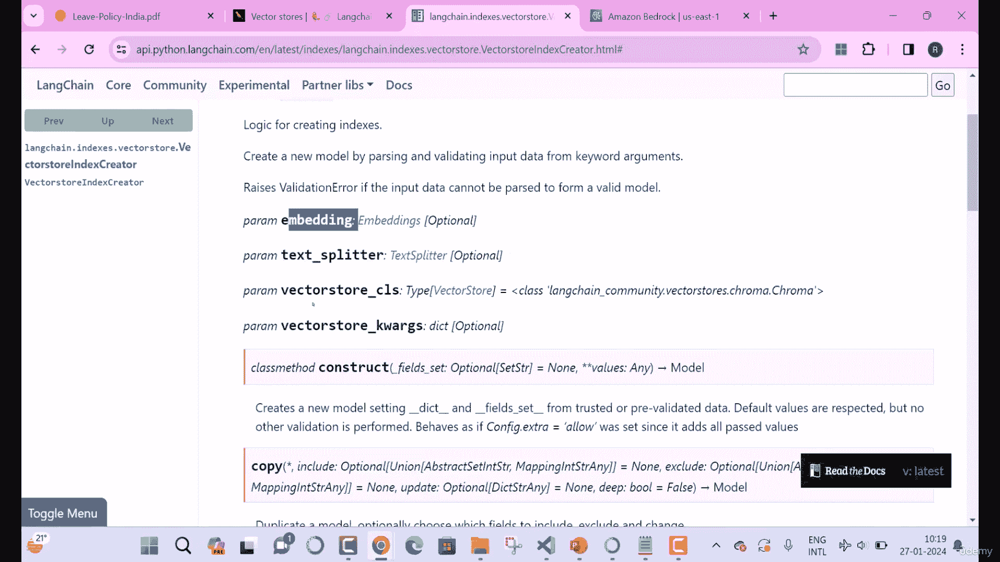
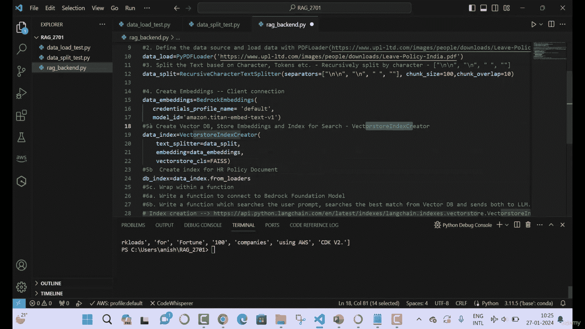
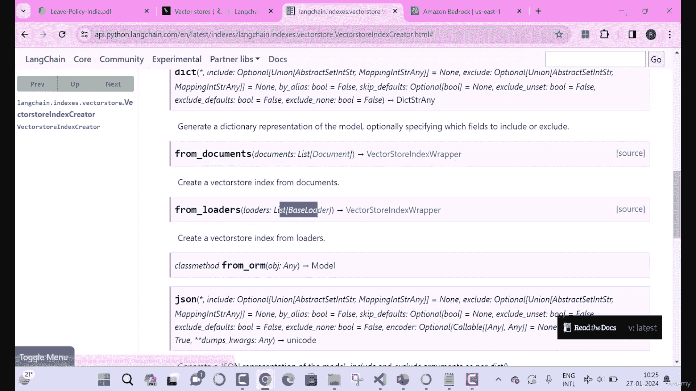
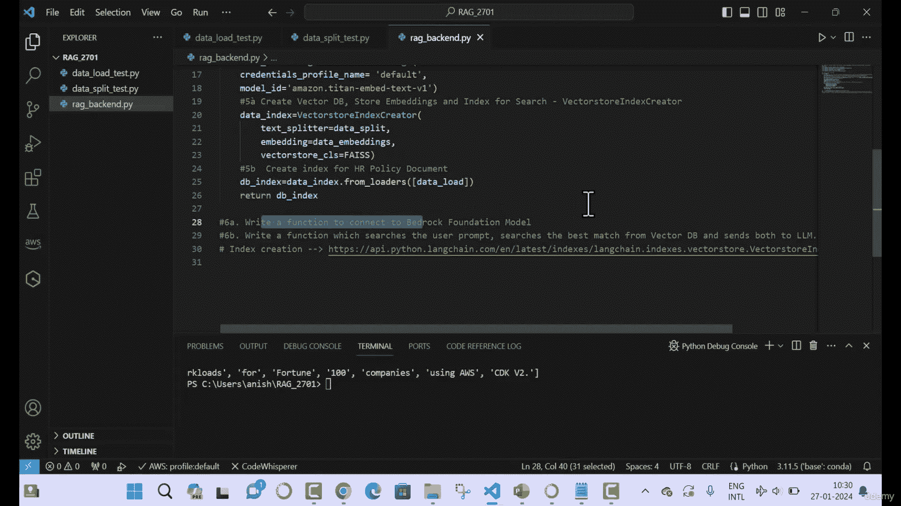

# 🤖 生成式AI在AWS：Part 1 P52-P54：HR问答RAG实战——Embedding向量存储与索引（第3部分）

在本节课中，我们将学习如何为HR问答系统构建RAG流程中的关键一环：从文本块生成向量嵌入（Embedding），把向量存储到开源向量数据库FAISS中，并创建索引以便后续快速检索。在正式动手之前，我们先简单回顾一下前几节课已经完成的工作，这样才能把当前要做的事情放到整个流程中去理解。

以下是前几节课已经完成的准备工作：

- 创建了一份HR策略文档，并上传到了Shareport（共享存储位置）。
- 使用PDF文档加载器将PDF文件中的数据加载到了内存中。
- 使用递归字符文本分割器把PDF内容切分成更小的文本块（chunks）。

完成这些准备之后，本课要做的就是利用Titan文本嵌入模型，从这些文本块中生成向量，再把向量存储到FAISS中，并为它创建索引。整个流程可以概括为：

```text
文本块 → Titan嵌入模型 → 向量 → 存入FAISS → 创建索引
```



后续搜索时可以这样使用：

```text
查询问题 → 向量化 → 在索引中搜索 → 返回最相关的文本块
```

下面我们就按照这个流程，一步步完成向量创建、向量数据库存储和索引构建。

---

## 一、创建Titan文本嵌入模型客户端

首先，我们需要导入Titan文本嵌入模型对应的类，并创建一个客户端连接。这里使用的库是LangChain，代码非常简单，只需要一行导入语句：

```python
from langchain.embeddings import BedrockEmbeddings
```

接着，我们给这个嵌入模型变量起一个名字，你可以随便取名，比如就叫 `bedrock_embeddings`。然后实例化它，在实例化时需要传入两个关键参数：



- `credentials_profile_name`：AWS凭证配置文件名。
- `model_id`：要使用的模型ID。

具体代码是这样的：

```python
bedrock_embeddings = BedrockEmbeddings(
    credentials_profile_name="default",
    model_id="amazon.titan-embed-text-v1"
)
```

第一个参数 `credentials_profile_name` 很好理解，就是我们之前创建好的AWS配置文件。这里一如既往地使用 `default` 配置文件。如果你不清楚如何创建这个配置文件，建议翻看之前chatbot用例的讲座，那里详细展示了需要安装哪些依赖、如何创建客户端连接。



第二个参数是 `model_id`，它的值是 `amazon.titan-embed-text-v1`。这个模型ID怎么来呢？通常可以登录AWS管理控制台，在“基础模型”（Base Models）列表中找到Titan模型，然后向下滚动并复制对应的模型ID。你也可以直接用Google搜索这个模型ID，两种方式都能拿到同样的结果。

需要提醒一下，AWS的网页界面一直在更新，你看到的UI可能跟我演示的略有不同，但操作路径基本一致：进入控制台 → 找到Bedrock服务 → 进入基础模型列表 → 找到Titan → 复制模型ID。只要找到基础模型区域，剩下的就不会有大问题。

成功创建客户端连接之后，我们就已经可以用Titan文本嵌入模型来把文本转换成向量了。不过，光有嵌入还不够，还需要把生成的向量存起来。我们接着看下一步。

---

## 二、创建向量存储与索引

按照最初的计划，我们需要做三件事：创建向量嵌入、把向量存储进FAISS、为FAISS创建用于搜索的索引。这三件事既可以分开完成，也可以借助LangChain提供的一个包装器 `VectorStoreIndexCreator` 一步到位。为了减少重复代码和降低出错概率，我们会选择包装器方案。

在写代码之前，先导入需要用到的两个模块：FAISS（向量库）和 `VectorStoreIndexCreator`（索引创建器）：

```python
from langchain.vectorstores import FAISS
from langchain.indexes import VectorStoreIndexCreator
```

`VectorStoreIndexCreator` 是一个非常方便的包装器，它的内部逻辑是：接收我们之前准备好的文本分割器、嵌入模型和向量存储类型，然后自动完成“从文本块生成嵌入→把嵌入写入向量数据库→为数据库创建索引”这一整套流程。

因此，我们需要给它提供几个参数：



- `text_splitter`：文本分割器，也就是之前用过的递归字符文本分割器 `data_split`。
- `embeddings`：嵌入模型，也就是刚才创建的 `bedrock_embeddings`。
- `vectorstore_cls`：向量存储类型，这里就是 `FAISS`。

代码如下：



```python
data_index = VectorStoreIndexCreator(
    text_splitter=data_split,
    embeddings=bedrock_embeddings,
    vectorstore_cls=FAISS
)
```

上面的代码中，`data_split` 是之前分割PDF时使用的递归字符文本分割器，它决定了向量索引会把文本块切成多大；`bedrock_embeddings` 就是刚刚创建的Titan嵌入模型客户端；`FAISS` 则是我们要用的向量存储类型。这样，`data_index` 就成了一个装配好的索引创建器，随时可以投入使用。

接下来，我们要为HR策略文档正式创建索引。这一步需要调用 `data_index` 的 `from_loaders` 方法，并传入一个加载器列表。`from_loaders` 方法同样来自 `VectorStoreIndexCreator`，作用是根据加载器中的文档内容创建向量存储索引。我们之前已经创建了一个名为 `data_loader` 的PDF加载器，所以直接把它放到列表里传进去就行：

```python
db_index = data_index.from_loaders([data_loader])
```

为什么要传列表？因为LangChain的设计中，`from_loaders` 支持同时传入多个文档加载器，虽然这里只有一个PDF文件，但统一用列表传递可以保持接口一致性。当方法执行完成后，`db_index` 就包含了HR策略文档的向量索引，之后就可以用它来进行相似性检索了。

---

## 三、封装为可复用函数

为了让代码更整洁，也为了后续调用更方便，我们最好把刚才整个索引构建过程封装成一个函数。这个函数可以命名为 `create_hr_index`，函数内部依次完成创建 `data_index`、调用 `from_loaders`，最后返回 `db_index`。

下面是完整的封装代码：





```python
def create_hr_index():
    # 创建索引构建器
    data_index = VectorStoreIndexCreator(
        text_splitter=data_split,
        embeddings=bedrock_embeddings,
        vectorstore_cls=FAISS
    )
    
    # 根据加载器创建向量索引
    db_index = data_index.from_loaders([data_loader])
    
    return db_index
```

看到这里，你可能会好奇为什么不把 `data_split`、`bedrock_embeddings`、`data_loader` 也作为函数参数传进来。其实完全可以，但为了保持与课程演示一致，我们假设这些变量已经作为全局变量准备好了。如果你希望函数更灵活，也可以在定义函数时加上这些参数。但不管怎么写，核心逻辑都是一样的：先配置索引创建器，然后从加载器构建索引，最后返回索引对象。

完成封装之后，我们只需要调用 `create_hr_index()`，就能得到HR策略文档的向量索引。这样，HR问答系统的检索入口就准备好了。

---

## 总结

本节课我们一起完成了HR问答RAG流程中Embedding、向量存储和索引的创建。我们首先回顾了前几节课的准备步骤：创建策略文档、加载PDF、分割文本块。然后我们使用Titan文本嵌入模型（`amazon.titan-embed-text-v1`）创建了嵌入客户端，接着借助FAISS和 `VectorStoreIndexCreator` 包装器，把向量存入数据库并创建了索引。整个过程最终被封装成了一个可复用的函数 `create_hr_index`。



下节课我们将继续学习如何创建连接Bedrock基础模型的函数，那将让HR问答系统真正具备调用大模型进行问答的能力。希望这节课对你有所帮助，我们下节课见。
