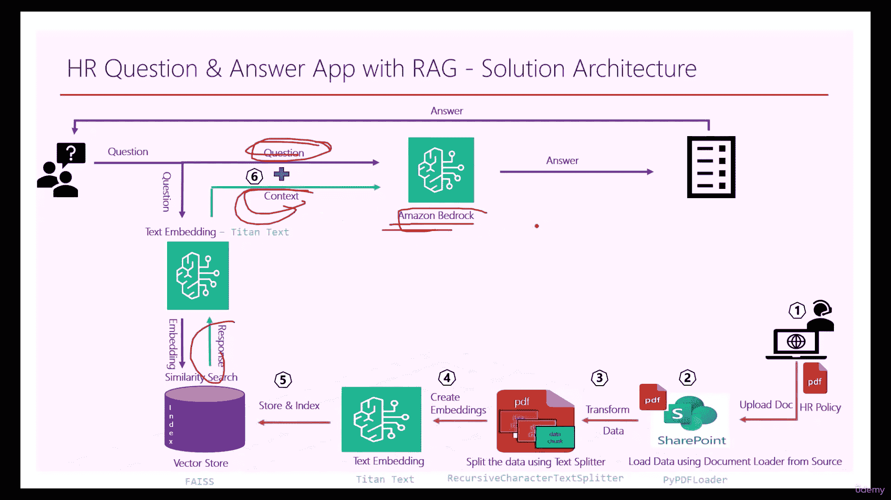
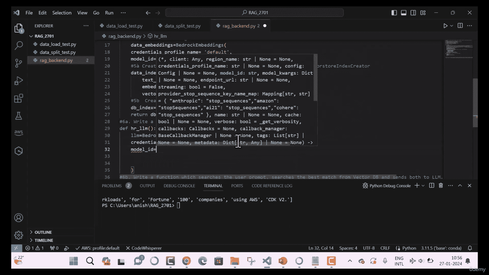
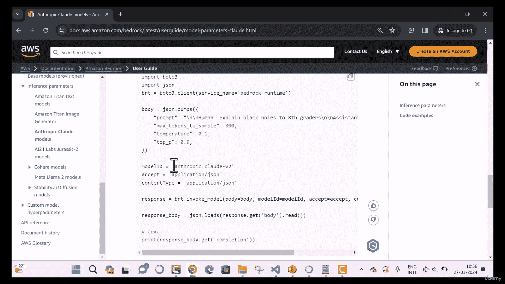
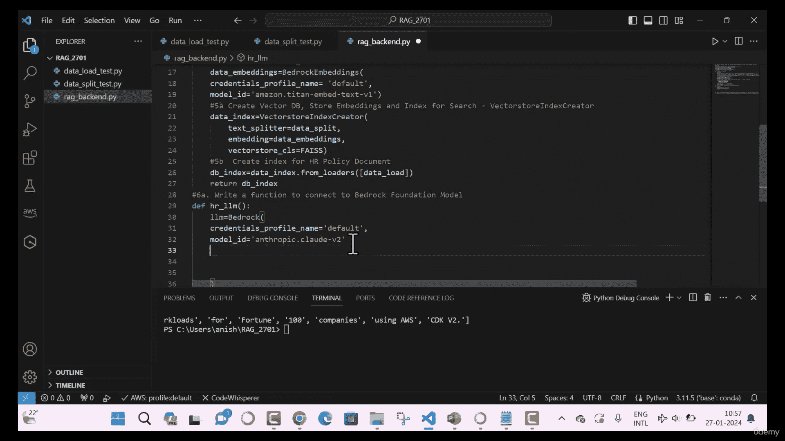
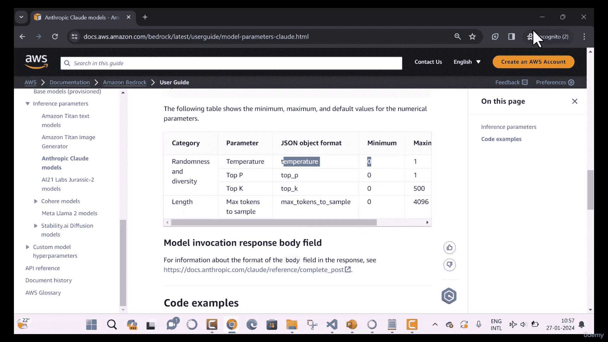
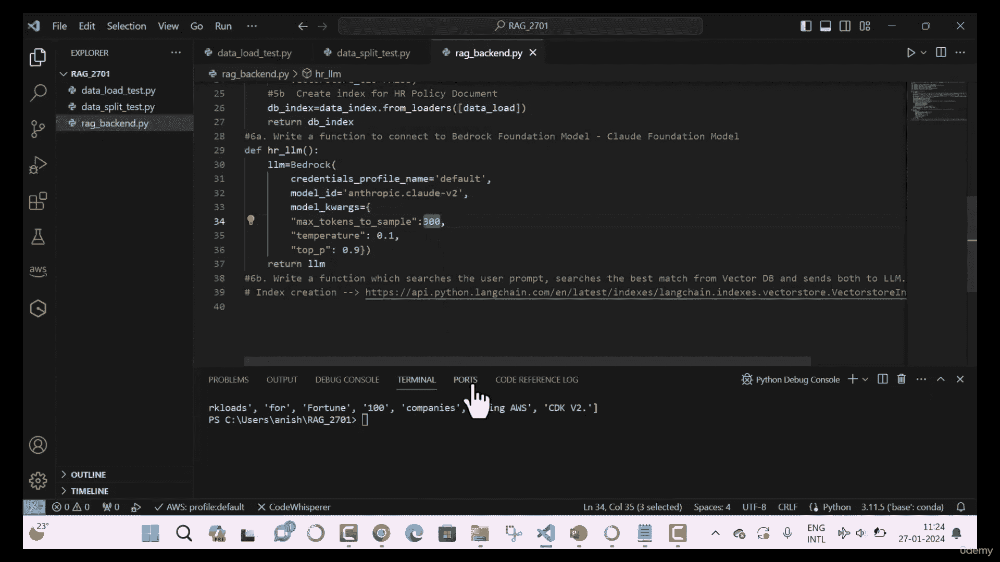
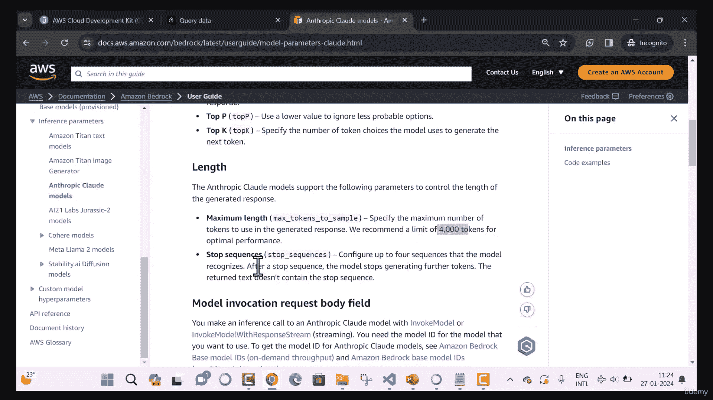
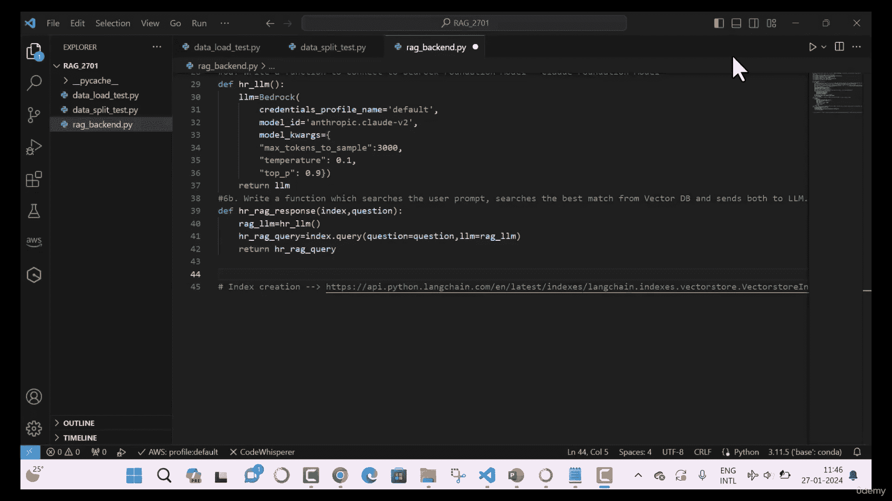

# 🧩 生成式AI在AWS上：第53-55节：HR问答与RAG实战——LLM创建上下文第4部分

## 📌 生成式AI在AWS上：第53-55节：本节概述

在本节课中我们将要学习如何把RAG流程的后半段接起来：用户提出问题后，系统先做文本嵌入和相似度搜索，再把检索到的上下文和原问题一起交给Amazon Bedrock上的基础模型生成答案。上一节我们介绍了如何创建向量嵌入并把嵌入存入向量库，本节我们来看看剩下的完整调用流程，以及如何用代码创建Bedrock客户端连接、配置模型参数、编写查询函数。

> RAG的大白话是：先从知识库检索相关资料，再把资料和问题一起交给大模型生成答案。

以下是本节要完成的主要任务：

1. 回顾HR问答的RAG流程。



2. 创建与Amazon Bedrock的客户端连接。

3. 配置模型ID和模型参数。

4. 编写搜索问题、生成上下文并调用大模型的函数。

5. 为下一节的前端代码做准备。

## 🔄 生成式AI在AWS上：第53-55节：RAG问答流程回顾



上一节我们完成了向量嵌入和向量库存储，本节先回顾整个HR问答流程。HR员工提出一个问题后，这个问题会先送到文本嵌入模型，课程里使用的是Titan文本嵌入模型；该模型会为问题创建一个嵌入向量。随后系统会在向量库中做相似度搜索，找出与问题相关的资料片段，并生成上下文。接着，员工提出的问题以及检索到的响应上下文会一起发送到Amazon Bedrock的基础模型，课程里使用的是Anthropic的Claude作为基础模型。基础模型收到问题和上下文后生成最终响应，并把响应返回给用户。

核心流程可以用下面的代码和公式表示：

```text
question_embedding = TitanEmbedding(question)
top_k_chunks = VectorStore.similarity_search(question_embedding)
context = "\n".join(top_k_chunks)
answer = Claude(question + context)
```



```text
similarity = cosine_similarity(embedding(question), embedding(document_chunk))
```



简单说，这一步的意义是让模型不必只依赖自身记忆，而是先拿到企业内部资料作为依据，再基于资料回答问题。作为本节实战的一部分，我们要创建与Amazon Bedrock的客户端连接，然后把问题和上下文发送给基础模型并生成响应。接下来我们看看具体如何用代码完成这些步骤。

## 🔌 生成式AI在AWS上：第53-55节：创建Amazon Bedrock客户端连接

在上面回顾了RAG流程后，本节开始写后端代码。首先需要导入Bedrock相关类，原文演示的是从LangChain相关包中导入Bedrock封装类。代码大致如下：

```python
from langchain_aws import BedrockLLM
```



导入完成后，下一步是创建一个函数，原文中称为HR相关函数，可以命名为`hr_llm`。这个函数负责创建与Amazon Bedrock的客户端连接，并返回一个可供后续调用的模型对象。创建连接时需要关注三类参数：凭据配置文件名、模型ID和模型参数。凭据配置文件名使用`default`，因为课程环境中的配置文件名称就是`default`。模型ID需要到Amazon Bedrock控制台查看模型参数，在详情中滚动找到模型ID并复制到代码里；这个模型ID在前面多个用例中已经反复出现，所以课程没有再次展开描述。模型参数则包含温度、Top P、Top K、最大生成token数等配置。

下面给出一个整理后的代码示例：

```python
def hr_llm():
    llm = BedrockLLM(
        credentials_profile_name="default",
        model_id="<从Bedrock控制台复制的模型ID>",
        model_kwargs={
            "max_tokens_to_sample": 3000,
            "temperature": 0.1,
            "top_p": 0.9
        }
    )
    return llm
```

代码写完后需要整理并保存。下一节我们来看看这些模型参数分别是什么意思，以及它们对生成结果有什么影响。

## ⚙️ 生成式AI在AWS上：第53-55节：模型参数与随机性控制



上一节我们创建了Bedrock客户端连接并填入了模型参数，本节解释这些参数的作用。课程中提到，控制台会显示温度、Top P、Top K等参数的默认值，示例里可以看到类似0.5、1、250这样的默认配置；课程代码则选择了最大生成token数为300、温度为0.1、Top P为0.9作为示例。随后原文又解释，`max_tokens_to_sample`表示生成响应时最多使用的token数量，生成响应长度上限大约为4000，示例中先把该值设为300，后来又改为3000并保存。温度和Top P都会控制答案的随机性，数值不同会让输出更稳定或更多样。



以下是本节用到的模型参数说明：

- `max_tokens_to_sample`：控制生成响应最多能使用多少token，也就是限制回答长度。

- `temperature`：控制输出的随机程度，数值越低通常越稳定，数值越高通常越发散。

- `top_p`：从概率最高的一批候选token中采样，用来控制输出的多样性。

- `top_k`：限制每一步候选token的数量，也会影响生成结果的随机性。

大白话理解就是：最大token数决定答案能写多长，温度和Top P决定答案有多“保守”或多“灵活”。参数配置完成后，接下来就可以编写真正执行RAG查询的函数。

## 🔍 生成式AI在AWS上：第53-55节：实现RAG查询函数

上一节我们配置好了模型参数，本节编写最后一段后端代码。这个函数要做的事情是：接收用户问题，基于问题创建嵌入，在向量库索引中做相似度搜索并取得上下文，然后把上下文和用户问题发送给大语言模型生成响应。函数需要两个参数，第一个是`index`，也就是向量库索引，系统会基于用户查询创建嵌入并在该索引中搜索；第二个是`question`，也就是用户提出的问题。

整理后的函数代码如下：

```python
llm = hr_llm()

def hr_qa_response(index, question):
    response = index.query(
        question=question,
        llm=llm
    )
    return response
```

这里的`index.query`会接收问题并完成向量库查询，同时把前面创建的`llm`传进去，用于根据检索到的上下文生成答案。`question`参数标记为用户输入的问题，`llm`参数则是前面创建好的Bedrock模型对象。函数最后返回`response`，也就是HR问答的最终响应。到这里，后端需要的代码基本完成。下一节我们将学习如何编写前端代码。

## ✅ 生成式AI在AWS上：第53-55节：本节小结



本节课中我们一起学习了HR问答RAG流程的后半段：先回顾了问题嵌入、相似度搜索、上下文拼接和Claude生成答案的完整流程；然后创建了Amazon Bedrock客户端连接，配置了凭据配置文件名、模型ID和模型参数；接着解释了`max_tokens_to_sample`、`temperature`、`top_p`和`top_k`的作用；最后编写了`hr_qa_response`函数，通过`index.query`完成检索并调用大模型生成响应。原文最后说明下一节会创建前端代码，并希望你喜欢本节课，谢谢。

