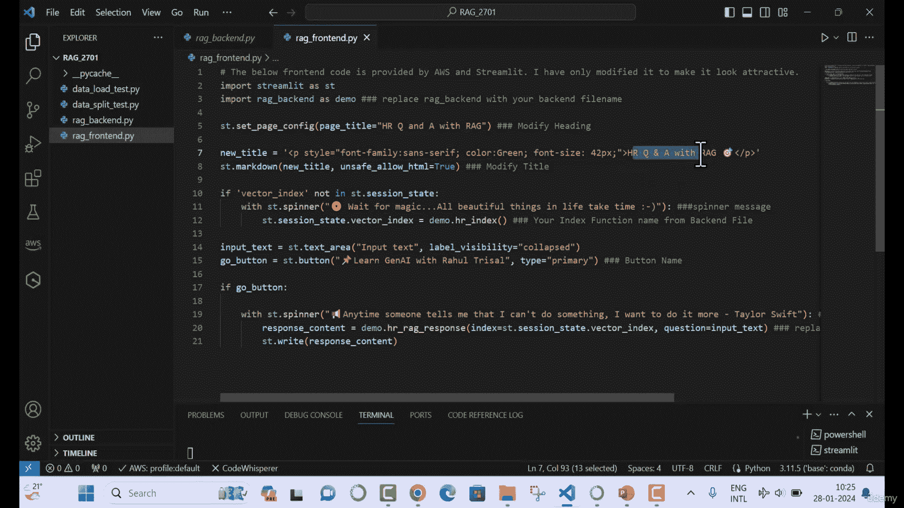
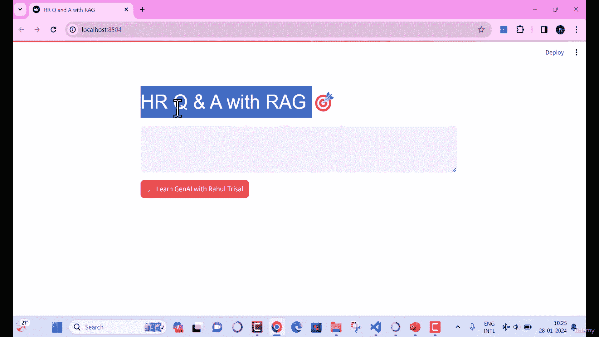
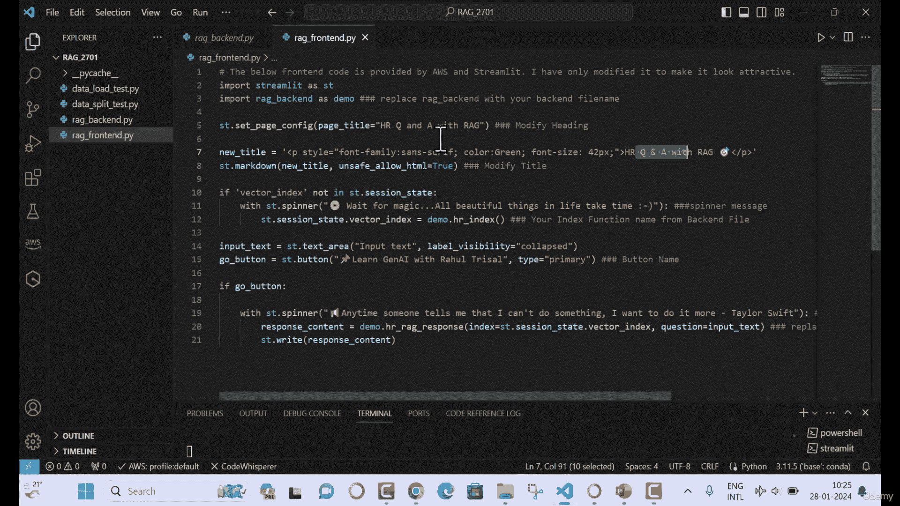
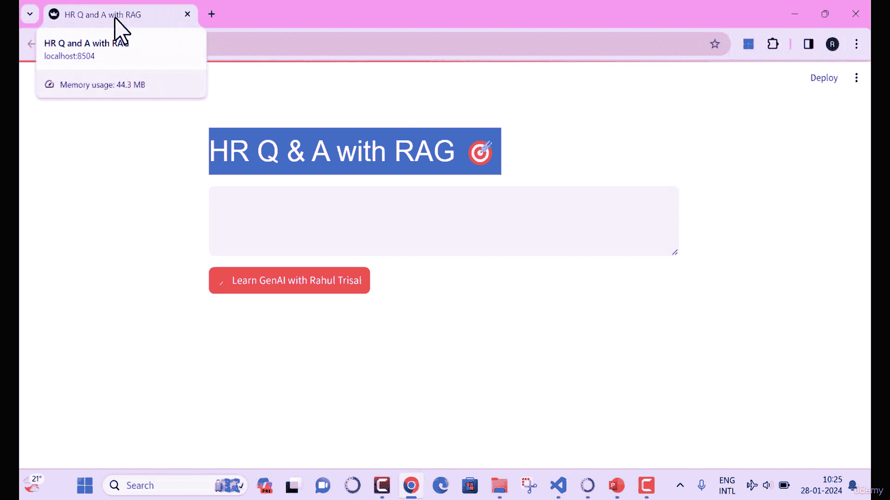
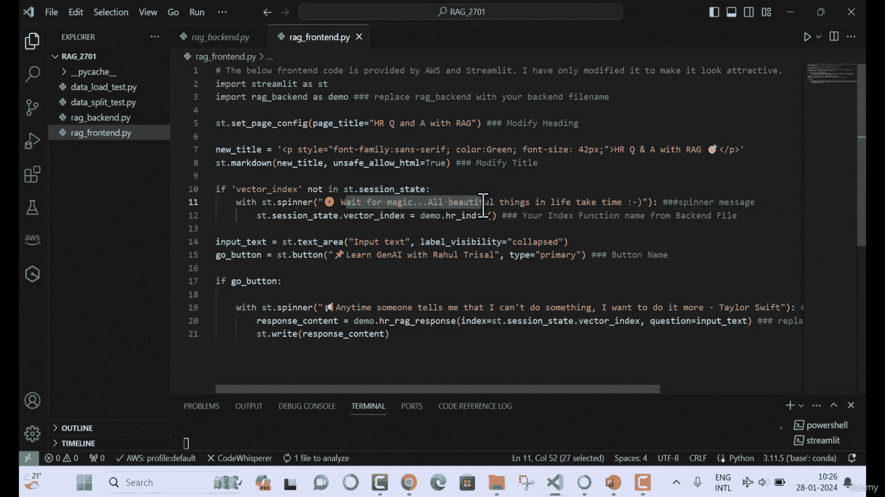
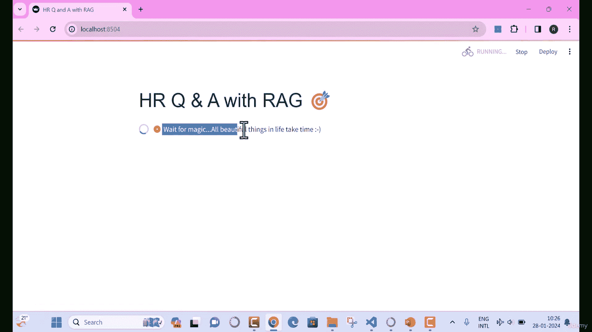
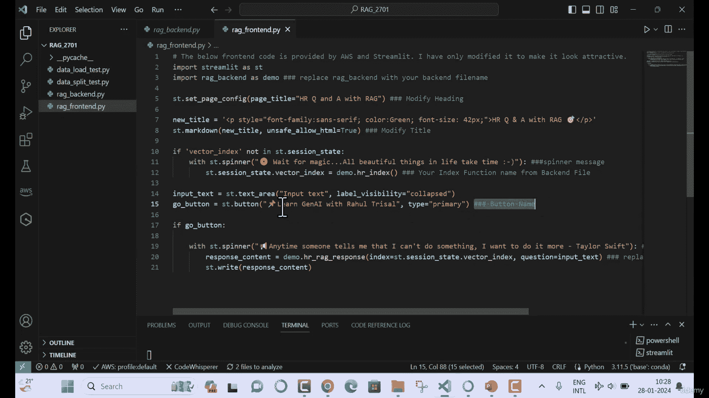
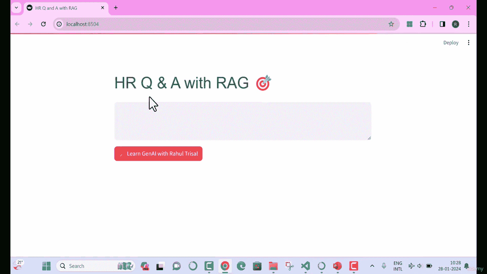
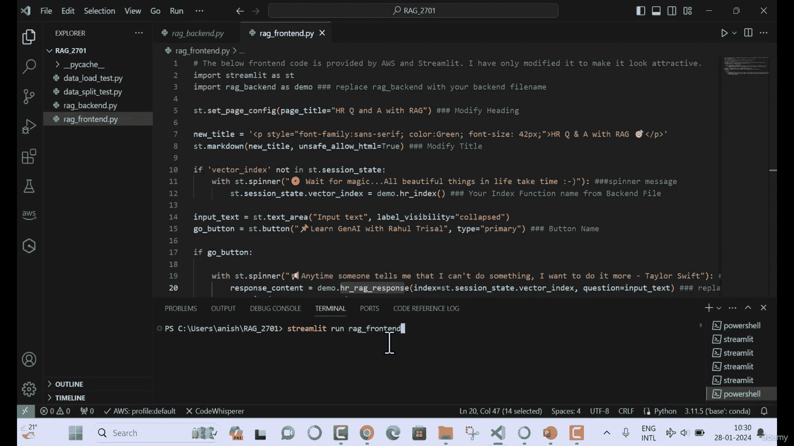
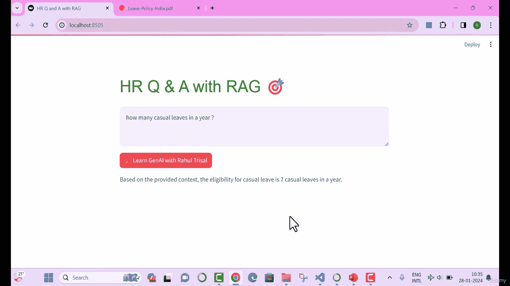

# 🚀 基于AWS的生成式AI：Amazon Bedrock、RAG与KIRO：第54-56节：HR问答与RAG前端动手实践与最终演示


在本节课中我们将要学习如何用Streamlit创建RAG前端，并把上一讲写好的RAG后端接入进来。上一讲讨论了如何创建RAG后端文件，本讲展示如何创建RAG前端。`rag_frontend.py`会作为本视频的一部分提供。这份代码主要由AWSN Streamlit编写，作者只修改了代码的外观和布局，并把RAG后端中写好的部分函数替换到前端中。RAG前端的作用很直白：用户在网页里输入问题，前端把问题交给后端，后端先检索知识库，再让大模型生成回答。为了帮助初学者理解，可以把核心流程写成下面这个公式。


$$
\text{RAG回答}=\text{大模型}\left(\text{检索}\left(\text{问题},\text{知识库}\right),\text{问题}\right)
$$


这个公式说明，RAG不是直接让大模型凭空回答，而是先拿问题去知识库中查找相关资料，再把查到的资料和原问题一起交给大模型生成回答。前端负责收集问题并展示结果，后端负责检索和生成。明确这个整体流程后，下一节我们进入前端文件和代码来源。


## 📄 基于AWS的生成式AI：Amazon Bedrock、RAG与KIRO：第1节：前端文件与代码来源


上一节我们明确了本讲目标和RAG前端的作用，本节我们来看看前端文件的来源和代码结构。前端文件名为`rag_frontend.py`。代码里放了三处`###`标记，用来提示可以修改外观或替换后端函数，以便把示例代码构建成应用。看到`###`就表示需要替换某些内容。代码主要由AWSN Streamlit编写。作者只修改了代码的外观和布局，并把RAG后端中写好的部分函数替换到前端中。为了更直白地说明函数关系，可以用下面的代码理解替换点。


```python
# 前端会导入后端文件，并调用后端里的函数
import rag_backend as demo  # 文件名不同时需要替换 rag_backend

demo.HR_index(...)         # 索引函数
demo.HR_rag_response(...)  # RAG回答函数
```


这段代码表达的是前端与后端的连接方式：前端先导入后端文件，再调用后端里的索引函数和RAG回答函数。文件名、导入别名和函数名需要保持一致，否则前端就找不到后端能力。了解代码来源后，下一节我们逐项处理需要检查并替换的内容。






## 🔧 基于AWS的生成式AI：Amazon Bedrock、RAG与KIRO：第2节：需要检查并替换的内容




上一节我们介绍了前端文件和代码来源，本节我们来看看需要动手检查和替换的内容。代码中的`###`是占位提示，不是业务逻辑。以下是需要检查并替换的内容。




- 第一处，替换`rag_backend`文件名。作者使用的文件名是`rag_backend`，如果你的后端文件名不同，就需要把这里替换成实际文件名。
- 第二处，把后端文件导入为`demo`。可以保留`demo`这个别名，也可以改成其他名字。如果后端文件名保持不变，则不需要修改。
- 第三处，修改页面标题。作者这里的页面标题是`HR Q and A with RAG`，可以按需要修改标题，也可以保持原样。
- 第四处，修改页面顶部显示的标题。到`HR Q and A with RAG`这一处修改即可，前端UI会反映修改结果。作者已经运行过应用来展示前端效果，应用顶部显示`HR Q and A with RAG`，修改这里会反映到顶部标题。
- 第五处，修改spinner加载提示文案。当前文案是`wait for magic, all beautiful things in life take time`，刷新页面后可以看到这段提示。如果要修改加载提示，就在这里改。
- 第六处，修改索引函数名。前端调用`demo.HR_index`，这个函数名来自后端文件。到`rag_backend`文件中可以看到`HR_index`。如果后端函数名相同，就不需要修改。
- 第七处，修改按钮名称。当前按钮名称是`Learn GenAI with Rahul Russell`，如果要替换按钮文字，就在这里修改。
- 第八处，替换RAG回答函数。前端调用`demo.HR_rag_response`，这个函数来自后端文件。后端文件里对应的是`HR_rag_response`。如果函数名相同，就不需要修改。




完成这些替换后，保存文件。保存动作是必要步骤，否则运行的可能还是旧代码。完成替换并保存后，下一节我们启动应用。




## ▶️ 基于AWS的生成式AI：Amazon Bedrock、RAG与KIRO：第3节：启动Streamlit应用


上一节我们完成了前端替换并保存文件，本节我们来看看如何启动Streamlit应用。启动前需要打开终端，并确保终端位于项目目录中。以下是启动应用时需要执行的步骤。


- 在项目目录中新建一个终端。
- 运行命令`streamlit run rag_frontend.py`。
- 应用默认使用本地地址`http://localhost:8501`，原文这里说的是本地端口`localhost:8501`。


```bash
streamlit run rag_frontend.py
```


运行命令后，Streamlit会自动在本地机器打开页面。页面加载需要一点时间，这是正常现象。页面会显示标题、加载提示和Go按钮。应用启动后，下一节我们测试HR问答。






## 🧪 基于AWS的生成式AI：Amazon Bedrock、RAG与KIRO：第4节：测试HR问答与最终演示


上一节我们启动了应用并看到标题、加载提示和Go按钮，本节我们来看看如何测试HR问答。测试时输入一个具体问题，然后观察系统是否从文档中检索并生成回答。以下是测试HR问答前端的步骤。




- 在输入框输入问题`How many casual leaves in a year?`，中文意思是一年有多少天事假。
- 点击Go按钮，等待系统返回回答。
- 查看回答，并打开`leave policy` PDF核对内容。


测试结果显示，系统基于先前上下文给出回答：事假资格是一年7天事假。这个回答来自文档。打开`leave policy` PDF可以看到`eligibility 7 casual leaves in a year`。回答不是凭空生成，而是从文档中检索后生成。下节会展示更详细的演示，并问更多HR问题，构建HR问答与RAG应用。希望你喜欢这节课。感谢观看。


> 一年有7天事假。  
> 文档中写作：eligibility 7 casual leaves in a year。


测试完成后，下一节我们总结本讲内容。


## ✅ 基于AWS的生成式AI：Amazon Bedrock、RAG与KIRO：第5节：本讲总结




前面我们完成了前端替换、应用启动和问答测试，本节我们一起总结本讲内容。本节课中我们一起学习了如何用Streamlit创建RAG前端，如何检查并替换`###`标记，如何导入RAG后端，如何修改页面标题、加载提示、索引函数、按钮名称和RAG回答函数，如何用`streamlit run rag_frontend.py`启动应用，以及如何测试HR事假问题。最后得到的回答是：一年有7天事假，并且可以在`leave policy` PDF中核对。下一节会展示更详细的演示，并继续问更多HR问题。希望你喜欢这节课。感谢观看。

