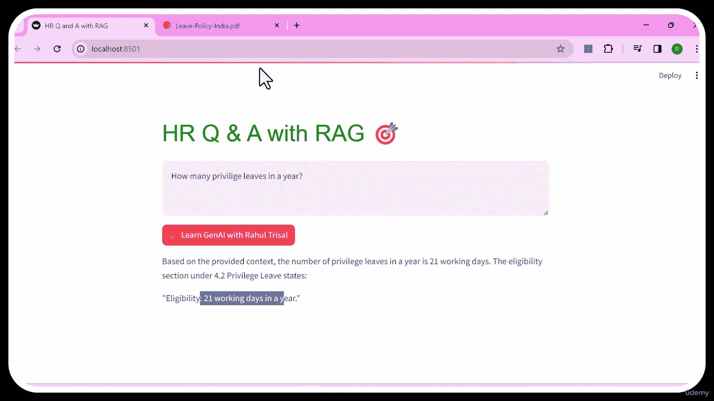
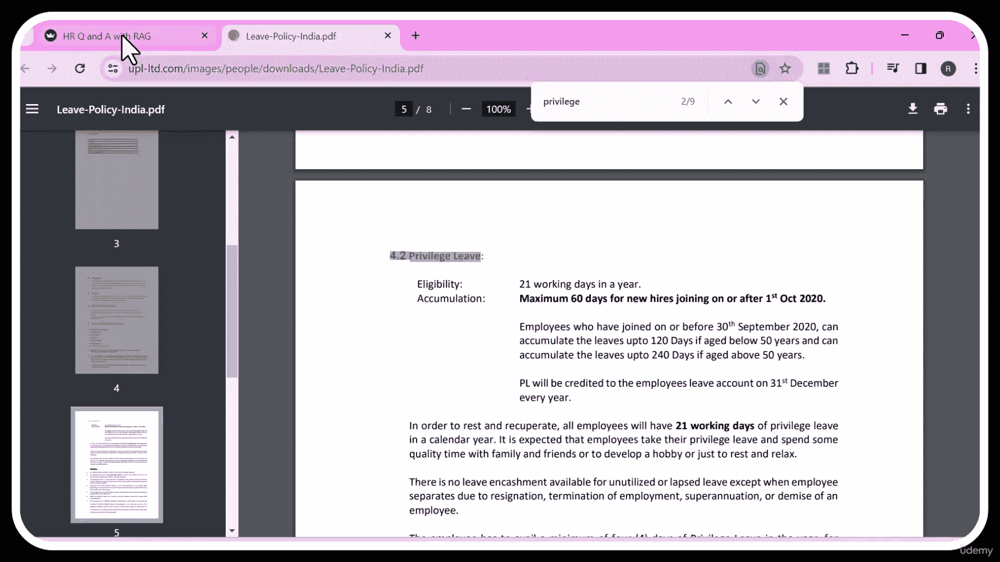
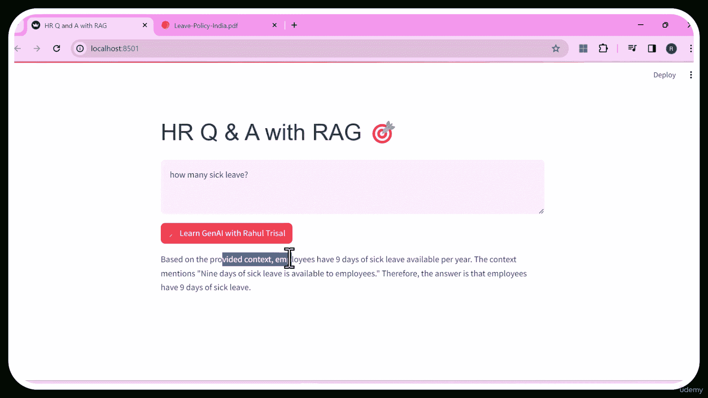
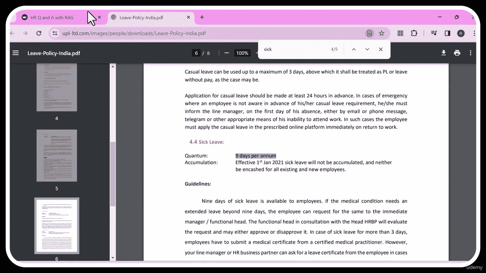
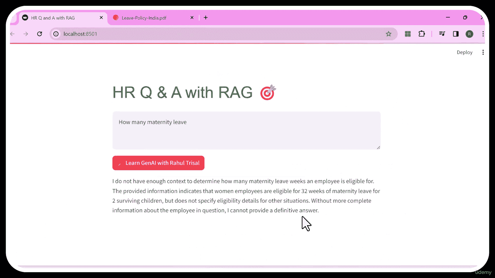

## 🎬 Udemy - Generative AI on AWS - Amazon Bedrock, RAG & KIRO [2026]：p55-57：HR QA with RAG 端到端演示


在本节课中我们将要学习一个基于 RAG 的 HR 问答应用最终演示流程。上一部分我们已经完成了应用搭建与基础配置，本节中我们来看看实际提问和验证结果的过程。这个演示的重点是观察应用如何从 HR 文档中检索上下文，并基于检索到的内容回答员工假期相关问题。


RAG 问答的核心逻辑可以用下面公式表示，初学者可以把它理解成“先查资料，再让大模型根据资料回答”：


```text
答案 = LLM(问题, TopK(检索(文档库, 问题)))
```


也就是说，系统先根据问题去文档库中检索最相关的若干段内容，再把这些内容作为上下文交给大模型生成答案。下面我们开始进行最终演示，并提出几个问题来检查回答是否准确。以下是演示中执行的操作步骤：


1. 打开应用并进行最终演示，提出第一个问题：一年有多少天特权假。

2. 观察应用基于提供的上下文给出的回答：一年特权假为 21 个工作日。



3. 查看文档中 4.2 节“特权假”的资格说明：一年资格为 21 个工作日。

4. 在文档中搜索与特权假相关的关键词，确认结果中显示一年 21 个工作日。



5. 确认回答与文档一致：所有员工在 4.2 节特权假部分下享有 21 个工作日。

6. 提出第二个问题：有多少天病假。

7. 观察应用基于提供的上下文给出的回答：员工每年有 9 天病假。

8. 在文档中搜索“sick”，确认结果中显示每年 9 天病假。




上一段我们列出了演示步骤，本节中我们来看看第一个问题的实际问答结果。应用运行后，我们询问一年有多少天特权假，系统返回的内容如下：


> 基于提供的上下文，一年特权假数量为 21 个工作日。4.2 节特权假下的资格部分说明，一年资格为 21 个工作日。




为了验证这个回答，我们到文档中搜索与特权假相关的关键词，可以看到文档中确实写着一年 21 个工作日。这个结果说明，应用回答与文档中的 4.2 节特权假说明一致，也就是所有员工在 4.2 节特权假部分下享有 21 个工作日。这个回答符合预期，演示继续进行。


第一个问题验证完成后，本节中我们来看看第二个问题。我们提出病假天数问题，询问员工有多少天病假。应用运行后可以看到，系统基于提供的上下文回答：员工每年有 9 天病假可用。随后我们搜索“sick”，在结果中可以看到每年 9 天病假。这个结果同样与文档内容一致，说明检索和回答流程工作正常。




本节课中我们一起学习了 HR QA with RAG 的端到端最终演示。我们提出了特权假和病假两个问题，观察了应用如何基于检索到的上下文给出答案，并通过文档搜索验证了回答的准确性。希望本节课内容对你有用，下节课见，谢谢。
