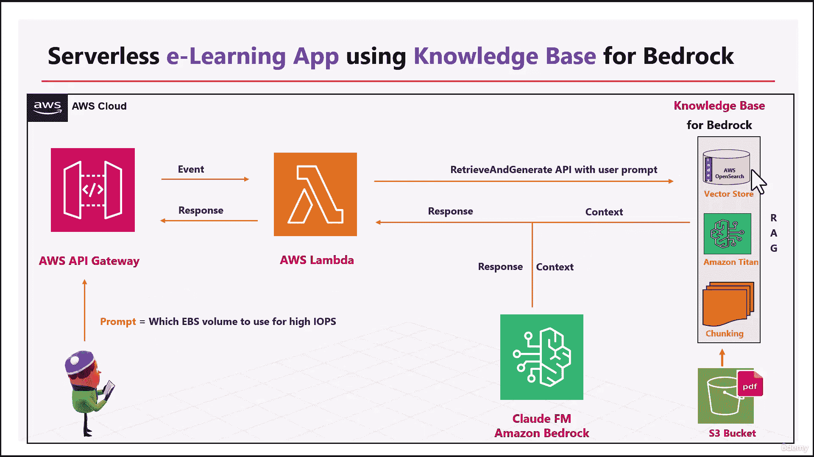
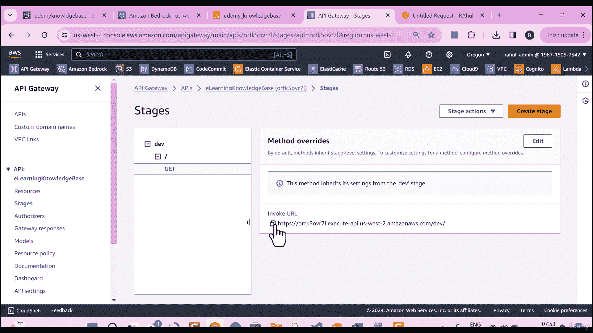
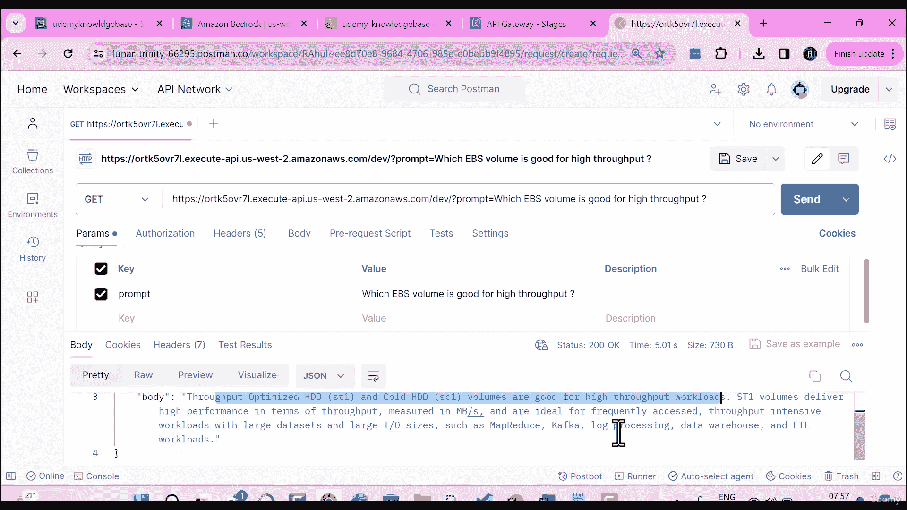
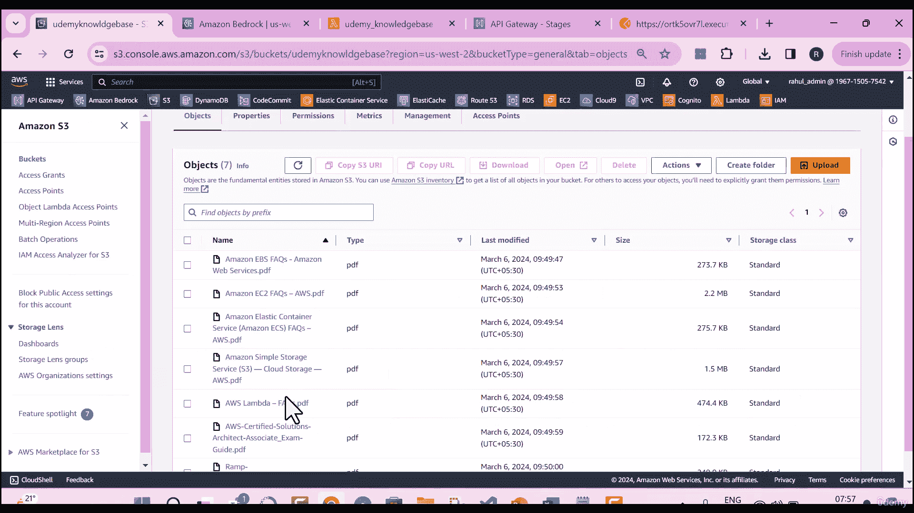
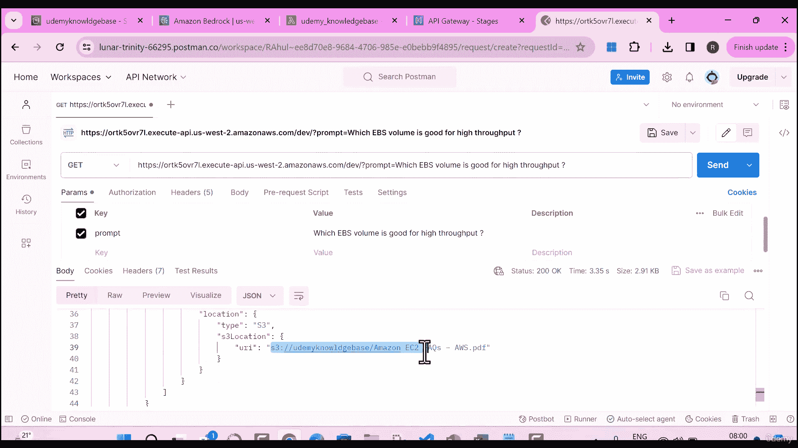
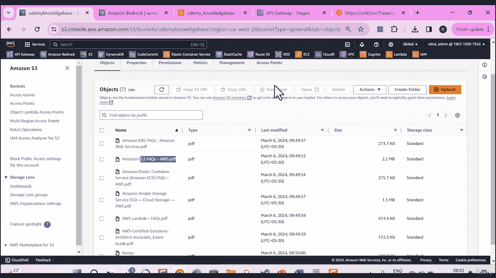

# 🚀 AWS 生成式 AI 实战：第 56-58 讲：Amazon Bedrock Knowledge Base、Lambda 与 API Gateway 演示

在本节课中，我们将要学习如何用 Amazon Bedrock 的知识库（Knowledge Base）、云基础模型（Cloud Foundation Model）、AWS Lambda 和 Amazon API Gateway 构建一个无服务器 E-learning 应用。这个应用的目标是让大型组织在把应用迁移到 AWS 的过程中，帮助员工学习更多 AWS 服务知识。我们还会快速查看这个用例最终要构建出来的效果，并在架构部分继续讨论相关细节。


## 🏢 AWS 生成式 AI 实战：第 56-58 讲：业务场景与建设目标

上一节概述了我们要做的应用，本节来看看它对应的业务场景。假设有一个大型组织，正在尝试把它的应用迁移到 AWS。这个组织想构建一个 E-learning 应用，帮助员工更了解 AWS 服务。于是，有一名员工想学习更多 AWS 知识，而我们就要在 AWS 云上构建这个应用。为了完成这个应用，第一步是创建一个 S3 桶，把员工为了完成迁移需要学习的各种 AWS 服务文档都加载进去。创建好 S3 桶以后，下一步是创建知识库。知识库可以帮助你构建基于 RAG 的应用，它会在后台完成一些任务，例如分块（chunking）、创建向量嵌入（vector embeddings），以及把结果存到向量存储（vector store）中。如果你还不了解这些概念，可以查看我之前创建的一些视频，其中我们构建了 HR 问答应用。创建好知识库以后，这个用例会使用云基础模型（Cloud Foundation Model）。


## 🔄 AWS 生成式 AI 实战：第 56-58 讲：整体调用流程

上一节介绍了业务场景和基础组件，本节我们来看看整个流程如何运转。员工可以向 E-learning 应用提出问题，例如员工问：如果自己需要高 IOPS，应该使用哪个 EBS 卷。这个问题会作为提示词（prompt）发送到 Amazon API Gateway，然后 Amazon API Gateway 会把它作为事件（event）传给 AWS Lambda。接着 AWS Lambda 会调用知识库提供的 Retrieve and Generate API，同时带上用户提示词。知识库会生成一个响应，这个响应就是存储在 PDF 桶中的上下文信息。随后上下文信息会传给云基础模型，基于这些上下文和云基础模型的智能能力，系统会得到一个响应。这个响应会传回 AWS Lambda 函数，AWS Lambda 函数再通过 AWS API Gateway 把响应发送回用户。接下来我们会快速查看这个用例最终要构建出来的演示效果，详细架构会在架构部分讨论。

这个流程可以先用一个简化公式表示：


```
答案 = FoundationModel(用户问题, Retrieve(KnowledgeBase, 用户问题))
```


也可以把服务链路写成代码式流程：




```
用户问题 -> API Gateway -> Lambda -> Knowledge Base RetrieveAndGenerate(prompt)
-> 上下文 -> Foundation Model -> 答案 -> Lambda -> API Gateway -> 用户
```


> 一句话理解：RAG 应用就是先查资料，再让基础模型根据资料回答。


## 🧱 AWS 生成式 AI 实战：第 56-58 讲：演示环境的构建步骤

上一节梳理了调用链路，本节我们来看看演示环境里已经准备好了哪些组件。这个演示的目标是展示最终要构建出来的应用形态，下面列出演示中用到的主要构建步骤。




- 第一步，创建一个 S3 桶。演示中已经创建了一个名为 Udemy knowledge base 的 S3 桶，并在里面上传了许多不同的 PDF，例如 EBS FAQs、EC2 FAQs 以及其他文档。这些文档是员工学习 AWS 时可能需要的资料。
- 第二步，创建一个知识库。演示中可以看到名为 Udemy Bedrock knowledge base 的知识库，它会使用这个 S3 桶作为数据源。
- 第三步，创建一个 Lambda 函数。演示中创建了名为 Udemy knowledge base 的 Lambda 函数，并在其中使用 Retrieve and Generate API 从知识库中检索上下文。
- 第四步，使用 AWS API Gateway 创建 REST API。演示中创建了名为 E-learning knowledge base 的 REST API。


这些组件搭好以后，下一步就是用 Postman 测试整个接口，观察用户问题如何经过 API Gateway、Lambda 和知识库，最后得到基础模型生成的答案。


## 🧪 AWS 生成式 AI 实战：第 56-58 讲：用 Postman 测试 API

上一节介绍了演示环境的组件，本节我们来看看如何实际测试这个 API。演示中使用 Postman 进行测试。先把调用 URL（invoke URL）复制下来。如果你以前没有用过 Postman，它基本上是一个 API 测试工具，可以从互联网上免费下载。





在 Postman 中，演示使用 GET 方法，把 URL 粘贴到请求地址里，然后提供键（key）为 prompt，再输入问题。第一个测试问题是：哪个 AWS 计算服务最适合事件驱动工作负载。发送请求后得到响应，响应说 Elastic Container Service 最适合事件驱动工作负载，因为它允许运行容器化应用。这个回答基本上是根据我们提出的问题，从 EC2 FAQs 这类文档中取得上下文后生成的。

接着测试第二个问题。把问题改成：哪个 EBS 卷适合高吞吐。发送请求后得到响应，响应说吞吐优化型 SSD 和冷 HDD 卷适合高吞吐工作负载，并给出更多细节。这个回答的数据源可能是 EBS FAQs 文档。

通过 Retrieve and Generate API，我们不仅能得到答案，还能得到答案来源的引用（citations）。演示中对 Lambda 函数做了一些小改动，然后再次测试。接下来可以看到它会提供更详细的答案，同时提供这个答案来源。保持问题不变并发送请求后，响应给出更多信息。前面已经得到过关于吞吐优化型和冷 HDD 的文本，现在还能看到文本来源的引用和 URL。响应会显示答案来自哪个 URL，看起来是 EC2 FAQs，也就是来自某个特定文档中的 EC2 FAQs。


## ✅ AWS 生成式 AI 实战：第 56-58 讲：课程总结





本节课中我们一起学习了如何用 S3、Amazon Bedrock 知识库、云基础模型、AWS Lambda 和 API Gateway 构建无服务器 E-learning 应用。我们了解了知识库会在后台完成分块、向量嵌入和向量存储等任务，也梳理了用户问题从 API Gateway 进入 Lambda，再由 Lambda 调用 Retrieve and Generate API，最后通过基础模型生成答案并返回用户的完整流程。演示部分还展示了 S3 桶、知识库、Lambda 函数和 REST API 的创建结果，并用 Postman 测试了两个问题，看到了答案以及答案来源引用和 URL。这个就是本用例中要构建的内容，下一讲再见，谢谢。
