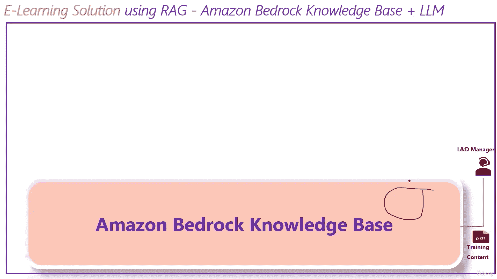
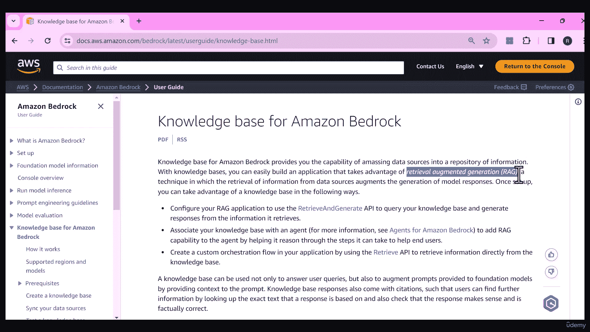
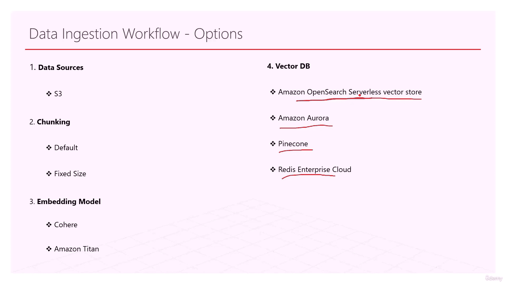

# AWS 生成式 AI 实战：p57-59：🧩 什么是 Bedrock 知识库——概念与架构

在本节课中，我们将要学习 Amazon Bedrock 知识库是什么，以及它在使用检索增强生成（RAG）构建生成式 AI 应用时如何发挥作用。这个主题看起来像是一个单独的服务介绍，实际上它和前面构建 RAG 应用的流程紧密相关，因为 RAG 应用并不是只把文档丢给大模型就结束了，而是要先准备好可检索的资料。接下来我们先回顾前面的场景，再一步步理解知识库放在整个架构中的位置。

## AWS 生成式 AI 实战：p57-59：🎯 回顾 RAG 与数据摄取工作流

在上一节构建 HR 问答应用时，我们讨论了使用 RAG 构建这类应用需要做的第一件事：建立一个数据摄取工作流。这里的数据摄取工作流可以理解为一套把原始文档变成“可检索知识”的流水线，而 Amazon Bedrock 知识库正是在这个位置发挥作用。本节中我们来看看这个结论在更具体的业务场景中如何体现，这样初学者会更容易理解知识库并不是一个抽象概念。

接下来用一个员工学习 AWS 的场景来说明。假设你要为员工构建一个 E-learning 解决方案，帮助员工提升 AWS 方面的专业能力。为了构建这个解决方案，假设组织内有一位 L&D 经理，他聘请了一些外部顾问，由这些顾问为组织创建定制化的 AWS 内容。外部顾问会创建一些 PDF，组织内的学习者需要阅读这些 PDF 来提升专业能力。

当这些内容创建完成后，假设 L&D 经理想把所有培训内容上传到一个 S3 桶中，员工就可以通过 S3 桶中的 PDF 学习顾问创建的 AWS 内容。进一步假设，L&D 经理认为与其让员工直接阅读 PDF，不如通过 E-learning 解决方案提供更具互动性的体验。为了构建这个 E-learning 解决方案，首先要做的就是创建一个数据摄取工作流。下面的内容会把这个工作流拆成四步，方便看清楚每一步在做什么。

## AWS 生成式 AI 实战：p57-59：🧱 数据摄取工作流的四个步骤

上一节我们提到，构建互动式学习方案前要先建立数据摄取工作流。本节中我们来看看这个工作流大致包含的四个步骤。对于初学者来说，可以把它想成一条“文档加工线”：先把资料收进来，再切成小块，再变成数字向量，最后放进专门检索的仓库。

这个流程的核心概念可以用下面的公式表示：

\[
D_{\text{原始文档}} \xrightarrow{\text{加载数据源}} D \xrightarrow{\text{分块}} C=\{c_1,c_2,\dots,c_n\} \xrightarrow{\text{嵌入模型}} V=\{e(c_i)\} \xrightarrow{\text{向量存储}} \text{Vector Store}
\]

这个公式的意思是，原始文档先被加载，再被切成块，每一块通过嵌入模型变成向量，最后这些向量被存入向量存储或向量数据库。下面给出这个数据摄取工作流的具体步骤，方便逐步对照理解。

以下是数据摄取工作流大致包含的四个步骤：

1. 第一步是识别数据源，并把所有内容加载到该数据源中；在这个案例中，数据源就是已经加载了全部培训 PDF 的 S3 桶。

2. 第二步是对数据进行转换，具体方式是通过分块，把 PDF 拆分成块；例如可以把它拆成 300 个字符左右的块，这通常是默认值。

3. 第三步是创建向量嵌入；为此要使用嵌入模型，例如 AWS 提供的 Cohere 嵌入模型或 Titan 嵌入模型。也就是把拆成小块的 PDF 内容拿过来，生成向量嵌入。

4. 第四步是把这些向量嵌入存储到向量存储或向量数据库中；这里有很多选择，例如可以使用 Pinecone 或 Amazon OpenSearch。

上面这整个流程被称为数据摄取工作流。这里稍微补充一句，分块的目的不是把文档弄碎，而是让检索时能够定位到较小范围的资料；向量嵌入的目的则是把文本变成一串数字，方便计算机用相似度来查找相关内容。理解这一点后，就能明白为什么知识库要处理这些步骤，而不是简单地上传文件。

## AWS 生成式 AI 实战：p57-59：⚙️ Bedrock 知识库如何自动完成四步

前面我们介绍了数据摄取工作流的四个步骤，本节中我们来看看 Amazon Bedrock 知识库在其中扮演什么角色。核心问题是：Amazon Bedrock 知识库在这四步中从哪里介入？答案是，通过控制台中的少量点击，或者通过使用 SDK，就可以用 Amazon Bedrock 知识库自动化这全部四个流程。

换句话说，你只需要把所有文档上传到数据源，知识库就会负责处理刚刚展示的四个步骤。这里可以用一段简化的伪代码来描述这种自动化关系，帮助初学者把“上传文档”和“知识库处理四步”对应起来。

```text
上传文档到数据源（例如 S3）
        |
        v
Bedrock 知识库自动执行：
1. 加载数据源
2. 分块
3. 生成向量嵌入
4. 存储到向量存储/数据库
        |
        v
得到可供 RAG 检索的信息仓库
```

接下来看知识库文档页中的说明。在知识库的文档页面上可以看到，Amazon Bedrock 的知识库提供将数据源摄取到信息仓库的能力。用大白话解释，就是你有 PDF 或其他想上传的文档，知识库会把这些内容整理成一个信息仓库，而这个信息仓库主要用于检索增强生成，也就是 RAG。下面的引用保留了文档页的核心含义，方便和前面的流程对照。

> Amazon Bedrock 的知识库提供将数据源摄取到信息仓库的能力，这一能力主要用于检索增强生成（RAG）。

从架构角度看，可以把 Bedrock 知识库理解为“数据摄取工作流的管理层”：它不替代前面说的四步概念，而是把这些步骤封装起来，让你不用自己逐步搭建加载、分块、嵌入和存储逻辑。对于想要快速构建 RAG 应用的开发者来说，这种封装能减少重复工作，也能让整个流程更容易落地。

## AWS 生成式 AI 实战：p57-59：🗂️ 知识库在每一步提供的工作流选项

上一节我们了解了知识库可以自动化四步流程，本节中我们来看看知识库为每一步提供了哪些数据摄取工作流选项。需要说明的是，这些选项会随着服务发展而变化，下面按当前讲座中提到的内容来梳理，便于初学者建立整体印象。





以下是知识库在数据源、分块、嵌入模型和向量数据库四类选项上的情况：

- 数据源方面，目前只支持 S3 桶，因此可以把全部 PDF 加载到 S3 桶中；但这是当前唯一支持的数据源，未来可能会支持更多数据源。

- 分块策略方面支持两种：第一种是默认策略，把 PDF 拆成约 300 个字符的块；第二种是可以自定义固定大小或固定块，也就是按你指定的固定块大小来拆分 PDF。

- 嵌入模型方面，支持 Cohere 的嵌入模型和 Amazon Titan 嵌入模型。

- 向量数据库方面支持四种：默认可以使用 Amazon OpenSearch Serverless 向量存储；也可以使用 Amazon Aurora；在外部服务方面，目前支持 Pinecone 和 Redis Enterprise Cloud。

这些选项覆盖了从数据进入到向量存储的主要环节，也说明知识库并不是一个黑盒，而是针对每一步给出了可配置的选择。对于初学者而言，先记住默认选项和常见组合即可，后续动手时再根据实际数据源、成本和使用场景选择合适的配置。

## AWS 生成式 AI 实战：p57-59：✅ 本讲小结与下一步

本讲座的内容到这里基本结束。下一讲我们会进行动手实践，创建一个 Amazon Bedrock 知识库。希望本讲座对你有帮助，感谢阅读。为了把整节课串起来，我们再做一个简单总结。



本节课中我们一起学习了 Amazon Bedrock 知识库是什么，以及它在使用 RAG 构建生成式 AI 应用时如何发挥作用。我们还回顾了数据摄取工作流的四个步骤：加载数据源、分块、生成向量嵌入、存储到向量存储或数据库；并理解了 Bedrock 知识库可以通过控制台少量点击或 SDK 自动化这些步骤，同时了解了它在数据源、分块策略、嵌入模型和向量数据库方面提供的当前选项。下一讲将通过动手实践创建知识库，把本节的概念落到实际操作中。

