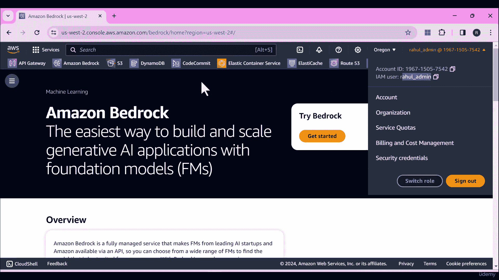
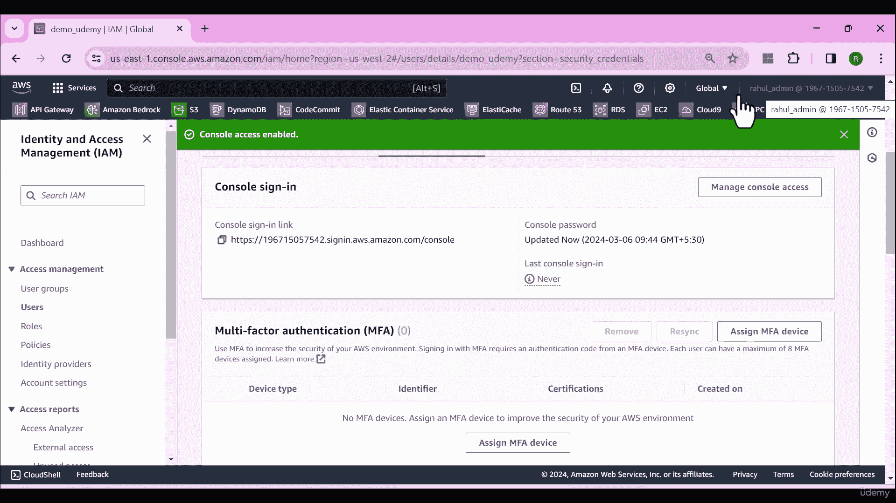
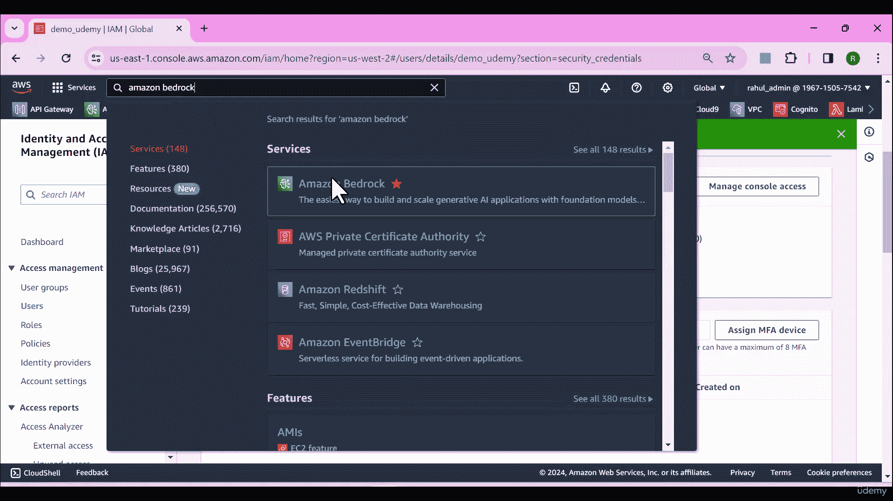
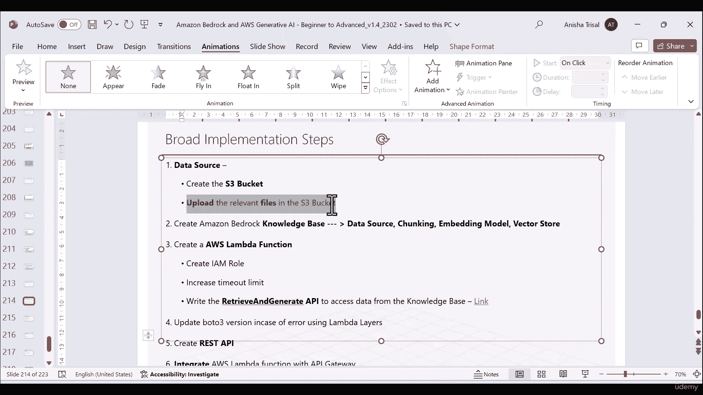
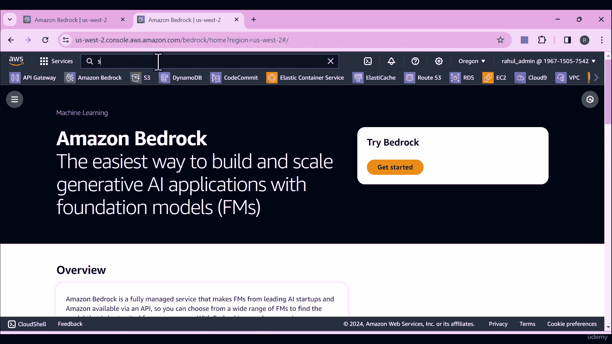
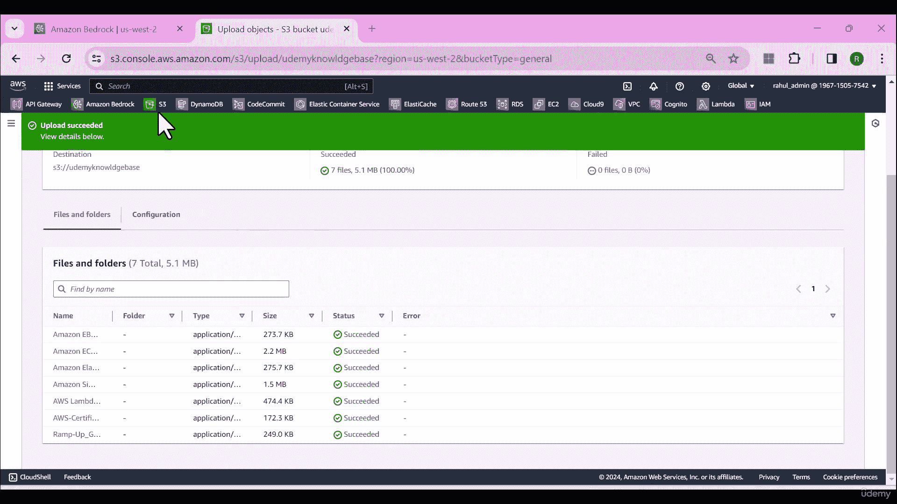
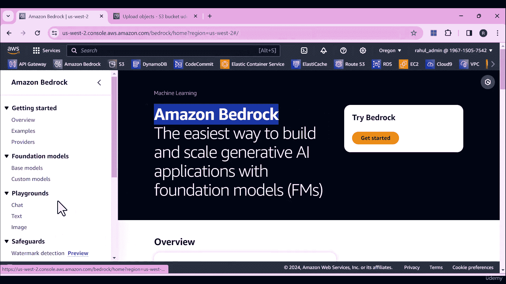
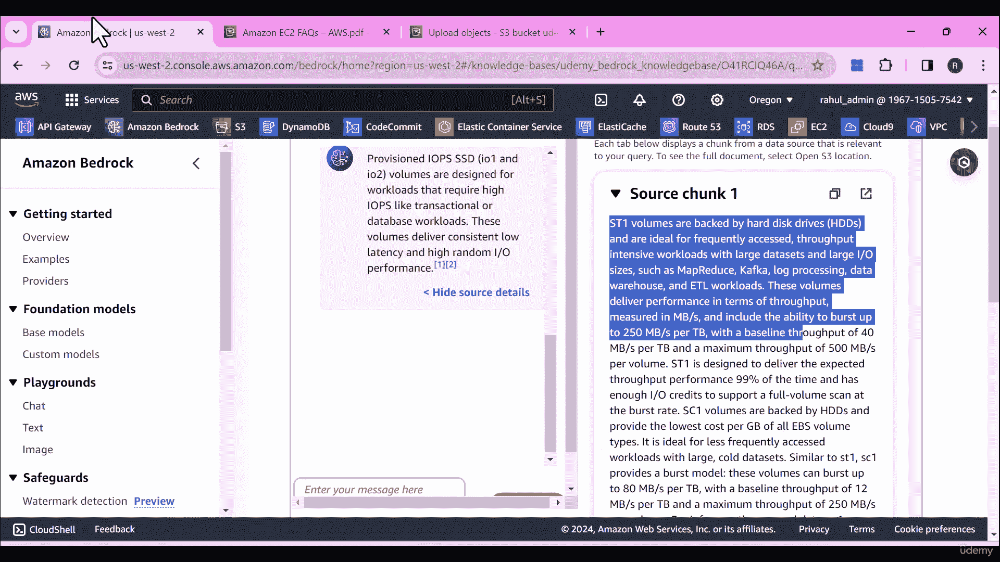

# 🚀 Udemy生成式AI on AWS：58-60：创建Amazon Bedrock知识库

在本节课中我们将要学习如何在Amazon Bedrock中创建一个知识库，并把一个在线学习应用作为示例场景走完整套流程。课程会从区域选择、IAM用户准备、S3数据源准备讲起，然后进入知识库创建、分块策略、嵌入模型、向量数据库选择、同步数据，最后在控制台里用RAG方式测试问答效果。这里先把核心概念用直白方式说清楚：知识库本质上就是一个“文档检索加生成回答”的管道，它先把文档切块并转成向量，存进向量数据库，用户提问时先检索相关文档块，再把问题和文档块一起交给基础模型生成答案。下面用公式和代码描述几个关键点。

$$
\text{RAG回答}=f(\text{用户问题},\text{检索到的知识块})
$$



$$
\text{chunk\_size}\approx 300\ \text{tokens}
$$

$$
\text{每小时成本}\approx 0.5\sim1.0\ \text{USD}
$$

```text
S3桶名示例：udemy-knowledge-base
默认分块大小：约300 tokens
默认向量库：Amazon OpenSearch Serverless vector store
```



上一节内容从整体上说明了创建知识库前需要注意的背景，本节中我们来看看具体准备工作。这里要特别说明区域问题：本节使用的区域是美国西部US West 2，也就是US West 2。如果你要跟着操作，请使用这个区域，因为当前有些服务在US East还不支持，可能几个月后会在所有区域可用，到那时你可以选择任意区域，但现在先使用US West 2。

## 🧭 Udemy生成式AI on AWS：01：准备工作与区域选择







上一节我们概述了知识库和RAG的基本概念，本节中我们来看看开始创建前的两个重要准备。第一个准备是区域选择，第二个准备是登录身份。这里再强调一次：如果使用根用户登录，就无法创建Amazon Bedrock知识库，因此必须创建一个IAM用户。你可以看到这里已经创建了一个IAM用户Rahul_admin，这就是你需要做的准备。如果你不知道如何创建IAM用户，下面快速展示操作过程。

以下是创建IAM用户并启用控制台登录的操作步骤：

- 在搜索框中搜索IAM，进入IAM服务，在左侧点击Users，然后点击Create user。
- 输入用户名，例如demo，然后点击Next。
- 你可以把用户加入用户组，但这里直接附加策略，所以选择Attach policy directly，并赋予AdminAccess权限。
- 点击Next，再点击Create user。
- 此时可以看到demo用户，点击该用户，进入Security credentials。
- 点击Enable console access，选择Enable，然后点击Apply。
- 页面会给出console sign-in link，你可以复制该链接，或者下载CSV文件。
- CSV文件中包含三个数据点：控制台登录URL、用户名、密码。
- 使用这个控制台登录URL、用户名和密码，先Sign out，再通过该URL和用户名密码重新登录。

上一节我们完成了IAM用户准备，本节中我们来看看如何进入Bedrock并准备S3数据源。完成上述操作后，就可以继续创建知识库。此时已经以IAM用户登录，而不是根用户。接下来进入Amazon Bedrock，点击进入服务，当前已经位于Amazon Bedrock控制台。为了把这个在线学习应用讲清楚，我已经整理了一份分步指南，说明如何创建这个e-learning应用。第一步是识别数据源，因此需要创建一个S3桶，并上传所有相关文件，让用户能够把这些文件作为在线学习平台的一部分来访问。

## 📦 Udemy生成式AI on AWS：02：创建S3桶并上传文档

上一节我们准备好了IAM用户并进入Bedrock，本节中我们来看看如何创建S3桶并上传知识库文档。此时我位于Bedrock页面，因此复制一个页面并搜索S3。进入S3服务后，创建一个桶。可以看到AWS区域必须选择US West 2，然后提供桶名。这里尝试输入类似“udemy-knowledge-base”的名称，之前尝试加下划线时，页面提示无效字符，因此删除无效字符后重新创建，最后S3桶创建成功。





以下是创建S3桶并上传数据源文件的操作步骤：

- 在S3服务中点击创建桶，区域选择US West 2，输入合法桶名，例如udemy-knowledge-base。
- 如果提示无效字符，删除非法字符后重新创建。
- 桶创建成功后，回到这个S3桶，搜索udemy，可以看到刚才创建的udemy-knowledge-base桶。
- 点击Upload，再点击Add file。
- 打开桌面上的knowledge base文件夹，选择所有文件，点击Open。
- 点击Upload，等待所有文档上传完成。
- 上传完成后，确认文档已经进入桶中。

上一节我们创建了S3桶并上传了文档，本节中我们来看看这些文档的来源和用途。作为这个用例的一部分，我已经下载了围绕Amazon EC2 FAQs、EBS FAQs、Lambda等服务的AWS文档，这些文档会作为内部数据源使用。上传这些文档的过程就是让知识库后续能够检索它们。完成上传后，我认为数据源准备已经完成。

## 🧱 Udemy生成式AI on AWS：03：创建知识库并配置分块嵌入向量库

上一节我们准备好了S3数据源，本节中我们来看看如何在Bedrock中创建知识库并完成关键配置。此时进入Amazon Bedrock，点击左上角三条横线，在orchestration下面可以看到左侧的Knowledge base，点击Knowledge base。创建之前需要提醒：创建知识库会产生一定成本，因为会创建AWS OpenSearch Serverless vector store，这个向量存储大约每小时50美分，同时S3等还会有小成本。可以粗略认为，知识库和OpenSearch每运行一小时，成本大约在50美分到1美元之间。

以下是创建知识库时的配置步骤：

- 点击Create knowledge base。
- 输入名称，例如udemy-bedrock-knowledge-base，并输入描述，例如e-learning use case。
- 创建IAM角色时，可以创建自己的角色，也可以使用已有服务角色，这里选择创建并使用新的服务角色。
- 标签部分不添加任何标签，然后点击Next。
- 第一步选择S3位置，点击Browse S3，选择刚才创建的udemy-knowledge-base桶。
- 选择数据源后，下一步选择数据转换或分块策略。点击Advanced settings可以看到分块策略，它决定文本在嵌入前如何切分成更小的片段。
- 分块可以选择默认分块，默认大约是300 tokens，也可以选择固定大小分块，或者选择不分块。这里选择默认分块，然后点击Next。
- 第三步是把这些文本块传入嵌入模型。当前支持Amazon Titan embeddings、Cohere embed English、Cohere embed multilingual，这里选择Titan embeddings。
- 最后选择向量数据库。这里有四个选项，可以直接使用默认选项，默认会使用Amazon OpenSearch Serverless vector store，这个选项就是我之前说大约每小时50美分的serverless存储；也可以选择自己的向量库，例如Amazon Aurora、Redis Enterprise Cloud、Pinecone等。这里选择默认选项。
- 选择默认向量库后，系统会为我创建向量存储，然后点击Next。
- 在Review页面检查所有配置，然后点击Create knowledge base。

上一节我们完成了知识库配置并提交创建，本节中我们来看看创建完成后的同步操作。创建知识库大约需要4到5分钟，因此视频在此处暂停等待。等待约5分钟后，知识库已经准备就绪。此时有一件重要的事情必须做：当界面显示知识库创建成功后，需要执行Sync同步操作。点击Sync后，同步还会再花几分钟。等待几分钟后，界面显示数据源同步完成。

## 🔄 Udemy生成式AI on AWS：04：同步知识库并准备测试问答

上一节我们创建了知识库，本节中我们来看看同步完成后如何访问和测试。访问这个知识库最简单的方式是直接从控制台操作。前面讨论过，这是一个基于RAG的解决方案，因此还需要选择可以使用的基础模型。在右侧可以看到Select model按钮。如果当前通过UI访问，目前只支持Anthropic模型。可以看到模型提供商是Anthropic，然后可以选择模型类型，这里选择一个模型并点击Apply。

以下是同步后测试知识库问答的观察步骤：

- 确认知识库创建成功，然后点击Sync。
- 等待几分钟，直到界面显示数据源同步完成。
- 在控制台右侧点击Select model，模型提供商选择Anthropic，选择模型类型后点击Apply。
- 在问答输入框中提问，系统会先检索知识库，再生成回答。
- 查看回答内容，并展开Source details查看来源片段，例如source chunk 1和source chunk 2。
- 点击来源片段，可以查看回答所引用的源文档。

上一节我们完成了同步并选择了模型，本节中我们来看看实际提问效果。此时可以提问，系统会结合Claude基础模型和知识库中的数据来回答问题。第一个问题是：在AWS中哪些EBS卷可用于高吞吐量工作负载？可以看到界面显示正在检索并生成回答。回答指出Throughput Optimized HDD和Cold HDD类型的EBS卷可以用于高吞吐量工作负载，这个回答是正确的。第二个问题是：哪些EBS卷用于高IOPS工作负载？点击提问后，回答指出Provisioned IOPS SSD io1和io2卷适用于需要高IOPS的事务型或数据库型工作负载。界面还会显示Source details，其中可以看到source chunk 1和source chunk 2，说明回答来自哪些片段。点击这些来源，可以显示该回答的来源是之前上传的Amazon EC2 FAQ源数据。

## 📝 Udemy生成式AI on AWS：05：课程总结



上一节我们完成了知识库的同步和RAG问答测试，本节中我们对整个流程做总结。本节课中我们一起学习了创建Amazon Bedrock知识库的完整流程，包括选择US West 2区域、创建并使用IAM用户登录、创建S3桶并上传AWS文档、创建知识库、选择默认分块策略、选择Titan嵌入模型、选择默认OpenSearch Serverless向量数据库、等待创建完成、执行同步、在控制台选择Anthropic模型并进行RAG问答测试。希望这些内容对你有用，下节课再见，感谢阅读。

