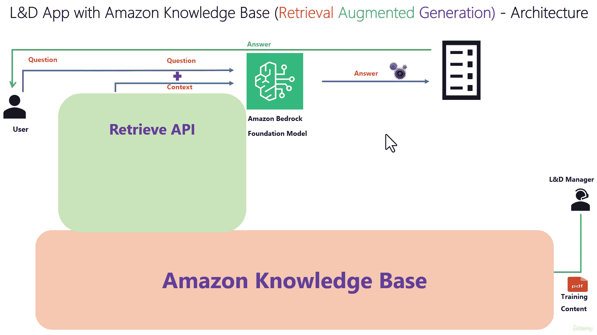
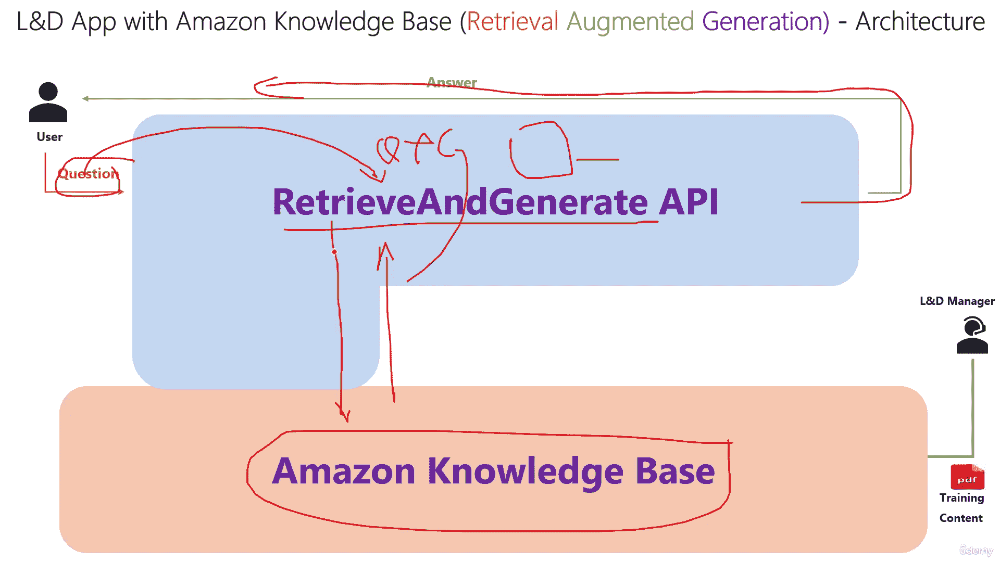
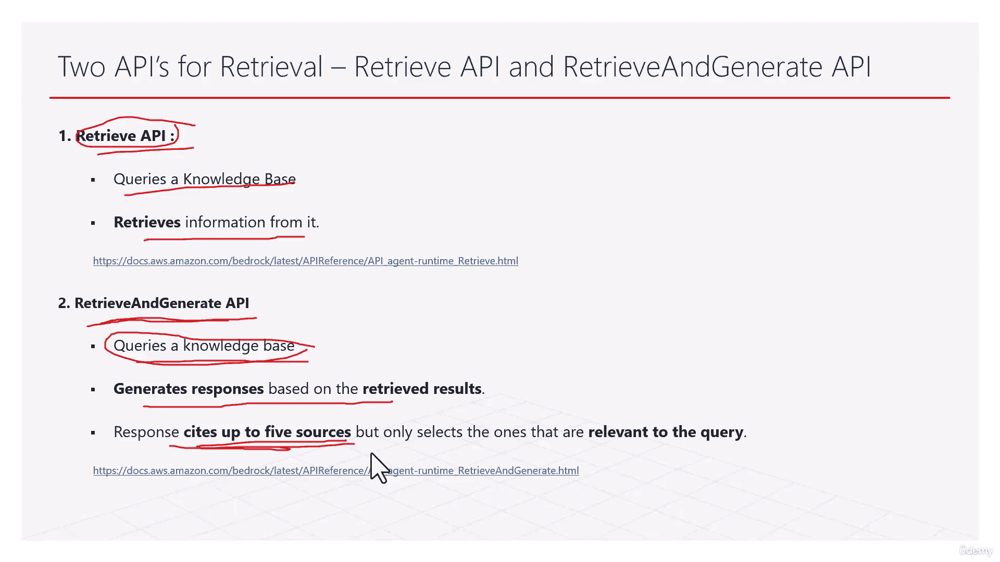

# 📚 AWS 生成式 AI 教程：第 1 节：课程概述与检索问题

在本节课中，我们将要学习在已经创建 Amazon Bedrock 知识库之后，如何访问这个知识库，以及如何从知识库中检索数据。这个问题的核心并不复杂，但它是构建 RAG 应用时必须先搞清楚的一步，因为知识库创建完成只是起点，真正的数据读取和答案生成还要依赖后面的检索接口。

上一节我们已经完成了 Amazon Bedrock 知识库的创建，本节中我们来看看知识库创建之后如何被应用程序访问。下面先说明本节关注的几个基本问题。

- 如何访问已经创建好的 Amazon Bedrock 知识库？
- 如何从知识库中检索数据？
- 后续生成式 AI 应用会怎样使用这些检索结果？

这些问题是理解后面 API 调用的基础，所以先把整体思路理顺，再进入具体接口会更轻松。接下来我们先从 RAG 应用的整体工作流程开始看。

# 🧭 AWS 生成式 AI 教程：第 2 节：RAG 应用的基本工作流程

在上一节中我们明确了知识库访问与数据检索的问题，本节中我们来看看带有 RAG 的生成式 AI 应用通常怎样工作。理解这个流程之后，Retrieve API 和 RetrieveAndGenerate API 的差异就会非常直观。

典型情况下，系统中会有一个用户提出一个问题，然后这个问题会先经过文本嵌入模型，例如 Titan Text，生成这个问题的向量嵌入。可以用下面的公式表示。

```text
v_q = Embedding_TitanText(question)
```

接着，这个向量嵌入会用于相似性搜索，在向量数据库中查找与问题相似的内容。在本场景中，向量数据库由 Amazon Bedrock 知识库以托管服务的方式管理。相似性搜索可以简单写成下面的形式。

```text
similar_results = SimilaritySearch(v_q, VectorStore)
```

在这个场景里，我们不是直接操作底层的向量存储，而是使用 Amazon Bedrock 知识库，它本质上是你底层向量存储的一层接口。知识库会根据检索结果生成上下文，然后这个上下文会和用户问题一起发送给基础模型。可以用代码表达这个过程。

```text
context = KnowledgeBase.retrieve(question)
answer = FoundationModel.generate(question, context)
```

到这里，RAG 的基本链路已经清楚了：问题先变成向量，向量用于相似性搜索，搜索结果再变成上下文，最后上下文和问题一起交给基础模型。下面我们看看 Amazon Bedrock 知识库提供的第一个接口，也就是 Retrieve API。

# 🔎 AWS 生成式 AI 教程：第 3 节：Retrieve API 的作用与调用方式

上一节我们介绍了 RAG 应用从问题到上下文的基本流程，本节中我们来看看 Retrieve API 如何完成其中的检索部分。为了执行前面提到的这些步骤，Amazon Bedrock 知识库提供了一个名为 Retrieve API 的接口。

Retrieve API 做的事情可以概括为：你把用户问题作为提示词传进去，它会完成底层的全部处理，例如把问题转换成向量嵌入、执行相似性搜索，并检索出答案所需的上下文。调用方式可以用下面的伪代码表示。

```text
context = RetrieveAPI(
    knowledgeBaseId = "知识库ID",
    prompt = user_question
)
```

当你调用 Retrieve API 并把问题作为提示词传入之后，它会返回一个上下文。这个上下文就是后续生成答案时需要使用的检索结果，因此 Retrieve API 的核心价值是从 Amazon Bedrock 知识库中生成上下文。为了更清楚地说明，下面列出这个接口在流程中的关键点。

- 输入是用户问题，也就是 prompt。
- 底层会完成向量嵌入转换。
- 底层会执行相似性搜索。
- 输出是检索到的上下文。

这些步骤对调用方来说是封装好的，所以应用程序不需要自己一步步操作向量数据库。拿到上下文之后，下一步就是把它和用户问题一起交给基础模型，接下来我们就看这个环节。

# 🤖 AWS 生成式 AI 教程：第 4 节：把检索上下文交给基础模型

上一节我们说明了 Retrieve API 可以返回上下文，本节中我们来看看拿到上下文之后应该怎样生成最终答案。通常的做法是：用户提出了一个问题，你把用户问题以及从 Retrieve API 得到的上下文一起传给基础模型。

这里有一个重要区别：使用 API 进行检索时，你可以选择任意 Amazon Bedrock 基础模型。之前在界面中我们只能选择来自 Anthropic 的 Claude 基础模型，但通过 API 检索时，基础模型的选择范围不再受这个界面限制。可以把这一步理解为下面的调用。

```text
final_answer = BedrockFoundationModel.generate(
    prompt = user_question,
    context = retrieved_context
)
```

用户问题和上下文会一起传给 Amazon Bedrock 基础模型，模型据此生成带有上下文信息的答案，然后把这个答案返回给用户。为了让这个环节更完整，下面列出这一阶段的主要输入和输出。

- 输入一：用户原始问题。
- 输入二：Retrieve API 返回的上下文。
- 处理：选择一个 Amazon Bedrock 基础模型生成答案。
- 输出：返回给用户的上下文答案。

至此，我们知道了如何手动组合检索与生成。不过，如果每次都手动把上下文和问题拼接起来再调用模型，代码会变得比较繁琐，所以 Amazon Bedrock 知识库还提供了另一个接口，也就是 RetrieveAndGenerate API。

# ⚡ AWS 生成式 AI 教程：第 5 节：RetrieveAndGenerate API 的作用与调用方式

上一节我们介绍了把检索上下文和问题一起交给基础模型的做法，本节中我们来看看 RetrieveAndGenerate API 如何把这一整套流程封装起来。Amazon Bedrock 知识库提供了另一个 API 调用，名为 RetrieveAndGenerate API。

RetrieveAndGenerate API 的作用是：在已经创建 Amazon Bedrock 知识库之后，当用户提出问题，你可以调用这个 API。它会把问题作为提示词接收，然后完成知识库底层的全部处理，检索出上下文，再把问题与上下文一起发送给 Bedrock 基础模型，生成答案，并把答案作为响应返回。可以用下面的代码概括。

```text
response = RetrieveAndGenerateAPI(
    knowledgeBaseId = "知识库ID",
    prompt = user_question
)
```

前面我们看到的所有底层处理，都会由 RetrieveAndGenerate API 完成。也就是说，调用方不需要自己先调用检索接口，再手动拼接上下文和问题，而是直接得到生成后的响应。下面列出这个接口的主要特点。



- 输入是用户问题。
- 内部会查询知识库并检索上下文。
- 内部会把问题和上下文交给 Bedrock 基础模型。
- 输出是生成后的答案响应。

因此，RetrieveAndGenerate API 更适合希望一次调用完成检索与生成的场景。接下来我们从官方文档的角度快速对比两个 API，看看它们在职责上的差别。

# 📑 AWS 生成式 AI 教程：第 6 节：两个 API 的文档对比与来源引用

上一节我们介绍了 RetrieveAndGenerate API 的封装能力，本节中我们来看看文档中对 Retrieve API 和 RetrieveAndGenerate API 的描述差异。根据前面图示和文档说明，Retrieve API 会查询知识库并从中检索信息，然后把这些信息连同用户问题一起传给所选的 Amazon Bedrock 基础模型。

相比之下，RetrieveAndGenerate API 也会像 Retrieve API 一样查询知识库，但它还会基于检索结果生成响应。更进一步，它最多可以引用五个来源，用来说明这个上下文响应是从哪些来源生成的。两个接口的差别可以用下面的对照表示。

```text
RetrieveAPI:
  context = 查询知识库并检索信息
  后续由调用方把 context 和 question 交给基础模型

RetrieveAndGenerateAPI:
  response = 查询知识库 + 检索上下文 + 生成答案
  可引用最多 5 个来源
```

需要记住的是，这些上下文来自我们上传到 S3 存储桶中的文档。知识库之所以能够检索到相关内容，前提是这些文档已经作为数据来源被上传和索引。下面列出这一节需要记住的对比点。

- Retrieve API 重点在检索上下文。
- RetrieveAndGenerate API 重点在检索并生成答案。
- RetrieveAndGenerate API 支持引用最多五个来源。
- 检索到的上下文来源于上传到 S3 存储桶的文档。



理解到这里，两个 API 的定位就比较清楚了：一个负责取上下文，另一个负责把取上下文和生成答案一起完成。下一讲我们会进入实际实现环节，用 AWS Lambda 函数实现 RetrieveAndGenerate API。

# ✅ AWS 生成式 AI 教程：第 7 节：本节总结与下一节预告

在本节中，我们一起学习了 Amazon Bedrock 知识库创建之后如何访问和检索数据，也理解了 RAG 应用中从用户问题到向量嵌入、相似性搜索、上下文生成以及基础模型回答的完整流程。我们还分别看了 Retrieve API 和 RetrieveAndGenerate API：前者返回检索上下文，后者把检索和生成封装成一次调用，并且可以引用最多五个来源。



最后再回顾一下下一步：下一讲我们会使用 AWS Lambda 函数实现 RetrieveAndGenerate API。这样从概念到代码的过渡就完成了，后面就可以把今天理解的流程真正落到可运行的应用中。
