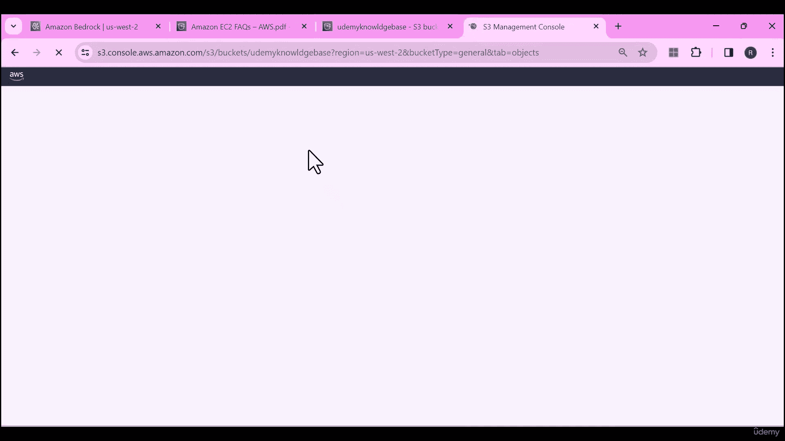
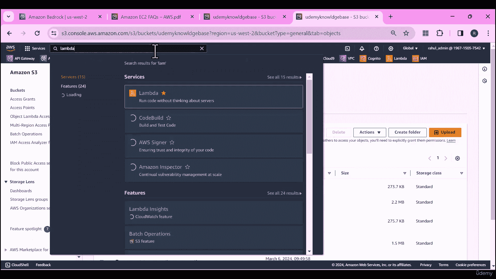
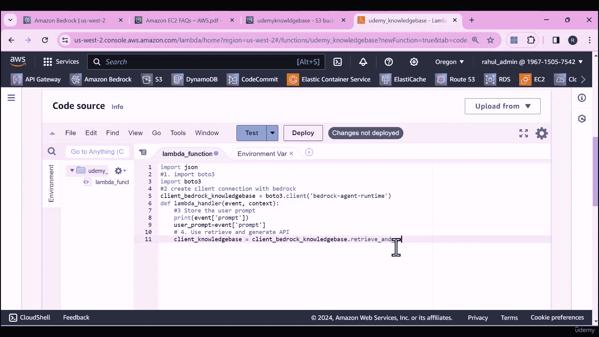
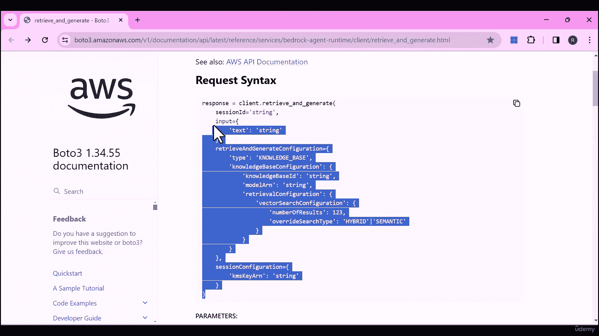
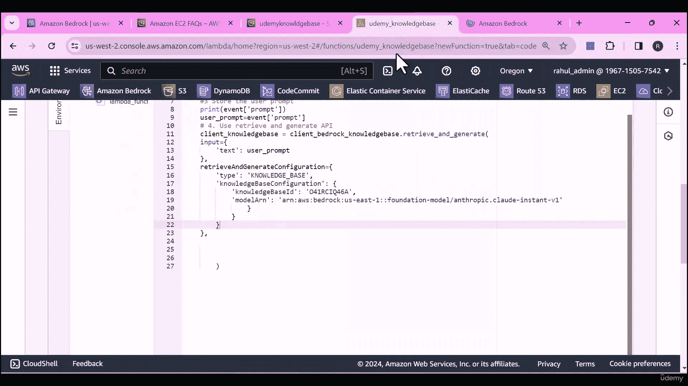
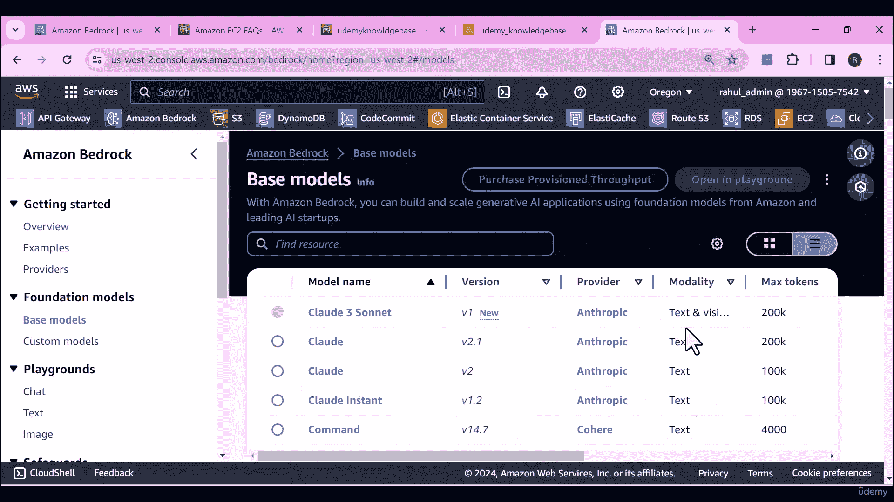
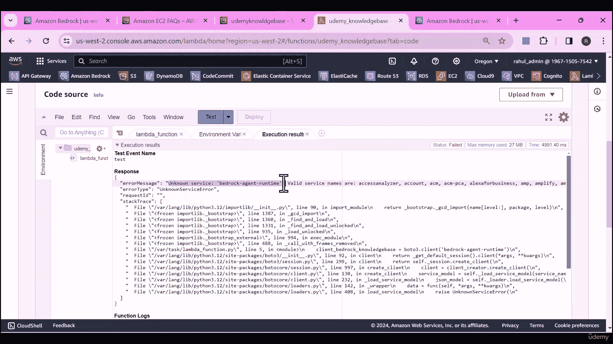

# 📘 Generative AI on AWS - Amazon Bedrock, RAG & KIRO [2026]：第60节：知识库与 AWS Lambda 函数创建（第一部分）

在本节课中，我们将学习如何为 eLearning 应用创建一个 AWS Lambda 函数，并使用 Amazon Bedrock 的 retrieve_and_generate API 来基于知识库生成答案。我们会先回顾整个实施步骤，然后重点演示 Lambda 函数的创建、配置、代码编写和测试过程。同时，我们还会讨论一个常见的坑：Lambda 环境中的 boto3 版本过旧导致 bedrock-agent-runtime 服务不可用的问题。通过本节课，你将能够把 Bedrock 知识库与 Lambda 函数整合起来，构建一个简单的问答后端服务。

## 📋 总体实施步骤概览

在动手之前，我们先从全局角度看一下整个实现流程，这样可以让后面的操作更有方向感。以下是之前已经完成和接下来要执行的步骤：





- 第一步，创建数据源。数据源是一个 S3 桶，我们把自己准备好的文档文件上传到这个桶中。
- 第二步，创建知识库。知识库会基于 S3 桶中的文档构建向量索引，以便后续进行语义检索。
- 第三步，创建 AWS Lambda 函数。这个函数会使用 retrieve_and_generate API，读取用户问题和知识库配置，最终生成答案并返回给 eLearning 应用。

可以看到，本节的核心工作就是第三步：创建 Lambda 函数。前两步已经为函数准备好了数据基础，接下来我们只需把函数写好，并确保它能正确调用 Bedrock 即可。

## 💰 成本提醒：删除知识库时别忘了向量存储

在正式创建 Lambda 函数之前，有一个非常重要的成本问题需要提醒你注意。只要创建了知识库，后端关联的向量存储（vector store）就会产生按小时计费的费用。因此，在本节末尾，当我们演示完整个流程并决定删除知识库时，不能只删除知识库本身，还需要单独删除 OpenSearch 向量存储，否则你会继续被收费。这个细节很容易被忽略，但如果你忘记删除，账单可能会让你意外。请牢牢记住这一点。

## 🔧 创建 Lambda 函数

现在，我们开始正式创建 Lambda 函数。请先确保你在 AWS 控制台上选择的区域是 us-west-2，也就是美国西部（俄勒冈）区域。区域选对很重要，因为后面用到的模型只在这个区域可用。接下来，按照以下步骤操作：

- 进入 Lambda 控制台，点击“创建函数”。
- 将函数命名为 `e-learning-app`（视频中的名称可能发音不清晰，你可以使用任何合法名称）。
- 运行时选择 Python 3.12。
- 点击“创建函数”。

函数创建完成后，控制台会自动进入函数详情页面。这里先不用急着写代码，我们还需要做一些基础配置。

## ⚙️ 配置超时和权限

首先要调整超时时间。默认情况下，Lambda 函数的超时时间只有 3 秒，这远远不够，因为调用大模型生成回答往往需要好几秒甚至更长时间。请这样配置：

- 点击“配置”选项卡。
- 在左侧菜单中选择“常规配置”，点击“编辑”。
- 将超时时间设置为 1 分 3 秒。
- 点击“保存”。

设置好超时后，我们需要给这个 Lambda 函数添加访问 Bedrock 的权限。没有这个权限，函数调用 Bedrock API 时会被拒绝。操作步骤如下：

- 点击“权限”选项卡。
- 点击角色名称，进入 IAM 角色详情页面。
- 在“权限策略”部分，点击“添加权限”，然后选择“附加策略”。
- 在搜索框中输入 `bedrock`，从结果中选择 `AmazonBedrockFullAccess`。
- 点击“添加权限”，完成授权。

现在，这个 Lambda 函数已经可以访问 Bedrock 了。接下来就可以编写代码了。

## 📝 编写 Lambda 函数代码

回到“代码”选项卡，我们开始编写函数的核心逻辑。整个代码分为几个步骤，下面我们逐步实现。

首先，导入 boto3 库。boto3 是 AWS 的 Python SDK，我们通过它来调用 Bedrock 服务。

```python
import boto3
```

接下来，创建与 Bedrock Agent Runtime 服务的客户端连接。注意，服务名称是 `bedrock-agent-runtime`，这个名称可以在 AWS 官方文档中找到，它是 retrieve_and_generate API 所在的服务。

```python
client = boto3.client('bedrock-agent-runtime')
```

在 Lambda 函数中，我们通常需要定义一个 `lambda_handler` 函数，它接收 `event` 和 `context` 两个参数。用户通过 eLearning 应用提交的问题会出现在 `event` 中。我们假设传入事件的键为 `prompt`，对应的值就是用户问题。代码如下：

```python
def lambda_handler(event, context):
    # 获取用户提供的 prompt
    user_prompt = event['prompt']
    print("Received event:", event)
    print("Prompt:", user_prompt)
```

代码中我们把 `event` 和 `prompt` 都打印出来，方便调试时查看输入数据。现在，我们有了用户问题，下一步就是调用 retrieve_and_generate API。

## 🔍 理解 retrieve_and_generate 的请求参数





在写 API 调用代码之前，我们先来看看这个接口需要哪些参数。根据官方文档，retrieve_and_generate 方法的核心参数如下：

- `sessionId`：可选参数，主要用于聊天机器人场景，用来保持多轮对话的上下文。如果是单轮问答应用，则不需要传递这个参数。
- `input`：必填参数，包含用户的输入文本，也就是 `user_prompt`。
- `retrieveAndGenerateConfiguration`：必填参数，用于配置检索和生成的行为。这里有一个 `type` 字段，我们需要将其设置为 `KNOWLEDGE_BASE`，因为我们使用的是知识库。同时，还需要在 `knowledgeBaseConfiguration` 中提供知识库 ID 和基础模型 ARN。
- `retrievalConfiguration`：可选参数，用于调整检索细节，比如向量搜索配置、返回结果数量以及覆盖搜索类型（混合或语义）。由于我们使用默认的向量存储，这些细节可以暂时忽略。

按照上述说明，我们可以组装代码了。下面是调用 retrieve_and_generate 的完整代码片段：

```python
    response = client.retrieve_and_generate(
        input={
            'text': user_prompt
        },
        retrieveAndGenerateConfiguration={
            'type': 'KNOWLEDGE_BASE',
            'knowledgeBaseConfiguration': {
                'knowledgeBaseId': 'your-knowledge-base-id',
                'modelArn': 'arn:aws:bedrock:us-west-2::foundation-model/mistral.mistral-7b-instruct-v0:2'
            }
        }
    )
```

关于 `knowledgeBaseId`，你需要从 Bedrock 控制台的知识库页面获取。在控制台中点击已创建的知识库，会看到知识库 ID，把它复制并粘贴到代码中即可。

关于 `modelArn`，这里我们选择的是 Mistral AI 的 `mistral-7b-instruct` 模型。我在录制本视频时，这个模型只在美国西部（俄勒冈）区域（us-west-2）可用，所以我特意选择了这个区域。如果未来在 us-east-1 或其他区域也上线了，你可以换成对应区域的模型 ARN。你可以在 Bedrock 控制台的“基础模型”页面找到所有可用模型，点击模型后往下滚动就能看到模型 ID，直接复制使用。

需要注意的是，视频中我还特意提到，之前我在 us-east-1 测试过使用 Claude 基础模型可以正常工作，但这次为了尝试新的 Mistral 模型，我换到了 us-west-2。操作原理是一样的。

## 📤 查看响应结构

调用 retrieve_and_generate 之后，返回的响应中包含很多信息。为了看清结果，我们可以把 response 打印出来：





```python
    print("Response:", response)
    return response
```

这个响应主要包括以下几个部分：

- `sessionId`：会话 ID。如果以后要对 chatbot 支持多轮对话，可以使用它来延续之前的对话。
- `output`：最终的答案文本。这个答案结合了知识库检索到的文档片段以及大模型的生成能力。
- `citations`：引用信息。它列出了答案中哪些内容是从文档中复制出来的，并给出对应的文档位置 URI。也就是说，用户可以知道答案来源于哪个 PDF 或文件。

现在，把以上代码整合到一起，完整的 Lambda 函数代码如下：

```python
import boto3

# 创建 Bedrock Agent Runtime 客户端
client = boto3.client('bedrock-agent-runtime')

def lambda_handler(event, context):
    # 获取用户提供的 prompt
    user_prompt = event['prompt']
    print("Received event:", event)
    print("Prompt:", user_prompt)

    # 调用 retrieve_and_generate API
    response = client.retrieve_and_generate(
        input={
            'text': user_prompt
        },
        retrieveAndGenerateConfiguration={
            'type': 'KNOWLEDGE_BASE',
            'knowledgeBaseConfiguration': {
                'knowledgeBaseId': 'your-knowledge-base-id',
                'modelArn': 'arn:aws:bedrock:us-west-2::foundation-model/mistral.mistral-7b-instruct-v0:2'
            }
        }
    )

    print("Response:", response)
    return response
```

要提醒的是，在实际填写代码时，请务必将 `your-knowledge-base-id` 替换成你自己的知识库 ID，并把模型 ARN 中的区域和模型 ID 调整为你实际使用的值。代码中 `return response` 可以让外部应用拿到完整的响应对象，方便进一步处理。

## 🚀 部署与测试 Lambda 函数

代码写好后，点击“部署”按钮保存更改。部署完成后，我们创建一个测试事件来验证函数是否正常工作。测试事件是 JSON 格式的输入数据，它会作为 `event` 参数传给 Lambda 函数。由于我们的代码从 `event['prompt']` 中取用户问题，所以测试事件中也需要包含 `prompt` 键。测试事件的内容如下：

```json
{
  "prompt": "什么是 Amazon Bedrock？"
}
```

创建测试事件的步骤是：点击控制台上的“测试”按钮，选择“配置测试事件”，命名事件比如为 `test`，然后在代码编辑框中粘贴上述 JSON，点击“保存”。保存后，点击“测试”按钮运行函数。

运行之后，如果一切正常，你应该能在日志中看到响应结果。但如果你在近期观看本视频，很可能会遇到一个错误，错误信息大致是：

```
unknown service: bedrock-agent-runtime
```

这个错误的原因是 Lambda 默认自带的 boto3 版本太旧，而 bedrock-agent-runtime 是 AWS 新发布的功能，尚未集成到 Lambda 默认环境中。每当 AWS 发布新的 Bedrock 特性，Lambda 的 boto3 默认版本都会暂时不兼容。解决办法是手动升级 boto3 版本。通常可以通过 AWS CloudShell 执行一些 pip 升级命令，然后把更新后的库打包成一个 Lambda 层并附加到函数上。不过，如果过几个月再看这个视频，AWS 可能已经升级了 Lambda 的 boto3 版本，届时就不会出现这个错误，也不需要额外升级了。也就是说，这个问题的修复取决于你观看视频的时机。

## ✅ 总结



本节课中，我们一起学习了如何创建 AWS Lambda 函数，并将其与 Bedrock 知识库集成。我们回顾了总体实施步骤：S3 数据源、知识库、Lambda 函数。然后重点完成了 Lambda 函数的创建、超时设置和权限配置。接着，我们编写了调用 retrieve_and_generate API 的 Python 代码，解释了请求参数和响应结构。最后，我们进行了测试，并讨论了 boto3 版本不兼容导致 `unknown service` 错误的解决方案。希望你已经掌握了这些核心概念，并能独立构建自己的问答应用。在下一节中，我们可能会继续完善这个函数的其他部分，或者探讨如何在前端应用中集成这个后端接口。

