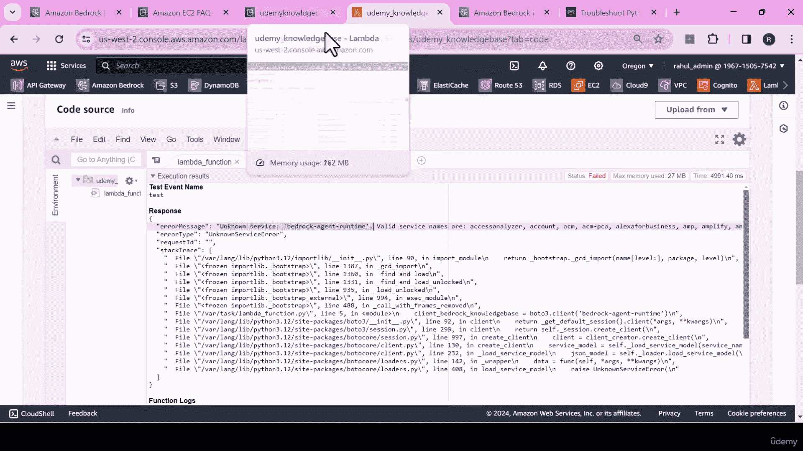
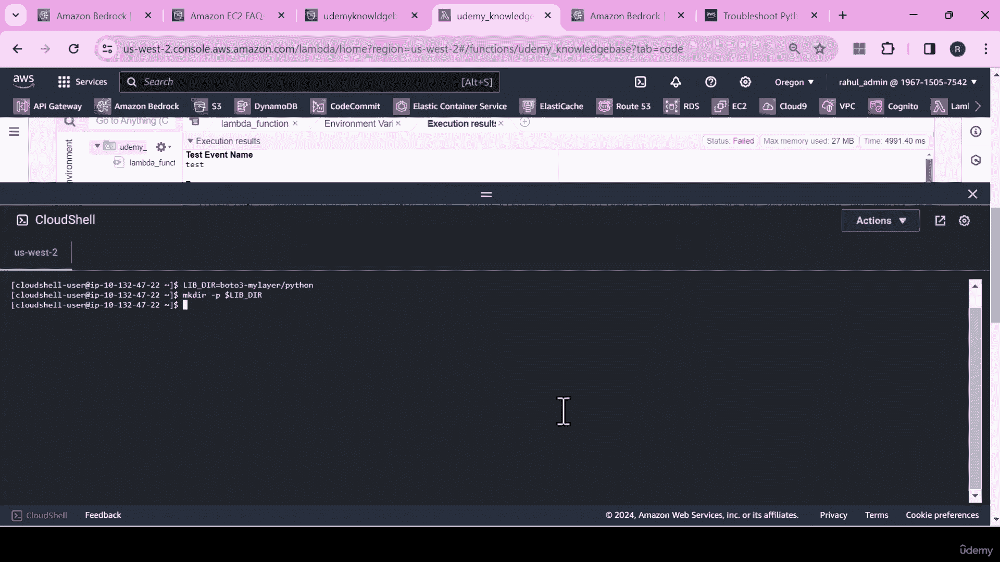
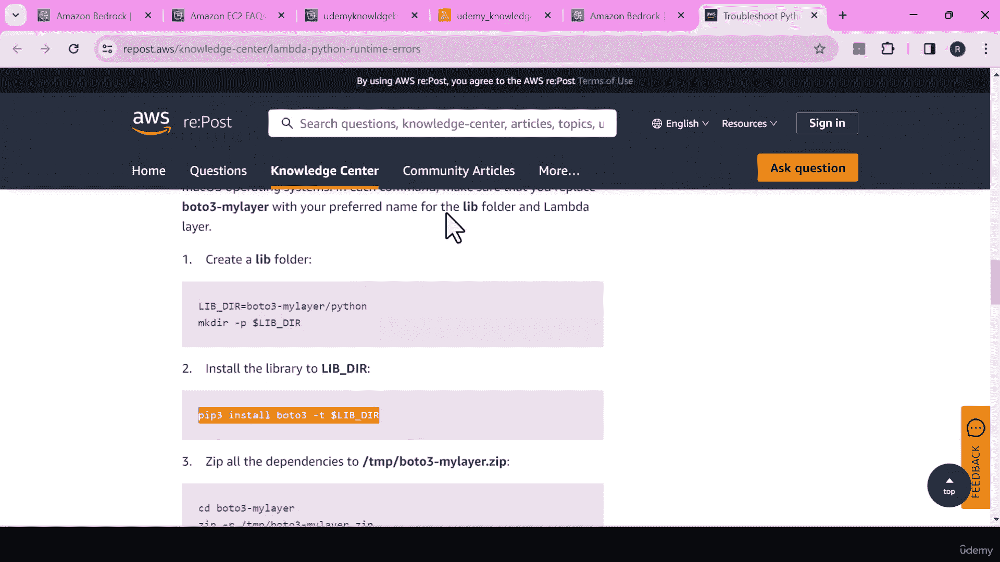
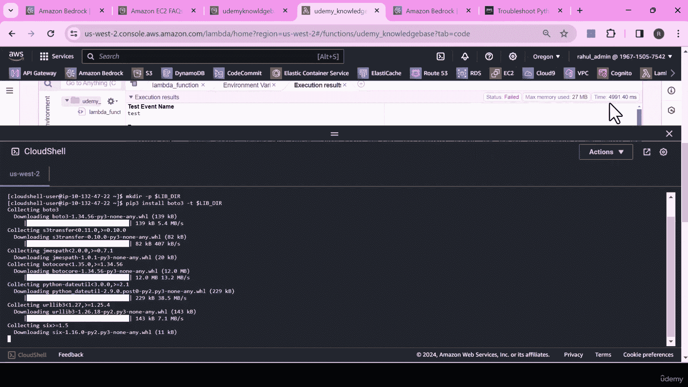
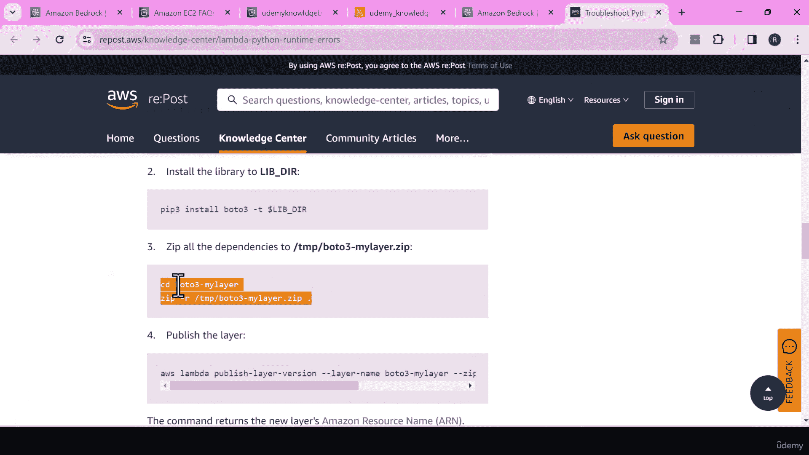
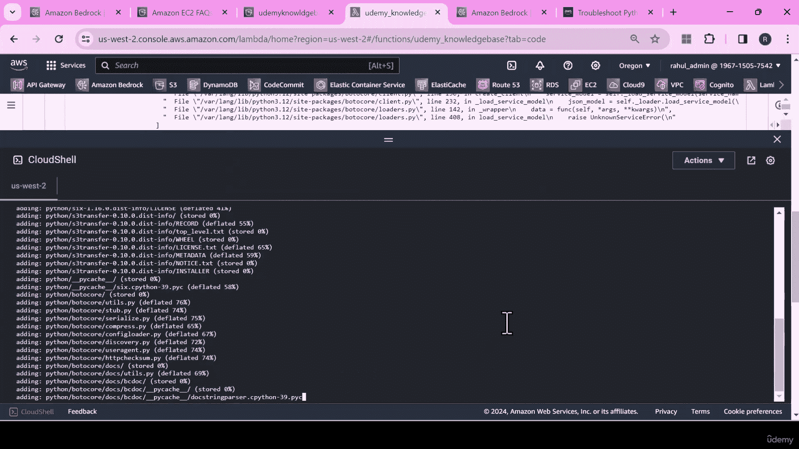
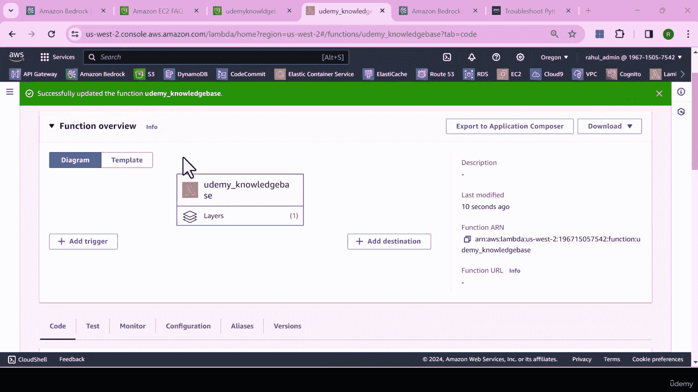

# Generative AI on AWS - Amazon Bedrock, RAG & KIRO：P61-P63：知识库与 AWS Lambda 创建之 Boto3 升级（第2部分） 🤖

## 概述 📘

在本节课中，我们将学习如何升级 AWS Lambda 函数中的 Boto3 SDK。通俗地说，Boto3 是 Python 用来调用 AWS 服务的工具包，而 Lambda 默认内置的 Boto3 版本可能比较旧，导致某些新功能无法使用。因此，我们需要手动将它升级到最新版本。我们主要会用到 AWS 的 CloudShell（一个网页版终端）以及 Lambda 的 Layer（层）功能。整个流程并不复杂，按部就班地操作即可。接下来，我们先看一下大体的实施步骤，然后再一步步完成升级。

## 总体步骤 🗺️



首先，我们需要拿到官方的操作步骤。在课程视频的描述区域中，我放了一个链接，你直接点击这个链接就能打开一个页面。这个页面会列出升级 Boto3 所必需的全部步骤。你只需要从头到尾滚动页面，把这些命令一条一条地复制下来，然后运行一遍就可以了。不需要深究每个命令的细节，只要按顺序执行即可。这些命令会帮助我们完成 Boto3 的打包和发布工作。下面我们正式进入操作。

## 核心概念：Boto3、Layer 与 ARN 🧠





在实际操作之前，我们先明确几个核心概念，这样你才能知道自己在做什么。Boto3 是 AWS 官方的 Python SDK，负责与各种 AWS 服务交互。Lambda Layer 则是一个可复用的代码包，你可以把它挂载到多个 Lambda 函数上，避免重复打包依赖。ARN 是 AWS 资源的唯一标识，相当于资源的“身份证号”。当我们发布一个 Layer 时，会得到两种 ARN，它们的格式不同，作用也不同。代码如下所示：

```text
# Layer ARN（标识 Layer 本身，不带版本）
arn:aws:lambda:{region}:{account_id}:layer:{layer_name}

# Layer Version ARN（标识 Layer 的某个具体版本，带版本号）
arn:aws:lambda:{region}:{account_id}:layer:{layer_name}:{version}
```



注意，后一步添加 Layer 时，我们需要使用 **Layer Version ARN**，而不是普通的 Layer ARN。版本号的变化可以用一个简单的公式来描述：`升级前版本号 = 0`，`升级后版本号 = 1`。接下来，我们开始具体操作。





## 第一步：打开 CloudShell 并运行升级命令 ☁️

先去 Lambda 服务页面。在页面下方或侧边栏中，你可以看到一个名为 CloudShell 的入口，它本质上是一个运行在浏览器里的终端环境，不需要你本地安装任何软件。点击这个 CloudShell 图标，系统就会开始准备终端环境，稍等片刻，终端就绪后，我们就可以输入命令了。

接下来，从刚才那个链接的页面里复制第一条命令，粘贴到 CloudShell 终端中并回车。这条命令的作用是：针对你当前这个特定的 Lambda 函数，把它的 Boto3 升级到最新版本。注意，这个操作只影响当前指定的函数，不会影响账户里的其他函数。运行完第一条命令后，接着复制下一条命令，继续粘贴并运行。需要强调的是，这些命令之间有先后依赖关系，顺序不能打乱，所以一定要按照页面上列出的顺序逐条执行。这些命令实际上是在准备一个新的 Boto3 包，为稍后发布 Layer 做好材料。

## 第二步：发布 Lambda Layer 📦

最后一条命令非常关键，它的作用是把升级好的 Boto3 打包发布成一个 Lambda Layer。发布成功后，终端会输出一堆信息，其中就包含之前提到的 `layer arn` 和 `layer version arn`。初次接触的同学可能会混淆这两个名字，这里给你一个简单的区分：

- `layer arn`：只标识这个 Layer 本身，不包含版本信息。
- `layer version arn`：标识这个 Layer 的具体版本，每次发布新版本时都会变化。

我们需要的是 **Layer Version ARN**，也就是后面那个带版本号的。为了看清输出，你可以把终端字体调大一些。然后，把这两个 ARN 都复制下来，存到一个安全的地方。最简单的做法是打开记事本（Notepad），把它们粘贴进去，以免后面找不到。注意，在后一步添加 Layer 时，我们要使用的是 `layer version arn`，而不是 `layer arn`。换句话说，`layer arn` 可以不用复制，我们只需要 `layer version arn`。

## 第三步：把 Layer 添加到 Lambda 函数 ➕

现在，回到刚才那个 Lambda 函数的控制台页面。如果你觉得页面字体太大，可以适当调小，方便操作。在函数页面的上方菜单中，找到“层（Layers）”选项卡，点击它。接着，点击“添加层（Add a layer）”按钮。在弹出的界面中，选择“指定一个 ARN”选项，然后把刚才复制好的 `layer version arn` 粘贴进去，最后点击“添加”按钮。等一下，添加完成后，你会看到 Layers 列表中这个 Layer 的版本号显示为 `1`，而之前这里显示的是 `0`。这个从 `0` 到 `1` 的变化，就说明新的 Boto3 已经成功挂载到你的 Lambda 函数上了。至此，你的知识库函数已经具备使用新版本 Boto3 的能力了。

## 总结 ✅



本节课中，我们一起学习了如何通过 AWS CloudShell 升级 Lambda 函数中的 Boto3 SDK，并将升级后的版本发布为一个 Lambda Layer。首先，我们查看了官方提供的升级步骤链接；然后，逐步运行了相关命令，生成了 Layer ARN 和 Layer Version ARN；接着，我们把 Layer Version ARN 复制并保存到了安全位置；最后，我们将该 Layer 添加到了目标 Lambda 函数中，并确认版本号从 `0` 变成了 `1`。这样，你的 Lambda 函数就能使用最新的 Boto3 功能了。如果以后需要更新其他函数，重复这套流程即可。
