# 🧠 Generative AI on AWS：第62节：知识库与 AWS Lambda 创建（第3部分）

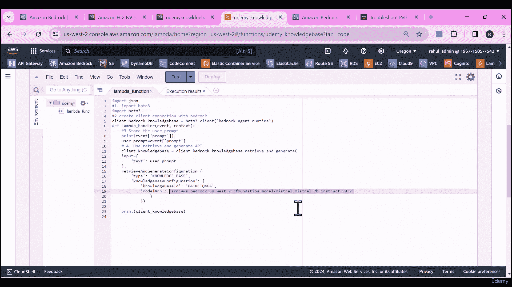

## 🧪 本课概述

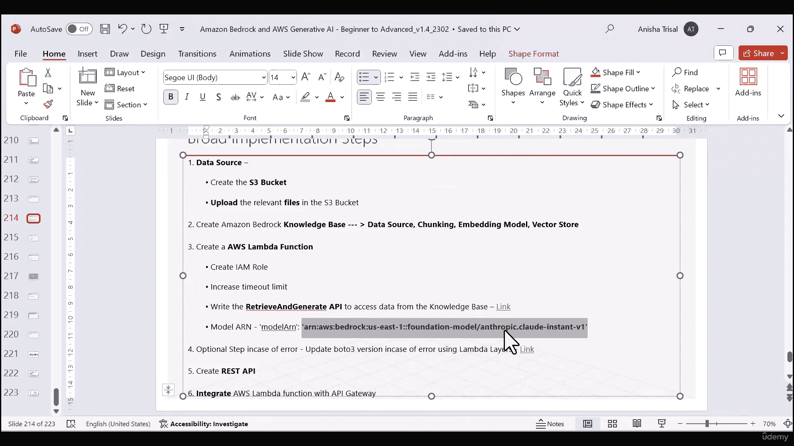

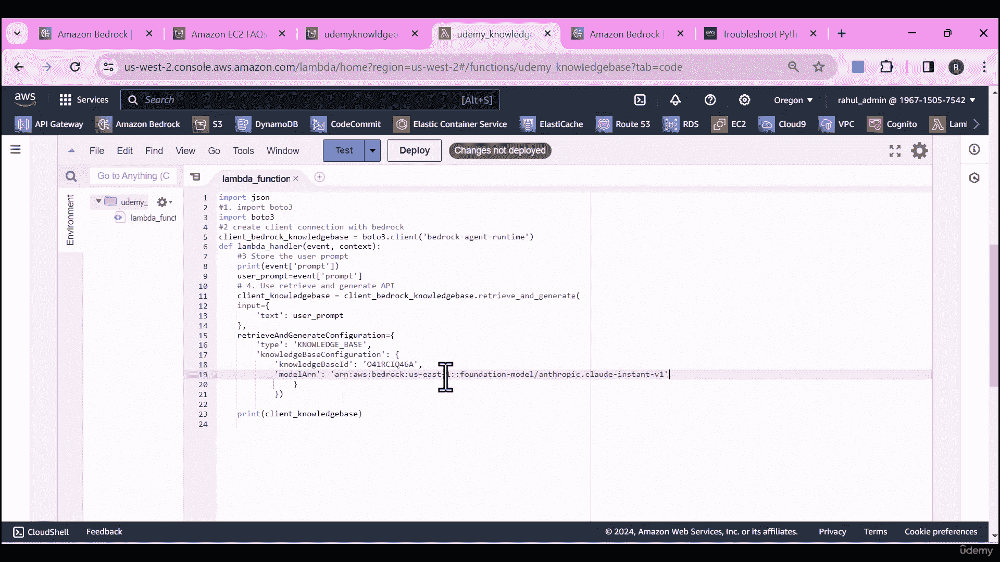

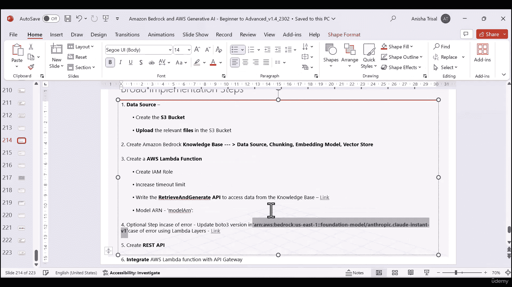

在本节课中，我们将继续完善之前创建的 AWS Lambda 函数，并验证它与 Amazon Bedrock 知识库的集成是否真的能跑通。我们会先执行一次真实测试，观察代码当前报出的错误；接着把模型替换成受支持的 Claude 基础模型，并调整 AWS 区域；然后部署函数，再通过 CloudWatch 查看完整的响应日志。重点会放在理解知识库返回的数据结构上，搞清楚 sessionId、output、text、citations、retrieveReferences 这些字段分别代表什么。之后，我们会修改 Lambda 代码，让函数只返回我们真正需要的答案字符串，并且顺便演示如何单独提取引用信息和文本。最后，我们会为了让下一步能与 API Gateway 顺利集成，把知识库的输出整理成标准的 HTTP 响应格式。这样你就能明白，一个基于知识库的问答函数内部到底发生了哪些事情。

以下是本课中要完成的主要步骤：

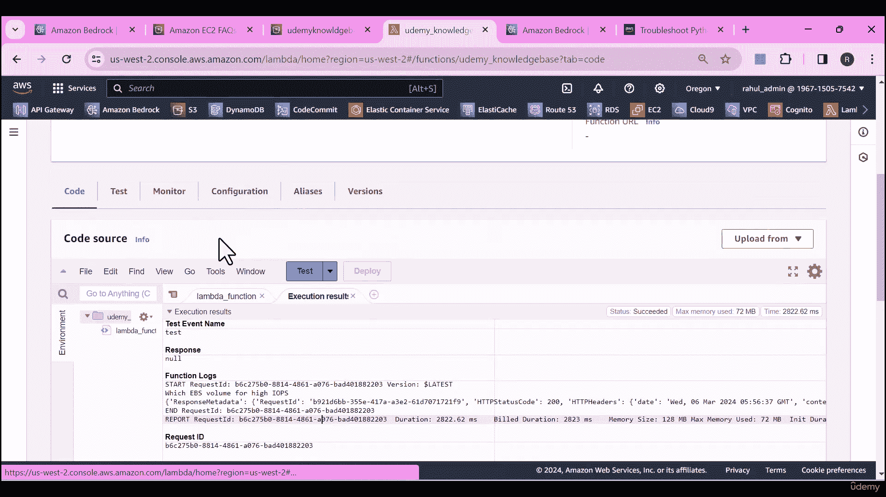

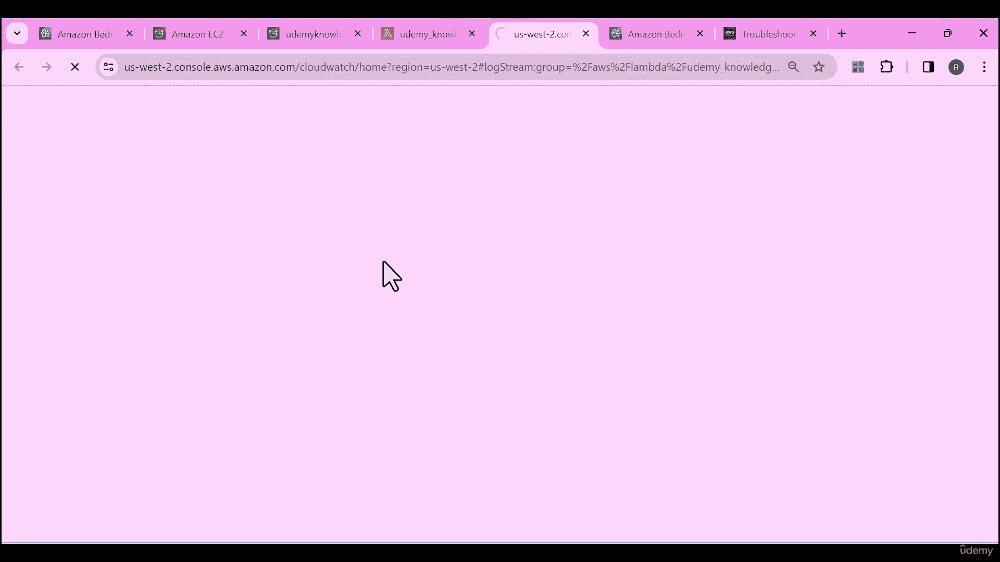

- 测试当前 Lambda 函数，观察模型不支持的错误；
- 更换为 Claude 模型并修改区域；
- 部署后通过 CloudWatch 查看完整响应；
- 理解响应数据结构；
- 修改代码，只返回答案文本；
- 演示提取引用信息；
- 调整返回值，为 API Gateway 集成做准备。

## 🧯 第一次测试：发现模型不受支持

上一节我们已经把知识库和 Lambda 函数连接好了，但连接好不代表一定能用，所以现在要做的就是上手验证。直接点击 Lambda 控制台中的“Test”按钮，发起一次测试。你很快会看到一个报错，错误类型是 validation exception。这个异常信息的意思是“校验异常”，具体描述为：The model Arn provided is not supported，也就是“提供的模型 Arn 不受支持”。换句话说，当时使用的模型标识符无法被当前的 Bedrock 知识库环境识别。

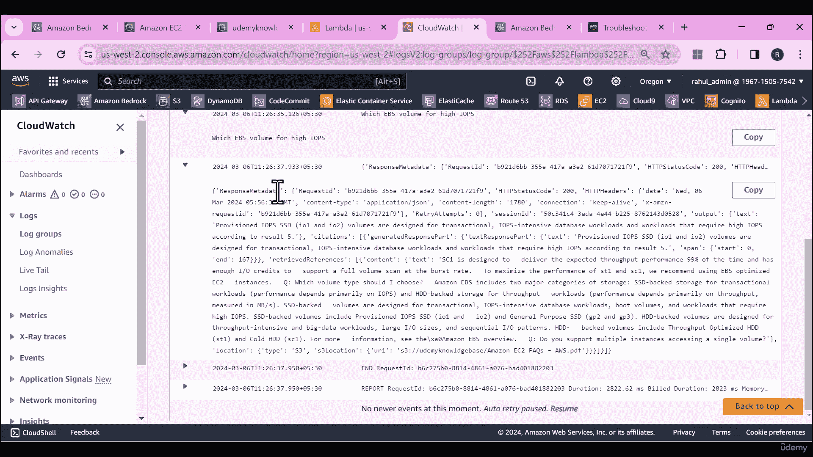

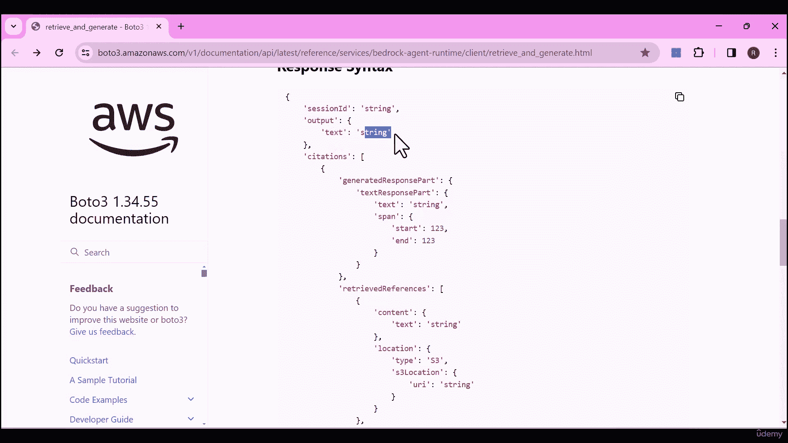

这里需要稍微解释一下背景：我们最初在知识库的配置里使用的是某个 Mistral 模型。根据当前这个区域的模型支持列表，知识库后端并不支持 Mistral 模型的调用。所以，为了能让测试继续，我们必须换一个受支持的模型。好在 Bedrock 上的 Claude 基础模型是普遍兼容的，所以接下来就把模型替换成 Claude。

以下是报错信息的核心内容：

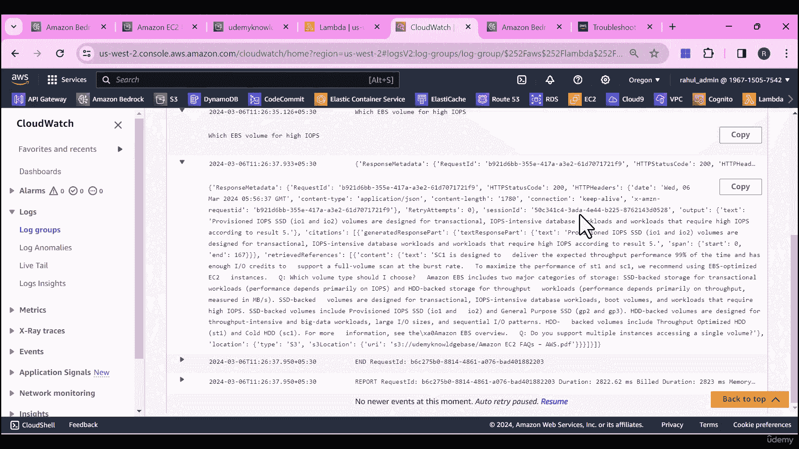

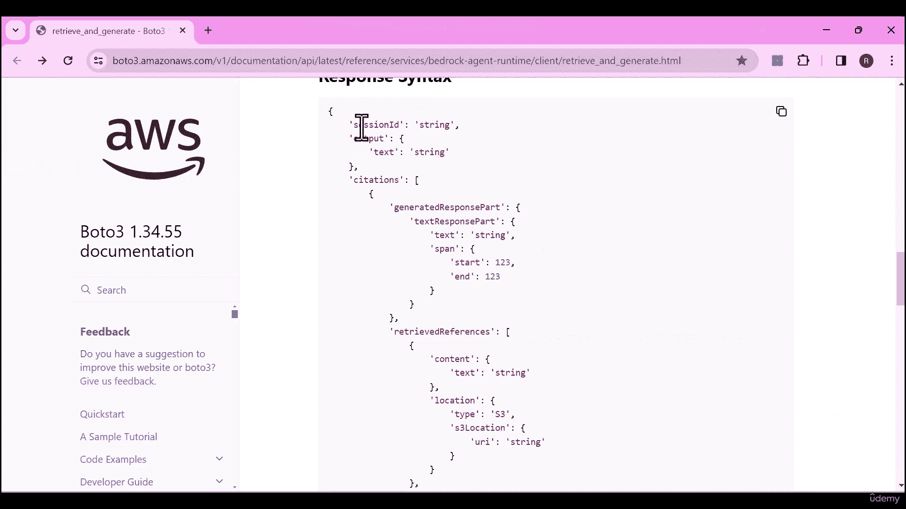

> ValidationException: The model Arn provided is not supported.

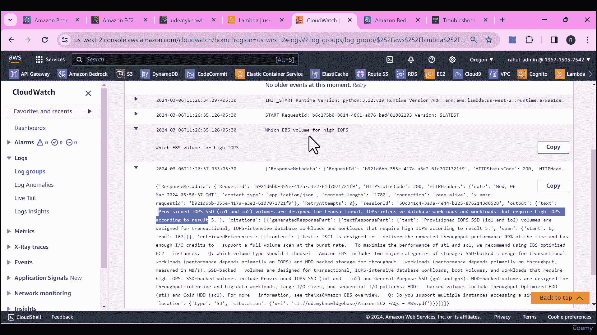

## 🔄 替换模型并修改区域

刚才那一步已经很明确地告诉我们：Mistral 模型用不了。于是我们把目光转向代码里的模型参数。先回到函数代码中，把原来写好的 Mistral 模型 Arn 注释掉，然后从文档中复制 Claude 基础模型的 Arn 粘贴过来。修改完模型之后，还有一个容易忽略的地方也必须改，那就是区域。为什么区域很重要？因为每个模型并不是在 AWS 的所有区域都默认可用，而我们的文档中明确写着这个模型位于 us-east-1，也就是美国东部（弗吉尼亚北部）区域。但你当前使用的环境是 us-west-2，也就是美国西部（俄勒冈）区域，因此需要把区域的配置改成 us-west-2。这一步不修改，后面的调用很有可能继续出现认证或模型不可用的问题。

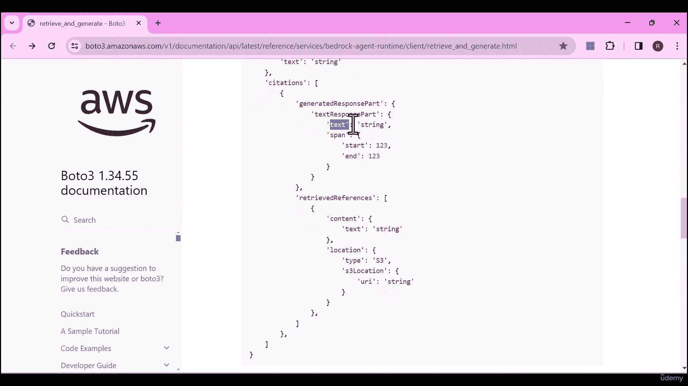

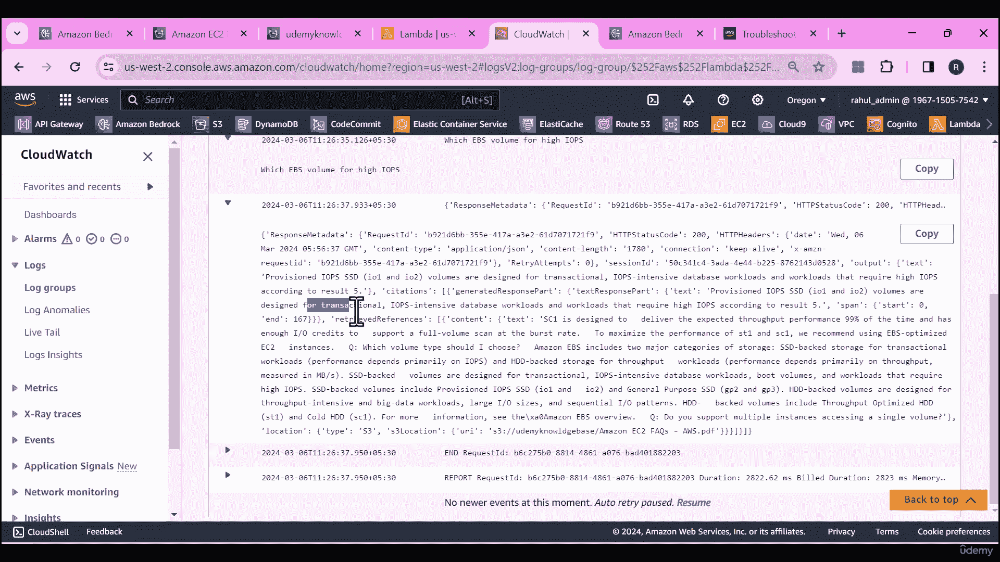

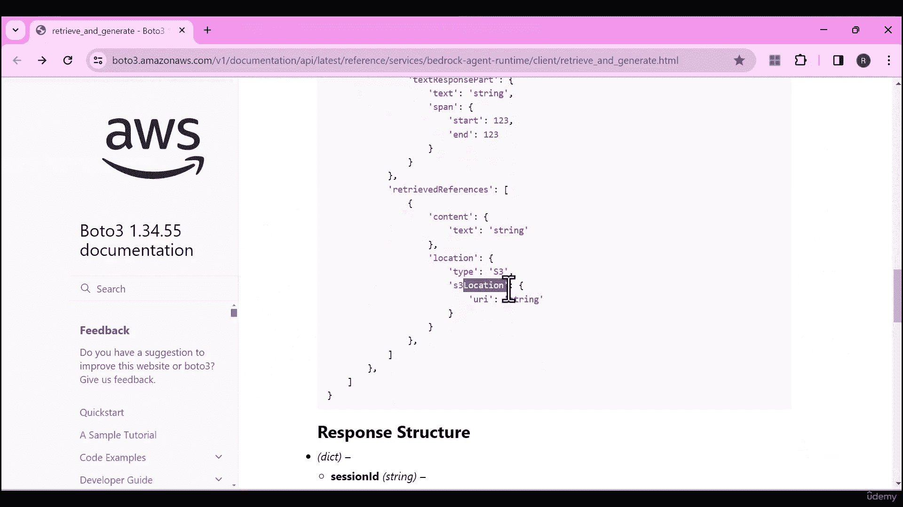

等到模型和区域都改好之后，就可以部署函数了。部署完成后，继续点击“Test”进行测试。这一次，你会看到函数顺利返回了响应。测试模板中我们提交的问题是：“Which EBS volume should I use?”（我应该使用哪种 EBS 卷？）。虽然返回的内容已经有了，但是响应看起来非常长，在 Lambda 的测试界面上不好阅读，所以接下来我们转到 CloudWatch 日志中查看完整的输出。

## 📜 在 CloudWatch 日志中观察完整响应

为了看清楚知识库到底返回了什么，我们需要在 Lambda 控制台中找到“监控”（Monitor）选项卡，然后点击“查看 CloudWatch 日志”（View CloudWatch logs）。点击之后，页面会跳转到 CloudWatch 日志组，里面会列出当前函数最近产生的日志流。打开最近的一条日志流，首先能看到的是测试模板中传入的原始提问，也就是“Which EBS volume for high IO”。再往下看，就能看到知识库返回给我们的完整响应内容。这份响应很长，里面既有元数据，也有实际的回答文本。

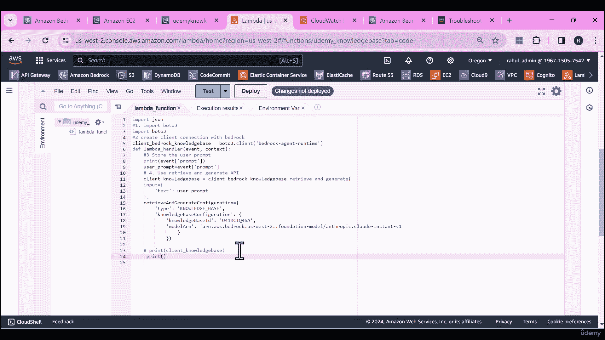

要理解这段超长响应，我们最好先查一下 Bedrock 知识库的官方文档，看看响应格式是怎么定义的。根据文档描述，响应体是一个字典，依次包含几个重要字段。第一个是 sessionId，即会话 ID，用来标识当前这一轮问答；第二个是 output，它又是一个字典，里面有一个 text 字段，这个 text 字段存放的是真正的答案字符串。当然，除了这两个之外，还有 citations 和 retrieveReferences 等额外信息。我们对照日志可以看到，确实先出现 response metadata，再出现 citation，然后才是 sessionId、output、text 这些内容。其中，实际答案的内容是：provisioned IOPS SSD volumes are designed for transactional IO-intensive database workloads，翻译过来就是“预置 IOPS 的 SSD 卷专为事务型、IO 密集型数据库工作负载而设计”。所以，整个响应的结构可以表示成下面这样：

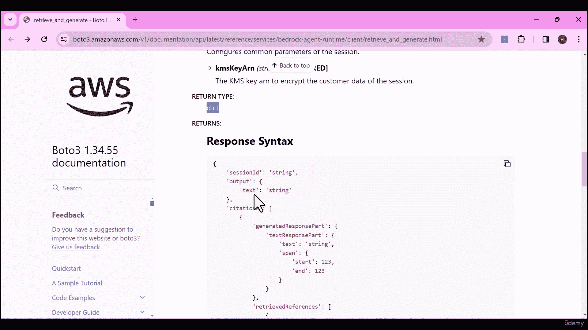

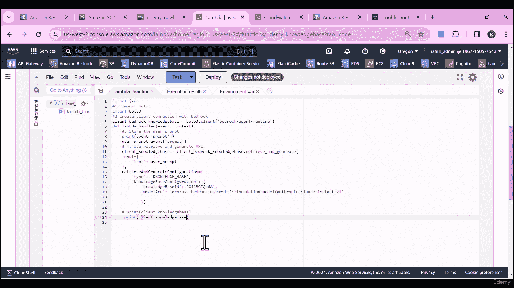

```json
{
  "sessionId": "会话ID",
  "output": {
    "text": "真正的答案文本"
  },
  "citations": [
    {
      "generatedResponse": {
        "text": "引用来源中的文本"
      }
    }
  ],
  "retrieveReferences": [
    {
      "uri": "s3://你的存储桶/文档名称.pdf"
    }
  ]
}
```

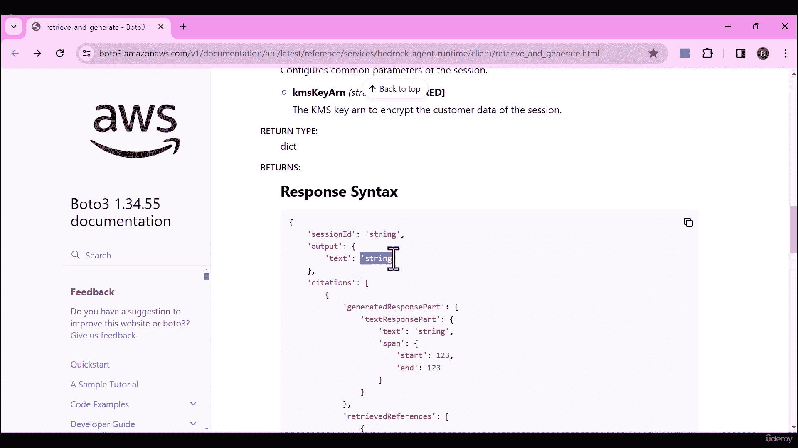

这个结构非常重要，因为你之后所有对响应的处理，本质上都是在这个字典里按照 key 一层一层取值。继续往下看，日志里还会显示 citations 字段。citations 是“引用”的意思，它负责把答案的来源展示出来。当知识库处理问题时，它会先从你上传的 PDF 文档中找出与问题最相关的段落，然后把这些段落原封不动地复制到提示词中，再交给 Claude 基础模型生成最终回答。所以，citations 里记录的就是从 PDF 里拷贝出来的那段原始文本。你可以在 generatedResponse 下面再次看到 text 字段，那个 text 就是直接从源文档拿来的内容。再往后，还有 retrieveReferences 字段，它会给出这个引用来源的 S3 存储位置。例如，S3 存储桶的 URL 以及对应的文档名都会显示出来。正因为这些步骤，知识库才能既保证回答有依据，又让用户能追溯答案来自哪个文件。

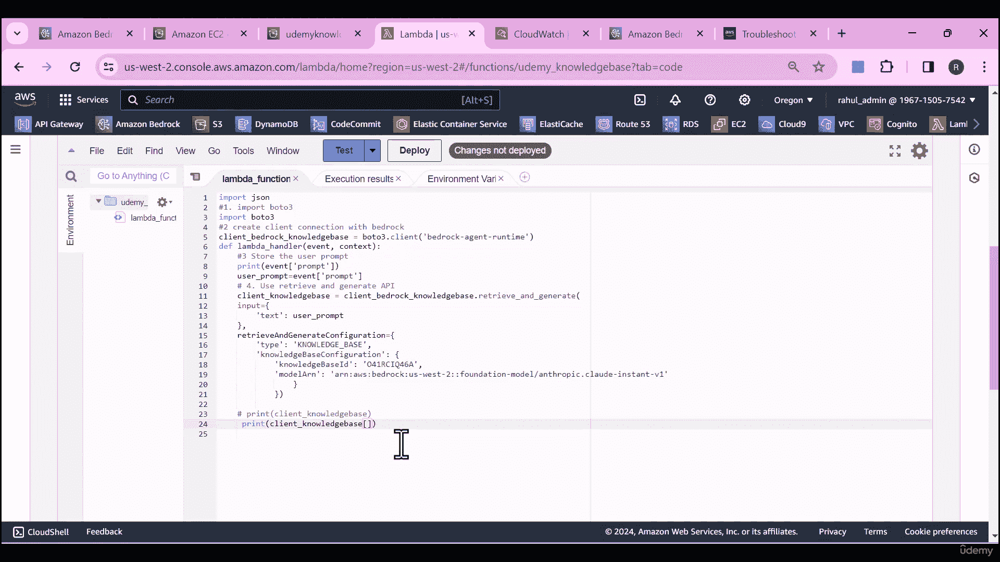

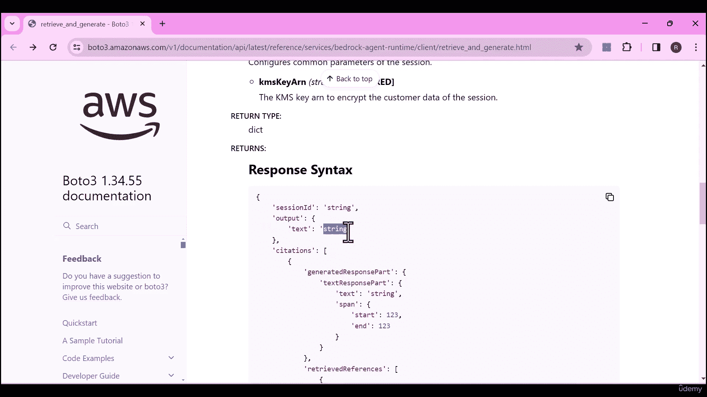

## ✂️ 让函数只返回答案文本

前面的内容已经说明了知识库返回的数据非常丰富，但在实际使用中，我们往往只想要最干净的那一句话，而不是一大坨 JSON。所以，这一节我们来对输出做一点“裁剪”。简单来说，就是写代码把 sessionId、citations、retrieveReferences 这些我们不关心的字段全部剔掉，最后只保留 output.text 里的答案文本。

还记得刚才那个响应字典吗？要拿到最终答案，我们只需要做两次字典取值。首先，整个响应的变量我们命名为 client_knowledge_base，它的类型是字典。然后我们取它的 output 键，得到一个小字典；再从这个子字典中取 text 键，这样就拿到了纯文本的答案。写成代码其实就是：

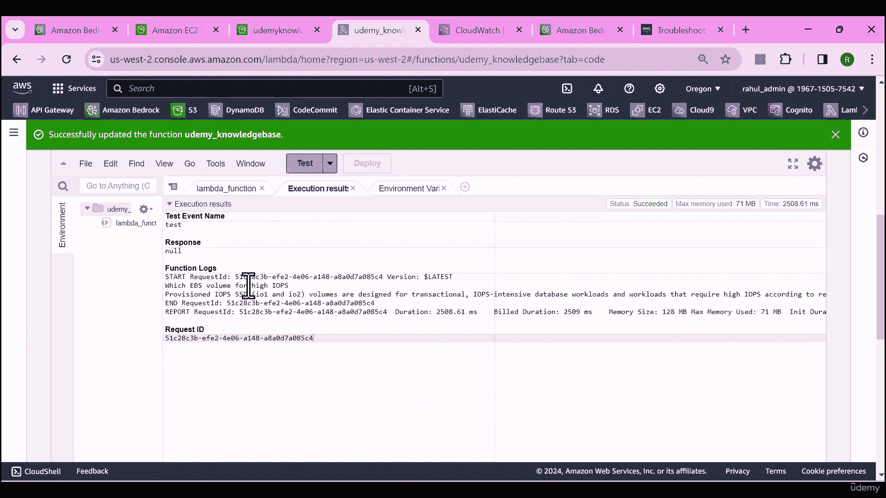

```python
# 假设 client_knowledge_base 是知识库返回的完整响应
answer_text = client_knowledge_base["output"]["text"]
```

这里其实就利用了两次键查找：第一次拿到 output 子字典，第二次从 output 子字典中拿到 text 字符串。代码写好后，保存并重新部署 Lambda。部署完毕后再次点击测试，你会立刻发现，执行结果变得非常清爽：只有一行答案，没有 citations，没有 URL，没有任何多余的信息。为了方便确认，我们还是可以去 CloudWatch 日志里看一眼，会发现虽然日志中依然记录了完整响应，但函数实际返回给调用方的只有那一句最终答案。

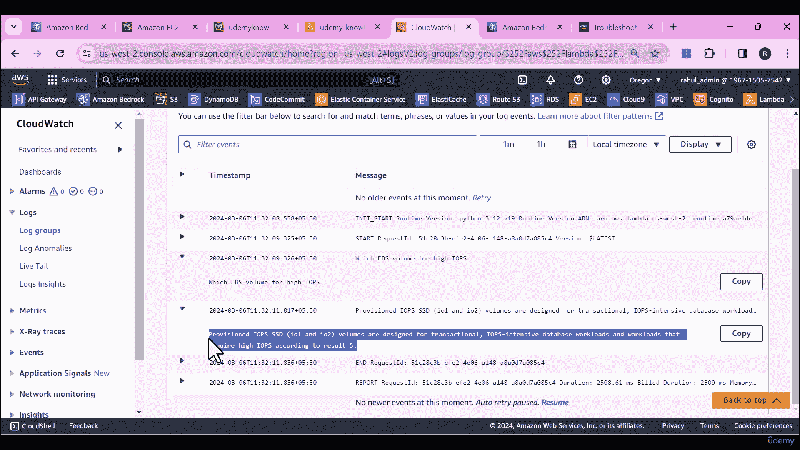

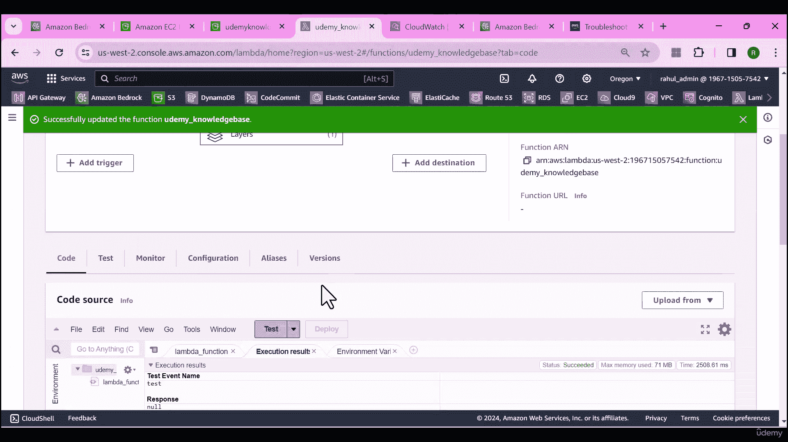

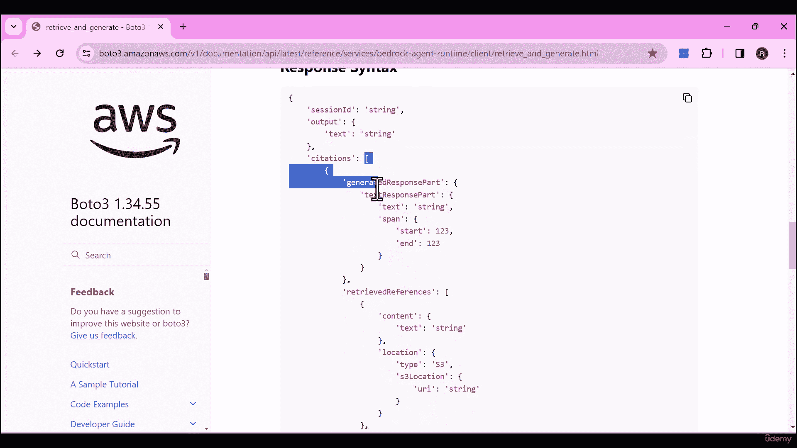

## 📚 单独提取引用信息（citations）

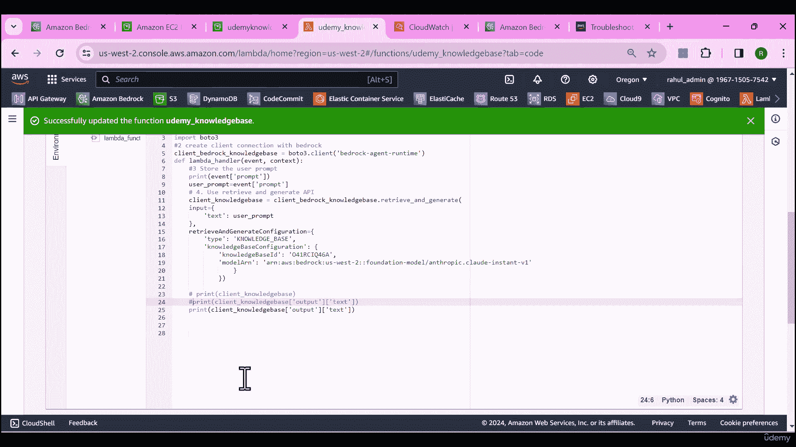

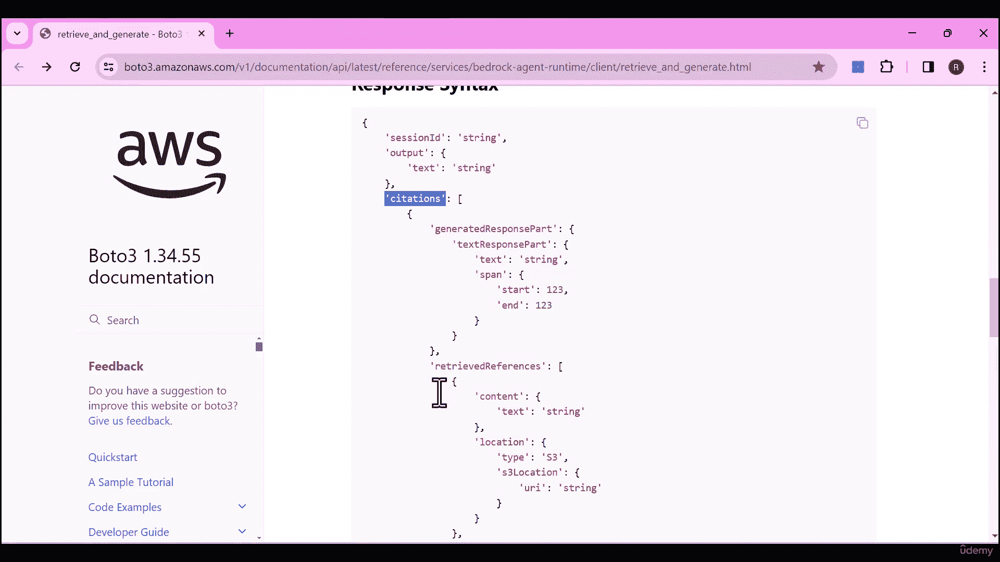

只提取答案虽然是最常见的需求，但有时候你可能希望单独拿到引用的来源信息。比如，你想知道模型是根据哪一段文档来回答的，那么你就可以对 citations 这个字段下手。同样是在响应字典中，citations 对应的值是一个列表。列表的含义是，答案可能来源于多个不同的文档片段，因此会有多条引用记录。我们可以通过位置索引来获取列表中的第一条引用，代码就是 client_knowledge_base["citations"][0]。拿到第一条引用记录之后，它仍然是一个字典，里面包含 generatedResponse 和 text 这样的键。如果你想取出那条引用中最原始的文本，就可以继续用键查找，最终得到的结果就是文档中对应位置的原文。

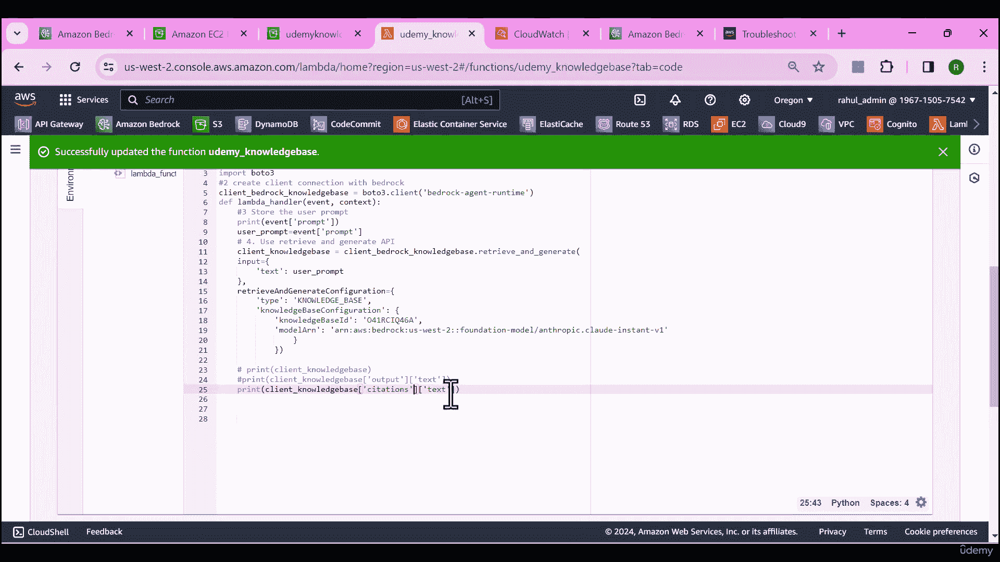

下面这段代码演示了如何只获取第一条引用中的文本：

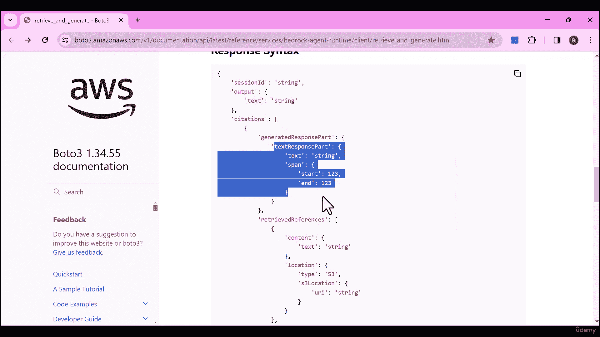

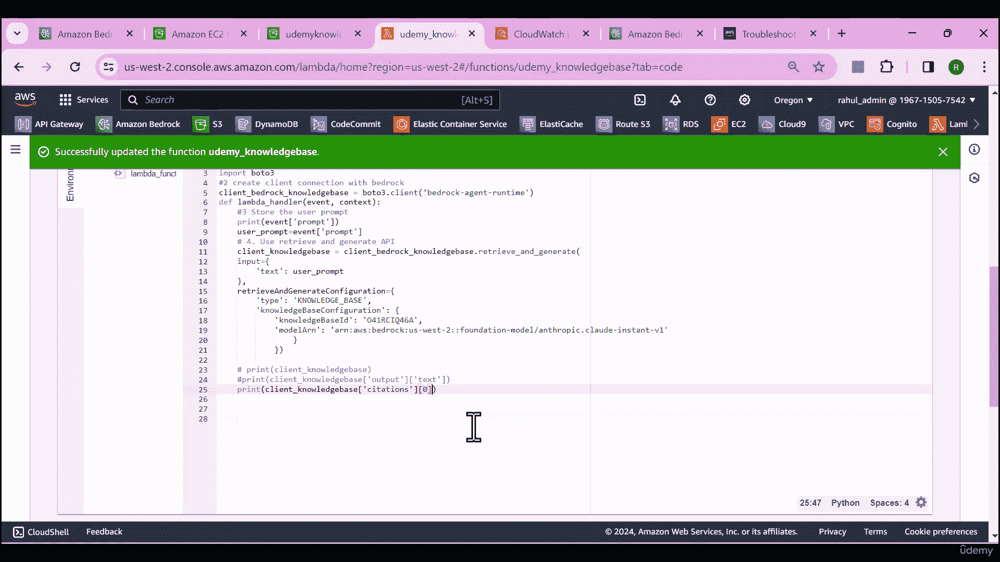

```python
first_citation_text = client_knowledge_base["citations"][0]["generatedResponse"]["text"]
```

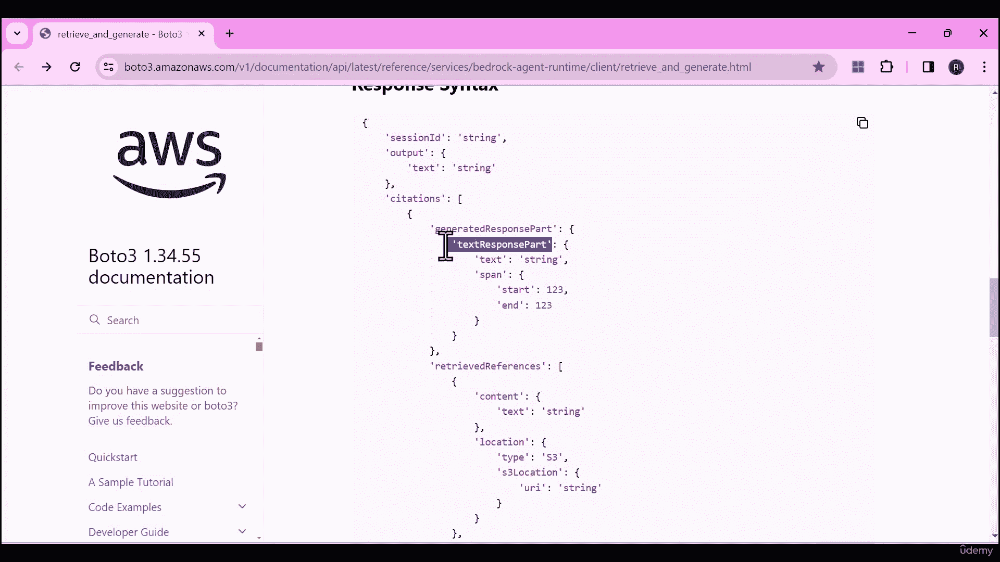

把它部署并测试，你会发现返回的内容就是某条 citation 里包含的那一段文字。这说明，通过组合字典和列表的索引，你完全可以按照自己的需求随意“摆弄”返回的数据。如果你想拿 sessionId，就取响应字典里的 sessionId；如果你想拿 S3 地址，就遍历 retrieveReferences。总之，知识库的响应对你来说就是一层一层可拆解的容器。不过，我们这次的目的只是为了验证这种方法，所以看完结果之后就可以把这段代码注释掉，恢复成返回答案文本的状态。

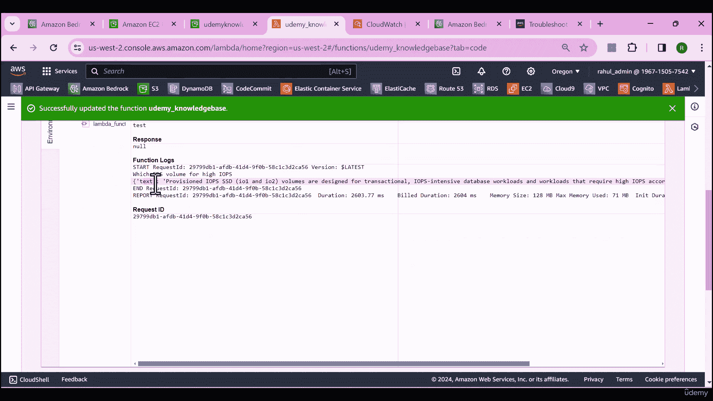

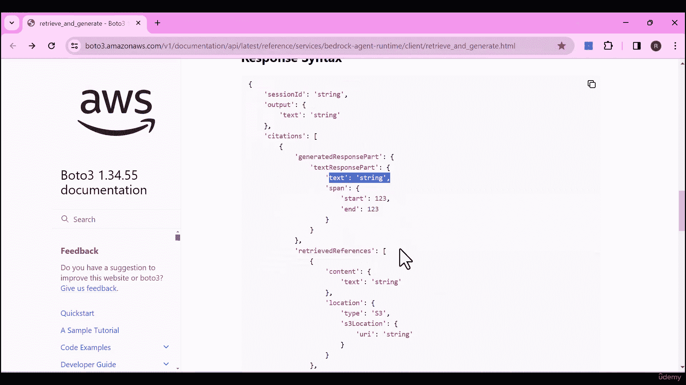

## 🚀 为 API Gateway 集成准备 Lambda 返回值

前面所有的操作其实都在为后续真正上线做准备。因为我们下一步打算把这个 Lambda 函数通过 API Gateway 暴露成 HTTP 接口，所以函数最终返回的格式必须符合 API Gateway 对 Lambda 代理集成的约定。API Gateway 希望 Lambda 返回一个包含 statusCode 和 body 的 JSON 对象，而不是一串纯文本。因此，我们需要在函数里构造一个标准的返回结构。

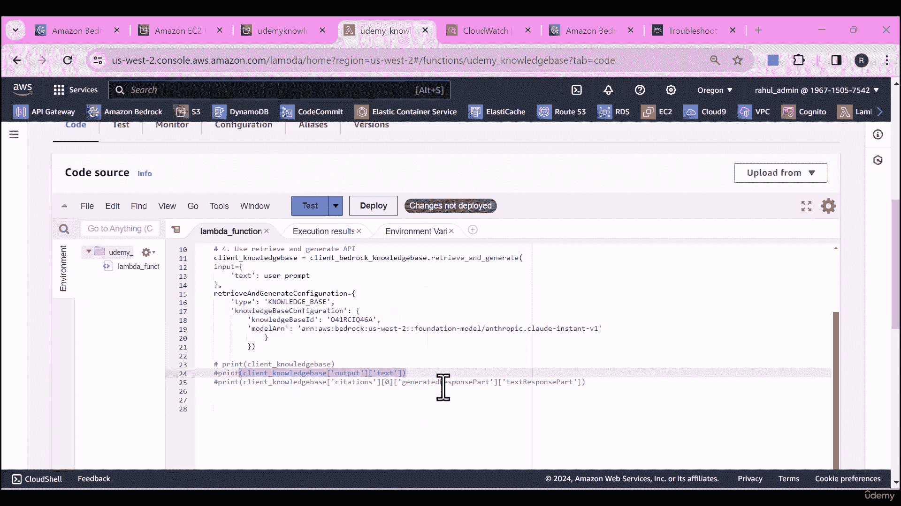

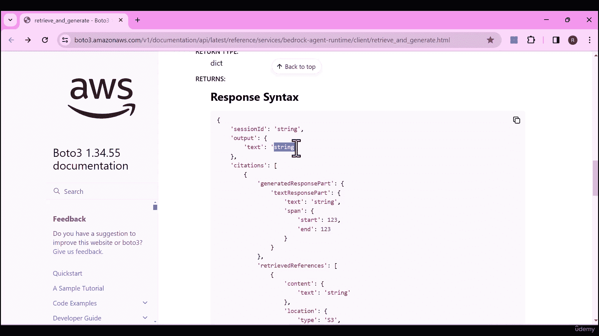

具体思路如下：首先，创建一个变量，名字可以取成 response，用来承载最终要返回给调用方的答案字符串。这个字符串的来源还是知识库响应中的 output.text，也就是我们刚才已经成功提取过的值。然后，我们使用 return 语句返回一个字典，字典里包含两个键。第一个键是 statusCode，值设为 200，代表成功；第二个键是 body，值就是 response 变量。这样，将来用户通过 API Gateway 调用时，就能收到一个 HTTP 状态码以及包含答案的响应体。可以看看下面这段示意代码：

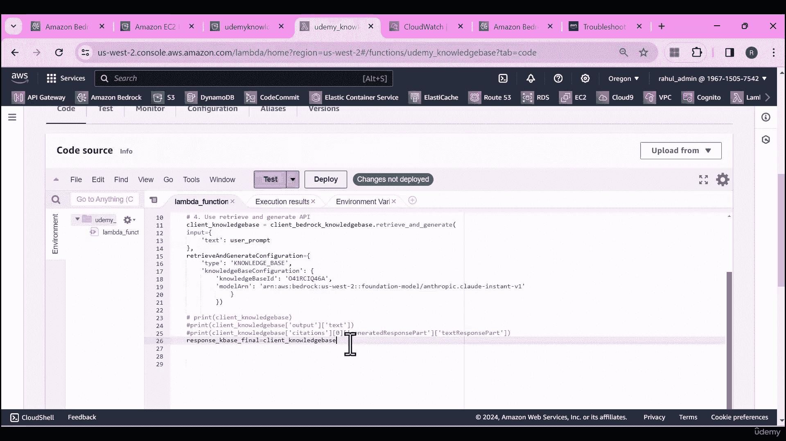

```python
response = client_knowledge_base["output"]["text"]
return {
    "statusCode": 200,
    "body": response
}
```

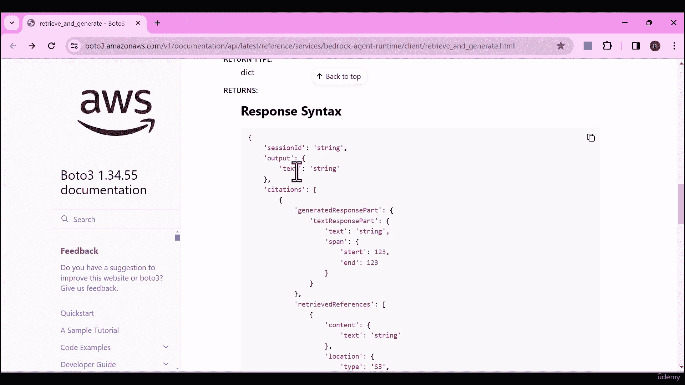

这里还有一个细节要提醒一下：在 Lambda 的测试面板中，你可能会觉得返回 body 时直接放一个字符串有点奇怪，但这完全没问题。API Gateway 会把这个字符串放进 HTTP 响应的 body 字段里，浏览器或者客户端就能直接读到了。改好代码之后，继续部署并点击测试。这次测试返回的结果终于变成了预期的样子：statusCode 是 200，body 就是知识库回答的文字内容。看到这个结果，说明我们离最终的 API 集成只剩一步之遥。下一节课，我们就会把这个 Lambda 函数正式挂到 API Gateway 后面，让外部请求也可以通过 HTTP 来使用知识库问答能力。

## ✅ 本节总结

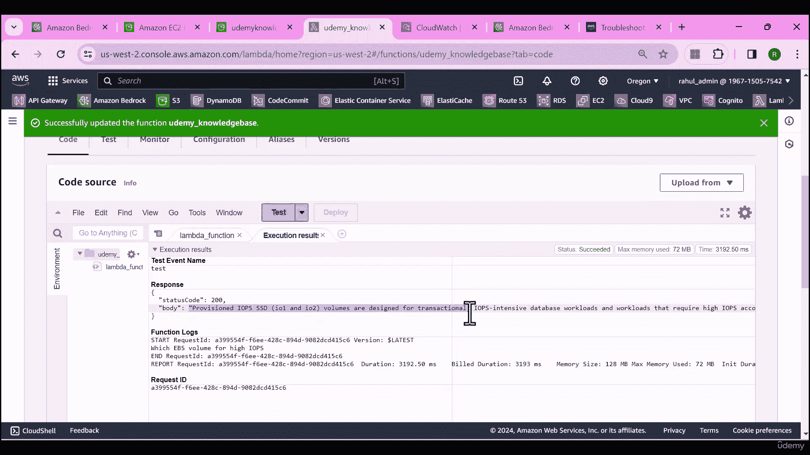

本节课中，我们一起完成了知识库与 Lambda 函数的联调。首先，我们通过一次测试发现了 Mistral 模型不受支持的问题，然后把它替换成了 Claude 基础模型，并且把区域从 us-east-1 改成了 us-west-2。部署成功之后，我们在 CloudWatch 日志中仔细分析了知识库返回的完整响应，理解了 sessionId、output、text、citations、retrieveReferences 这些字段的含义。接着，我们修改 Lambda 函数，让它只提取 output.text 中的纯文本答案。随后我们又演示了如何单独获取 citations 列表中的引用文本，证明了对响应数据的灵活操控是完全可行的。最后，为了对接 API Gateway，我们把函数返回值重构为 statusCode 200 和 body 的结构。下一节课，我们将把这个 Lambda 函数与 API Gateway 集成，敬请期待。
