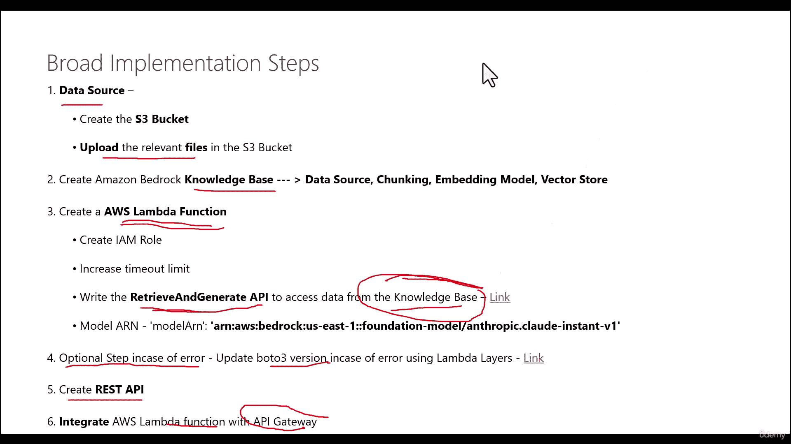
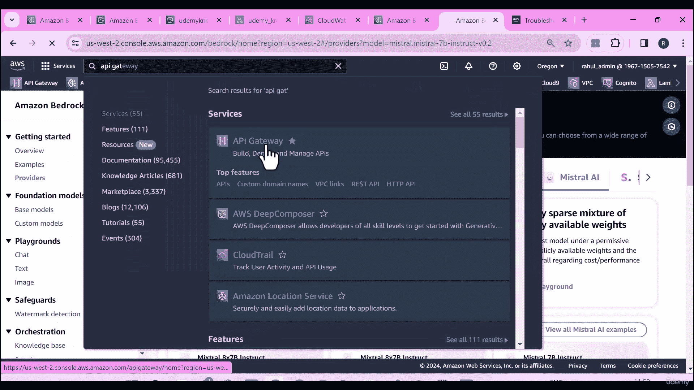
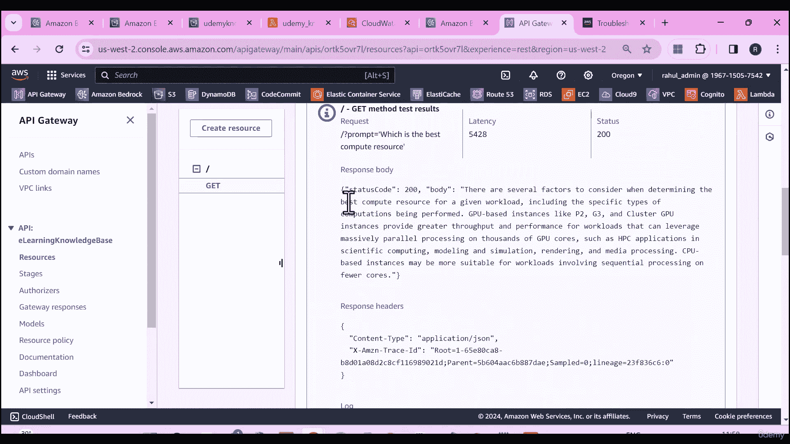

# AWS生成式AI实战：63-65：知识库REST API创建与Lambda集成 🚀

在本节课中我们将要学习如何使用AWS API Gateway创建一个REST API，并把这个REST API与前面已经创建好的Lambda函数集成起来。这样做的目的很直接：当用户调用REST API并传入一个问题作为提示词时，REST API会调用Lambda函数，Lambda函数再去查询Amazon Bedrock知识库，最后把检索到的答案返回给用户。整个流程把用户输入、Lambda函数和知识库连接在一起，是构建生成式AI应用时非常常见的一种做法。

上一节我们已经完成了知识库和Lambda函数的基础工作，本节我们来看看如何把REST API这一层补上。为了把上下文接起来，先回顾一下前面已经完成的实现步骤。以下是整体实现步骤的回顾，方便你确认当前进度：





- 我们已经创建了数据源，并把文件上传到了S3存储桶。
- 我们已经创建了知识库。
- 我们已经创建了AWS Lambda函数，并使用retrieve and generate API访问知识库中的数据。
- 我们还查看了一个可选步骤：如果出现错误，可以上传Boto3版本进行处理。

回顾完这些步骤后，本节的重点就落到REST API和Lambda函数的集成上。接下来我们会打开AWS API Gateway，创建一个REST API，配置方法和参数，再把API部署到阶段并进行测试。下面先进入创建REST API的环节。

# AWS生成式AI实战：63-65：创建REST API 🧱

上一节回顾了知识库、Lambda函数和retrieve and generate API的作用，本节我们来看看如何创建REST API。具体操作是搜索API Gateway，进入AWS API Gateway服务。进入服务后，选择REST API，点击build，然后新建一个API。这里可以把API命名为E-Learning知识库API，API端点类型保持为regional，最后点击create API完成创建。这个REST API会成为用户访问Lambda函数和知识库的入口。

创建完REST API后，如果查看步骤，下一步就是创建资源和方法。前面已经创建了资源，现在需要创建方法。以下是创建方法的具体操作，目的是让API Gateway把请求交给Lambda函数：

- 点击create method。
- 选择API Gateway和Lambda函数作为集成类型。
- 复制前面Lambda函数的名称，并粘贴到对应位置。
- 确认区域为US West-2。
- 点击create method完成创建。

方法创建完成后，还需要对方法请求做一些修改。接下来我们进入method request配置，添加查询字符串输入参数，并启用请求验证器。以下是方法请求中需要完成的两项配置，它们决定了用户传入的prompt能否被正确接收和校验：

- 在URL query string parameters中添加输入参数。
- 启用请求验证器，验证请求体、查询字符串参数和请求头。

这两项配置都在method request中完成。先进行验证配置：找到request validator并点击进入，然后设置URL query string parameter。查看Lambda函数代码可以看到，事件对象中使用的变量名是prompt，因此这里提供的参数名也应该是prompt。这样用户通过REST API传入的prompt就会作为Lambda函数的用户输入，存入user prompt变量，并发送给基础模型。配置完成后点击save保存。

方法请求配置好之后，下一步是配置API Gateway的集成请求。上一节我们完成了方法请求和参数验证，本节我们来看看如何把请求映射到Lambda函数。以下是集成请求的配置步骤，重点是映射模板和内容类型：

- 进入integration request并点击edit。
- 找到mapping template并添加映射模板。
- 内容类型填写application/json。
- 在template body中粘贴课程提供的模板内容。
- 注意引号、单引号和转义字符的写法，否则后续调用API时可能报错。
- 点击save保存配置。

集成请求保存后，还需要把API部署到阶段。每次修改API后都必须重新部署到阶段，否则修改不会生效。以下是部署和测试前的准备步骤，确保API处于可用状态：

- 选择deploy API。
- 新建一个stage，名称可以任意填写，例如dev。
- 点击deploy完成部署。

部署完成后就可以测试API了。接下来回到左侧资源列表，点击GET方法，再点击test进行测试。为了方便查看，可以把界面稍微向左移动。前面配置的查询字符串参数是prompt，因此测试时传入同样的问题，例如“哪种计算资源最好”。前面已经上传了一些关于EC2实例的PDF资料，所以这里正好可以用这个问题验证知识库检索和生成答案的效果。点击test后，如果返回状态码200和响应体答案，就说明整个REST API到Lambda再到知识库的链路已经打通。响应体中会说明确定最佳计算资源时需要考虑多个因素，并给出更多细节。

测试成功后，还可以回到Lambda函数查看当前配置。由于前面只选择了final answer，所以响应中只返回最终答案。如果需要了解答案是如何得到的、引用了哪份文档、文档位置在哪里等细节，还可以启用citation引用信息。到这里，REST API创建、Lambda集成、部署和测试的完整流程就完成了。

# AWS生成式AI实战：63-65：课程总结 🎯

本节课中我们一起学习了如何创建知识库REST API，并将其与Lambda函数集成。我们回顾了数据源上传、知识库创建、Lambda函数创建以及retrieve and generate API的使用，然后通过API Gateway创建REST API，配置方法请求、prompt查询参数、请求验证器、集成请求映射模板，最后部署到阶段并完成测试。整个调用关系可以概括为下面的流程：

```text
用户问题(prompt)
    → REST API
    → Lambda函数(event.prompt)
    → Amazon Bedrock知识库检索与生成
    → 返回最终答案
```



本节课程到此结束，希望你喜欢这节课，谢谢。

