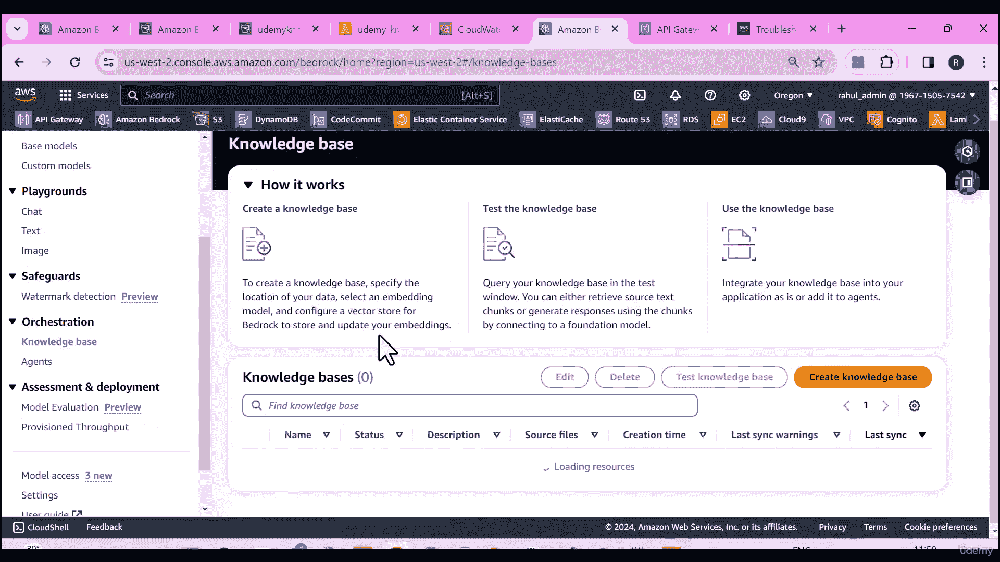
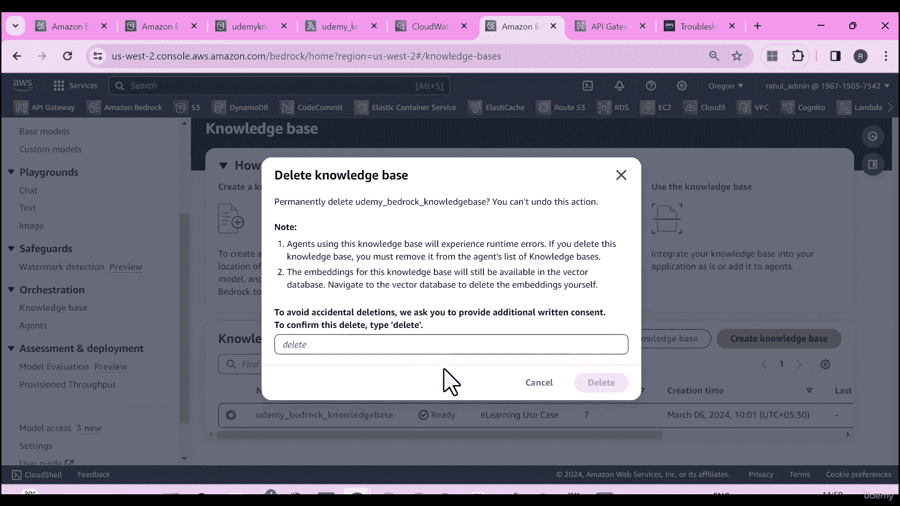
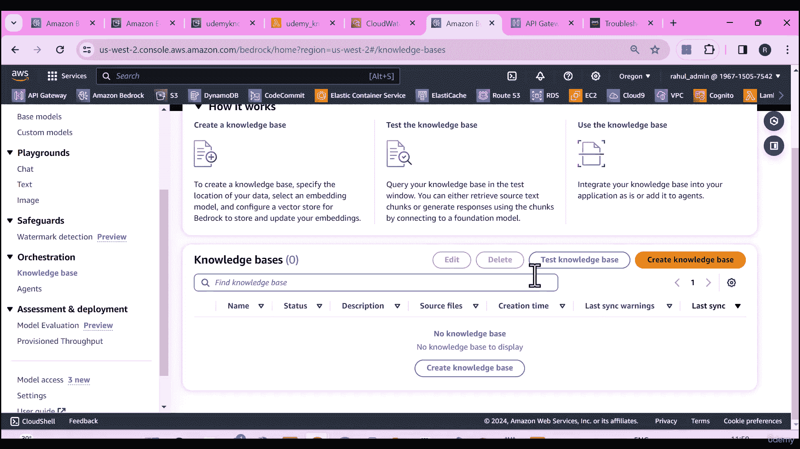
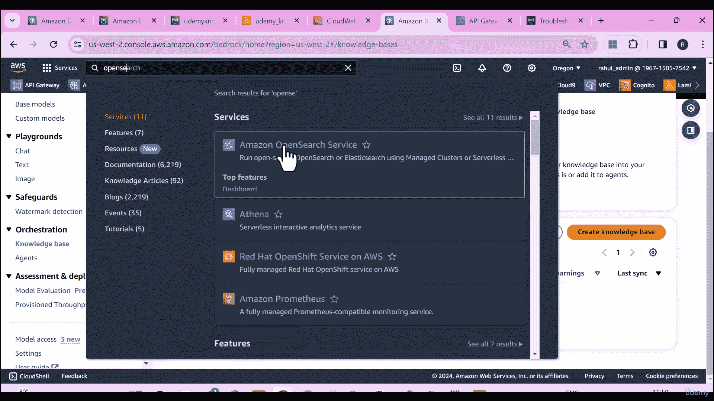
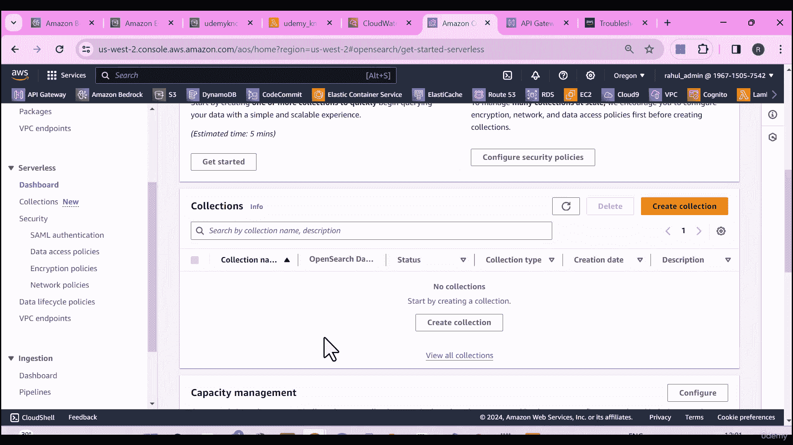

# Amazon Bedrock 生成式 AI 实战：p64-p66：清理知识库以避免额外费用 🧹💸

在本节课中，我们将要学习如何清理 Amazon Bedrock 中的知识库，并进一步清理知识库背后自动创建的 OpenSearch 向量资源。这个操作看起来只是点几下删除按钮，但实际很重要，因为如果只删除知识库而忘记清理关联资源，就可能继续产生费用。很多初学者会以为删除知识库就结束了，实际上还需要检查 OpenSearch Serverless 中的向量存储和集合，确保没有遗留资源在运行。

为了更直白地理解清理范围，可以把核心概念记成下面这个公式。清理知识库不是单一步骤，而是要把知识库和它关联创建的向量资源一起处理掉。

\[
\text{Cleanup} = \text{Delete Knowledge Base} + \text{Delete OpenSearch Serverless Vector Resources}
\]

上一段我们明确了“完整清理”的范围，本节中我们来看看具体在控制台里怎么操作。首先进入 Amazon Bedrock 控制台，然后找到 Knowledge bases 页面；在这个页面中会看到已经创建好的知识库。下面给出删除知识库的具体步骤，按顺序执行即可。

以下是删除 Amazon Bedrock 知识库的步骤：

1. 打开 Amazon Bedrock 控制台，进入 Knowledge bases（知识库）页面。
2. 在页面中找到已经创建好的知识库。
3. 点击这个知识库，然后点击 Delete（删除）。
4. 按提示确认删除，等待控制台完成删除操作。

完成上述操作后，你会看到知识库已经被删除。这个删除动作非常重要，因为不删除知识库就可能持续被收费。不过，这里还有一个容易被忽略的点：在尝试清理时可能会发现，创建知识库的同时还会创建一个 OpenSearch 向量数据库；而删除知识库并不会自动删除这个向量数据库。因此，还必须前往 OpenSearch 服务中手动清理对应资源。

既然只删除知识库还不够，下一步就要进入 Amazon OpenSearch Service 继续处理。下面给出清理 OpenSearch Serverless 向量资源的步骤，重点是找到知识库创建的向量存储、向量搜索和集合，并确认它们都被删除。

以下是清理 OpenSearch Serverless 向量资源的步骤：

1. 打开 Amazon OpenSearch Service 控制台。
2. 进入 Serverless（无服务器）部分，查看 Dashboard（仪表盘）。
3. 在仪表盘中找到为知识库创建的 vector store（向量存储）和 vector search（向量搜索）相关资源。
4. 点击对应资源并执行 Delete（删除），按提示确认删除。
5. 删除后检查 collection（集合）中是否还有内容，确保没有遗漏。

完成这些操作后，可以看到相关资源正在删除或已经删除。需要在 Dashboard 中确认清理干净，这样费用就只会按照实际使用时间计算。同时还要监控费用，因为费用通常每 24 小时更新一次；过一段时间再检查账单，可以确认没有遗留资源继续运行。

本节课中我们一起学习了清理知识库的完整流程：先在 Amazon Bedrock 中删除 Knowledge Base，再进入 Amazon OpenSearch Service 的 Serverless Dashboard 删除关联的向量存储、向量搜索和集合，最后检查 collection 并监控费用更新。只有把知识库和关联向量资源都清理掉，才能避免不必要的持续收费。

