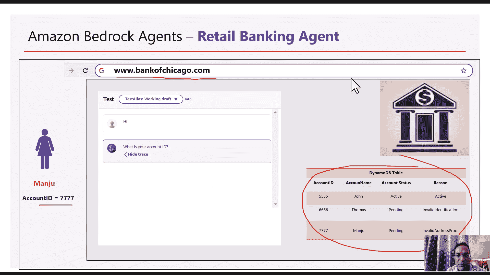
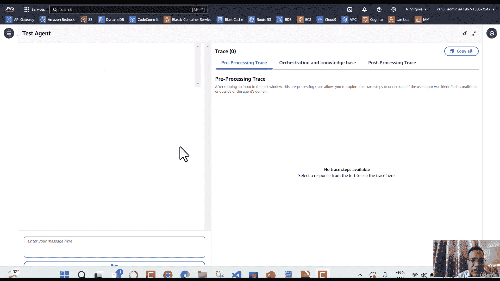
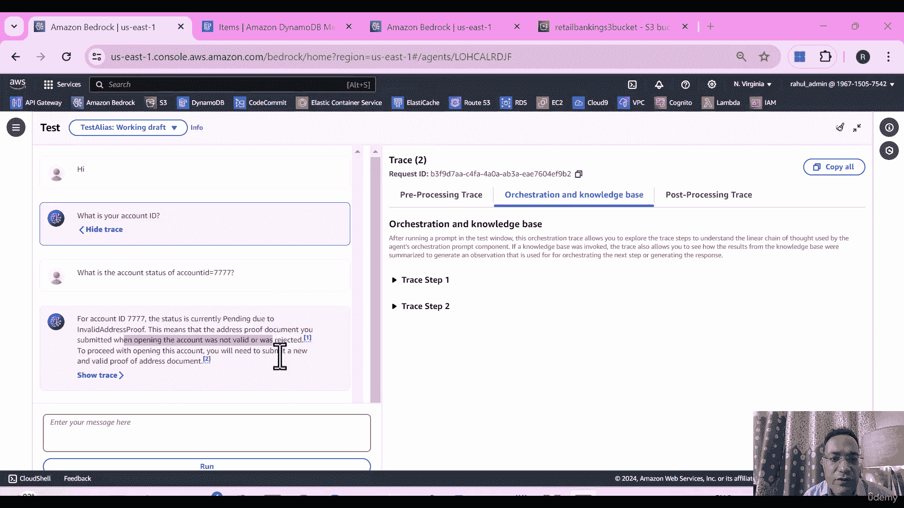
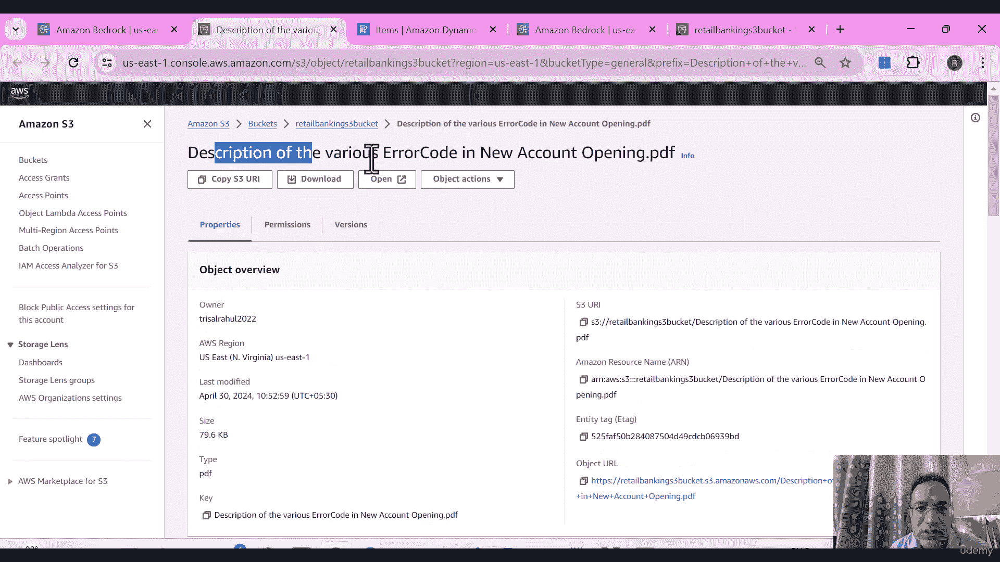
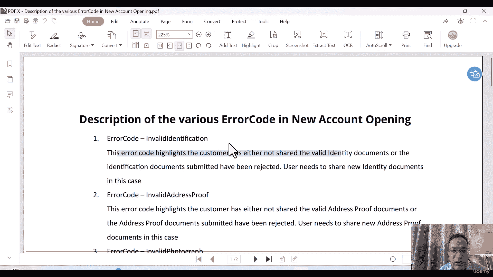
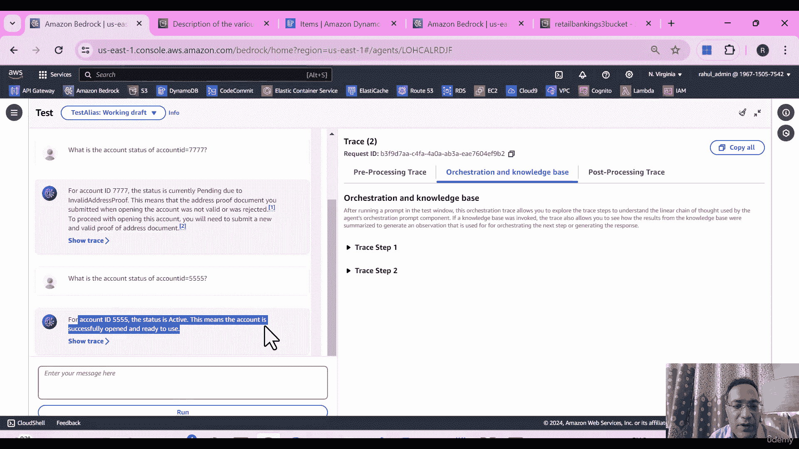
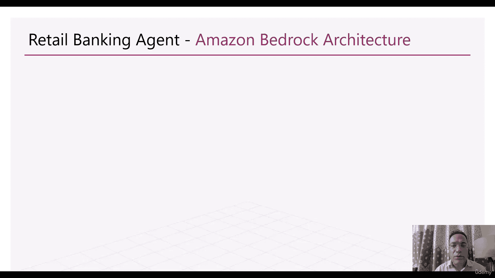

# 🏦 生成式AI在AWS上：65-67：构建Amazon Bedrock零售银行Agent演示


在本节课中我们将要学习如何用 Amazon Bedrock Agents 构建一个零售银行 Agent，并查看它的实际演示。这个用例会从三个客户开立支票账户或储蓄账户的场景出发，先理解临时账户 ID、DynamoDB 状态表和账户状态之间的关系，再进入 Bedrock Agent 的控制台观察真实问答过程。演示中还会看到 Agent 如何同时连接结构化数据源与基于文档的 RAG 知识库，并显示引用来源。最后我们会把演示收束到架构构建环节，为后续实现打基础。


## 🧭 生成式AI在AWS上：65.1：零售银行Agent的用例背景


上一节概述了本课目标，本节中我们来看看这个零售银行用例的具体背景。这里要使用的核心工具是 Amazon Bedrock Agents，目标是创建一个零售银行 Agent。为了讲清楚这个 Agent 要解决什么问题，课程先举了一个开户例子，例子中的三个银行客户分别是 John、Thomas 和 Manju，他们都在尝试开立新的支票账户或储蓄账户。三个人住在 Chicago，附近有一家虚构的 Bank of Chicago，这家银行面向任何开立新支票账户或储蓄账户的人提供 500 美元 credit。于是三个人前往银行开户，提交了所需文件，银行随后给他们每人一个临时账户 ID。银行还要求他们三天后回到银行网站查询新账户状态。


下面列出三个客户和银行给出的临时账户 ID，这些 ID 就像取号单一样，是后续查询账户状态的入口。


- John：临时账户 ID 为 5555。
- Thomas：临时账户 ID 为 6666。
- Manju：临时账户 ID 为 7777。


用代码表示这个映射关系如下：

```text
John   -> 临时账户 ID 5555
Thomas -> 临时账户 ID 6666
Manju  -> 临时账户 ID 7777
```


在这三天里，假设 Bank of Chicago 创建了一张 DynamoDB 表，并根据之前提供的临时账户 ID，评估三位客户提交的文件，判断账户状态是 active 还是 pending。DynamoDB 可以理解成银行内部的一张状态查询表，它保存的是银行审核文件后得到的结果。审核结果中，John 的账户状态是 active，因为他的所有文件都有效；Thomas 的身份无法被验证；Manju 的状态仍然是 pending，因为他的地址证明无法被验证。此时这张 DynamoDB 表就是银行查询账户状态的 proof source，也就是事实来源。


下面列出 DynamoDB 表中三个客户的审核结果，方便和后面的 Agent 回答对照。


- John：账户状态为 active，原因是文件有效。
- Thomas：账户状态为 pending，原因是无法验证身份。
- Manju：账户状态为 pending，原因是无法验证地址证明。


用代码表示这张 DynamoDB 表的核心数据如下：

```text
account_id: 5555 -> name: John   -> status: active  -> reason: valid documents
account_id: 6666 -> name: Thomas -> status: pending -> reason: invalid identification
account_id: 7777 -> name: Manju  -> status: pending -> reason: invalid address proof
```




三天后，Manju 打开 Bank of Chicago 网站，已知他的临时账户 ID 是 7777，于是他登录 Agent 并提出一个问题。到这里，用例背景已经铺好，接下来我们进入实际演示，看看这个 Agent 如何回答问题。




## 🖥️ 生成式AI在AWS上：65.2：实际演示与Trace观察


上一节介绍了客户、临时账户 ID 和 DynamoDB 状态表，本节中我们来看看已经构建好的零售银行 Agent 在 Bedrock 控制台中的实际表现。这个 Agent 是为零售银行场景构建的，演示的第一步就是直接测试它。进入 Bedrock Agent 后，先向它提出一个问题。演示中先从一句 “hi” 开始，观察 Agent 的响应。Agent 会询问 account ID 是什么，同时在右侧可以看到 trace 信息。trace 可以理解成 Agent 在后台思考和调用工具的过程记录，课程后面会进一步讨论。这里先记住 trace 有三类。


下面列出演示中提到的三类 trace，它们分别对应 Agent 处理请求的不同阶段。


- preprocessing trace：预处理 trace。
- orchestration and knowledge base trace：编排与知识库 trace。
- post processing trace：后处理 trace。


随后演示中输入 account ID。此时 Manju 想确认自己新开账户的状态，临时账户 ID 是 7777，于是把问题粘贴进去并提交。Agent 返回的答案是：account ID 7777 当前状态为 pending，原因是 invalid address proof。接着打开 DynamoDB 表，这张表是银行创建的，可以看到 account ID 7777 对应名称 Manju、账户状态 pending、原因 invalid address proof，与 Agent 的回答一致。Agent 还进一步解释，这意味着开户时提交的地址证明文件无效并被拒绝，同时补充了一些说明数据，并显示 citation 引用来源。


演示中的问答关系可以用引用块表示如下。


> 用户问题：account ID 7777 的账户状态是什么？
>
> Agent 回答：account ID 7777 当前状态为 pending，原因是 invalid address proof。


看到回答和引用后，自然会问一个问题：这个答案到底来自哪里？上一节已经看到 DynamoDB 表中有状态数据，但 Agent 的回答里还包含解释性内容和引用，所以本节演示引出了下一节要讲的答案来源问题。


## 📚 生成式AI在AWS上：65.3：答案来源、RAG与Knowledge Base


上一节看到 Agent 回答了 Manju 的账户状态并显示 citation，本节中我们来看看这些答案的来源。前面讨论过，Agent 既可以连接 RDS、DynamoDB 这类数据源，也可以连接基于 RAG 的解决方案，也就是 retrieval augmented generation，检索增强生成。也就是说，Agent 的来源之一可以是 PDF 文档，Agent 能读取文档并检索答案。演示中点击 citation 后，可以看到内容位于 S3 bucket 中，这个 S3 bucket 会在本用例中创建。该文档描述的是新开户过程中各种错误码的说明。这个 PDF 文档是示例中创建的，用来解释错误码含义，例如 invalid identification error code 表示什么。这里的内容是示例性编造的，含义可以理解为没有提供有效身份文件。重点在于，Agent 既能连接 DynamoDB、RDS 这样的内部数据源，也能构建基于 RAG 的解决方案，让 Agent 从 PDF 或其他数据源中检索数据。对于 RAG 方案，Amazon Bedrock Agent 使用的是 Knowledge Base，也就是知识库。如果不了解 Knowledge Base，可以查看另一个用例，那个用例讲如何构建一个 e-learning 应用，其中使用了 Knowledge Base。


用公式表示这个 Agent 的答案来源如下：

```text
回答 = Agent(用户问题, 结构化数据源, 知识库文档)
```

也可以写成更具体的形式：

```text
回答 = Agent(
  用户问题 = "account ID 7777 的状态是什么",
  DynamoDB = 账户状态与原因,
  Knowledge Base = S3 中的 PDF 错误码说明
)
```


随后演示又提出第二个问题：account ID 5555 的账户状态是什么。打开 DynamoDB 表可以看到，5555 对应 John，状态是 active。提交问题后，Agent 返回响应：account ID 5555 的状态是 active，这表示账户已经成功开立并可以使用，这条数据来自 DynamoDB。这个查询说明，当问题只需要结构化数据时，Agent 可以直接从 DynamoDB 中取到答案。


下面总结这次演示验证的两类查询路径，帮助初学者区分结构化数据和文档知识库的作用。


- DynamoDB 路径：查询 account ID 5555 时，Agent 直接返回 John 的 active 状态，并说明数据来自 DynamoDB。
- RAG 与 Knowledge Base 路径：查询 account ID 7777 时，Agent 除返回 pending 状态外，还能结合 S3 中的 PDF 文档解释错误码并显示 citation。


完成这个快速演示后，下一步就是看看如何为这类零售银行 Agent 构建架构。




## 🏗️ 生成式AI在AWS上：65.4：演示之后看架构






上一节完成了快速演示并区分了两类数据来源，本节中我们来看看这类零售银行 Agent 的架构应该如何搭建。原文在这里只给出了架构构建的过渡，也就是在看完演示后，接下来要进入架构设计。可以把刚才演示中的角色先串成一条工作流：用户提出问题，Bedrock Agent 接收问题，然后根据问题选择连接 DynamoDB、RDS 这类数据源，或者连接基于 S3 文档和 Knowledge Base 的 RAG 方案，最后把答案和 citation 返回给用户。


用公式表示这个工作流如下：

```text
用户问题 -> Amazon Bedrock Agent -> 数据源/知识库 -> 回答与引用
```

更具体地写，就是：

```text
用户问题
  -> Bedrock Agent
  -> DynamoDB / RDS（结构化账户状态）
  -> Knowledge Base + S3 PDF（错误码说明）
  -> 回答 + citation
```


到这里，演示部分已经把 Agent 的输入、输出、trace、数据源和知识库都展示出来了，后续架构设计就是把它们拆成可以实现的组件。


## 📝 生成式AI在AWS上：65-67：总结






本节课中我们一起学习了如何用 Amazon Bedrock Agents 构建零售银行 Agent 的演示用例。我们先理解了三名客户 John、Thomas、Manju 开立账户并拿到临时账户 ID 的过程，随后看到了 DynamoDB 表如何保存账户状态与原因。接着进入 Bedrock Agent 控制台，观察了 Agent 询问 account ID、显示 trace、回答 account ID 7777 为 pending 并给出 invalid address proof 的过程。随后我们分析了答案来源，理解了 Agent 既能连接 DynamoDB、RDS 这类数据源，也能通过 Knowledge Base 和 S3 中的 PDF 文档实现 RAG 检索，并在回答中显示 citation。最后通过 account ID 5555 的查询验证了 DynamoDB 路径，并把演示收束到架构设计环节。下一节就可以基于这个用例继续构建零售银行 Agent 的完整架构。
