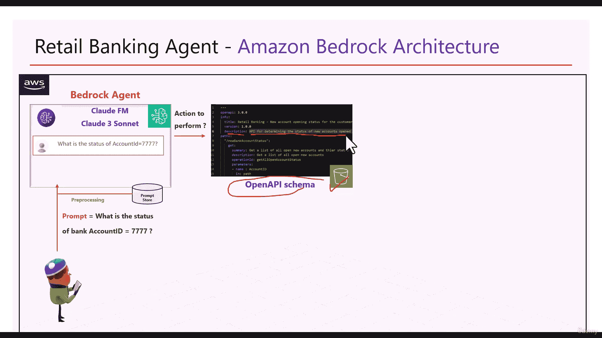
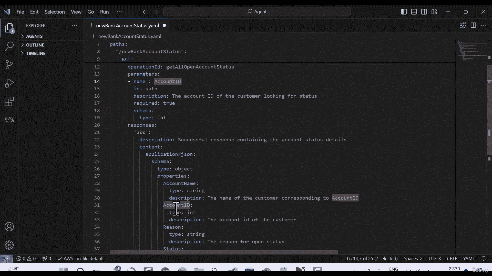
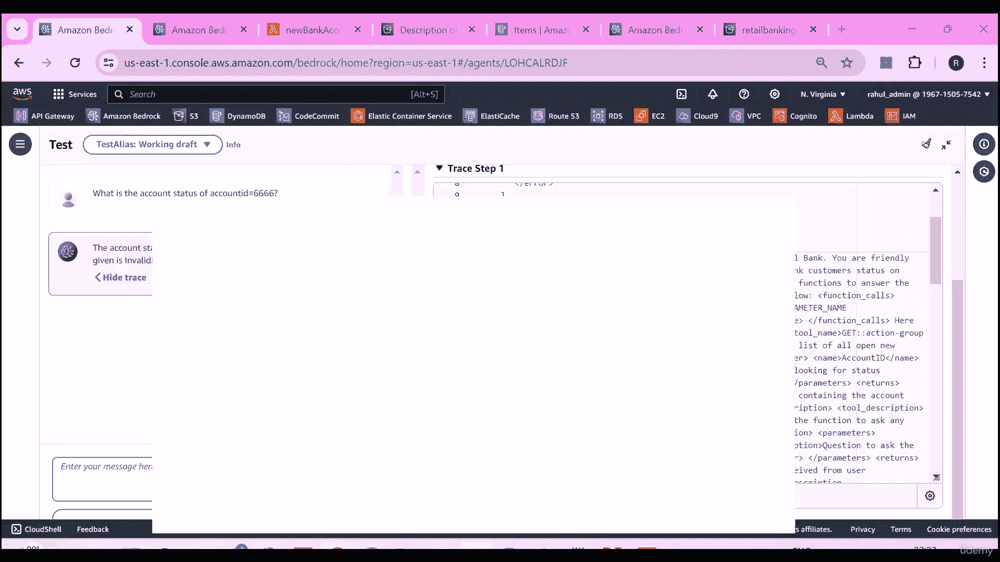
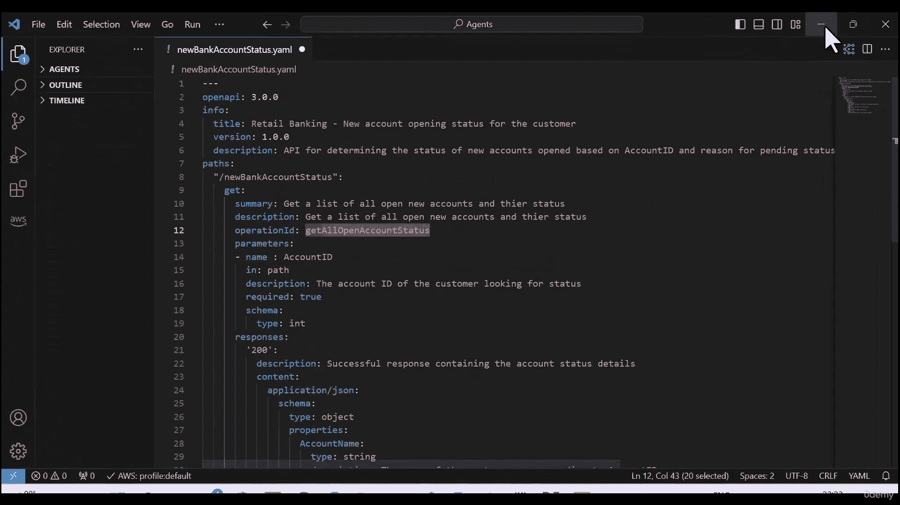
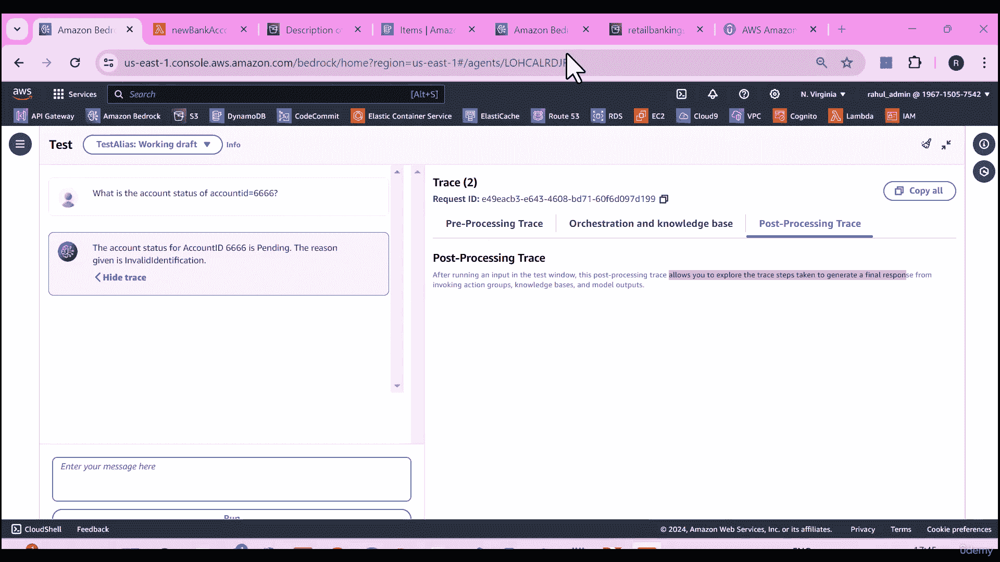

# 🧭 生成式AI在AWS上的应用：第66-68讲：Amazon Bedrock Agent用例架构

在本节课中我们将要学习 Amazon Bedrock Agent 的零售银行用例架构。我们已经看过要构建的演示，接下来把整套架构拆开：从 AWS 账户中创建 Bedrock Agent，到用户输入进入预处理、编排、Lambda 与 DynamoDB 的工具调用，再到用 Knowledge Base 实现 RAG 检索增强生成，最后通过思维链追踪查看代理的推理过程。这个架构步骤较多，但主线可以概括为“输入、判断、调用工具或查知识库、生成回答”，初学者抓住这条主线就不容易迷路。

下面是整个 Bedrock Agent 处理链路的核心概念公式，后面各节都会围绕它展开：

```text
用户输入
  -> 预处理：恶意检查、领域检查
  -> 编排：instructions + OpenAPI schema + 用户输入
  -> Action Group：Lambda -> DynamoDB
  -> 或 Knowledge Base：RAG -> OpenSearch
  -> 后处理：生成最终响应
```

## 🧱 生成式AI在AWS上的应用：第1节：零售银行代理架构总览

上一节我们通过演示看到了目标效果，本节我们来看看零售银行代理的整体架构。这个解决方案构建在 AWS 上，我们有一个 AWS 账户。第一步是创建一个 Bedrock Agent，并使用 Claude 基础模型，尤其是 Claude 3 Sonnet，因为社区中已有大量讨论认为这个基础模型表现很好。这个代理的目标是处理零售银行客户查询，尤其是查询客户最近开立银行账户的状态，所以它不是一个通用聊天机器人，而是有明确领域边界的业务代理。

从架构上看，代理需要知道自己能做什么、不能做什么，还需要能够调用外部工具获取真实数据。工具调用负责回答数据库里已有的信息，知识库负责回答数据库里没有的说明性信息。两条路径最后由代理汇总成一段自然语言响应返回给用户。

完成整体认识后，下一节我们进入控制台，看看如何创建这个 Bedrock Agent。

## 🧱 生成式AI在AWS上的应用：第2节：从控制台创建Bedrock Agent

在理解了代理的目标之后，本节我们来看看如何在控制台创建 Bedrock Agent。进入控制台后，我们进入 Agent 创建流程，给代理起一个名称并填写描述；在本用例中，这个代理负责提供客户最近开立银行账户的状态。接着选择基础模型，目前控制台只支持 Anthropic 模型，所以我们选择 Anthropic，再选择 Claude 3 Sonnet，这些就是当前可用的选项。

创建代理时还需要提供 instructions，这一步非常重要，因为它给代理提供上下文，说明代理所在的领域以及可以回答哪些问题。示例 instructions 写的是：你是零售银行中的银行助理，友好且礼貌，通过提供银行客户新开银行账户的状态来帮助解决客户查询。这段 instructions 相当于代理的行为边界和工作说明书。

以下是创建代理时在控制台需要填写和选择的关键内容：

- 进入 Bedrock Agent 创建页面。

- 给代理填写名称。

- 给代理填写描述，本用例描述为客户最近开立银行账户的状态。

- 选择基础模型，目前只支持 Anthropic，选择 Anthropic 后选择 Claude 3 Sonnet。

- 填写 instructions，说明代理是零售银行助理，友好礼貌，负责提供新开银行账户状态。



完成这些填写后，代理就有了名称、描述、模型和领域说明。下一节我们来看用户提问进入代理后，预处理阶段会发生什么。

## 🔍 生成式AI在AWS上的应用：第3节：用户输入与预处理

代理创建完成后，本节我们来看看用户输入进入预处理时发生了什么。假设银行客户萨曼朱询问账户 ID 7777 的状态，就像演示中看到的那样。这个用户输入会先进入基础模型，并经过一个叫预处理的步骤。在预处理中，代理有一个提示存储，它会把用户输入转换成适合当前基础模型的提示；目前 Bedrock 只支持 Claude，未来如果支持其他基础模型，也会把用户输入转换成适合那个模型的格式。

随后，这个提示会作为预处理的一部分发送给 Claude 基础模型，由模型验证并分类。分类主要看两件事：第一，检查提示是否具有恶意，如果判断为恶意，就不再继续处理；第二，检查问题是否在 Bedrock Agent 的领域内。我们构建的是零售银行代理，如果用户问“我的理赔 ID 7777 状态是什么”，代理会说明自己不是保险代理，而是银行代理，因此这个问题无效。



以下是预处理阶段需要完成的两类核心检查：

- 恶意检查：判断用户输入是否包含恶意内容，若为恶意则停止后续处理。

- 领域检查：判断用户问题是否属于当前代理的业务范围，例如银行代理不回答保险理赔问题。

这些检查完成后，如果 Claude 基础模型确定用户输入有效，代理就需要决定下一步动作。下一节我们来看看编排步骤和 OpenAPI schema 如何参与这个决策。

## 🧩 生成式AI在AWS上的应用：第4节：OpenAPI Schema与编排

预处理确认输入有效后，本节我们来看看编排步骤。为了确定下一步动作，Amazon Bedrock 要求我们创建 OpenAPI schema，并把该文件上传到 S3 桶。这个 OpenAPI schema 可以用 YAML 或 JSON 编写，格式中包含接口描述、参数和响应定义。这里最重要的部分是 description，需要明确描述这个 API 的用途，例如“用于确定新开账户状态的 API”。

本用例要创建的 YAML 文件包含 OpenAPI 版本、OpenAPI schema 标题、描述，以及当描述匹配时要调用哪个函数、需要传什么参数、会得到什么响应。描述部分说明：根据账户 ID 确定新开账户状态；参数是账户 ID；响应包含账户 ID、原因、状态等内容。下面的代码片段展示了这种 schema 的核心结构：

```yaml
openapi: 3.0.0
info:
  title: Bank Account Status API
  description: 根据账户ID确定新开户账户的状态
paths:
  /account-status:
    get:
      parameters:
        - name: accountId
          in: query
          required: true
      x-amazon-apigateway-integration:
        # 匹配后调用对应的Lambda函数
```

> description 是语义匹配的关键锚点，instructions 是代理的领域边界。

这个 description 之所以重要，是因为基础模型会根据用户提示对 description 做语义匹配；如果匹配成功，就会调用这里定义的 Lambda 函数。这个阶段有时称为编排步骤。在编排中，Claude 基础模型会同时查看用户输入、OpenAPI schema 和代理的 instructions，理解代理的关键角色，然后把任务拆解成可管理的步骤，并给出执行任务的逻辑推理，这种推理有时称为思维链。

假设 Claude 3 Sonnet 根据这些参数和推理，确定需要调用名为 new bank account status 的函数来查询账户 ID 7777 的状态。这个函数的业务逻辑需要写在 Lambda 服务中，因为 Bedrock Agent 允许集成 Lambda 函数。下一节我们来看看 Lambda、DynamoDB 和 action group 如何一起完成工具调用。

## ⚙️ 生成式AI在AWS上的应用：第5节：Lambda、DynamoDB与Action Group

编排决定调用工具后，本节我们来看看 Lambda 和 DynamoDB 组成的 action group。这个用例会编写一个 Lambda 函数，该函数由代理调用，并根据用户输入查询我们创建的 DynamoDB 表。例如用户询问账户 7777 的状态，Lambda 函数被调用后，会从 DynamoDB 表中检索数据。

在 Amazon Bedrock 的术语中，OpenAPI schema 和 Lambda 函数一起称为 action groups。对于这个代理，我们需要创建一个 action group；在控制台中点击进入后，可以看到它定义了上传到 S3 桶的 OpenAPI schema 以及对应的 Lambda 函数。

以下是 action group 中需要组合的两个核心部分：

- OpenAPI schema：上传到 S3 桶，描述接口用途、参数和响应，供模型做语义匹配。

- Lambda 函数：承载实际业务逻辑，根据参数查询 DynamoDB 并返回结果。

创建 action group 后，Lambda 函数会向 DynamoDB 发起 API 调用，检索用户请求的数据；代理收到响应后，会把结果发送回用户。不过，之前演示中用户还可能追问另一个问题：如果账户状态是 pending，invalid address proof 是什么意思。DynamoDB 中没有提供这类说明数据，所以我们需要另一条路径，下一节来看看如何用 Knowledge Base 实现 RAG。

## 📚 生成式AI在AWS上的应用：第6节：用Knowledge Base实现RAG

工具调用只能回答数据库中已有的数据，本节我们来看看当数据库没有答案时，RAG 如何补充说明性知识。针对“invalid address proof 是什么意思”这类问题，我们创建了一个 PDF 文档，其中讨论各种错误码以及它们的含义。Bedrock Agent 允许集成基于 RAG 的解决方案，这个方案可以通过 Amazon Bedrock Knowledge Base 构建。

RAG 的工作过程是：把错误码 PDF 上传到 S3 桶，使用 Knowledge Base 把长 PDF 切成固定大小的块，再把这些块传入 Amazon Titan embedding model 生成向量嵌入，最后把向量嵌入存到向量存储中。在本用例中，向量存储使用 AWS OpenSearch。当用户提出“invalid address proof 是什么意思”时，这个问题会先通过 Amazon Titan embedding model 转换为向量，然后代理查询向量存储并得到回答。

以下是 RAG 知识库链路的核心步骤：

- 把错误码 PDF 上传到 S3 桶。

- 使用 Knowledge Base 把长 PDF 切成固定大小的文本块。

- 用 Amazon Titan embedding model 为文本块生成向量嵌入。

- 把向量嵌入存入向量存储，本用例使用 AWS OpenSearch。

- 用户提问时，把问题转换为向量并查询向量存储，得到相关回答。

RAG 返回结果后，代理会把最终响应发送给用户。这个最终响应生成阶段有时称为后处理任务。下一节我们来看看后处理，以及如何在控制台中追踪完整思维链。

## 🧠 生成式AI在AWS上的应用：第7节：后处理与思维链追踪

前几节覆盖了工具调用和知识库两条路径，本节我们来看看后处理和思维链追踪。最终响应发送给用户后，这个阶段有时称为后处理任务。整套推理有时也称为思维链推理，它包含三个步骤：预处理、编排、后处理。



以下是思维链推理的三个核心阶段：



- 预处理：检查用户输入是否恶意、是否超出代理领域。

- 编排：结合 instructions、OpenAPI schema 和用户输入，决定任务步骤和工具调用计划。

- 后处理：把工具或知识库结果整理成最终响应返回给用户。

在演示中询问账户 6666 的状态，点击简短追踪后可以看到三个标签页。预处理追踪用于探索输入是否被识别为恶意或超出代理领域；如果输入有效，就会进入编排和知识库步骤。运行提示后，编排追踪用于探索代理编排提示组件使用的线性思维链；如果调用了知识库，追踪还能看到知识库结果如何被总结并作为 observation 生成。

点击 trace step1，可以看到模型参数 temperature、top K、top P 都已经定义。文本中写有“你是零售银行中的银行助理，友好且礼貌”，这正是我们提供的 instructions，作为输入之一。接着文本说明已经提供函数列表，其中之一是 get all open accounts，这个信息来自我们编写的 Open spec .yaml 文件，并包含 operation ID。

同样地，追踪会查看用户问题“账户 ID 66 的状态是什么”等属性，解释这些输入并给出推理依据：要获取新账户状态，需要调用 get action group demo get all open account status 函数，并提供 account ID 参数。对 Lambda 函数来说，这就是要传入的参数；推理中还说明从用户问题中获得了 account ID 值，并查看 action group 名称和 API 路径，这些是调用 Lambda 函数时要传的参数以及 action group 和响应结构，响应包含账户状态、原因和其他内容。

这是 trace step1。继续查看 trace step2，模型会进一步处理信息并给出最终响应：账户 ID 666 的状态是 pending，原因是 invalid identification，类型为编排。通过这个标签页可以看到代理的推理和编排计划。最后是 post processing trace，它用于探索生成最终响应所经过的追踪步骤。到这里，整个代理架构、工具调用、RAG 补充和思维链追踪就串成了一条完整链路。

## ✅ 生成式AI在AWS上的应用：第8节：课程总结



到这里，本节课的架构拆解就完成了。本节课中我们一起学习了 Amazon Bedrock Agent 的零售银行用例架构：从控制台创建代理并填写 instructions，到用户输入进入预处理并做恶意检查和领域检查，再到用 OpenAPI schema 和编排步骤决定工具调用，随后通过 Lambda 与 DynamoDB 组成的 action group 查询账户状态，并用 Knowledge Base、Titan embedding 和 OpenSearch 实现 RAG，最后通过后处理和思维链追踪查看代理的完整推理过程。本节内容基本到此结束，希望本讲对理解该架构有帮助，下一讲继续。

