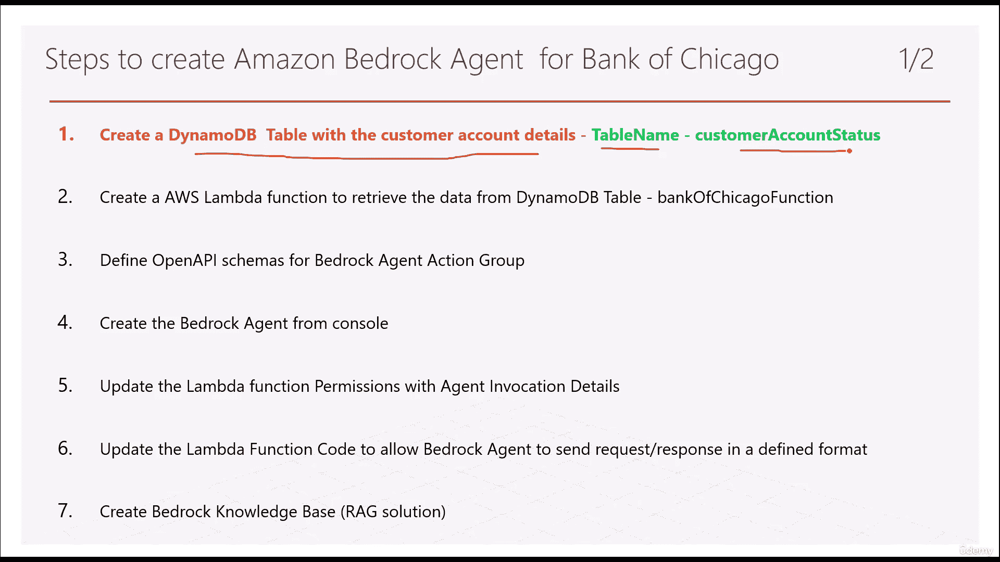
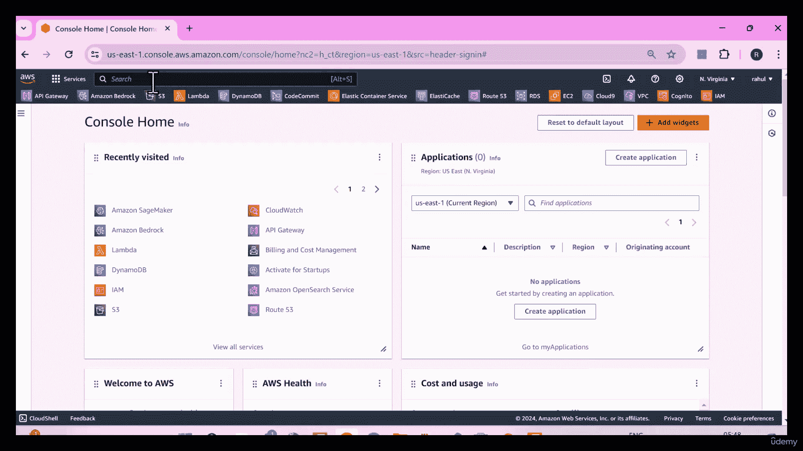
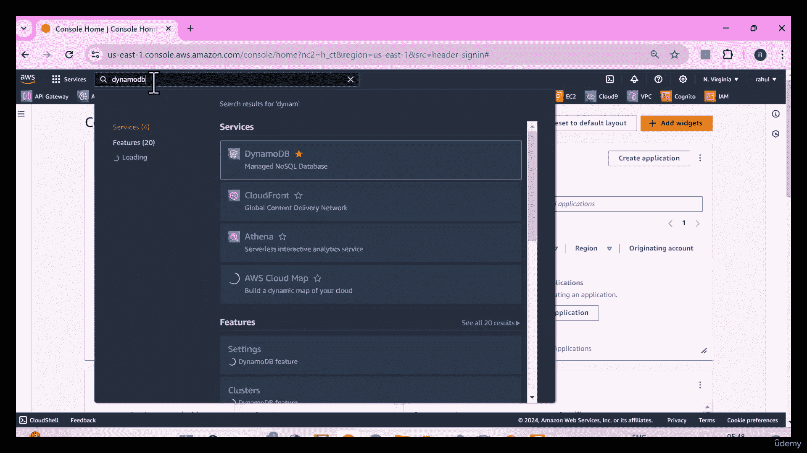
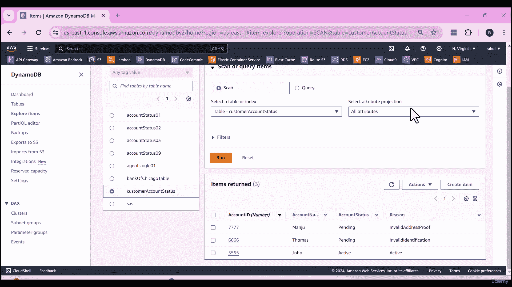

# Udemy - 生成式AI在AWS上 - Amazon Bedrock、RAG与KIRO [2026]：第67–69节：零售银行代理DynamoDB表创建 🏦

在本节课中，我们将要学习如何在AWS控制台中创建一张DynamoDB表，并用它来支撑一个零售银行场景里的Bedrock Agent。课程会先说明为什么需要这张表，再按控制台步骤创建表结构，最后逐条录入三条客户账户数据。内容会尽量用直白的大白话解释，让初学者也能跟着完成操作。

## Udemy - 生成式AI在AWS上 - Amazon Bedrock、RAG与KIRO [2026]：第67–69节：1. 为什么需要DynamoDB表 🧭

上一段我们概述了本节课的任务，本节中我们来看看为什么这张DynamoDB表是必要的。我们会在AWS Cloud上构建应用。通过控制台构建Bedrock Agent，并使用基础模型。这个Agent会被客户使用。客户会提出一个问题，例如“银行账户ID 5555的状态是什么”。为了回答这个问题，Bedrock Agent需要从某个数据源检索答案。在我们的案例中，会构建一张DynamoDB表，由这张表提供查询答案。

课程还准备了创建Bedrock Agent的逐步指南。指南中的第一步是创建一张包含客户账户详情的DynamoDB表。在我们的案例中，表名称为customer account status。接下来就通过控制台完成这张表的创建。下面用代码描述这个场景的数据流，帮助理解Agent和表之间的关系。

```text
客户问题 -> Bedrock Agent -> 数据源(DynamoDB表) -> 返回账户状态
```







下面是这张表的关键标识公式，后续建表会围绕它展开。

```text
表名 = customer_account_status
分区键 = account_id
分区键类型 = Number
```

在理解数据流之后，下一步进入AWS控制台执行创建操作。这里先说明业务背景，是为了让后面的字段设计不显得突兀。接下来我们看看如何在DynamoDB控制台中创建表。

## Udemy - 生成式AI在AWS上 - Amazon Bedrock、RAG与KIRO [2026]：第67–69节：2. 在控制台创建表 🛠️

上一节我们介绍了为什么需要这张表，本节中我们来看看在AWS控制台中创建表的具体步骤。首先在AWS控制台搜索DynamoDB。进入DynamoDB服务后，点击Tables，再点击Create table，然后输入表名称。我们的表名称是customer account status。接下来需要提供分区键。在这个案例中，分区键是account Id，类型为Number。我们不提供排序键，因为当前没有大量值，所以忽略排序键。下面是创建表时需要确认的配置项。

- 表名称：customer account status。
- 分区键：account Id。
- 分区键类型：Number。
- 排序键：不设置。

等待几分钟后，可以看到customer account status表创建成功。点击这张表，进入表页面，再点击Explore table items，然后点击Create item来创建条目。下面先说明表结构。表中有account ID作为主键，类型是数字，账户ID包括5555、6666和7777。对于每个账户ID，还有account name属性，类型是字符串；account status属性，类型是字符串；以及reason属性，用于说明账户不活跃时的原因。下面是表结构示意代码。

```json
{
  "account_id": 5555,
  "account_name": "John",
  "account_status": "active",
  "reason": "active"
}
```

下面用列表说明三个示例账户的业务含义，方便录入时对照。

- 账户5555：账户名John，账户状态active。reason字段本来用于说明pending原因，但John是active，所以没有待处理原因；按讲解中的控制台操作，reason填写为active。
- 账户6666：账户名Thomas，账户状态pending，原因是invalid identification。
- 账户7777：账户名Manju，账户状态pending，原因是invalid address proof。

完成表结构理解后，下面进入逐条录入数据的环节。录入时会使用Create item和Add new attribute按钮，并按字段类型填写值。接下来我们看看三条账户数据分别如何录入。

## Udemy - 生成式AI在AWS上 - Amazon Bedrock、RAG与KIRO [2026]：第67–69节：3. 录入三条账户数据 📝

上一节我们创建了表并确认了字段结构，本节中我们来看看如何录入三条账户数据。第一项数据中，account Id填写5555，类型为Number，它也是主键。点击Add new attribute，类型选择String，属性名为account name，值为John。再次点击Add new attribute，类型选择String，属性名为account status，值为active。再次点击Add new attribute，类型选择String，属性名为reason，值为active。最后点击Create item保存。下面把第一项操作步骤整理为列表。

- 输入account Id：5555，类型Number。
- 新增属性account name：John，类型String。
- 新增属性account status：active，类型String。
- 新增属性reason：active，类型String。
- 点击Create item保存条目。

第二项数据中，点击Create item，account Id填写6666。新增属性account name，类型String，值为Thomas。新增属性account status，类型String，值为pending。新增属性reason，类型String，值为invalid identification，按讲解从已有文本复制该原因。点击Create item保存。下面是第二项字段清单。

- account Id：6666，类型Number。
- account name：Thomas，类型String。
- account status：pending，类型String。
- reason：invalid identification，类型String。

第三项数据中，点击Create item，account Id填写7777。新增属性account name，类型String，值为Manju。原文口播为man，结合末尾汇总对应Manju。新增属性account status，类型String，值为pending。新增属性reason，类型String，值为invalid address proof，按讲解复制该原因文本。点击Create item保存。下面是第三项字段清单。

- account Id：7777，类型Number。
- account name：Manju，类型String。
- account status：pending，类型String。
- reason：invalid address proof，类型String。

三条数据录入完成后，可以看到三个账户ID都已创建：7777、6666、5555，对应账户名Manju、Thomas、John。本节内容到此结束，下节课再见，感谢观看。下面是三条数据的汇总代码，便于对照检查。

```json
[
  {"account_id": 5555, "account_name": "John", "account_status": "active", "reason": "active"},
  {"account_id": 6666, "account_name": "Thomas", "account_status": "pending", "reason": "invalid identification"},
  {"account_id": 7777, "account_name": "Manju", "account_status": "pending", "reason": "invalid address proof"}
]
```

完成录入后，这张表就可以作为Bedrock Agent查询账户状态的数据源。接下来我们对本节内容做一次收束，把创建表和录入数据的要点串起来。

## Udemy - 生成式AI在AWS上 - Amazon Bedrock、RAG与KIRO [2026]：第67–69节：4. 本节总结 ✅



本节课中我们一起学习了零售银行代理场景中DynamoDB表的创建过程。我们先理解了Bedrock Agent需要从数据源检索答案，因此要创建customer account status表。然后在DynamoDB控制台中设置表名、分区键account Id和Number类型，并跳过排序键。最后录入三条账户数据：5555对应John且状态active，6666对应Thomas且状态pending、原因invalid identification，7777对应Manju且状态pending、原因invalid address proof。核心公式可以记为`分区键 = account_id，类型 = Number`。完成这些步骤后，后续就可以继续构建Bedrock Agent并让它查询这张表。下节课继续学习后续内容。

