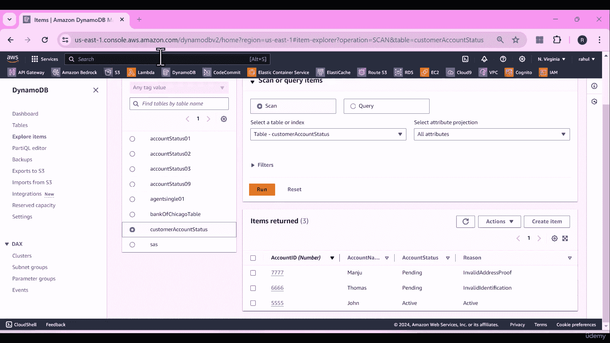
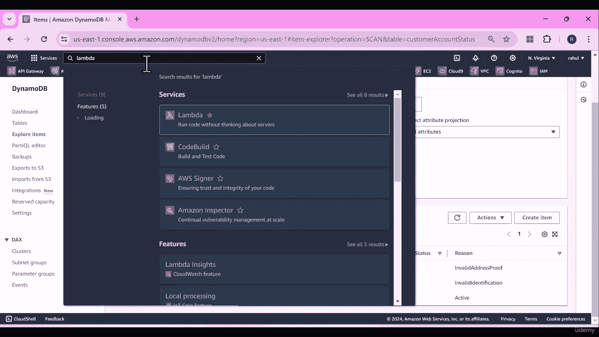
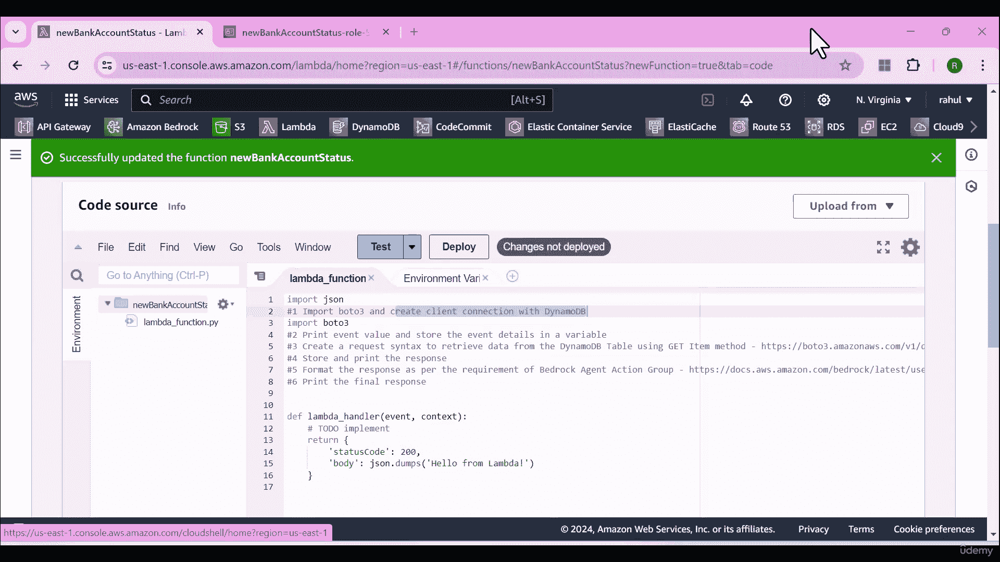
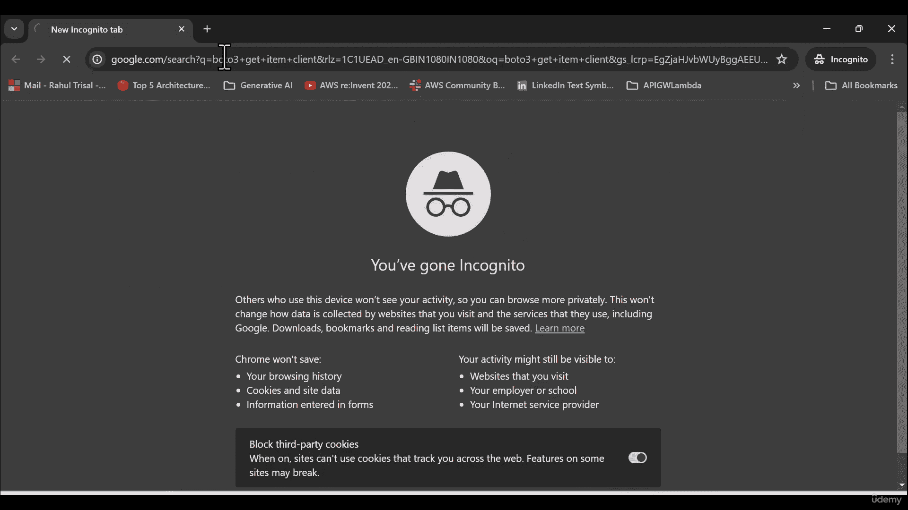
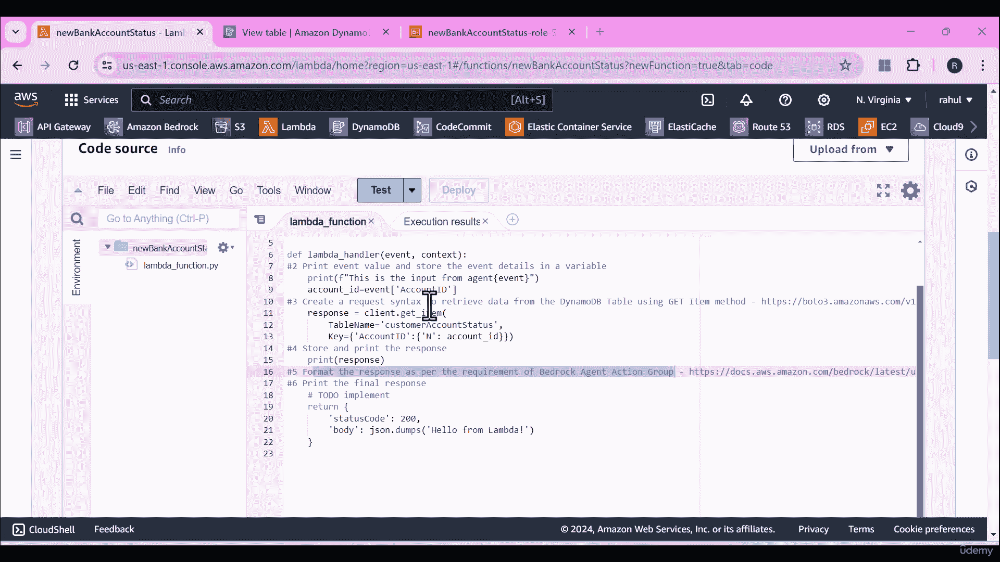

# 🌩️ Generative AI on AWS：P68-P70：创建零售银行Agent的AWS Lambda函数

在本节课中，我们将学习如何在 AWS 上为零售银行 Agent 创建一个 Lambda 函数。我们会从控制台创建函数开始，接着调整超时时间，然后配置 IAM 权限，最后编写并测试用于查询 DynamoDB 表数据的 Python 代码。整个过程会围绕一个实际场景展开：用户询问“我的账户 ID 5555 的状态是什么”，而 Lambda 函数需要根据这个账户 ID 去 DynamoDB 中查询并返回状态。

## 进入 Lambda 服务并创建函数

首先，打开 AWS 管理控制台，在顶部的搜索框中输入“Lambda”，然后进入 Lambda 服务的主页。在 Lambda 的首页上，点击“创建函数”按钮，进入函数创建向导。

接下来，需要给函数起一个名字。按照本课程的需求，我们把函数命名为 `new-bank-account-status`。你可能会问，为什么叫这个名字？因为它的职责就是查询新银行账户的状态。运行时方面，我们选择 Python 3.12 版本，因为我们会用 Python 来编写这个函数的代码。设置好之后，直接点击“创建函数”按钮，等待 AWS 完成函数的基础设施初始化。

创建完成后，我们会看到函数的基本信息页面。默认情况下，AWS 已经生成了一段简单的 Lambda 函数代码，这段代码会返回“hello from Lambda”。不过在开始写业务逻辑之前，我们还需要做几个基础的配置调整，让这个函数能够满足我们的实际需求。

## 调整函数超时时间

默认创建的 Lambda 函数有一个重要限制：超时时间只有 3 秒。这意味着函数必须在 3 秒内执行完毕，否则 AWS 会强制终止运行。在什么情况下会超过 3 秒呢？比如当我们需要访问数据库、调用外部 API，或者处理大规模数据时，就很可能会超时。由于我们要查询 DynamoDB 表，这个操作可能涉及网络延迟和数据读取，3 秒通常是不够用的，因此我们需要把这个时间改长一些。

操作方法是：在函数页面中进入“配置”选项卡，然后选择“常规配置”。在常规配置页面里，你可以看到当前超时时间是 3 秒。点击右侧的“编辑”按钮，把超时时间改成至少 1 分钟。这里我们直接选择 1 分钟，然后点击“保存”即可。这样一来，函数就有充足的时间去完成 DynamoDB 查询了，不用担心运行到一半被强行掐断。

完成这一步之后，我们需要处理一个更关键的问题：函数目前没有权限访问 DynamoDB。如果直接运行查询代码，AWS 会拒绝请求。所以在写代码之前，让我们先去配置权限。

## 配置 IAM 权限

在 AWS 中，Lambda 函数运行时会扮演一个 IAM 角色，这个角色决定了函数能够访问哪些 AWS 资源。我们创建函数时，AWS 会自动创建一个默认的 IAM 角色。现在，我们需要查看一下这个角色当前拥有的权限。

在函数页面的“配置”选项卡中，点击“权限”，然后点击默认生成的那个 IAM 角色链接。为了不干扰当前页面，我们可以在新标签页中打开这个角色。打开后，查看它的权限策略，你可以看到它只有最基本的权限：创建日志组并向 CloudWatch 日志组写入日志。这些权限对于运行基础函数是够用的，但我们的函数需要查询 DynamoDB 表，所以必须额外添加访问 DynamoDB 的权限。

回到函数页面的权限区域，点击“添加权限”按钮，然后选择“附加策略”。在策略搜索框中输入“DynamoDB”，找到对应的托管策略。一种常见做法是直接附加 `AmazonDynamoDBFullAccess` 策略，也就是给函数完全的 DynamoDB 访问权限。当然，如果是在生产环境中，为了安全起见，最好只给函数访问特定表的权限，而不是所有表。不过在本课程的实验环境中，为了简单起见，我们直接赋予完全访问权限。

点击“添加权限”之后，策略就成功附加到了这个 IAM 角色上。此时再回到角色页面，你会看到该角色已经同时拥有 CloudWatch 日志和 DynamoDB 的访问权限了。权限配置完成，接下来就可以安心编写函数代码了。

## 编写 Lambda 函数代码

编写代码之前，我们先回到函数页面的“代码”选项卡。为了让编写过程更清晰，我们可以从课程 PPT 里把预先写好的步骤复制过来，粘贴到代码编辑器中作为参考。这些步骤实际上就是整个函数实现的地图，告诉我们要做什么、按什么顺序做。以下是我们在这一节中需要实现的主要步骤：

- 导入 Boto3 库
- 创建与 DynamoDB 的客户端连接
- 打印事件值，并将事件详细信息存储到变量中
- 创建向 DynamoDB 表检索数据的请求语法
- 存储并打印响应结果

这些步骤会引导我们逐步完成整个函数逻辑。下面我们逐一实现。

### 导入 Boto3 并创建 DynamoDB 客户端

第一步是导入 Boto3。Boto3 是 AWS 提供的 Python 软件开发工具包（SDK），我们通过它来调用各种 AWS 服务。你可以把它理解成连接 AWS 各种服务的一把通用钥匙。在 Lambda 代码的最顶部，我们只需要写一行导入语句：

import boto3

第二步是创建与 DynamoDB 服务的客户端连接。我们要使用 DynamoDB 的 `get_item` 方法来获取数据，因此客户端连接是必须的。代码非常简单：

client = boto3.client('dynamodb')

这里的 `client` 就是后续用来调用 DynamoDB API 的客户端对象。你可能想问，为什么不直接使用资源（resource）接口？其实这是个人习惯问题，文档中通常也会展示客户端的用法，所以我们按照文档风格来。

### 打印事件并存储账户 ID

现在进入更核心的逻辑。在架构图中，用户向 Bedrock Agent 提出的问题会触发一个事件，这个事件会被传递给 Lambda 函数。举个例子，用户问“我的账户 ID 5555 的状态是什么？”，Bedrock Agent 本身是无法直接查询 DynamoDB 的，它需要把账户 ID 作为事件参数传给 Lambda 函数，让 Lambda 去数据库里取数据。因此，我们要先打印出这个事件，看看它的数据结构是什么样的，这样才能写出正确的代码。

我们用一个 `print` 语句把整个事件打印出来：

print(event)

打印事件只是为了让开发阶段能看到输入内容，我们还需要把事件中的账户 ID 提取出来，存到一个变量中。在这个用例中，事件的输入参数名是 `accountID`，所以我们这样写：

account_id = event['accountID']

注意，这里的 `event` 是 Lambda 函数处理程序（handler）的第二个参数，它包含了触发函数的所有输入数据。我们把它取出来，后面查询 DynamoDB 时要用到这个 `account_id`。

### 测试事件并验证代码

代码写到这里，我们可以先做一次测试，确认前面的逻辑没有错误。点击“部署”按钮，将最新代码发布到 Lambda 服务。然后点击“测试”按钮，在弹出的配置窗口中创建一个测试事件。我们给测试事件起个名字，比如 `demo`，然后在事件 JSON 中输入：

{
  "accountID": 5555
}

这里我们模拟用户查询账户 ID 5555 的状态。保存并运行测试，返回结果状态码是 200，并且输出了默认的“hello from Lambda”。不过真正要看的是函数日志。展开日志，你可以看到我们打印的事件内容：这确实是来自 Agent 的输入，里面携带的 `accountID` 是 5555。同时，`account_id` 变量也成功保存了 5555。这个结果符合我们的预期，说明对事件的处理是正确的。

### 从 DynamoDB 查询数据

下一步，我们要构造一个请求，从 DynamoDB 表中检索数据。这里我们使用客户端对象的 `get_item` 方法。这个方法的作用是什么呢？简单来说，`get_item` 操作会根据你提供的主键（Primary Key），返回对应的项（Item）以及该主键下的所有属性。在我们的场景中，主键就是账户 ID。

为了正确书写这个请求，我们通常需要查阅 AWS 官方文档，了解请求语法的具体格式。文档会告诉你每个参数应该怎么写。在我们这个场景里，DynamoDB 表的名字是 `customer-account-status`。为了查询某个客户的状态，主键就是账户 ID。我们先把表名填进去：

response = client.get_item(
    TableName='customer-account-status',
    Key={'accountID': {'N': account_id}}
)

这里有一个细节：DynamoDB 的 `get_item` 要求键值的类型必须明确指定。在我们的表中，`accountID` 是数字类型（Number），所以我们要用 `'N'` 来表示。`account_id` 这个变量是我们上一步从事件中提取出来的值，当用户查询 5555 时，这里就会变成 `{'N': '5555'}`。需要注意，虽然 `account_id` 本身是 Python 字符串或整数，但 DynamoDB API 要求我们以 `{'类型': '值'}` 的形式包装，因此我们需要这样写。

为了保险起见，可以再检查一下括号是否闭合。`get_item` 的调用包含表名和键两个参数，两个地方都要正确闭合，否则代码会报语法错误。

### 打印响应结果

请求写完以后，我们需要看看从 DynamoDB 返回了什么。查看文档中的响应语法可以发现，`get_item` 返回的是一个字典，里面包含了与主键匹配的项的所有属性。比如账户状态、账户名等。虽然返回结果中可能包含很多我们暂时用不到的元数据，但为了开发调试，我们先用 `print` 将整个响应打印出来：

print(response)

打印之后，我们可以部署代码，再次用刚才的测试事件运行测试。这次测试事件仍然传入账户 ID 5555。运行结果中，除了之前看到的事件日志，还会打印出 DynamoDB 的返回内容。你可以看到返回结果中有一个 `item` 字段，其中包含账户状态 `active`、账户 ID `5555`、原因 `active`、账户名 `John`，以及许多其他属性。此外，响应中还包含 `ResponseMetadata` 之类的元数据，因为整个 `response` 是一个复杂的字典结构。看到这些输出，说明我们的函数已经顺利从 DynamoDB 中取到了正确数据。

至此，这个 Lambda 函数已经完成了核心任务：接收一个账户 ID，然后从 DynamoDB 中查询出对应的账户状态信息，并返回结果。

## 总结与后续步骤

本节课中，我们一起学习了如何创建并配置一个 AWS Lambda 函数，内容包括：在控制台创建函数、将超时时间从 3 秒调整为 1 分钟、为函数附加 DynamoDB 访问权限、编写 Boto3 代码实现 DynamoDB 查询，以及通过测试事件验证函数能否正确返回账户状态。

不过，目前这个函数返回的响应格式还不是 Bedrock Agent 的 Action Group 所要求的最终格式。我们暂时无法处理这一步，因为 Bedrock Agent 还没有创建。等后面的课程创建好 Bedrock Agent 之后，我们需要根据 Agent 接收输入的具体格式，以及它要求我们返回的响应格式，再回来对这个 Lambda 函数做相应的修改。

就目前来说，这个函数已经能够在给定测试事件（即某个用户的账户 ID）时，正确地从 DynamoDB 表中获取数据了。后面的课程中，我们再继续完善它。感谢观看，我们下节课见。

