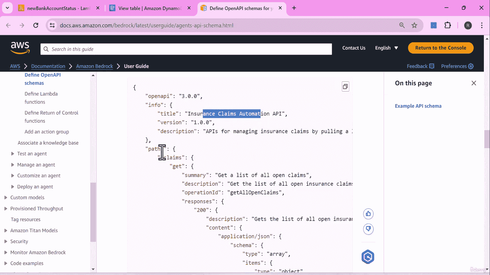
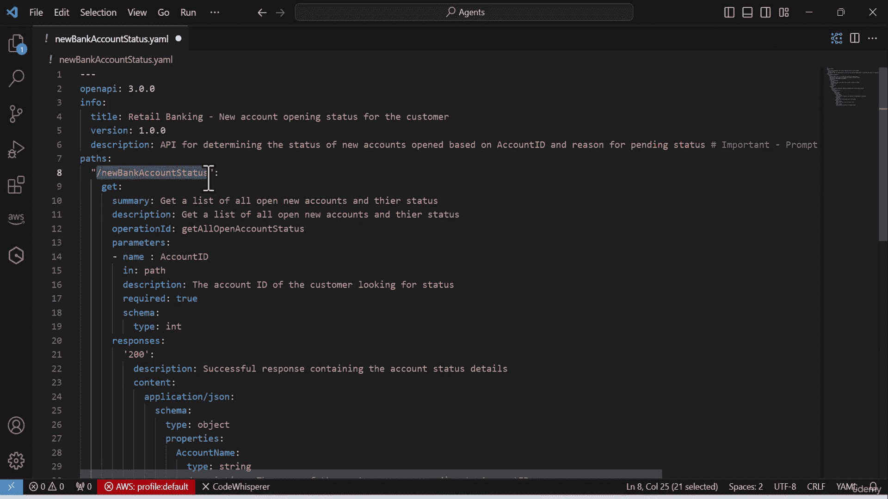
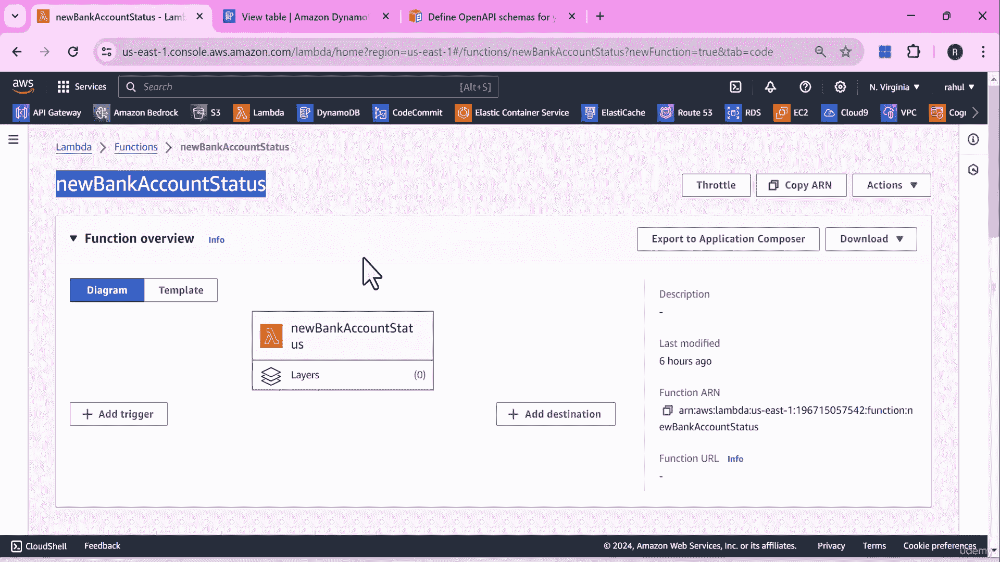
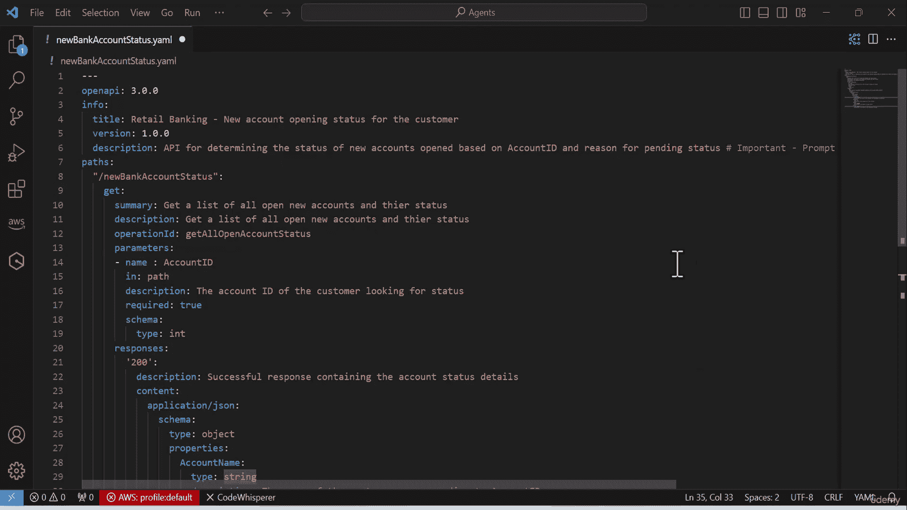
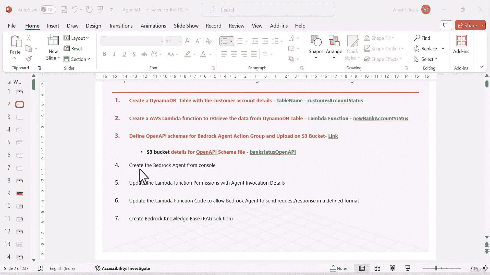

# 🏦 AWS生成式AI：第69-71讲：零售银行Agent的OpenAPI规范文档创建


在本节课中，我们将要学习如何为Amazon Bedrock Agent编写OpenAPI规范文档，并把这个文档上传到S3，供后续创建Bedrock Agent时使用。我们会从一个零售银行账户状态查询场景出发，先回顾前面已经完成的DynamoDB和Lambda函数，再解释Bedrock Agent如何根据用户问题选择要调用的Lambda函数，最后一步步写出一个可用的OpenAPI Schema。整个教程会尽量用大白话说明，让初学者也能顺着思路看懂。


## 🧭 AWS生成式AI：第69-71讲：回顾问题与Agent如何选择Lambda


在上一讲中，我们说过这样一个场景：我们已经有一个由Claude基础模型驱动的Bedrock Agent，用户会向它询问账户状态。随后我们创建了DynamoDB，又创建了Lambda函数。现在的问题变成：当客户把问题发给Bedrock Agent之后，Agent怎么知道应该调用哪一个Lambda函数。简单来说，Agent需要把“用户问题”和“函数说明”进行匹配，匹配成功后才能决定调用谁。


在我们的例子里，目前只有一个Lambda函数，所以选择起来并不复杂。但我们可以假设现在又多了一个Lambda函数：Bedrock Agent会询问客户，如果账户缺少某些文件，是否需要发送邮件。在这种情况下，Agent就可以调用这个新增的Lambda函数。因此，Bedrock Agent必须根据用户问题判断，到底应该调用原来的Lambda函数，还是调用新的Lambda函数。这个判断过程可以概括为下面的公式。


\[
\text{用户问题} \longrightarrow \text{语义匹配 OpenAPI 中的 description} \longrightarrow \text{命中后调用对应的 Lambda}
\]


为了让Bedrock Agent能够完成这种匹配，Bedrock Agent服务要求你编写一个OpenAPI Schema，格式可以是JSON，也可以是YAML。这个Schema里会写清楚每个操作是做什么的，例如某个描述用于确定账户开户状态。当用户提出问题后，Agent会把用户问题映射到为某个Lambda函数定义的描述上，如果语义匹配成功，就调用对应的Lambda函数。下面用一个简单公式表示这个对应关系。


\[
\text{OpenAPI 操作描述} \approx \text{Lambda 函数职责}
\]


如果描述匹配到“发送邮件”这类意图，Agent就会调用对应的那个Lambda函数。本讲要学习的重点，就是如何为某一个具体的Lambda函数编写这样的OpenAPI Schema。接下来我们转到步骤指南，看看本讲具体要完成什么任务。在本讲中，我们将要为Bedrock Agent的Action Group定义OpenAPI Schema。


## 🧩 AWS生成式AI：第69-71讲：Action Group与OpenAPI Schema是什么


上一节我们弄清楚了Agent为什么需要OpenAPI描述，本节中我们来看看Action Group到底是什么。Bedrock Agent的Action Group，基本上就是“你编写的OpenAPI Schema”和“Lambda函数”的组合。可以写成下面这个公式。


\[
\text{Action Group} = \text{OpenAPI Schema（JSON/YAML）} + \text{Lambda 函数}
\]


一旦我们创建好Bedrock Agent，Agent就能够看到这个Action Group。写OpenAPI Schema时，需要把它上传到一个S3桶里，然后在创建Bedrock Agent时提供这些S3文件信息。换句话说，Schema文件不是直接贴在Agent配置里的，而是先放进S3，再让Agent去读取。


我打开了一个AWS文档链接，用来查看如何为Agent的Action Group编写OpenAPI Schema。文档说明，你需要用JSON或YAML格式编写Schema，然后上传到S3桶。这里需要说明的是，AWS至少在目前这个时间点，在“如何编写OpenAPI Schema”这件事上，文档和支持做得并不算好。我自己也是通过一点一点试错完成的，因为官方提供的示例并不多。为了帮助理解，下面给出一般格式中需要关注的关键字段，这些字段可以帮助初学者建立整体印象。


- `openapi`字段用于声明OpenAPI版本，例子中是3.0.0，这个值保持原样即可。

- `info`字段用于放标题、版本和描述等信息，其中标题需要改成你自己的场景名称。

- `paths`字段用于定义路径或资源，可以把它理解成REST API里的资源路径。

- `method`字段用于定义HTTP方法，我们的例子使用GET方法。

- `description`字段非常重要，它帮助Bedrock Agent把用户查询语义映射到某个Lambda函数。

- `operationId`字段用于说明调用哪个具体操作来获得响应。

- `parameters`字段用于定义传给Lambda函数的输入参数。

- `requestBody`字段用于定义请求体，包括内容类型和Schema结构。

- `responses`字段用于定义Lambda函数返回的响应结构。


从REST API和API Gateway的角度看，这个过程会更容易理解。你平时用API Gateway创建REST API并集成Lambda函数时，会创建一个path或者resource，这里也是一样，需要先写资源路径。然后要写method，在我们的场景里就是GET方法。接着要提供描述、操作ID、参数、请求体和响应等内容。下面我们结合一个零售银行用例，把这些内容真正写出来。




## 🛠️ AWS生成式AI：第69-71讲：从AWS示例转换YAML并搭好骨架


上一节我们了解了OpenAPI Schema里的关键字段，本节中我们来看看如何从AWS提供的示例开始，把它改成适合我们场景的版本。AWS文档里只提供了几个示例，其中一个是保险理赔自动化场景，而且是JSON格式。JSON格式读起来不太直观，尤其对初学者来说，嵌套一多就容易看花眼。所以我做了一件很简单的事：先把示例复制下来，然后到Google里搜索JSON转YAML的工具，把JSON粘贴进去，得到YAML文件。


YAML比JSON更容易写，也更容易读，缩进清晰，结构一眼就能看出来。得到YAML之后，我把它复制到VS Code里，你也可以用任何顺手的代码编辑器。接下来我会解释，为了我们的零售银行用例，我做了哪些修改。这个过程同样有一点试错成分，因为可参考的优秀文档并不多。下面先给出一个适合本场景的YAML骨架，后续字段都围绕它展开。


```yaml
openapi: 3.0.0
info:
  title: Retail Banking New Account Opening Status
  version: 1.0.0
  description: 根据账户ID和待处理原因确定新账户开户状态
paths:
  /new-bank-account-status:
    get:
      summary: 所有新开户账户及其状态列表
      description: 获取所有新开户账户的状态信息
      operationId: getAllOpenAccountStatus
      parameters:
        - name: accountId
          in: path
          required: true
          description: 客户用于查询状态的账户ID
          schema:
            type: integer
      responses:
        '200':
          description: 成功响应包含账户状态数据
          content:
            application/json:
              schema:
                type: object
                properties:
                  accountName:
                    type: string
                    description: 与账户ID对应的客户姓名
                  accountId:
                    type: integer
                    description: 客户账户ID
                  reason:
                    type: string
                    description: 待处理原因
                  status:
                    type: string
                    description: 账户ID对应的状态
```


在这个骨架里，`openapi`保持为3.0.0，`info`整体保留，`version`也保持为1.0.0。需要修改的是`title`，我把它写成“零售银行新账户开户状态”。最重要的字段是`description`，因为Agent会拿用户问题去和这个描述做语义匹配，匹配上了才会调用对应的Lambda函数。因此我写的是：根据账户ID和待处理原因，确定新账户开户状态。这个描述需要写得清楚，不能太含糊。


## 🏗️ AWS生成式AI：第69-71讲：填写路径、方法和输入参数


上一节我们把YAML骨架搭好了，本节中我们来看看路径、方法和参数应该怎么填。路径部分可以按照标准写法来处理，在我的例子里，路径名写成了`new bank account status`。这个名字和Lambda函数名相同，但需要说明的是，路径名和Lambda函数名并不一定非要一样，你可以按自己的习惯命名，只要前后一致、容易理解即可。方法部分在我们的例子里使用GET方法。


在GET方法下面，有`summary`字段。我写了“所有新开户账户及其状态的列表”，`description`也提供了类似说明。`operationId`可以写成`getAllOpenAccountStatus`，因为我们这里要检索的就是所有开户账户状态。这个名字稍微改一改问题不大，对整体功能影响很小。下面列出参数部分需要定义的内容，这些内容决定了Agent要把什么输入传给Lambda函数。


- 参数名写成`accountId`，因为客户查询时提供的就是账户ID。

- 参数位置写成`in: path`，表示它放在路径中传递。





- 参数描述写成“客户用于查询状态的账户ID”，让Agent知道这个输入的含义。

- `required`设置为`true`，因为这个参数必须提供，否则无法查询状态。

- `schema`的类型设置为整数，表示账户ID是整数类型。


这些参数会作为事件传递给Lambda函数。Agent需要理解它应该把什么输入传给Lambda，所以参数定义不能省。写完参数之后，还要继续定义响应，因为Lambda函数执行完以后，Agent需要把结果整理好再返回给客户。


## 📦 AWS生成式AI：第69-71讲：定义响应结构与字段说明


上一节我们定义了输入参数，本节中我们来看看响应应该怎么写。响应部分同样非常关键，因为Lambda函数返回数据后，Bedrock Agent需要能够读懂这些数据并传回给客户。如果响应结构没有写清楚，后面就容易出现错误。响应状态码写200，描述写成“成功响应包含账户状态数据”。内容类型要定义成`application/json`，也就是说，响应需要以JSON形式返回。后面修改Lambda函数以适配Agent时，我会再解释这一点。


响应里还要提供`schema`，并写清楚各个属性的含义。下面列出我们响应中需要写清楚的几个属性，这些属性来自前面创建的DynamoDB表以及Lambda函数的返回结果。


- `accountName`：类型为字符串，描述为与账户ID对应的客户姓名。DynamoDB表在收到账户ID后，会返回账户名。

- `accountId`：类型为整数，描述为客户账户ID。Lambda函数向DynamoDB发起请求时，也会带回这个账户ID。

- `reason`：类型为字符串，描述为待处理原因。

- `status`：类型为字符串，描述为账户ID对应的状态。


我在检查时发现某个字段描述写得不够准确，于是把它改成了对应字段的正确说明，例如状态字段应描述“账户ID对应的状态”。这些字段的先后顺序其实可以调整，把`status`放在`reason`前面，或者把`reason`放在`status`后面，都不会影响结果，因为请求完成后这四个字段都会返回。写OpenAPI Schema看起来有点复杂，但只要复制模板再按场景修改，其实并不难。完成Schema之后，下一步就是把它上传到S3桶。


## ☁️ AWS生成式AI：第69-71讲：把OpenAPI文件上传到S3


上一节我们完成了OpenAPI Schema的内容，本节中我们来看看如何把它上传到S3。现在我在AWS控制台里，打开S3服务，然后点击创建桶。我给这个桶起了一个名字，并把名字复制下来记录到某个地方，因为后面创建Bedrock Agent时还会用到。名字记录好之后，点击创建桶，S3桶就创建完成了。下面列出上传文件的操作步骤，按顺序执行即可。


- 在S3桶列表中点击刚刚创建好的桶，进入桶的详情页面。

- 点击上传按钮，准备上传刚才写好的OpenAPI Schema文件。

- 把名为`new bank account status`的文件拖拽到上传区域。

- 点击上传按钮，等待上传完成。



- 上传成功之后，可以在桶里看到`new bank account status`文件。

- 关闭上传窗口后，可以看到这个YAML文件已经存在，说明文件上传完成。


到这里，本讲的主要内容就完成了。我们从一个账户状态查询场景出发，弄清楚了Bedrock Agent为什么需要OpenAPI Schema，也知道了Action Group是OpenAPI Schema和Lambda函数的组合。随后我们把AWS的JSON示例转换成更易读的YAML，修改了标题、描述、路径、方法、参数和响应结构，最后把文件上传到了S3。这个文件会在后续创建Bedrock Agent时派上用场。


## ✅ AWS生成式AI：第69-71讲：本讲总结与下一讲预告




本节课中我们一起学习了零售银行Agent的OpenAPI规范文档创建过程。我们回顾了Bedrock Agent根据用户问题选择Lambda函数的机制，理解了`description`在语义匹配中的重要性，掌握了Action Group的组成公式，也就是OpenAPI Schema加Lambda函数。我们还把AWS的JSON示例转换成YAML，写出了包含路径、GET方法、`operationId`、`accountId`参数以及`application/json`响应的Schema，并把文件上传到了S3桶。OpenAPI Schema初看有点绕，但只要抓住“描述要准确、参数要清楚、响应要完整”这三个要点，再复制模板逐步修改，就能顺利完成。本讲到这里结束，下一讲再见，感谢观看。
