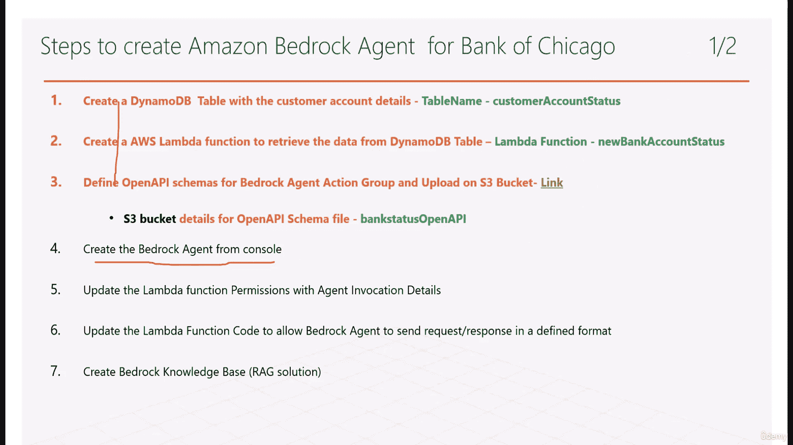
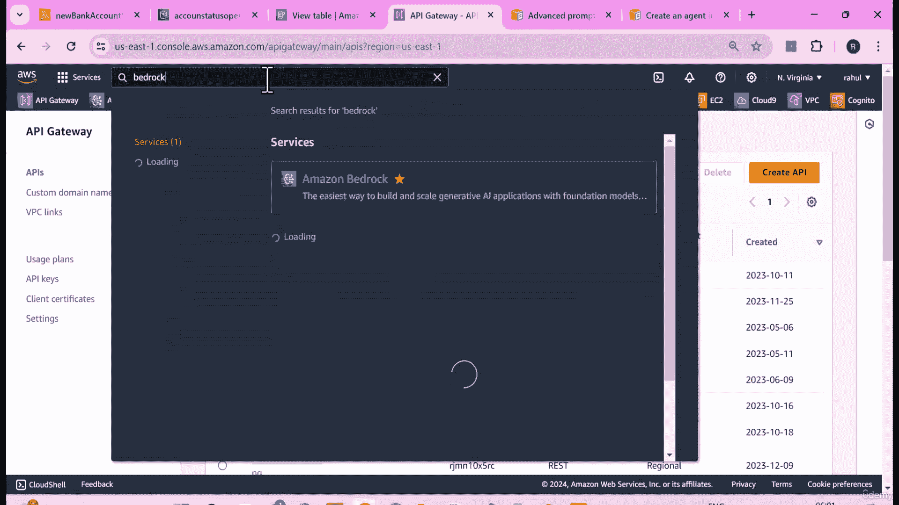
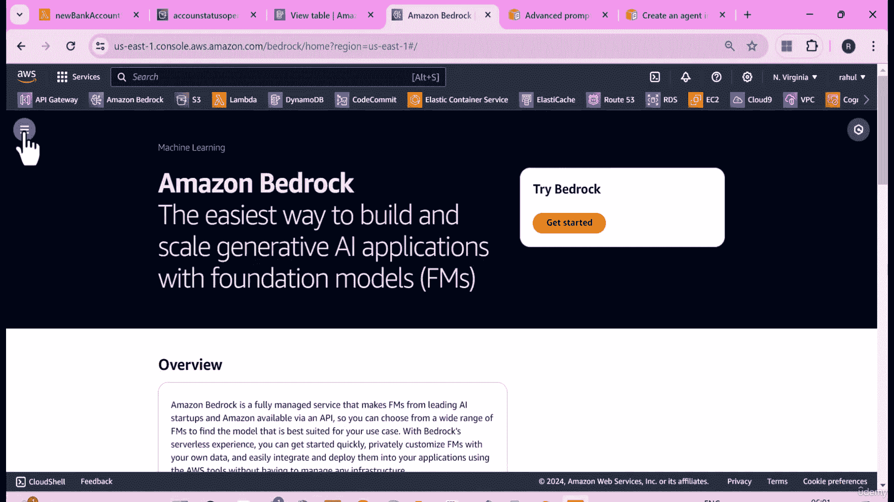
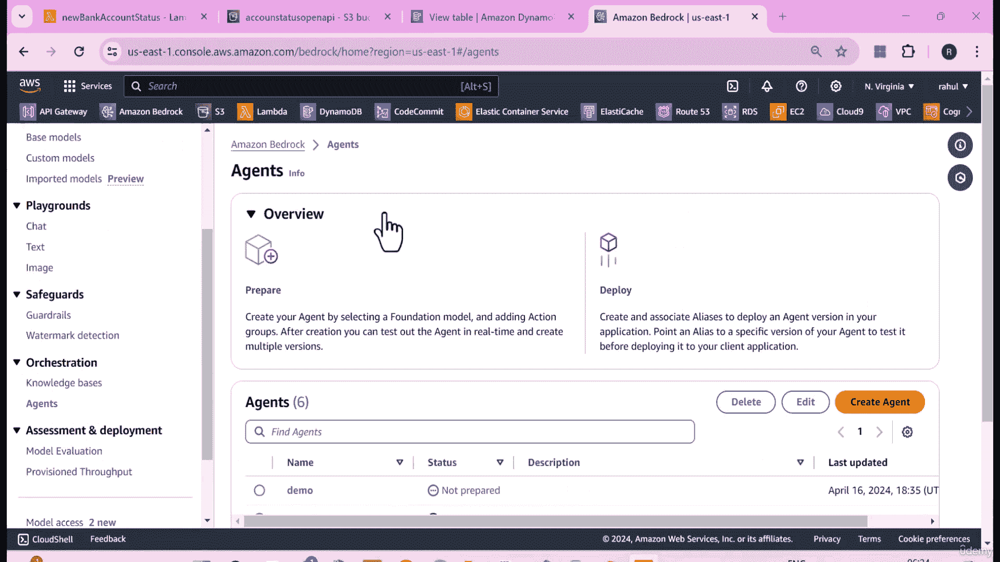
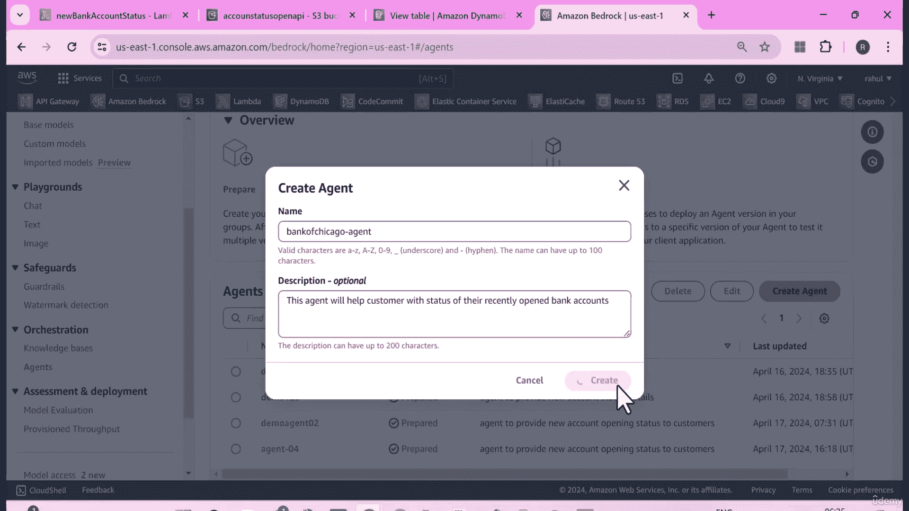
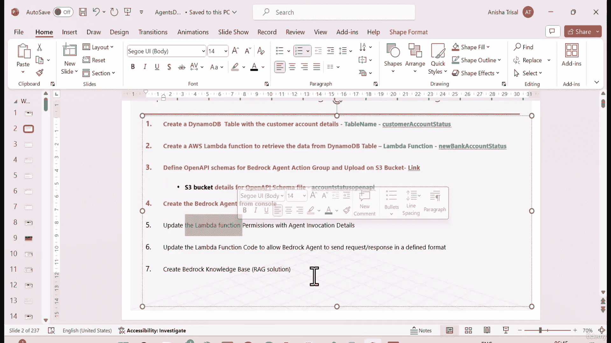

# 🚀 AWS生成式AI实战：第70-72讲：创建Amazon Bedrock Agent

在本节课中我们将要学习如何从AWS控制台创建一个Amazon Bedrock Agent，并使用Claude基础模型驱动它，再把上一讲准备好的Lambda函数、OpenAPI Schema等组件逐步接入代理。上一讲我们已经构建了DynamoDB和AWS Lambda函数，随后讨论了如何创建OpenAPI Schema；本讲的目标是把这些零散组件串起来，形成一个能处理银行账户状态查询的智能代理。

## 🧭 AWS生成式AI实战：第70-72讲：前置回顾与创建目标



上一讲我们构建了DynamoDB和AWS Lambda函数，随后讨论了如何创建OpenAPI Schema。现在本讲要使用Claude基础模型创建Bedrock Agent，并把Lambda函数和其他组件连接到这个代理上。进入控制台前，先查看分步指南；指南中前三步已经完成，本步要从控制台创建Bedrock Agent。明确这个目标后，下面进入控制台完成创建。



以下是对当前准备状态的简单回顾，方便初学者理解每一步在整体流程中的位置：



- DynamoDB和AWS Lambda函数已经构建完成。
- OpenAPI Schema已经讨论并准备好。
- 本讲要从控制台创建Bedrock Agent，并连接Lambda函数和其他组件。
- 分步指南的前三步已经完成，本步是在控制台中创建代理。



## 🏗️ AWS生成式AI实战：第70-72讲：在控制台创建Agent



现在进入AWS控制台。在AWS控制台中搜索Bedrock。进入Bedrock后，点击左侧菜单中的Agents。到达Amazon Bedrock Agent主页后，点击Create agent，并给代理命名；这里把代理命名为Bank of Shikaku Agent。代理描述是可选内容，但这里仍填写一段描述：该代理将帮助客户查询其最近开立银行账户的状态。随后点击Create。

控制台提示Bank of Asia成功创建；后续页面又出现Bank of Chicago Agent的名称，这是转录中的命名差异，实际操作以输入名称为准。接下来回顾已经创建的内容：代理名称和描述已经填写。页面中可以看到agent resource role，也就是代理资源角色。代理需要连接不同数据源，例如Lambda函数、作为OpenAPI Schema存放位置的S3桶，以及知识库；因此它需要一个IAM角色，允许连接多个不同服务。这个服务角色可以自行创建，也可以让Amazon Bedrock代为创建；这里允许Amazon Bedrock为代理创建新的服务角色。

基础模型方面，代理当前只支持Anthropic，页面提示Amazon Titan Express即将推出。这里使用Anthropic的Claude 3 Sonnet作为代理的基础模型。可以用下面的关系理解代理资源角色和模型配置：

```text
Agent -> IAM Role -> { Lambda, S3(OpenAPI Schema), Knowledge Base }
Foundation Model = Anthropic Claude 3 Sonnet
```

接下来要提供代理指令，这一步非常重要，因为它定义代理使用的风格和语气。这里已经写好一段指令并粘贴进去。指令内容是：你是零售银行的银行助手；你友好、礼貌；你通过向客户提供其新开银行账户的状态来帮助解决客户查询。

以下是需要粘贴给代理的指令内容，它用于定义代理的说话方式和职责范围：

> 你是零售银行的银行助手。你友好、礼貌。你通过向客户提供其新开银行账户的状态来帮助解决客户查询。

然后点击Additional settings。接下来是User inputs，也就是用户输入设置。它的含义是：如果Bedrock Agent认为客户发来的查询信息不足，代理可以向用户询问额外信息。页面说明，启用后允许代理向用户提出澄清问题，以捕获必要输入；这里点击Enable启用。随后是KMS key加密设置。默认情况下，使用由AWS KMS管理的密钥进行加密；如果想使用自定义加密设置，可以点击相关选项，但这里保留默认值。

接下来是idle session timeout，也就是空闲会话超时。当用户向代理提出查询时，代理会建立一个会话，该会话会持续一定时间。默认的空闲会话超时是30分钟；原文转录写为可设置1分钟到60秒，这里按控制台常见范围理解为1分钟到60分钟，实际以控制台为准。这里保留默认值。动作组和知识库暂时不添加，先创建这个代理。点击Save and exit。

页面提示Bank of Chicago Agent成功更新，并提示准备代理以保持其详细信息最新。可以用下面的式子理解几个核心配置：

```text
SessionIdleTimeout ∈ [1, 60] 分钟（默认30分钟，原文转录有60秒的说法，以控制台为准）
KMSKey = AWS Managed Key（默认） | Custom Key
UserInputs = Enable Clarifying Questions
```

代理创建并完成准备后，下一步先做测试，看看只有基础模型驱动时它会如何响应。

## 🧪 AWS生成式AI实战：第70-72讲：准备与测试Agent

现在尝试测试代理。在测试前需要先点击Prepare，这里执行一次准备。随后进行测试，输入“hi”。可以看到代理返回响应：今天如何协助你处理银行需求。问题在于，当前代理尚未连接OpenAPI Schema、Lambda函数或知识库，因此只有Anthropic Claude基础模型在驱动它，它只能提供通用回复。

以下是准备和测试代理的操作顺序，初学者可以按这个顺序观察代理当前的能力边界：

- 点击Prepare准备代理。
- 输入“hi”进行测试。
- 观察代理返回通用银行助手回复。
- 确认当前未接入OpenAPI Schema、Lambda函数和知识库，因此只能产生通用响应。

测试发现代理还没有接入业务组件，因此接下来要把OpenAPI Schema和Lambda函数、DynamoDB与代理集成起来。

## 🔗 AWS生成式AI实战：第70-72讲：集成Action Group

现在把OpenAPI Schema和Lambda函数、DynamoDB与代理集成。点击Edit in agent builder，然后向下滚动到Action groups。点击Add action groups。动作组本质上是OpenAPI Schema和已经写好的Lambda函数的组合。可以用下面的公式理解动作组：

```text
Action Group = OpenAPI Schema + Lambda Function
```

以下是添加动作组的关键步骤，按顺序操作即可把业务逻辑接入代理：

- 在代理构建器中点击Edit，滚动到Action groups。
- 点击Add action groups。
- 将动作组命名为Demo Agent；描述可选，这里留空。
- Action group type选择API Schema，也就是OpenAPI Schema。
- 选择现有Lambda函数，搜索并选择上一讲创建的new bank account status。
- 提供动作组Schema；可以内联定义，但这里使用已上传到S3的Schema链接。
- 在S3中浏览并选择account status open API桶中的account OpenAPI YAML文件。
- 点击Choose，再点击Create创建动作组。
- 动作组Demo创建完成后，点击Save and exit。

动作组类型可以由函数详情定义，但这里已经用API Schema也就是OpenAPI Schema定义。选择Lambda函数时，点击选择现有Lambda函数；这里的Lambda函数是new bank account status，也就是上一讲创建的函数，搜索后点击选中。动作组Schema可以在这里内联定义，但此前已经定义并上传到S3桶，因此只需要提供该S3桶的链接。进入S3后，桶名是account status open API，浏览并选择account OpenAPI YAML文件，点击Choose。随后点击Create，页面显示动作组Demo已经创建，于是点击Save and exit。

页面提示Bank of Chicago Agent成功更新。随后点击Prepare。动作组添加并准备完成后，下一步是处理代理调用Lambda函数的权限，并修改Lambda代码。

## 🛡️ AWS生成式AI实战：第70-72讲：后续权限与代码修改

完成Bedrock Agent创建后，下一步需要给代理授予调用Lambda函数的权限，同时还要对Lambda代码做一些修改。本讲内容到此结束，下一讲继续。

以下是本讲结束前确认的后续任务，方便在下一讲开始前建立整体认识：

- 为代理提供调用Lambda函数的权限。
- 修改Lambda代码以配合代理调用。
- 下一讲继续完成这些集成和权限配置。

## ✅ AWS生成式AI实战：第70-72讲：总结



本节课中我们一起学习了如何从AWS控制台创建Amazon Bedrock Agent，如何选择Anthropic Claude 3 Sonnet作为基础模型，如何填写代理指令和描述，如何配置用户输入、KMS加密和空闲会话超时，如何准备并测试只有基础模型驱动的代理，以及如何添加由OpenAPI Schema和Lambda函数组成的Action Group。代理创建和动作组接入完成后，下一讲还需要为代理授予调用Lambda函数的权限，并修改Lambda代码。
