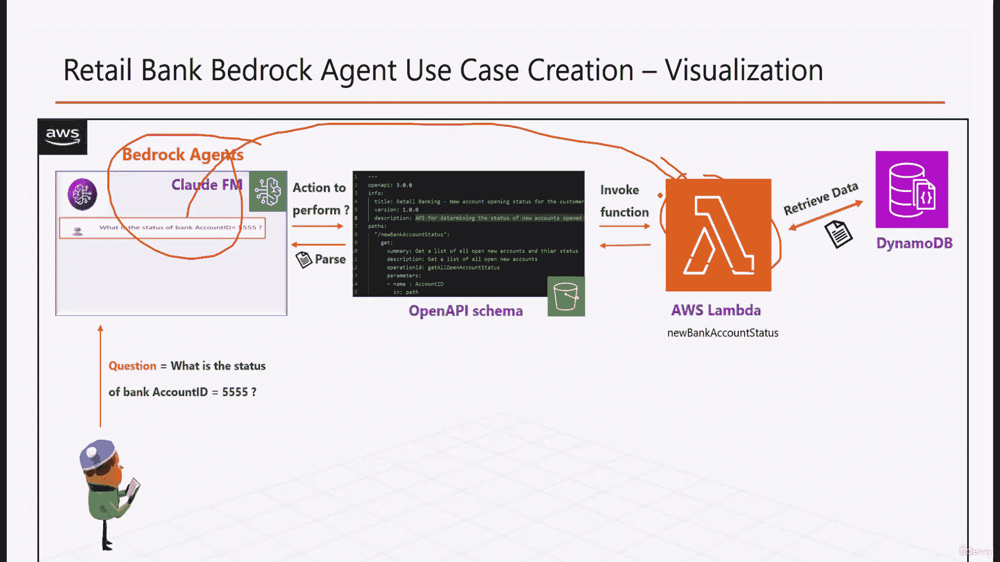
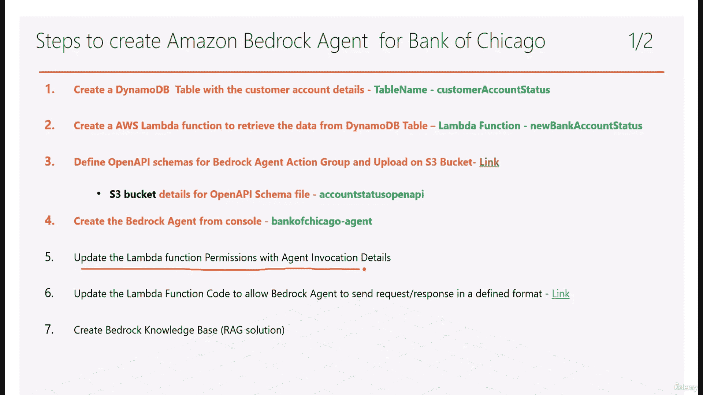
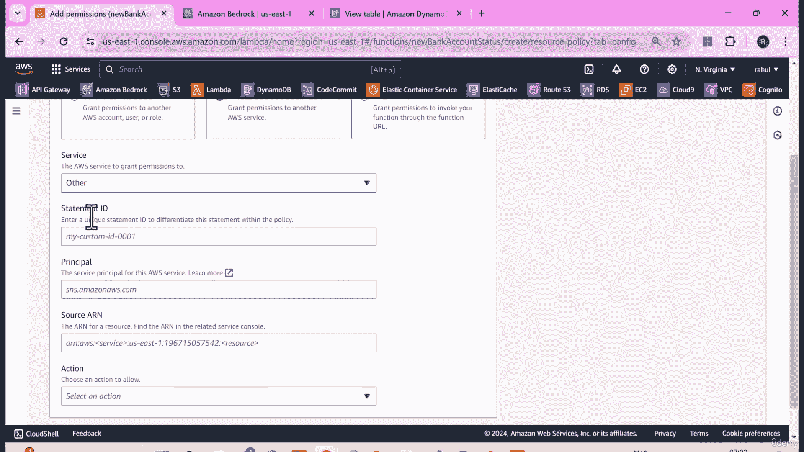
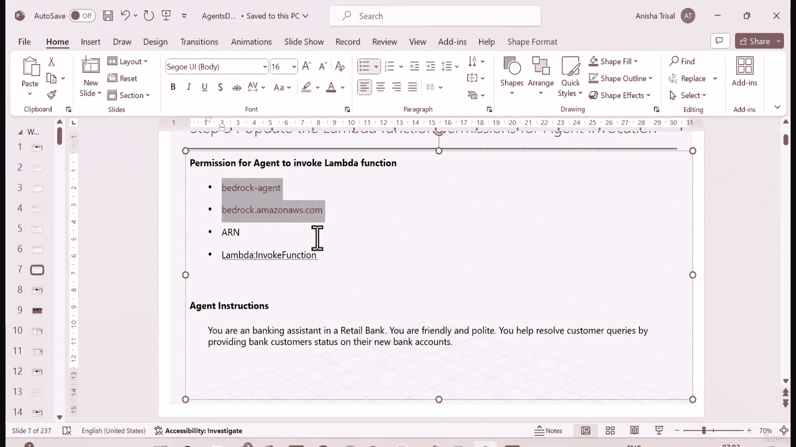
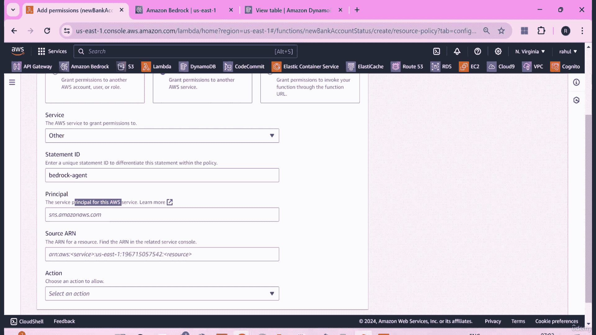
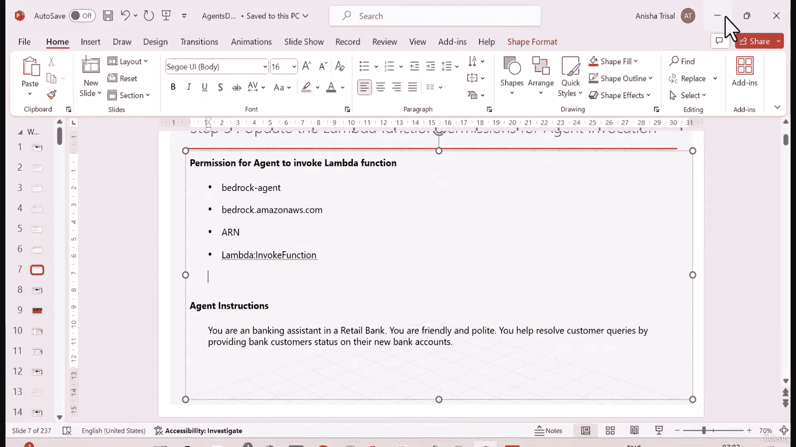
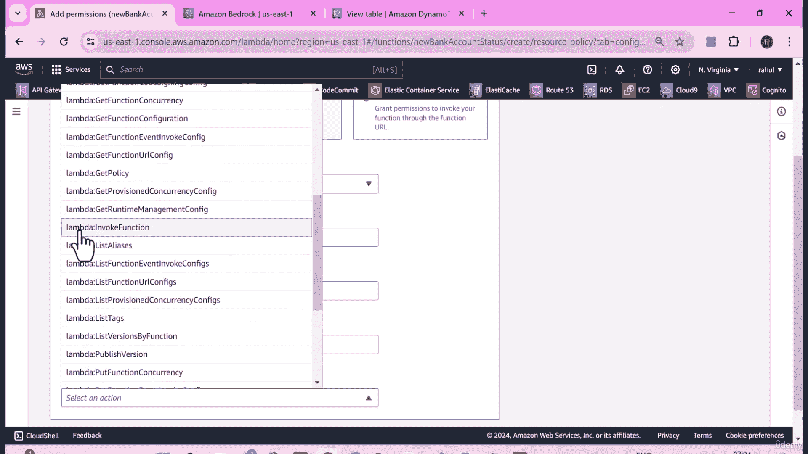
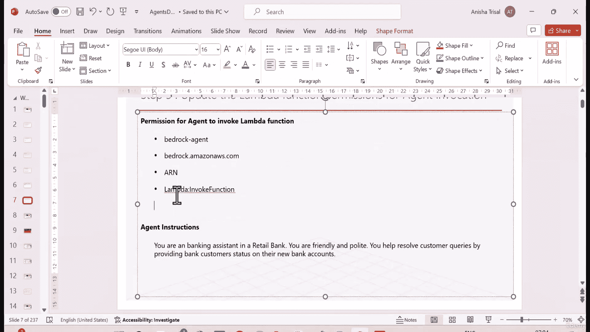
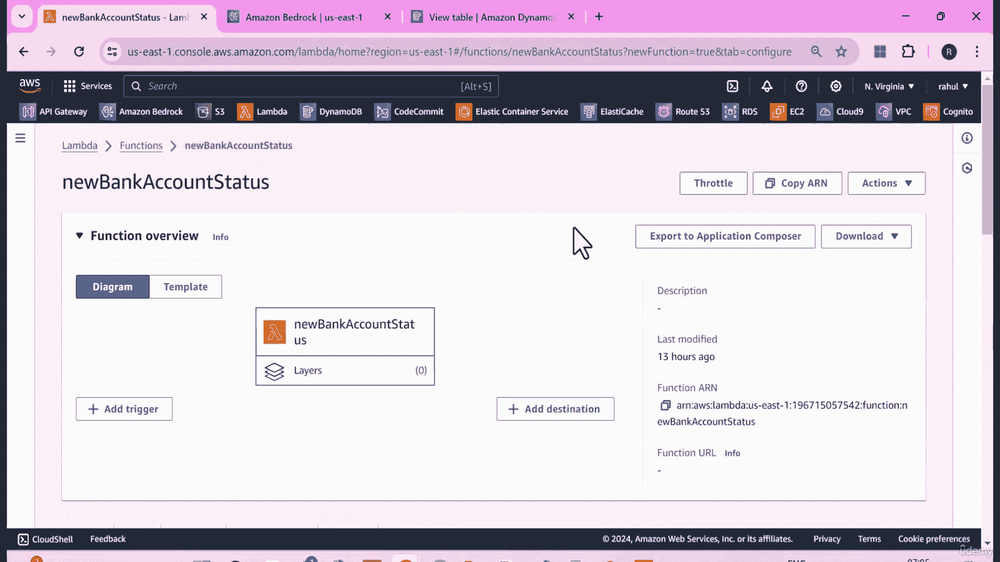

# Generative AI on AWS：第71-73节：配置 Bedrock Agent 调用 Lambda 函数的权限

## 📘 概述

在本节课中，我们要完成一项关键操作：为已经创建好的 Bedrock Agent 和 Lambda 函数配置权限，让 Bedrock Agent 能够调用这个 Lambda 函数。上一步我们已经创建了 Bedrock Agent 和 Lambda 函数，现在需要打通两者之间的调用链路。具体来说，要在 Lambda 函数的资源策略中添加一条授权语句，把 Bedrock Agent 的 ARN 写进去，这样代理在运行时就能触发这个函数了。下面我们进入控制台，一步步完成配置。



## 🖥️ 进入 Lambda 函数控制台



首先，我们需要打开之前创建的那个 Lambda 函数。为了醒目标记，这个函数的名字是 `new bank account status`。找到这个函数后，点击进入它的详情页面。在页面上，我们从上往下滚动，找到并点击 **Configuration** 选项卡，然后进入 **Permissions** 面板。在这里你会看到一个 **Execution Role**（执行角色），这是 Lambda 函数运行时使用的身份。不过我们需要配置的不是这个，而是下方的 **Resource-based policy statement**（基于资源的策略声明）。继续向下滚动，找到这个区域后，点击 **Add permissions** 按钮，这样就进入了添加权限的流程。

## ➕ 添加权限并填写策略内容

点击 **Add permissions** 之后，系统会弹出一个配置界面。界面中有一个 **AWS service** 的下拉选项，但在当前版本中，下拉列表里还找不到 **Bedrock Agents** 这个选项，所以我们需要选择 **Other**。选择之后，界面会要求填写若干字段。为了简化操作，我这里已经把所有需要填写的值都整理出来了，你可以直接参照。

下面我们逐一说明这些字段的内容：



- **Statement ID**：这是一个任意字符串，用来标识这条策略语句。你可以随意填写，比如我在这里填写的是 `bedrock-egypt`。
- **Principal**：这是能够调用该 Lambda 函数的 AWS 服务的服务主体（Service Principal）。对于 Bedrock 来说，它的值就是 `bedrock.amazonaws.com`。注意格式是 `服务名.amazonaws.com`，这里需要在输入框中准确填写。
- **Source ARN**：这是源头资源的 ARN，也就是我们刚刚创建的那个 Bedrock Agent 的 ARN。我们可以回到 Bedrock Agent 的页面，在 Agent 详情中找到 **Agent ARN** 字段，点击复制，然后返回这个配置界面，把它粘贴到 **Source ARN** 输入框中。这个字段非常重要，它限定了只有这个特定的 Agent 才能访问当前 Lambda 函数。
- **Action**：这是服务主体对 Lambda 函数执行的操作。我们要允许 Bedrock Agent 调用该函数，所以操作应该是 `lambda:InvokeFunction`。在下拉列表中找到 **Lambda invoke function** 这个选项，选中它即可。



在整个配置过程中，你会发现每个字段都有明确的格式要求，尤其是 **Principal** 和 **Source ARN**。为了更直观地理解这组配置的底层结构，我们可以用一段 JSON 代码来描述最终的权限策略：

```json
{
  "Version": "2012-10-17",
  "Statement": [
    {
      "Sid": "bedrock-egypt",
      "Effect": "Allow",
      "Principal": {
        "Service": "bedrock.amazonaws.com"
      },
      "Action": "lambda:InvokeFunction",
      "Condition": {
        "ArnLike": {
          "AWS:SourceArn": "arn:aws:bedrock:region:account-id:agent/agent-id"
        }
      }
    }
  ]
}
```

这里的关键逻辑可以用一个简单的公式表示：





**允许调用 = (Principal 是 `bedrock.amazonaws.com`) 且 (SourceArn 等于 Agent 的 ARN) 且 (Action 是 `lambda:InvokeFunction`)**。

只有同时满足这三个条件，Bedrock Agent 才能成功调用这个 Lambda 函数。如果任何一个条件不匹配，调用就会被拒绝。

## 💾 保存并确认配置

把上述字段都填写完整后，检查一遍，确保没有遗漏或拼写错误。在填写的过程中，我也把这些细节都记录在了笔记里，方便你随时对照参考。确认无误后，只需要点击页面底部的 **Save** 按钮保存即可。保存成功后，这条资源策略就会立即生效。



简单来说，这一步就是在 Lambda 函数的门禁系统里添加一条规则，把 Bedrock Agent 的身份放进行可通行的名单。完成后，我们的 Bedrock Agent 就获得了调用这个 Lambda 函数的权限，只要它需要，就能在运行过程中触发这个函数了。



## 📝 总结



本节课我们一起完成了 Bedrock Agent 调用 Lambda 函数的权限配置。我们首先进入了 Lambda 函数的控制台，在 **Permissions** 下的 **Resource-based policy statement** 中添加了权限。接着我们填写了 Statement ID、服务主体 `bedrock.amazonaws.com`、Agent 的 Source ARN 以及操作 `lambda:InvokeFunction`，最后点击保存。通过这个设置，Bedrock Agent 就能在需要时顺利执行我们创建的 Lambda 函数了。在下一节中，我们将继续探索 Bedrock Agent 的其他配置与测试方式，敬请期待。
