# 🚀 生成式AI在AWS上的实战（Amazon Bedrock、RAG与KIRO）：第72-74节：集成Bedrock Agent、Lambda与DynamoDB

在本节课中，我们将学习如何更新 Lambda 函数的代码，让 Bedrock Agent 能够按照明确定义的格式向 Lambda 发送请求，并接收 Lambda 返回的响应。这里的关键在于，Agent 与 Lambda 之间并不是随便传数据，而是要遵循一个双方都认可的“通信协议”。我们将先解释这个协议中的输入事件和输出响应的格式，然后实际操作修改 Lambda 函数，最后通过 Bedrock Agent 发起真实查询来验证整个链路是否已经打通。学完本节后，你就能明白如何把 Bedrock Agent 和 DynamoDB 数据查询服务完整地串起来。

在开始修改代码之前，我们首先要弄清楚 Bedrock Agent 到底用什么格式把请求交给 Lambda，又期望 Lambda 用什么格式把结果还回来。只有把这两个格式搞明白，后续的代码修改才会变得顺理成章。

## 📡 理解 Agent 与 Lambda 的通信格式

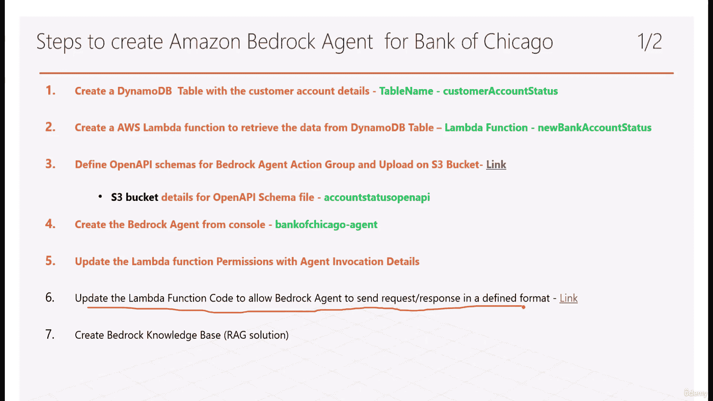

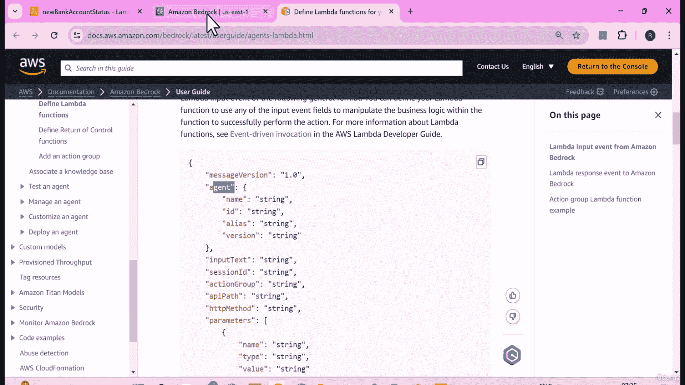

我们先来看输入事件。在 Agent 的文档页中，你可以看到 Lambda 输入事件的具体格式。一旦用户向 Agent 提出一个问题，比如“账户 I5555 的状态是什么”，Bedrock Agent 会连同底层基础模型一起，把请求组织成下面这种结构发送给 Lambda 函数。这里需要特别注意的是，这个输入事件并不是只有一句话，而是包含了很多元数据字段的 JSON 结构。

以下是一个典型的 Lambda 输入事件示例：

```json
{
  "messageVersion": "1.0",
  "agent": {
    "name": "Bank of Chicago",
    "id": "AGT123456",
    "alias": "TSTALIAS",
    "version": "1"
  },
  "inputText": "what is the status of bank account I5555",
  "sessionId": "session-1234",
  "sessionAttributes": {},
  "actionGroup": "actionGroup-demo",
  "apiPath": "/account/{accountId}",
  "httpMethod": "GET",
  "parameters": [
    {
      "name": "accountId",
      "type": "string",
      "value": "5555"
    }
  ]
}
```

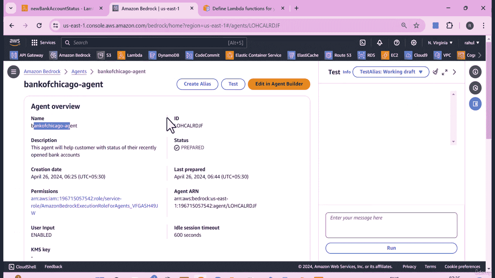

这个输入事件包含了 Bedrock Agent 要传给 Lambda 的全部信息。以下是输入事件中的主要字段：

- `messageVersion`：消息版本号，目前是 `1.0`。
- `agent`：Agent 的元信息，里面包含 `agentName`、`agentId`、`alias`、`version` 等。
- `inputText`：用户提交给 Agent 的原始请求文本。
- `sessionId`：当前会话的 ID。
- `sessionAttributes`：会话属性，用于在多次交互中保存一些状态。
- `actionGroup`：当前请求命中的动作组名称，比如这里的 `actionGroup-demo`。
- `apiPath`：当前请求对应的 API 路径。
- `httpMethod`：HTTP 方法，例如 GET。
- `parameters`：路径中携带的参数列表，里面会包含 `accountId` 以及它的值。

以上这些字段都会从 Agent 那边自动带过来，我们可以在 Lambda 的日志中实际看到它们。当你打开自己的 Agent 配置页面时，也能找到对应的 Agent 名称、Agent ID 等信息，它们会原封不动地出现在输入事件里。

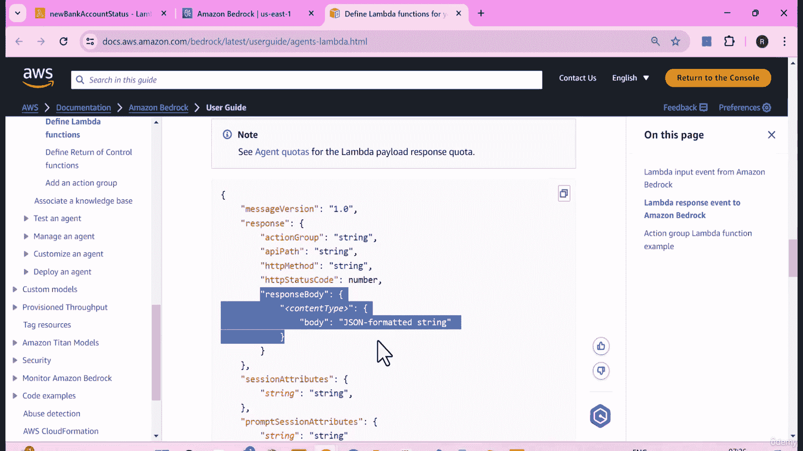

接下来我们看看输出响应格式。与输入事件类似，Agent 对 Lambda 返回的结果也有固定要求。响应中同样有 `messageVersion`，值也是 `1.0`；还会有 `responseActionGroup`、`apiPath` 等字段。其实这些字段的大部分内容都可以直接从输入事件中原样拿回来，唯一需要真正修改的只有 `responseBody`，也就是我们要返回给 Agent 的“正文”。因此，你不需要从零构造一整套响应，只需要把输入事件里的信息原样送回，再把查询结果填到响应体里就行。

下面是一个输出响应的示例结构：

```json
{
  "messageVersion": "1.0",
  "response": {
    "actionGroup": "actionGroup-demo",
    "apiPath": "/account/{accountId}",
    "httpMethod": "GET",
    "responseBody": {
      "application/json": {
        "body": "{\"accountId\":\"5555\",\"status\":\"active\"}"
      }
    }
  },
  "sessionAttributes": {}
}
```

可以看到，响应格式其实就是把输入事件中的关键字段回传回去，同时把业务查询结果放在 `responseBody.body` 里面。这样一来，Agent 才能正确解析 Lambda 返回的数据，并把最终结果呈现给用户。现在我们已经知道了理论上的格式，接下来就去实际环境中看看这些字段到底长什么样。

## 🔍 查看传入 Lambda 的真实事件

上一节我们介绍了通信格式的理论知识，本节我们来看实际运行时的真实数据。之前我们测试 Lambda 函数时，是在测试事件里手动配置了一个 `event`，并告诉 Lambda 说“`accountId` 就是这个”。但现在情况不同了：这次传入的输入事件不再来自测试配置，而是来自我们在 Bedrock 里构建的那个 Agent。所以我们可以先故意不修改 Lambda 函数，直接用 Agent 发起一个查询，让它报错，目的是看传递进来的事件结构。

我们在 Bedrock Agent 的测试界面中输入：

“What is the status of account ID equal to 5555？”

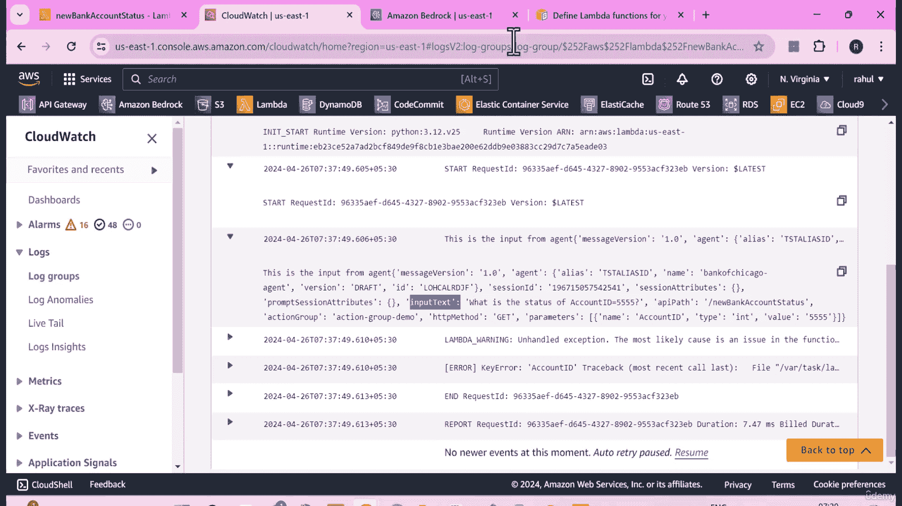

然后点击运行。此时 Lambda 函数还没有按照 Agent 要求的输入输出格式修改，所以一定会报错。你会看到类似“your request could not be completed”的提示，这没有关系，我们正是要通过这次报错来观察事件结构。接下来进入 Lambda 控制台，找到“监控”选项卡，然后点击“查看 CloudWatch 日志”。在日志组中，你可以看到函数启动时打印出来的输入事件。

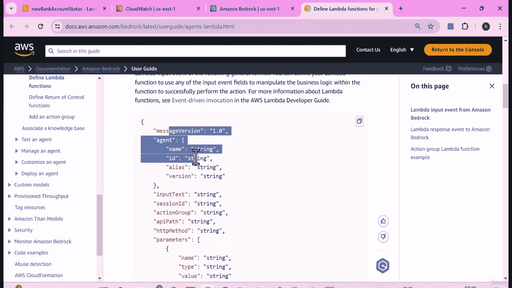

日志里可以看到 `messageVersion` 是 `1.0`，Agent 名称是 `Bank of Chicago`，还有对应的 Agent ID、会话 ID、会话属性、`inputText` 等。这些内容正是前面介绍的那些字段。不过我们真正关心的是 `apiPath` 和 `parameters`。在 `parameters` 中，你可以看到传给 Lambda 的 `accountId` 参数名为 `accountId`，值为 `5555`。也就是说，整个输入都传给了 Lambda，但我们真正想提取的只有那个 `5555`。

你可以打开自己的 Agent 页面，对比一下日志中的内容，会发现 Agent 名称、ID 等信息和页面上的配置完全一致。这证明这些字段确实是 Agent 自动填充的。

注意，在日志中的事件结构里，`parameters` 是一个列表，列表里只有一个元素，这个元素又是一个字典，里面有 `name`、`type`、`value` 这些键。所以我们需要按字典和列表的方式逐层取出值。这样做看起来多了一步，但这就是 Agent 和 Lambda 之间的约定，我们只能按这个结构来解析。

## 🛠 修改 Lambda 函数，解析输入参数

在上一节我们看到了事件的真实结构，现在我们来修改 Lambda 函数代码，让函数能正确地从事件中取出账户 ID。

原来的代码里，我们是直接从 `event` 中取 `accountId` 的，大概像下面这样：

```python
account_id = event["accountId"]
```

这种写法在我们自己配置测试事件时没问题，但 Agent 传来的事件并没有顶层的 `accountId` 键。根据刚才日志里看到的格式，我们要先从 `event` 中取出 `parameters`，再取列表中的第一个元素，最后从该元素中取出 `value`。对应的代码是：

```python
account_id = event["parameters"][0]["value"]
```

下面我们把这行代码替换到函数里。简单来说，之前我们是直接读取 `event["accountId"]`，现在改成读取 `event["parameters"][0]["value"]`。改完之后，整个输入事件中，唯一会被真正用来查询 DynamoDB 的值就是这个 `accountId`。DynamoDB 表名还是原来的表，主键仍然是 `accountId`，只是 `accountId` 的值现在来自 Agent 的传入参数。

修改完毕之后，部署 Lambda 函数。到这里，输入部分就算处理好了。你可能会觉得这样取值有点绕，但这是因为输入事件本身是一个嵌套结构，我们必须一层一层地把值取出来。实际上，这也是一种很常见的 JSON 解析操作，熟悉之后就会觉得很自然。

## 📦 按 Agent 要求构造响应

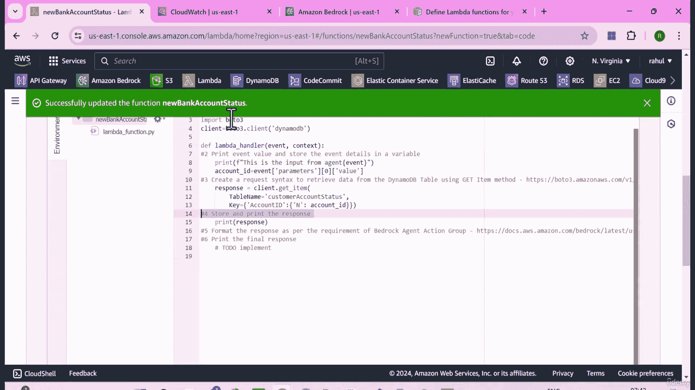

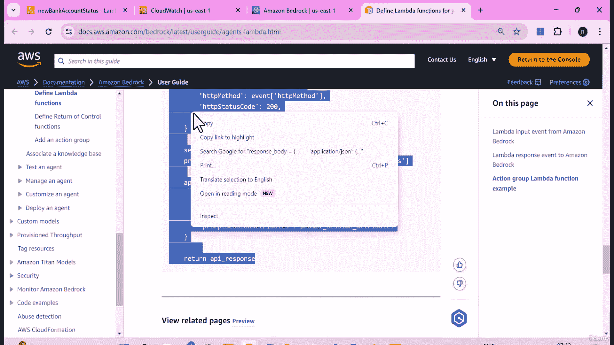

处理完输入后，我们还要让 Lambda 的返回结果符合 Agent 的预期。在上一节中，我们提到响应的大部分字段都可以从输入事件中直接复制，现在我们来看具体怎么做。

我们可以在 AWS 提供的文档中找到输出事件的示例，以及一个示例 Lambda 函数。文档里给出了响应体（`responseBody`）应该长什么样的说明：它应该是一个 `application/json` 类型的对象，其中 `body` 字段就是我们从 DynamoDB 查询到的结果。文档中的示例变量名是 `sample_response`，但实际操作时我们会把它替换成我们自己的 `response`。

有一点需要特别注意：`body` 字段的值必须是 JSON 格式的字符串。换句话说，不能直接把字典对象放进去，必须先用 `json.dumps()` 把查询结果序列化成字符串。因此，在响应代码中，我们要写成类似这样的形式：

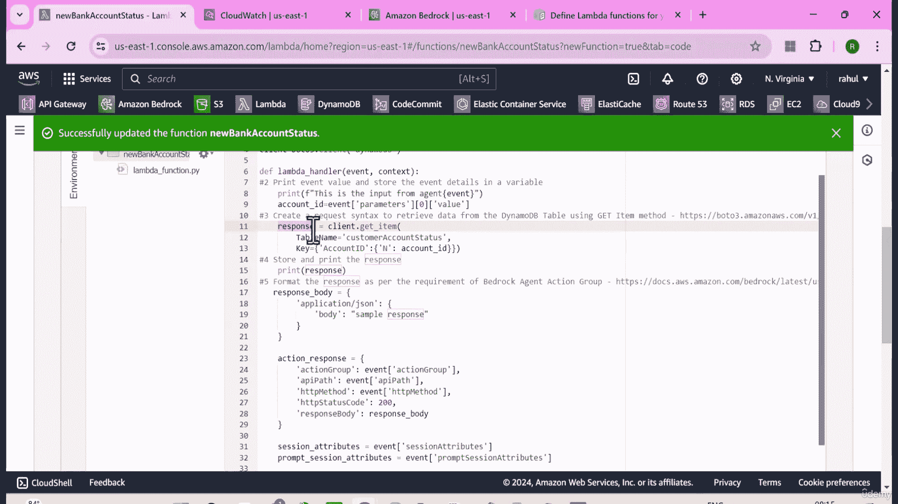

```python
response_body = {
    "application/json": {
        "body": json.dumps(response)
    }
}
```

如果直接放一个 Python 字典作为 `body`，Agent 可能无法正确解析，所以这个 `json.dumps()` 是必不可少的。关于这一点，最简单的理解就是：Agent 期望看到的是一个字符串，而不是一个对象，所以我们必须把对象“变成”字符串。

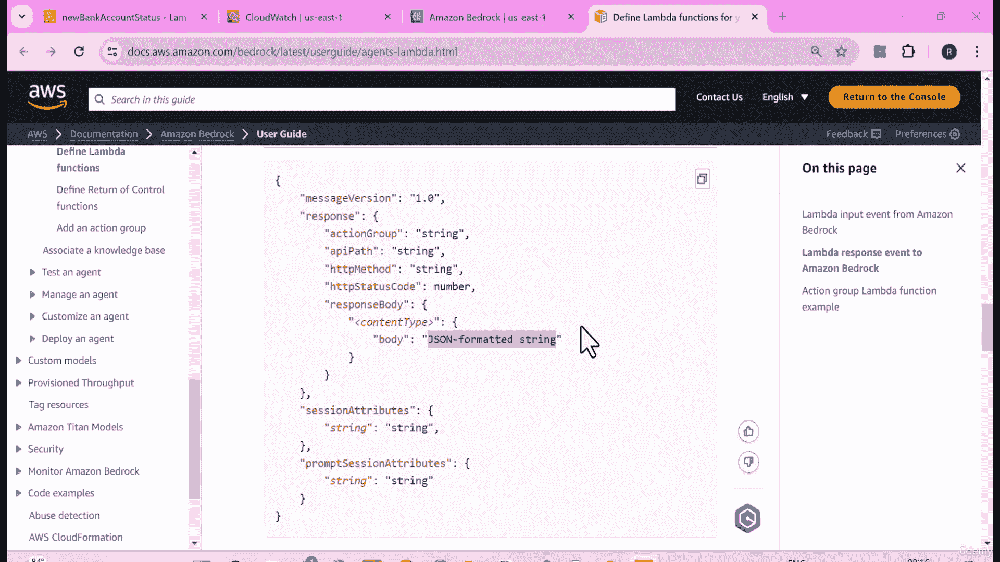

接下来的其他字段就简单了。在响应结构里，我们需要填写 `actionGroup`、`apiPath`、`httpMethod`、`messageVersion`、`sessionAttributes` 等信息。这些字段的值都可以从输入事件 `event` 中直接取回来，比如：

```python
action_group = event["actionGroup"]
api_path = event["apiPath"]
http_method = event["httpMethod"]
message_version = event["messageVersion"]
session_attributes = event["sessionAttributes"]
```

也就是说，整个响应基本上是一套“样板代码”：除了 `responseBody` 里的查询结果需要根据业务逻辑填充之外，其他部分都是从 `event` 里原样复制的。你可以把这理解为 Bedrock Agent 和 Lambda 函数之间约定好的“外壳”，你只需要关心怎么填 `body`，其他的照抄就行。

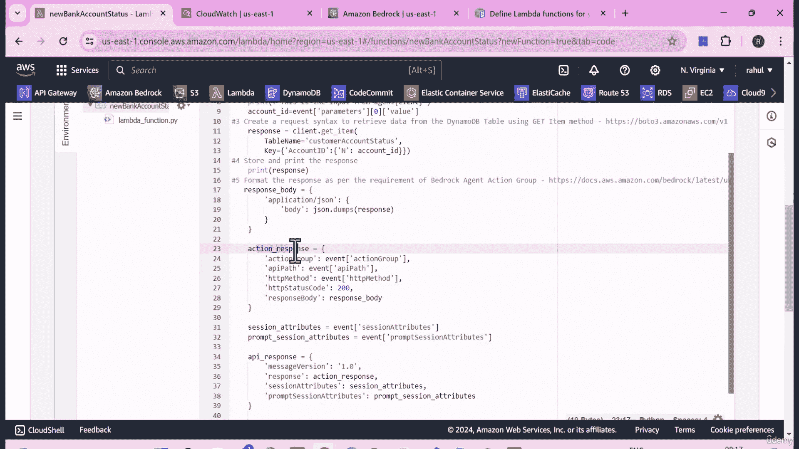

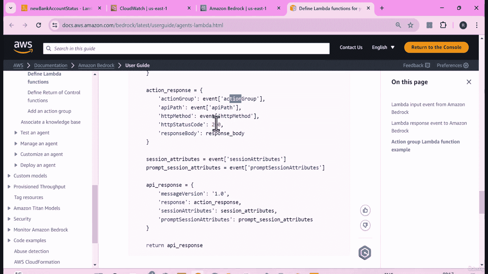

我们来看一个完整的响应构造示例，方便你理解代码应该怎么写：

```python
response = table.get_item(Key={"accountId": account_id}).get("Item", {})

response_body = {
    "application/json": {
        "body": json.dumps(response)
    }
}

action_response = {
    "actionGroup": event["actionGroup"],
    "apiPath": event["apiPath"],
    "httpMethod": event["httpMethod"],
    "responseBody": response_body
}

final_response = {
    "messageVersion": event["messageVersion"],
    "response": action_response,
    "sessionAttributes": event["sessionAttributes"]
}

return final_response
```

将这段逻辑整合到 Lambda 函数中，替换掉之前简单的 `return` 和打印语句。部署这些更改，这样 Lambda 函数的输出就能被 Bedrock Agent 正确解析了。可以看到，真正需要我们自己写的逻辑非常少，大部分代码都只是把输入事件里的字段“搬运”回响应里。

## 🧪 端到端测试

现在一切都改好了，我们来通过 Bedrock Agent 做一次真实的端到端测试，验证 Agent、Lambda 和 DynamoDB 之间是否已经正确连通。

在 Bedrock Agent 的测试界面中，我们输入以下问题：

“What is the status of account ID equal to 5555？”

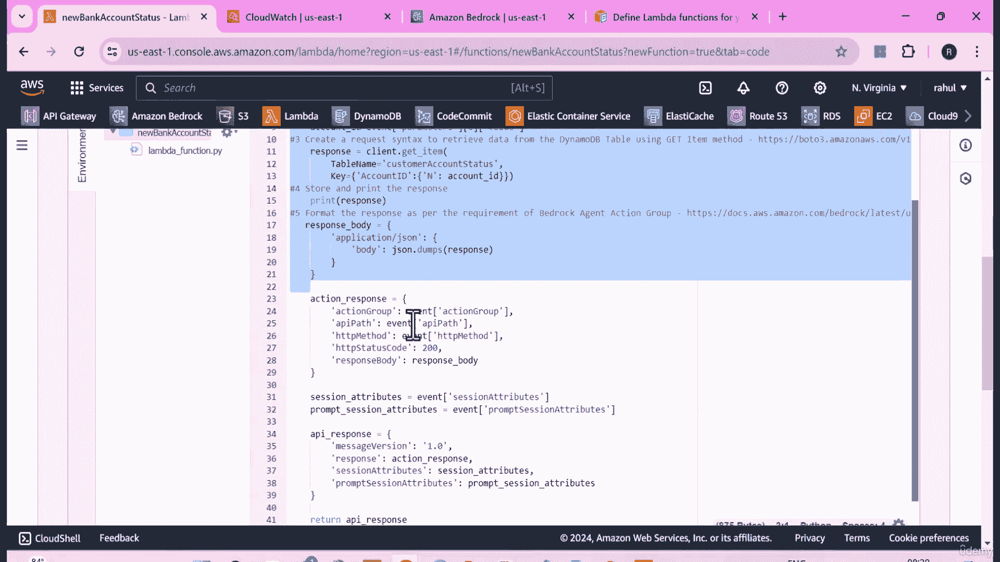

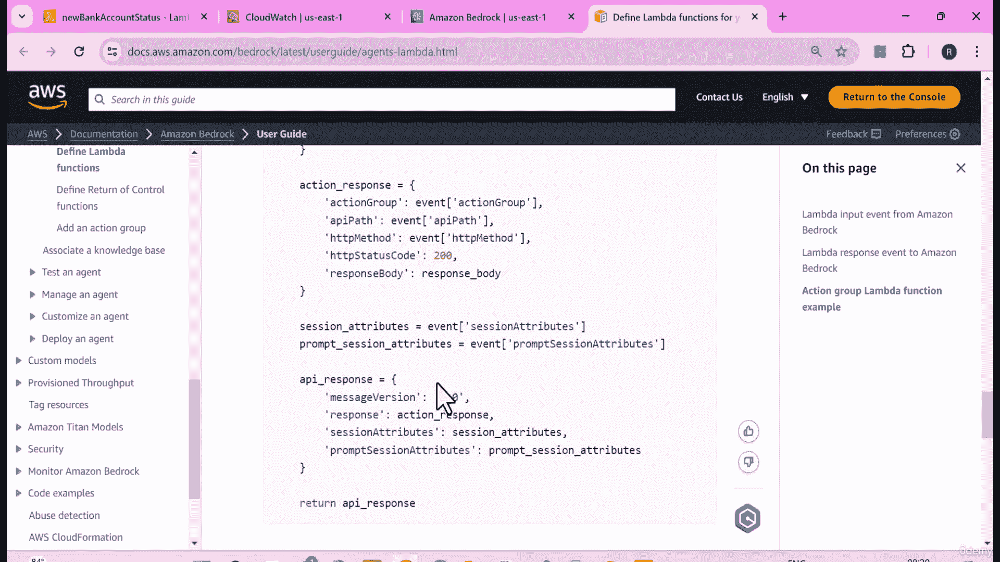

执行之后，Agent 返回的结果显示：账户 5555 的状态是 `active`。如果打开 DynamoDB 控制台查看对应记录，可以看到账户 5555 属于 John，状态确实是 `active`。这说明 Lambda 成功地从事件中提取出了 `accountId`，查询了 DynamoDB，并且把结果以 Agent 能理解的格式返回了。

接下来我们再试一个不同的查询。输入：

“What is the status of account ID equal to 7777？”

这次 Agent 返回的结果是：账户 7777 的状态是 `pending`，原因是 `invalid proof`（无效证明）。同样，打开 DynamoDB 查看这条记录，会发现该账户的状态确实是 `pending`，并且具体的原因为无效的地址证明（Invalid address proof）。Agent 返回的内容和数据库里的数据完全对得上。

到这里，整个链路已经全部打通：Bedrock Agent 接收用户提问，把参数传给 Lambda，Lambda 查询 DynamoDB，再把查询结果通过规定的格式返回给 Agent，最终 Agent 把结果展示给用户。整个过程中，我们最主要的工作就是调整 Lambda 函数的输入解析逻辑，以及构造符合规范的响应体。

## ✅ 总结

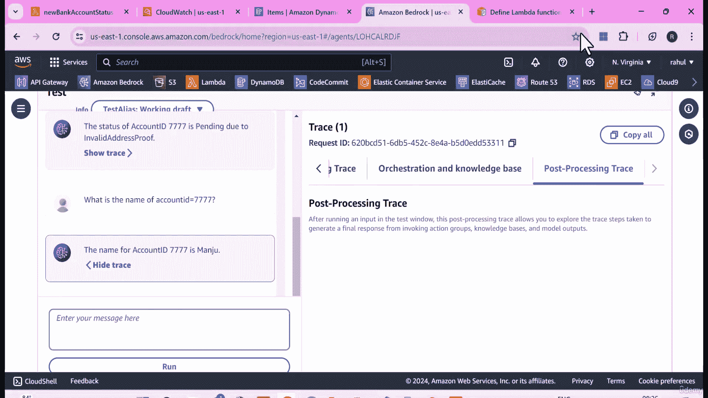

本节课中，我们一起学习了如何把 Bedrock Agent、Lambda 函数和 DynamoDB 集成在一起。我们首先了解了 Agent 与 Lambda 之间约定的输入事件和输出响应格式，接着利用 CloudWatch 日志查看了真实的事件结构，然后修改了 Lambda 函数的参数提取逻辑，使它能够从 `parameters` 列表里取出 `accountId`。我们还学习了如何按照 Agent 的要求构造响应，尤其是用 `json.dumps()` 把查询结果序列化成 JSON 字符串。最后，通过两个不同的账户 ID 完成了端到端测试，验证了查询结果与 DynamoDB 中的数据一致。希望你喜欢这节课，我们下节课见。

