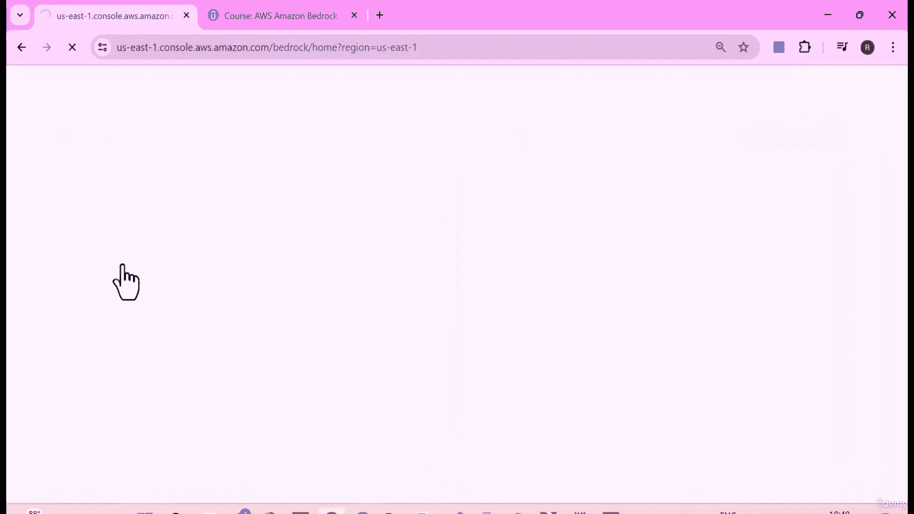
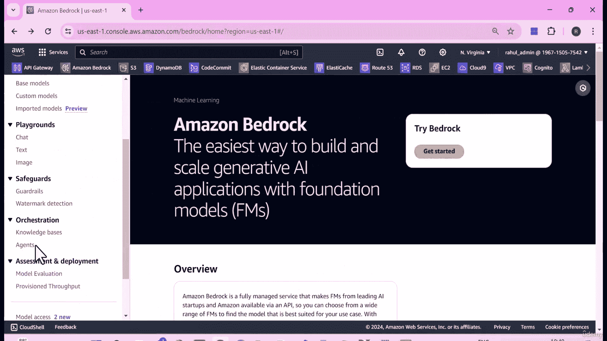
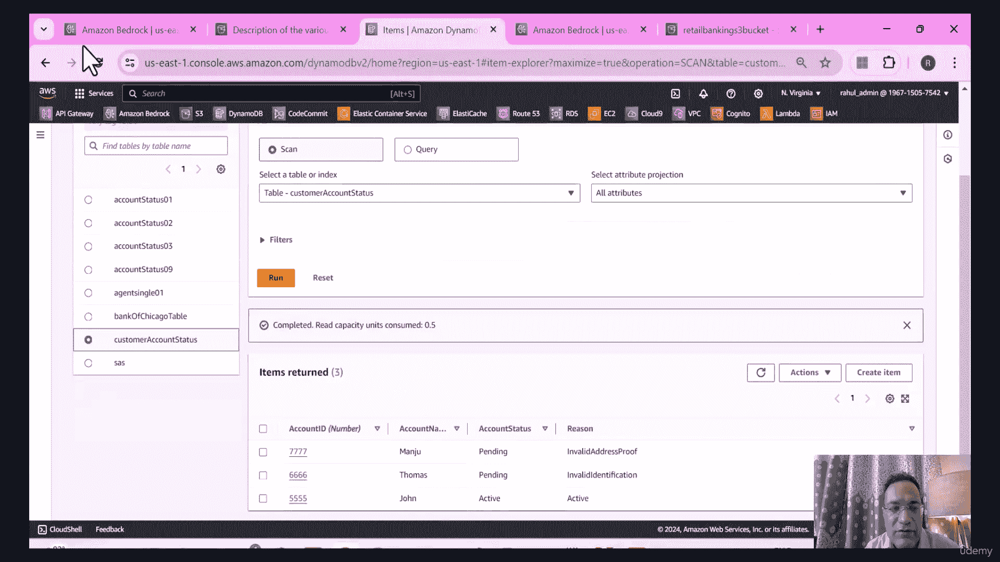

# 📘 生成式AI在AWS上的实践：73-75：Bedrock Agent与Knowledge Base集成教程

## 🎯 课程概述

在本节课中，我们将要学习如何把Amazon Bedrock Agent（智能代理）和Amazon Bedrock Knowledge Base（知识库）集成在一起。这个集成能够解决一个非常实际的问题：当大语言模型只能从结构化数据库（比如DynamoDB）中获取信息时，它无法回答那些需要参考外部文档才能解答的追问。比如说，用户可以查到一个账户状态是“待处理（pending）”，但为什么是“待处理”？这背后的详细原因（比如“地址证明无效”具体是什么意思）就需要一个RAG（检索增强生成）方案来补充。我们将一步步演示如何创建PDF文档、上传到S3、构建知识库、配置分块策略、生成向量嵌入，最后让Agent在回答问题时同时引用数据库信息和文档内容。整个过程都是实操演示，跟着做就能学会。

## 📖 回顾上节课的内容

在上一节课中，我们做了一个有趣的实验。当我们向Bedrock Agent提问“账户ID 7777的状态是什么”时，Agent给出了一个明确的回答：该账户状态为“待处理（pending）”。这个答案完全基于DynamoDB中存储的数据得出的，那个时候Agent只具备访问这个数据库的能力。

这个场景模拟的是银行业务中的一个真实情况：客户打来电话询问自己的账户为什么被冻结或者为什么还在审核中，Agent需要快速查询数据库并给出状态信息。

## 🤔 引出新的问题场景

现在，让我们把场景推进一步。假设用户接着追问了一个问题：“无效的地址证明（invalid address proof）是什么意思？”或者“无效的身份证明（invalid identification）是什么意思？”

在银行业务中，“无效的身份证明”这个表述可以有好几种含义。可能是用户提交的地址信息确实不符合要求，也可能是用户提供的银行卡已经过期了，还有可能是其他一系列不同的原因。这些详细的解释说明，你是不可能全部塞进DynamoDB表里的，因为那种结构化数据库是用来存储查询结果的，不是用来存放长篇解释文档的。

那怎么解决这个问题呢？一个比较直观的做法是：你写一份PDF文档，把这个错误码对应的各种解释说明都写进去，然后把这份PDF放到公司的官方网站上。用户如果想知道某个错误码的具体含义，就可以自己上去查看文档。

我已经把这件事做好了。我为各种不同的错误码编写了解释说明，专门做成了一份PDF文档。如果错误码是“无效身份证明（invalid identification）”，文档里就写清楚这可能意味着什么；如果错误码是“无效地址证明（invalid address proof）”，文档里也给出了对应的描述。这就是我们后续要用到的数据基础。

## 🔧 Bedrock Agent如何解决这个挑战

那么，Bedrock Agent是怎么帮助我们解决这个问题的呢？它允许我们集成一个基于RAG的解决方案。

RAG的全称是检索增强生成（Retrieval Augmented Generation）。它的核心思想是：大语言模型在回答问题之前，先从外部知识库中检索出相关的信息片段，然后基于这些检索到的信息来生成答案。这样做的好处是模型不需要把所有的知识都记在参数里，只需要知道去哪里检索就行了。

如果你还不了解RAG是什么意思、怎么实现，建议你先去看一下前面章节中构建基于RAG的在线学习应用（e-learning app）的那部分内容，那里详细展示了如何使用Amazon Bedrock Knowledge Base来搭建一个完整的RAG应用。我们这个章节的实现方式与那节课基本一致。

Bedrock Agent让我们能够极其简单地与Amazon Bedrock的知识库进行集成。整个流程可以这样理解：

以下是整个RAG工作流的步骤概括：

1. 你创建一份PDF文档，把错误码的详细解释写进去，就像我前面展示的那样。
2. 你把这份PDF上传到S3存储桶。
3. 你使用Amazon Bedrock Knowledge Base构建RAG方案。

以下是知识库在后台为你自动完成的几项关键任务：

1. 文档切分（Chunking）——把PDF拆成较小的文本块。
2. 向量化——使用Amazon Titan嵌入模型把每个文本块转换成一串数字向量。
3. 向量存储——把生成的向量存进向量数据库（本例中是OpenSearch Serverless）。

当用户向Agent提问时，这个问题的文本也会被转换成向量查询，然后拿着这个向量去匹配向量数据库中最相似的文本块，最后把匹配到的内容返回给Agent，Agent再结合这些内容给出最终回答。这就是我们这一节要实现的东西。

## 🛠️ 动手实操：准备IAM用户

现在我们进入实际操作环节。我当前已经登录到AWS控制台了。在创建Bedrock知识库之前，有一个非常重要的注意事项：你**不能**使用账户的根用户（root user）来创建知识库。这是AWS的一项硬性限制，你必须创建一个IAM用户，然后用这个IAM用户的身份登录控制台才能进行后续操作。



我现在演示用的IAM用户叫“Raul Amin”（这里原文如此，实际上应该是用户自定义的名称）。如果你不知道如何创建IAM用户，可以去学习“Serverless在线学习应用”这个实战案例中对应的那节课。请按照案例名称来查找，不要看小节编号，因为如果后续内容做了调整，编号可能会变。找到那节课之后，里面详细演示了创建IAM用户的全过程。



等你创建好IAM用户并用它登录AWS控制台之后，就可以点击进入Amazon Bedrock的知识库功能页面了。

## 🗄️ 创建Bedrock知识库

登录控制台后，找到Bedrock服务，点击左侧菜单中的“知识库（Knowledge Base）”选项，然后点击“创建知识库”按钮。

我们把知识库命名为“knowledge-base-retail-banking”（零售银行知识库）。

接下来需要填写一段描述信息。我已经提前写好了描述，直接粘贴进去。这段话的核心含义是：当客户向Bedrock Agent询问关于账户ID状态为“待处理”的原因时，Agent会利用这个知识库来回答。简单来说，如果用户问“为什么我的账户状态是pending”，Agent就知道要去这个知识库里找答案。

接下来要配置IAM权限。我们选择让知识库使用“服务角色（Service Role）”，这样知识库就能自动访问它需要的各类后端服务，比如S3存储桶等。其他选项（如标签）可以跳过不填，直接点击“下一步”。

这一步会进入“数据源（Data Source）”配置。我们选择的数据源是Amazon S3。

## 📦 创建S3存储桶并上传PDF文档

在配置知识库的数据源之前，我们需要把那个记录错误码说明的PDF文档上传到S3存储桶里。所以先来创建一个S3存储桶。

进入S3服务页面，点击“创建存储桶”。给存储桶命名为“retail-banking-s3”（这里原文为Re deal banking S 3，应该是Retail banking S3的口误）。复制一下存储桶名称，点击“创建”按钮，存储桶就建好了。

接下来，在存储桶列表中找到刚创建的桶，点击进入。我们要把Agent将来要查阅的PDF文档上传上去，点击“添加文件”，选择我们准备好的PDF文档，然后点击“上传”。看到上传成功的提示后，这份PDF就已经躺在S3里了。

## 🔗 把S3桶关联到知识库

现在回到之前的知识库创建页面。在数据源配置那里，点击“浏览S3”按钮，搜索我们刚创建的存储桶名称。如果列表里显示了它，就选中它然后点击“选择”。

有个小经验：有时候知识库页面不会自动刷新出新创建的S3存储桶，我自己就遇到过好几次。如果遇到这种情况，解决办法很简单：点击“上一步”按钮，再点一下“下一步”按钮，重新进入这个页面，S3存储桶通常就会出现了。

接下来展开“高级设置”选项。这里可以配置KMS密钥（加密密钥）。我们直接使用默认的KMS密钥就好。如果你的公司有自定义的加密要求，也可以在这一步指定自己的密钥。

## ✂️ 配置分块策略（Chunking Strategy）

下面进入“分块策略”的设置页面。我们已经上传了PDF文档，但在把文档转换成向量嵌入之前，它需要被拆分成更小的片段。这就是分块策略发挥作用的地方。

关于RAG的详细工作原理，如果你需要更深入的了解，可以回过头去看看之前创建的用例，这里不再重复展开。现在页面上有三个选项：

1. 默认分块（Default chunking）——将文档按大约300个token的大小切分。
2. 固定大小分块（Fixed size chunking）——可以自己指定每个块的大小。
3. 不分块（No chunking）——把整个文档当作一个块。

我们这里选择“默认分块”就行，它是比较稳妥的通用方案。

接着是“数据删除策略”选项。这个设置决定的是：当数据源被删除时，向量数据库中的数据是保留还是删除。我选择“删除”，意思是如果将来我们删掉这个S3存储桶，对应的向量数据也会一并清除，不会留下孤儿数据。选好之后点击“下一步”。

## 🧠 选择嵌入模型和向量数据库

接下来要选择嵌入模型。当我们从PDF文档中切分出块之后，需要把这些文本块转换成向量嵌入。这里提供的选项有：

- Amazon Titan嵌入模型（Titan Embeddings）
- Cohere的Embed English模型
- Cohere的Embed Multilingual模型

我决定继续使用Amazon Titan嵌入模型，它和Bedrock生态的配合很顺畅。

选择完模型之后，需要创建一个向量数据库。这个知识库会在后台自动帮我们完成很多事情：创建向量数据库、调用嵌入模型、执行分块……我们不需要自己动手写代码。页面提供了几个向量数据库选项：

- Amazon OpenSearch Serverless
- Amazon Aurora
- Redis Enterprise Cloud
- Pinecone

我选择默认的选项，也就是Amazon OpenSearch Serverless。知识库会自动帮我们创建一个OpenSearch向量存储。

这里要给大家一个成本方面的友情提醒：如果你跟着课程实操创建了这个向量数据库，请注意OpenSearch Serverless是**按小时计费**的，大约每小时0.5美元左右（原文说50 cents per hour，也就是每小时0.5美元）。虽然它是无服务器模式的，但持续运行也会产生费用。如果你只是跟着学习，操作结束后请一定记得把OpenSearch相关的资源删掉，否则账单会一直累积下去。好，检查一遍所有配置没有遗漏之后，点击“下一步”。

## ✅ 审查配置并创建知识库

现在进入最终审查页面。你可以在这里核对所有已经填写的信息，确认无误后，点击“创建知识库”。

知识库的创建过程需要花费几分钟时间。请耐心等待一会儿，视频里到这里也会有暂停。等状态变成“就绪（Ready）”之后，就说明OpenSearch Serverless向量数据库已经创建成功，知识库也已经构建完成了。

## 🔄 同步数据源

知识库创建好了之后，还差最后一步：把数据源和知识库进行同步。页面上会显示一个警告信息：“一个或多个数据源尚未同步”。

操作方法是：往下滚动找到我们创建的数据源，点击进入，然后点击“同步（Sync）”按钮。同步过程同样需要几分钟，页面上会显示“正在同步数据源”的状态。完成后，顶部会显示数据源状态为“已完成（Completed）”。现在，PDF文档的内容已经被切分、向量化并存入OpenSearch了。

## 🤖 将知识库集成到Bedrock Agent

现在进入下一步，也是本课的核心：把这个知识库集成到我们之前创建的Bedrock Agent中。

新开一个浏览器标签页，进入Bedrock的Agent功能页面，点击我们的“Bank of Chicago”智能代理，然后点击“编辑器（Agent builder）”中的“编辑”按钮。

进入编辑界面后，可以看到我们之前已经创建好了“操作组（Action Group）”，这是Agent用来调用DynamoDB的。现在我们需要添加知识库：点击“知识库（Knowledge Base）”选项卡，然后点击“添加”。

在弹出的列表中，选择我们刚创建的“knowledge-base-retail-banking”知识库。

这里有个**非常关键的步骤**：需要给Agent提供“知识库指令（Knowledge Base Instructions）”。这段指令的作用是告诉Agent什么时候应该调用知识库、什么时候不应该调用。指令写得好不好，直接影响Agent与知识库的交互质量。因为指定性指令会影响Agent如何利用知识库里的信息来构造回答，所以这一步真的很重要。

我们沿用之前用过的指令文本，它的大意是：当客户询问账户ID状态为“待处理”的原因时，Bedrock Agent将使用这个知识库来回答问题。也就是说，只有当用户问了“我的账户为什么是pending状态”这一类问题时，Agent才会去知识库中检索信息。

写好后点击“添加”，页面提示“知识库添加成功”。然后点击“保存并退出”，再点击“准备（Prepare）”按钮，把Agent的最新配置部署上线。到这里，我们的Agent已经准备就绪了。

## 🧪 测试Agent的完整能力

现在让我们实际测试一下集成效果，看看Agent的表现。先发一句“你好”试试，Agent会回复询问账户ID。我们把之前那个测试账户ID输进去，就是“7777”。

Agent给出的回答是：“对于账户ID 7777，当前状态为待处理，原因是无效的地址证明（invalid address proof）。”

这与DynamoDB里的数据完全吻合。查看DynamoDB表，账户7777对应的是“Manju”这个名字，账户状态为“pending”，原因为“invalid address proof”。

但是有意思的地方来了，Agent的回答并没有到此为止。它还**额外补充**了一段话来解释“无效的地址证明”是什么意思：“这意味着您在开户时提交的地址证明文件无效，已被拒绝。”同时它还提供了更多详细数据，并且显示了**引用来源（citation）**。

那么这段额外的解释是从哪里来的呢？如果点击Agent回答中的引用链接，可以看到数据来源显示的就是S3存储桶里的那份PDF文档。这正是我之前制作的“新账户开户错误码说明”文档。文档里写明了“invalid identification”错误码的含义，我是这么编的：如果出现“无效身份证明”，说明你没有提供有效的身份证明文件。

这个测试完美展示了我们想要的效果：Agent既能连接内部数据源（DynamoDB或RDS），又能通过RAG方案获取外部文档中的百科式知识。对于RAG方案，Bedrock Agent依靠知识库来完成检索增强生成。

我们再来测试另一个问题。问一下“账户ID 5555的状态是什么”。查看DynamoDB表格，5555对应的用户是“John”，状态是“active（正常）”。

Agent给出了如下回答：“对于账户ID 5555，状态为正常。这意味着账户已成功开通，可以正常使用了。”

注意看，这个回答里只有来自DynamoDB的直查结果，没有附带额外的原因解释，因为该账户本身就处于正常状态，不需要触发知识库检索。

## 🧩 核心概念图解

在这个小节中，我们涉及的核心流程可以用下面的伪代码来表示：

```
# RAG工作流伪代码
def answer_user_query(user_question):
    # 1. 判断是否需要知识库
    if need_knowledge_base(user_question):
        # 2. 将问题转换为向量嵌入
        query_embedding = embed(user_question)
        # 3. 在向量数据库中检索相似的文档块
        relevant_chunks = vector_db.search(query_embedding)
        # 4. 将检索到的上下文与大模型结合生成回答
        answer = llm_generate(user_question, relevant_chunks)
    else:
        # 直接从DynamoDB查询
        answer = dynamodb_query(user_question)
    return answer
```

这段伪代码描述的就是Agent内部的工作机制：它先判断问题类型，再决定是走知识库检索路线还是直接查数据库路线，或者两者都走。

## 📊 三种分块策略对比

刚才在配置知识库的时候，我们面对了三种分块策略的选择。为了让你更清楚地理解它们的区别，这里用一个表格来对比：

| 分块策略 | 工作方式 | 适用场景 |
|---------|---------|---------|
| 默认分块（Default） | 按大约300个token切分文档 | 大多数通用场景，开箱即用 |
| 固定大小分块（Fixed） | 手动指定块大小，完全控制切分粒度 | 文档结构特殊，需要精细控制时 |
| 无分块（No chunking） | 整个文档作为一个整体处理 | 文档很短，不需要切分时 |

在实际项目中，分块大小的选择会影响检索质量。块太小可能丢失上下文，块太大则可能引入噪声。默认的300 token通常是一个不错的起点。

## ✅ 本节总结



本节课中，我们一起学习了如何将Bedrock Agent与Bedrock Knowledge Base深度集成，从而实现一个同时具备结构化数据查询能力和外部文档检索能力的智能Agent。我们从实际问题出发，认识到DynamoDB这类数据库只能存储简洁的状态字段，无法承载详细的错误码说明文档；接着我们创建了PDF文档，把它上传到S3桶，并以此为数据源构建了RAG知识库。在这个过程中，我们配置了IAM用户权限、设置了默认分块策略、选定了Amazon Titan嵌入模型，知识库自动完成了切块、向量化和OpenSearch Serverless向量存储的建立。之后我们把知识库挂载到Agent上，并写明了触发知识库调用的指令条件。最后的测试环节验证了完整的效果：当用户查询账户7777时，Agent不仅返回了“pending”状态，还详细解释了“invalid address proof”的意思，并且附上了来自PDF文档的引用来源。而当查询账户5555时，Agent直接返回“active”状态，没有多余的解释。这说明Agent已经学会了根据问题类型智能决定调用哪些数据资源。这套架构在生产环境中非常实用，你可以把企业内部的说明书、帮助文档、知识手册放进去，让Agent具备真正的业务深度。
