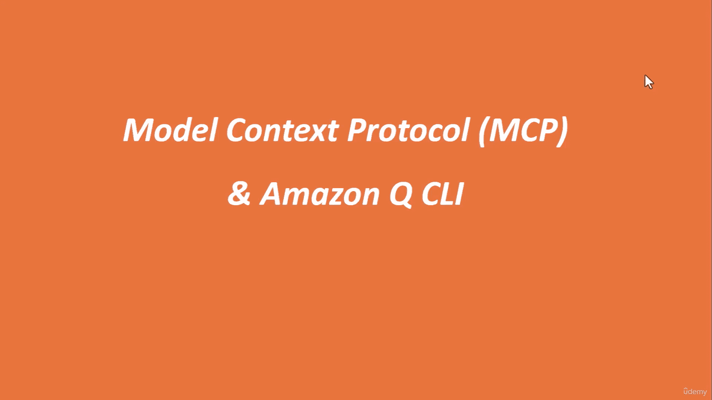
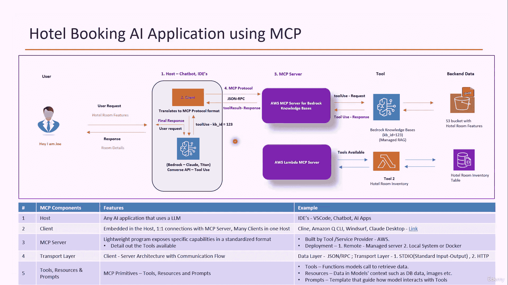

# 生成式AI在AWS上：01：🚀 课程概述与MCP引入

在本节课中，我们将要学习模型上下文协议（Model Context Protocol，MCP）的基本概念，并了解如何使用 Amazon Q CI（原文如此，通常对应 Amazon Q 命令行客户端）访问 AWS MCP 服务器中的数据。本节会从最基础的问题开始：MCP 是什么，它试图解决什么问题，以及它在 Amazon Bedrock 和 AWS 工具链中的实际使用方式。为了让初学者更容易理解，我们会先用一个企业应用场景说明问题，再通过酒店预订案例拆解 MCP 的核心组件和完整请求流程。

## 生成式AI在AWS上：02：🧩 MCP是什么以及它为什么出现

上一节我们概览了本课目标，本节中我们来看看 MCP 的基本定义和它出现的原因。MCP 指 Model Context Protocol，也就是模型上下文协议。这里的“模型”指你用来构建 AI 应用的大语言模型。这里的“上下文”可以这样理解：假设你要构建一个人力资源聊天机器人应用，为了回答员工问题，它需要访问某些企业 HR 数据或第三方数据。当你把这些数据检索出来并提供给大语言模型时，你实际上就是在给模型提供上下文。这里的“协议”指一组规则，允许两个设备之间交换数据；在 MCP 中，就是在大语言模型（模型）与不同内部或外部数据源之间交换数据。

因此，MCP 是一个开放协议，标准化了应用程序如何向大语言模型提供上下文。用一句话总结：你有大语言模型，也有数据源，而你通过某种协议把数据提供给大语言模型。这个定义听起来简单，但它背后解决的是应用与数据源之间连接方式混乱、重复开发的问题。理解了这个定义后，下一节我们来看 MCP 要解决的核心集成问题。

## 生成式AI在AWS上：03：🧱 MCP如何解决M×N集成问题

上一节我们介绍了 MCP 的定义，本节中我们来看看它试图解决的第一个问题：M×N 自定义集成问题。假设你的企业里有三个不同的 AI 应用：AI 应用 1、AI 应用 2 和 AI 应用 3。每个应用都需要从企业内的三个不同数据源访问数据：数据库、文档仓库和一个 A 服务。如果你使用 AWS，可能会编写自定义集成，通常使用 Lambda 函数写一些自定义代码，让 AI 应用 1 访问数据库、文档仓库和 A 服务；同样为应用 2 访问数据库、文档仓库和 A 服务编写代码；再为应用 3 编写类似代码。这样你会为三个应用分别写三套集成，总共九套集成。

使用 MCP 后，企业内所有应用可以连接到 MCP 客户端，MCP 客户端再与 MCP 服务器建立一对一连接，MCP 服务器连接这三个数据源。这样实现数量会变成 3 + 3 = 6 个。这个变化可以用下面的公式表示：

```text
未使用 MCP 的集成数量 = M × N
使用 MCP 后的集成数量 = M + N

本例中：
3 个应用 × 3 个数据源 = 9 个集成
3 个应用 + 3 个数据源 = 6 个实现
```

因此，MCP 减少了集成点数量。客户端和服务器的含义以及具体工作方式稍后会讨论；现在只需记住，集成数量被降低了。接下来，MCP 还标准化了大语言模型从不同数据源访问数据的方式，这一点稍后会展开说明。目前 AWS 提供了 50 多个 MCP 服务器，数量很多，覆盖场景也很广。理解了集成问题后，下一节我们看看 MCP 在 AWS 生态中的位置。

## 生成式AI在AWS上：04：☁️ MCP在AWS生态中的位置

上一节我们说明了 MCP 降低集成复杂度的思路，本节中我们从 AWS 的角度看看 MCP 的落点。AWS 已经提供 50 多个 MCP 服务器，这些服务器可以帮助应用以标准化方式连接不同数据源和服务。对初学者来说，可以把 MCP 服务器理解成“适配器”：它把某个数据源或服务的能力包装成统一格式，让 MCP 客户端可以调用。这样，AI 应用不需要为每个数据源重复写一套完全不同的连接代码，而是通过统一协议与服务器通信。

在后续内容中，我们会通过一个酒店预订 AI 应用案例来理解 MCP 实际如何工作。这个案例会帮助我们认识 MCP 的五个核心组件：Host（宿主）、Client（客户端）、MCP Server（MCP 服务器）、Transport Layer（传输层），以及 Tools、Resources 和 Prompts（工具、资源和提示词）。这五个组件是理解 MCP 请求如何从用户问题走到数据源、再回到大语言模型的关键。下面我们先进入酒店预订案例。

## 生成式AI在AWS上：05：🏨 通过酒店预订案例认识MCP五组件

上一节我们提到了 MCP 的五个核心组件，本节中我们通过一个酒店预订 AI 应用案例来逐个理解它们。假设我们要使用 MCP 构建一个酒店预订 AI 应用。这个应用有两个主要后端数据源：第一，S3 存储桶中有一个 PDF 文档，里面记录所有酒店房间特性，例如床的类型、是否有电视等；第二，有一个 DynamoDB 表，里面存储所有酒店房间库存，终端用户可以查询这些库存。我们还有一些工具：例如有一个 Bedrock 知识库（Knowledge Base），它是 AWS 提供的托管 RAG 解决方案，我们创建了一个知识库实例，KB_ID = 123；另外我们还编写了一个 Lambda 函数，能够从酒店房间库存表中检索数据。

因此，这个案例中有两个后端数据源和两个工具。假设有一个用户 Joe，他向酒店预订 AI 应用提出一个问题，询问存储在 S3 桶中 PDF 里的酒店房间特性。这个用户请求会发送到 Host（宿主）。Host 基本上是任何使用大语言模型的 AI 应用。在这个案例中，Host 可以是一个聊天机器人，终端用户通过它与应用交互；由于 MCP 被大量用于编码 AI 代理，其他 Host 也可能是 VS Code，或者我们讨论过的聊天机器人，或者任何 AI 应用。

请求发送到 Host 后，Host 会把它转发给大语言模型；在 AWS 场景中，请求可能发往 Amazon Bedrock，然后你选择具体模型，例如 Claude、Titan、Nova 等。这里大多数情况下会使用 Converse API。如果你没有使用过 Bedrock Converse API，它和 InvokeModel API 很相似，但它额外允许你把工具详情发送给大语言模型。下面是一个简化示意：

```python
response = bedrock.converse(
    modelId="anthropic.claude-...",
    messages=[
        {"role": "user", "content": "查询酒店房间设施"}
    ],
    toolConfig={
        "tools": [
            {"name": "knowledge_base", "knowledgeBaseId": "KB_ID_123"},
            {"name": "lambda_inventory", "function": "get_room_inventory"}
        ]
    }
)
```

在 Converse API 请求中，你会定义模型 ID，这里使用 Anthropic 模型；然后传入 message，也就是用户查询；同时告诉模型有哪些工具可用，并在这里定义 tool configuration。本质上，你发送了用户提示词，并同时通过提示词模板发送大语言模型可以使用的工具选项；在这个案例中，就是这两个工具，供大语言模型获取上下文。Bedrock 收到用户请求和工具配置数据后，会请求使用这里列出的工具，也就是带有 KB_ID_123 的 Bedrock 知识库。大语言模型随后会把请求发送给 MCP 中的 Client（客户端）。客户端嵌入在 Host 中；Host 可能是聊天机器人，也可能是 VS Code 这样的 IDE（在编码 AI 代理场景中）。客户端与 MCP 服务器保持一对一连接，MCP 服务器稍后讨论。这个案例让我们看到 Host、Client、Server 和工具之间的基本关系；下一节我们进一步看 Host 与 LLM 调用中的细节。

## 生成式AI在AWS上：06：🧠 Host、Client与LLM调用细节

上一节我们通过酒店案例看到了请求从用户进入 Host 的路径，本节中我们补充 Host、Client 和 LLM 调用之间的关系。客户端是 MCP 中的概念，它嵌入在 Host 中。你可能听说过一些客户端，例如 Amazon Q CLI、Windsurf、Claude Desktop，这些都是 MCP 目前支持的客户端。你可以把这些客户端安装在 IDE 或 VS Code 中，这也是为什么说客户端可以嵌入 Host；同一个 Host 中也可以有多个客户端。这里的重点不是记住所有产品名称，而是理解客户端在应用内部承担“协议转换和连接管理”的角色。

在酒店案例中，大语言模型会请求客户端使用工具去后端数据源检索上下文数据，使用的工具是 `KB_ID_123`，对应某个特定知识库。客户端会把这个请求翻译成 MCP 协议格式，MCP 协议格式稍后说明。然后客户端使用 JSON-RPC 向服务器发起请求。服务器使用这些工具从后端检索数据，并把响应发回客户端；客户端再把工具调用结果或上下文数据发送给大语言模型；大语言模型结合这些上下文和自身已有知识生成最终响应，在这个案例中就是把从数据源检索到的房间数据返回给终端用户。理解了这条链路后，下一节我们看看 MCP 服务器是什么，以及它们如何部署。

## 生成式AI在AWS上：07：🖥️ MCP Server是什么以及如何部署

上一节我们说明了客户端如何发起请求，本节中我们来看看 MCP 服务器。这个案例中有用于 Bedrock 知识库的 AWS MCP 服务器，以及 AWS Lambda MCP 服务器。服务器是轻量级程序，以标准化格式暴露特定能力。这些 MCP 服务器由 AWS 构建；在大多数场景中，MCP 服务器由工具或服务提供商构建。服务器构建完成后，部署 AWS MCP 服务器或不同工具服务提供商提供的任何服务器有两种方式。第一种有时称为远程部署，这是较新的方式，属于托管服务；在 AWS 场景中，服务器会部署在 AWS 环境中的某个位置。第二种也是最常见的方式，是本地系统或 Docker 部署，也就是把服务器部署在你的笔记本电脑上；AWS 提供的大多数服务器都可以部署在你的系统或笔记本电脑本地。

为了帮助初学者理解，可以把远程部署想成“别人替你托管服务器”，把本地部署想成“服务器跑在你自己的电脑上”。两种方式都遵循 MCP 的通信规则，区别主要在部署位置和管理方式。下面列出两种部署方式的要点：

- 远程部署：通常是托管服务，较新，服务器部署在 AWS 环境中。

- 本地系统或 Docker 部署：最常见，服务器部署在你的笔记本电脑或本地系统中，AWS 大多数服务器支持这种方式。

理解部署方式后，下一节我们看看 AWS 提供了哪些 MCP 服务器，以及如何查找它们。

## 生成式AI在AWS上：08：📚 AWS MCP服务器清单与查找方式

上一节我们介绍了服务器部署方式，本节中我们看看 AWS 提供了哪些 MCP 服务器。如果你访问 AWS 的 GitHub 链接，可以看到 AWS 提供的所有服务器，它们按不同类别组织。以下是这些服务器类别的简要说明：

- AWS API MCP 服务器、Knowledge Base MCP 服务器等基础服务类服务器。

- 基础设施类服务器，例如 CDK、CloudFormation、Terraform。

- AI/ML 类服务器，例如 Amazon Bedrock Knowledge Bases、Amazon Q Business。

- 数据分析类服务器，例如 DynamoDB、Elasticsearch，以及一系列其他服务器。

- 成本运营、开发者工具等类别的服务器。

你可以看到 AWS 有 50 多个服务器，并且可以从类别、工作流、名称等维度搜索每个服务器。这个清单说明 MCP 不是只停留在概念层面，而是已经有大量现成服务器可以接入实际服务。了解服务器清单后，下一节我们把酒店案例中的请求流程完整串起来。

## 生成式AI在AWS上：09：🔄 一次MCP请求的完整流程

上一节我们看了 AWS MCP 服务器清单，本节中我们把一次 MCP 请求从用户到数据源再回到用户的流程完整串起来。大语言模型请求客户端使用工具 `KB_ID_123` 去后端数据源检索上下文数据，这里的 `KB_ID_123` 对应特定知识库。客户端会把请求翻译成 MCP 协议格式，然后使用 JSON-RPC 向服务器发起请求。这个 JSON-RPC 请求可以用类似下面的代码表示：

```json
{
  "jsonrpc": "2.0",
  "id": 1,
  "method": "tools/call",
  "params": {
    "name": "knowledge_base",
    "arguments": {
      "knowledgeBaseId": "KB_ID_123",
      "query": "酒店房间设施"
    }
  }
}
```

MCP 服务器收到请求后，会使用工具从后端检索数据，并把响应发回客户端。客户端再把工具调用结果或上下文数据发送给大语言模型。大语言模型结合这些上下文和自身已有知识生成最终响应，在这个案例中就是把房间数据返回给终端用户。整个流程可以概括为：用户问题进入 Host，Host 调用 LLM，LLM 请求 Client 调用工具，Client 通过 JSON-RPC 请求 Server，Server 访问数据源并返回结果，Client 把上下文交给 LLM，LLM 生成最终答案。理解完整流程后，下一节我们看传输层和数据层。

## 生成式AI在AWS上：10：🔌 传输层、数据层与JSON-RPC

上一节我们串起了完整请求流程，本节中我们看看客户端和服务器之间的通信细节。传输层负责客户端和服务器之间的通信，客户端和服务器在这里交换信息。理解传输层需要记住两件事：第一是数据层，这里使用 JSON-RPC，也就是使用 JSON 数据格式交换数据；第二是传输层本身有两个选项。以下是传输层选项的简要说明：

- 标准输入输出（stdio）：直到最近，MCP 只有这个选项；它主要用于把 MCP 服务器部署在本地系统时。

- StTP 协议（原文如此，指远程传输协议）：用于远程 MCP 服务器，例如部署在 AWS 环境中的服务器。

因此，本地部署常用 stdio，远程部署使用 StTP。数据层使用 JSON-RPC 和 JSON 格式，这样做的好处是请求和响应都有统一结构，客户端和服务器都容易解析。理解传输层后，下一节我们看 MCP 的第五个组件：工具、资源和提示词。

## 生成式AI在AWS上：11：🧰 Tools、Resources与Prompts

上一节我们说明了传输层和数据层，本节中我们看看 MCP 的第五个组件：工具、资源和提示词。以下是这三个概念的简要说明：

- Tools（工具）：工具本质上是函数，大语言模型可以调用这些函数来检索数据。在酒店案例中，我们有两个工具。从 MCP 协议角度看，MCP 服务器必须向客户端详细说明该服务器上有哪些工具或可调用项可用。

- Resources（资源）：资源就是实际数据，可能位于数据库或文件系统中，可以被模型用作上下文。也就是说，资源是通过工具检索出来的实际数据。

- Prompts（提示词）：提示词是模板，用来指导模型如何与工具交互。在这个场景中，提示词模板包含用户请求或提示词，定义我们要使用哪个大语言模型，最后还定义大语言模型可以使用哪些工具，就像酒店案例中展示的那样。

这三个概念放在一起，就构成了模型使用上下文数据的完整方式：提示词告诉模型目标和工具选项，工具负责取数据，资源提供实际数据。理解这三个概念后，本节内容就接近尾声了。

## 生成式AI在AWS上：12：✅ 本节总结



上一节我们介绍了 Tools、Resources 和 Prompts，本节中我们对整节课进行总结。本节课中我们一起学习了模型上下文协议 MCP 的基本概念：MCP 是开放协议，标准化应用程序如何向大语言模型提供上下文；它解决了 M×N 自定义集成问题，把集成数量从 M × N 降低到 M + N；AWS 提供了 50 多个 MCP 服务器，并支持远程部署和本地或 Docker 部署。我们还通过酒店预订案例认识了 Host、Client、MCP Server、Transport Layer 以及 Tools、Resources、Prompts 五个核心组件，并梳理了从用户请求到 JSON-RPC 调用、再到服务器检索数据和 LLM 生成最终回答的完整流程。本节到此结束，下节课再见。

