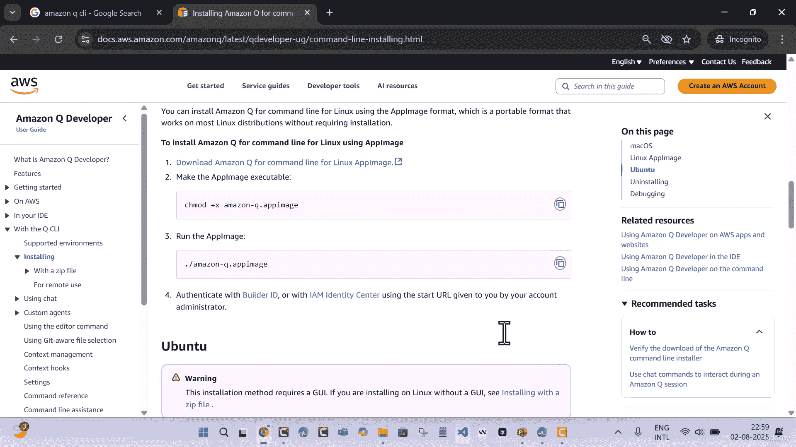
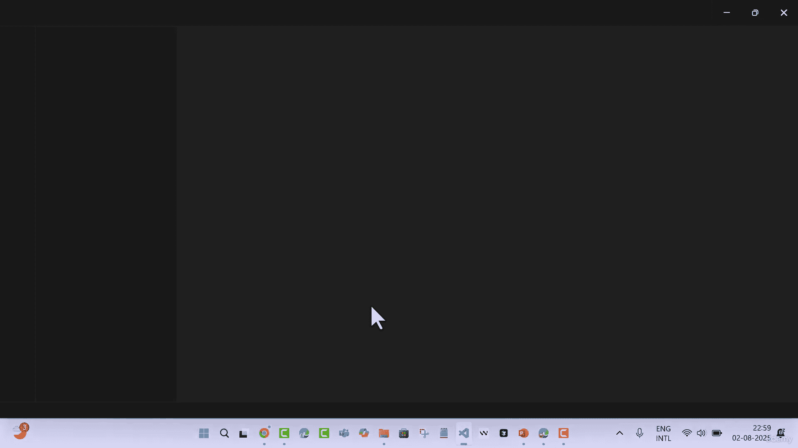
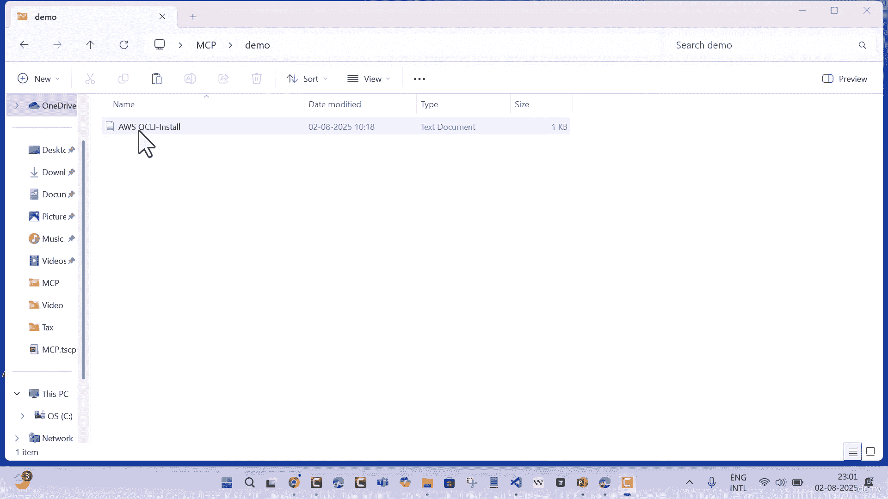
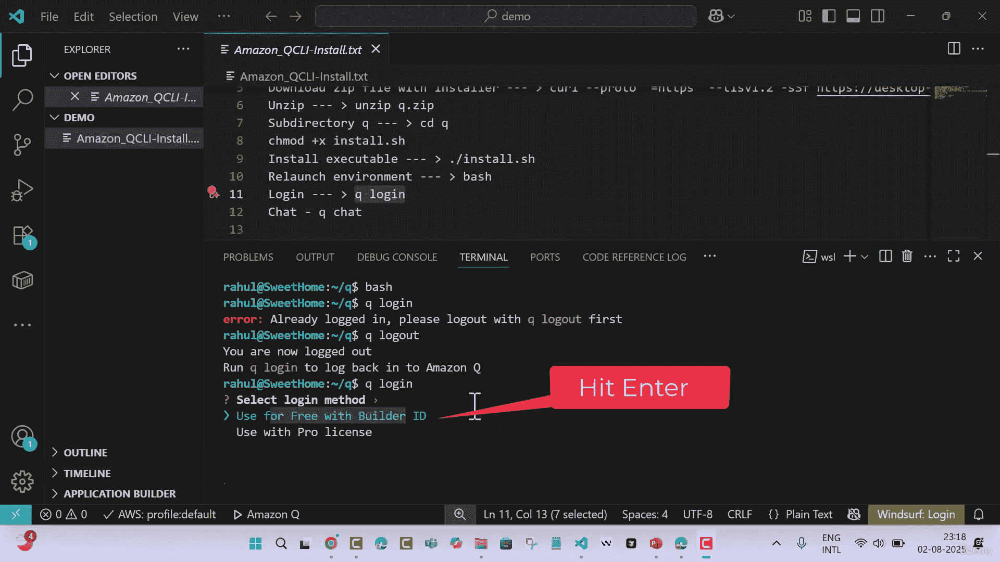
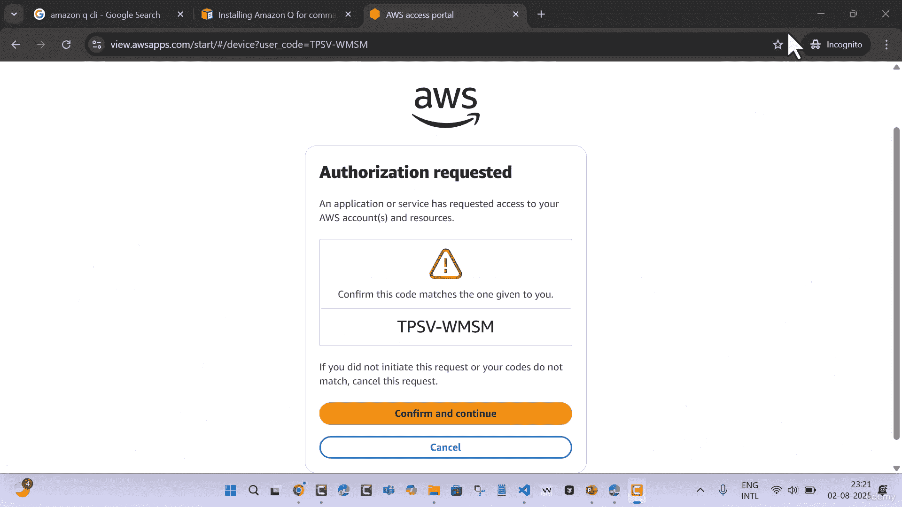
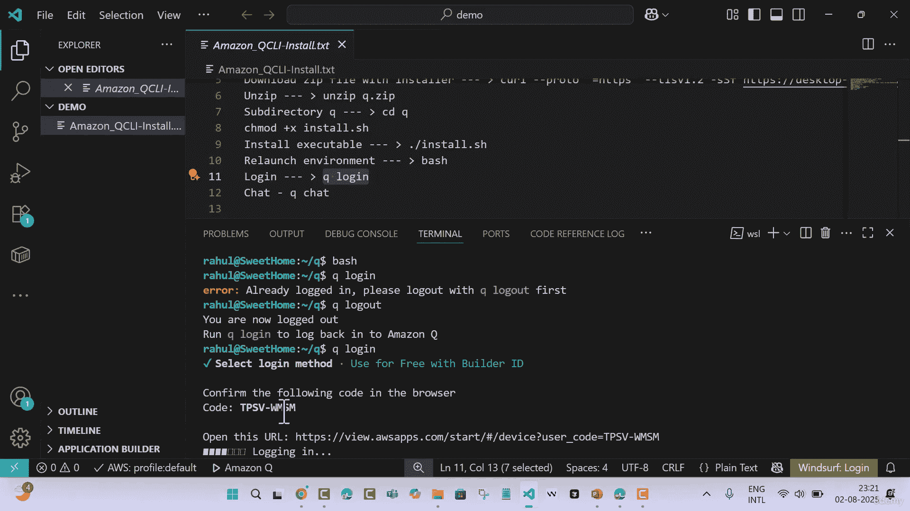
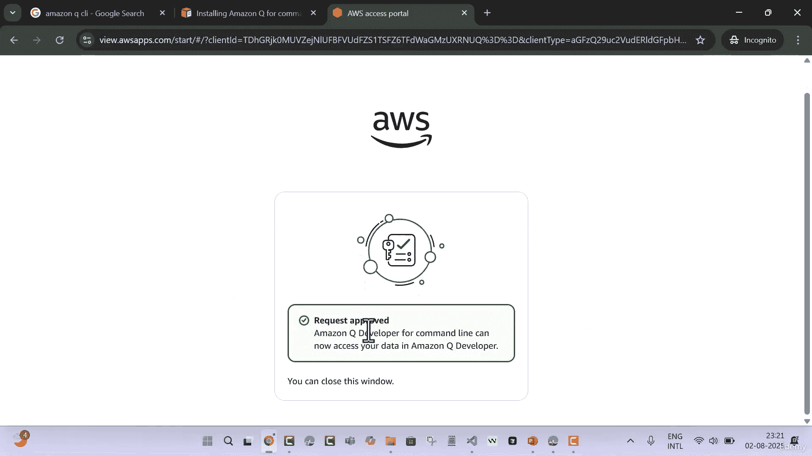
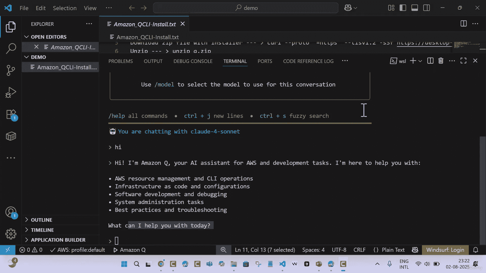

# 🧠 Generative AI on AWS：第75讲：Amazon Q CLI安装与MCP客户端

  

在本节课中，我们将学习MCP（Model Context Protocol）的三个核心组件，并动手安装Amazon Q CLI作为MCP客户端。我们会先回顾MCP的架构，然后从下载VS Code开始，一步步在Windows系统上通过WSL安装Amazon Q CLI，最后完成登录并验证客户端是否正常工作。这样一来，你就拥有了一套可以连接MCP服务器的完整环境，为后续使用RAG、KIRO等高级功能打下基础。

  

## 1️⃣ 回顾MCP三组件

  

在上一节中，我们学习了MCP的三个关键组件：host（宿主）、client（客户端）和MCP server（服务器）。简单来说，三者的关系可以用下面这个公式表达：

  

```text
MCP = Host + Client + MCP Server
```

  

使用MCP时，host是用户直接面对的应用，client是实际发起请求并管理连接的组件，而MCP server则提供具体的工具和数据。你可以把host理解成一个工作台，client是工作台上的操作员，server是放在旁边工具箱里的各种工具。只有三者配合，整个MCP流程才能跑起来。

  

本节课我们从host和client入手：使用VS Code作为host，安装Amazon Q CLI作为client，最终让它们能够访问MCP server。这是整个MCP链路的第一步，也是最基础的一步。

  

## 2️⃣ 下载安装VS Code

  

要开始搭建环境，我们首先需要一个宿主应用。这里选择VS Code，因为它是目前最常用的编辑器之一，而且对MCP支持很好。如果你还没有安装VS Code，可以直接去Google搜索“VS Code”，进入官网下载对应操作系统的版本。下载安装完成后，创建一个演示文件夹，比如叫做`demo`，专门用来存放这次实验的文件。

  

接下来，在VS Code中打开这个文件夹：点击“文件”→“打开文件夹”，然后选择刚才创建的`demo`文件夹，点击“选择文件夹”。此时，你会在VS Code左侧看到这个文件夹的内容，现在这个文件夹几乎是空的。如果我们需要输入命令，可以点击顶部菜单栏的“终端”→“新建终端”，打开一个新终端。在这个终端里，我们后续所有的安装命令都会在这里执行。

  



如果你使用的是Mac或Linux系统，可以直接访问Amazon Q CLI的安装页面，按照页面上的步骤操作。但如果你使用的是Windows系统，就需要多做一些准备工作，因为目前Amazon Q CLI并不能直接在Windows上运行，我们需要借助WSL（Windows Subsystem for Linux）来搭建一个Linux环境。下面我们来详细演示Windows下的安装过程。

  



## 3️⃣ Windows系统准备：安装WSL

  

在Windows上运行Amazon Q CLI，第一步是把WSL装好。WSL相当于Windows里的一个Linux子系统，它可以让你在Windows上直接使用Linux命令和环境。以下是具体的安装步骤：

  



- 打开终端，运行以下命令来安装WSL：

  

```bash
wsl --install
```

  

- 如果你之前没有用过WSL，这个命令会帮助你完成安装。安装过程可能需要一点时间，请耐心等待。如果已经安装过，系统可能会跳过安装步骤。

  

- 安装完成后，我们需要确认一下是否安装成功，可以运行：

  

```bash
wsl --version
```

  

- 看到类似`2.5.9.0`的版本号，就说明WSL已经正确安装了。我在演示环境中看到的是`2.5.9.0`，你的版本可能稍微不同，这没关系，只要能看到版本号就说明安装成功了。

  

确认WSL没问题后，我们还需要创建一个虚拟的Ubuntu实例，因为后续操作都需要在Ubuntu环境中进行。

  

## 4️⃣ 安装Ubuntu实例

  

接下来，在终端中运行下面的命令来安装一个虚拟的Ubuntu实例：

  

```bash
wsl --install -d Ubuntu
```

  

这个命令可能需要几分钟时间，因为系统需要下载并安装Ubuntu的基础镜像。请耐心等待。安装完成后，系统会自动进入Ubuntu环境，你可能会看到一个文件夹结构，看起来和Windows很像，但实际上是Linux环境。为了方便后续操作，我们先进入这个WSL环境的主目录。在终端中输入：

  

```bash
cd ~
```

  

接着清空屏幕：

  

```bash
clear
```

  

现在我们已经进入了Ubuntu环境，接下来要安装一些必要的软件包，为安装Amazon Q CLI做好准备。

  

## 5️⃣ 安装必要的软件包

  

在WSL的Ubuntu环境中，我们需要先安装一些依赖包，这样后续的下载和解压才能顺利进行。运行下面这条命令：

  

```bash
sudo apt update && sudo apt install unzip
```

  

执行过程中，系统可能会要求你设置用户名和密码。如果这是你第一次使用WSL，请记住你设置的密码，因为后续登录时还会用到。在演示环境中，我已经提前设置好了用户名和密码，所以只需要输入密码即可。安装完成后，继续清空屏幕：

  

```bash
clear
```

  

软件包准备好之后，接下来要下载Amazon Q CLI的安装包。这里要注意，Amazon Q CLI的安装包是一个zip文件，我们需要先下载再解压。

  

## 6️⃣ 下载并解压Amazon Q CLI

  

在终端中运行下面的命令，下载包含Amazon Q CLI安装程序的zip文件。由于视频中没有给出具体的下载链接，这里用`<installer-url>`占位，实际操作时请使用视频中提供的命令：

  

```bash
wget <installer-url>
```

  

下载可能需要几分钟时间，取决于你的网络速度。下载完成后，我们需要对这个zip文件进行解压。运行：

  

```bash
unzip q.zip
```

  

如果系统提示你已存在同名文件，询问是否替换或重新安装，我们就选择“是”。如果你是第一次安装，可能不会看到这些提示，直接解压即可。解压完成后，清空屏幕：

  

```bash
clear
```

  

现在，我们进入解压出来的`q`子目录，然后对安装文件进行权限修改。

  

## 7️⃣ 修改权限并安装

  

进入`q`目录：

  

```bash
cd q
```

  

在Linux环境中，要执行某个文件，通常需要先修改文件的权限，让它变成可执行文件。运行下面的命令，为安装脚本添加可执行权限：

  

```bash
chmod +x install.sh
```

  

权限修改完成后，我们运行安装脚本。先输入`ls`查看当前目录下的文件，你会看到`install.sh`这个文件。然后执行：

  

```bash
./install.sh
```

  

安装过程中，系统会询问你是否允许Amazon Q修改shell配置。在这里选择“是”即可。修改shell配置是为了让后面使用的`q`命令可以直接在终端中调用，省去每次都要输入完整路径的麻烦。

  



## 8️⃣ 重新加载环境并登录

  

安装完成后，需要重新加载环境，让刚才修改的配置生效。运行：

  

```bash
clear
bash
```

  

这样就会重新启动一个bash环境。接下来，我们需要登录Amazon Q CLI。在终端中输入：

  

```bash
q login
```

  

如果系统提示“already logged in”，说明你已经登录过了。为了演示完整的登录流程，我们先退出登录，再重新登录：

  

```bash
q logout
q login
```

  





此时，系统会要求你选择登录方式。我们选择“使用免费的Builder ID登录”。接着，终端会显示一个URL，我们需要把这个URL复制到浏览器中打开。在浏览器页面中，系统会询问你的AWS Builder ID。如果你没有Builder ID，可以直接用用户名和密码注册一个，Builder ID是免费的。在演示中，我已经有了Builder ID，所以输入账号密码，然后点击“Sign in”。

  

接下来，页面会显示一个验证码，我们需要在终端中看到对应的验证码，并在浏览器中输入并确认。确认后，系统会请求访问权限，点击“Allow access”。当浏览器显示“已批准”后，回到终端，你会看到“登录成功”的提示。清空屏幕：

  

```bash
clear
```

  



到此，Amazon Q CLI已经安装并登录成功了。我们来验证一下它是否真的可以正常工作。

  

## 9️⃣ 验证Amazon Q CLI

  

现在，运行：

  

```bash
q chat
```

  

这会启动一个交互式聊天界面。为了验证它能正常工作，我们可以输入一句简单的问候，比如`hi`。Amazon Q会回复类似“你好，我是Amazon Q，你的AWS开发助手”，并询问今天能帮你做什么。如果能看到这样的回复，说明Amazon Q CLI客户端已经成功运行，并且可以连接到MCP服务器了。到这一步，我们的host和client已经就绪，剩下要做的就是连接MCP server。

  

## 🏁 总结

  



本节课中，我们一起学习了MCP的三个核心组件（host、client、MCP server），并实际完成了Amazon Q CLI的安装和登录。我们先用VS Code作为host，然后在Windows上通过WSL安装Ubuntu实例，接着下载并安装了Amazon Q CLI，最后通过`q login`完成身份验证，并用`q chat`验证客户端可以正常使用。现在，我们的MCP客户端已经准备好了，下一步就是连接MCP server，这部分内容我们将在下一个视频中继续介绍。希望你已经成功完成了安装，咱们下一个视频见。

