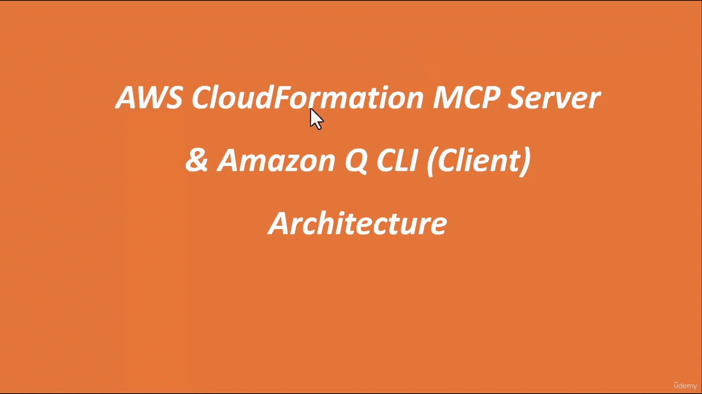
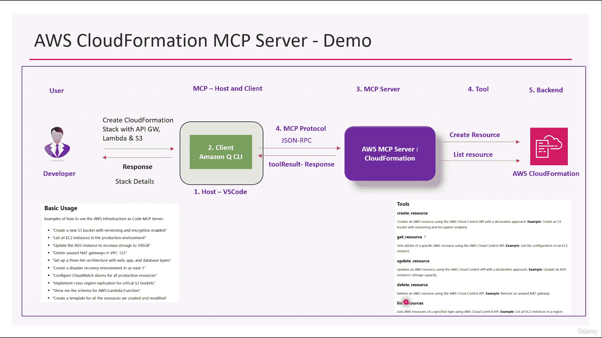

# 🧩 Udemy - Generative AI on AWS - Amazon Bedrock, RAG & KIRO [2026]：第 76–78 讲：基于 AWS MCP CloudFormation Server 的编码代理架构

在本节课中，我们将要学习如何把 Amazon Q CLI 当作客户端，把 AWS MCP CloudFormation Server 当作连接自然语言和 AWS CloudFormation 的中间层，从而搭出一个能用大白话操作云资源的编码代理架构。我们会先看清楚开发者、VS Code、Amazon Q CLI、MCP Server 和 AWS CloudFormation 服务各自扮演什么角色，再理解一条自然语言问题怎样一步步变成 API 调用，最后通过示例问题看看创建资源、查询资源、更新资源和删除资源这些动作是怎样对应到工具调用上的。整个过程不要求初学者先掌握复杂概念，只需要把这条链路想成“人用自然语言提要求，客户端负责转发，服务器负责翻译，云服务负责执行”即可。

## 🏗️ 整体架构：谁负责什么

为了把配置过程讲清楚，我们先从整体架构看起：示例里有一个开发者，他使用 VS Code 作为 IDE，这个 VS Code 就是本次示例中的 Host 宿主。安装完 Amazon Q CLI 之后，这个 CLI 会作为 Client 客户端，于是示例里就同时有了 MCP Host 和 MCP Client。接下来需要安装由 AWS 创建的 AWS MCP CloudFormation Server，并把这个服务器部署在本地笔记本电脑上。这样，当开发者用自然语言提问时，MCP Server 就会把自然语言查询翻译成 API 调用，再与 AWS CloudFormation 服务交互。可以用下面这条链路表示核心结构。



```text
开发者
  -> VS Code（Host 宿主）
  -> Amazon Q CLI（Client 客户端）
  -> AWS MCP CloudFormation Server（部署在本地）
  -> AWS CloudFormation 服务
```

在这个链路里，每个角色都有明确分工。以下是各个角色在示例中的职责说明。

- 开发者使用 VS Code 作为 IDE，VS Code 是本次示例的 Host 宿主。

- 在 VS Code 中安装 Amazon Q CLI，这个 CLI 充当 Client 客户端。

- 安装 AWS MCP CloudFormation Server，并把由 AWS 创建的这个服务器部署到本地笔记本电脑上。

- 当开发者用自然语言提出问题时，MCP Server 把自然语言查询翻译成 API 调用，并与 AWS CloudFormation 服务交互。

理解了这些角色之后，我们就能看到：这套架构的关键不在于让开发者记住复杂的 API 参数，而在于让自然语言先进入客户端，再由 MCP Server 把意图翻译成 CloudFormation 能理解的调用。下面我们继续看一条请求从发出到返回的完整流程。

## 🔄 自然语言请求如何变成 API 调用

上一节我们介绍了架构中的各个角色，本节中我们来看看一条自然语言请求是怎样流动的。开发者不需要直接编写 API 请求，而是用自然语言提问；Amazon Q CLI 作为客户端，把这个问题发送给 AWS MCP CloudFormation Server；服务器再把自然语言查询转换成工具调用，而这些工具调用本质上就是 API 调用。随后，工具调用会访问 AWS CloudFormation 服务，完成创建资源、查询资源或其他操作，并把结果沿着原路返回给开发者。可以用下面的公式描述这条核心链路。

\[
\text{自然语言问题} \rightarrow \text{Amazon Q CLI} \rightarrow \text{AWS MCP CloudFormation Server} \rightarrow \text{工具调用/API 调用} \rightarrow \text{AWS CloudFormation 服务}
\]

为了让流程更直观，可以把一次请求拆成下面这些步骤。以下是请求处理过程中的关键动作。

1. 开发者用自然语言提出一个云资源相关问题。

2. Amazon Q CLI 作为客户端，把这个问题发送给 AWS MCP CloudFormation Server。

3. MCP Server 把自然语言查询转换成工具调用，工具调用本质上就是 API 调用。

4. 工具调用访问 AWS CloudFormation 服务，执行创建、查询、更新或删除等操作。

5. AWS CloudFormation 服务检索数据或执行操作后，把结果返回给 MCP Server，再通过 Amazon Q CLI 客户端返回给云工程师。

用伪代码表示，这个过程可以写成下面这样。

```text
自然语言问题
  -> Amazon Q CLI 客户端
  -> AWS MCP CloudFormation Server
  -> 工具调用 tool_call(...)
  -> AWS CloudFormation API
  -> 返回结果
  -> Amazon Q CLI 客户端
  -> 开发者看到结果
```

看到这里就能明白：MCP Server 的作用是把“人话”翻译成“工具调用”，而工具调用再落到 AWS CloudFormation 的 API 上。接下来我们进一步看看服务器暴露了哪些工具，以及这些工具分别适合处理什么类型的自然语言请求。

## 🧰 MCP Server 暴露的工具

上一节我们梳理了请求流程，本节中我们来看看 AWS MCP CloudFormation Server 对外暴露的工具。演示画面中会看到服务器暴露了一些工具，其中部分工具被高亮显示，这些工具就是自然语言请求最终可以落脚的操作入口。以下是主要工具及其作用说明。

- create resources：创建资源工具，允许创建任何服务；在示例中，它可以根据自然语言请求创建 CloudFormation 堆栈里的资源。

- get resources：获取资源工具，用于查询资源信息，例如处理“列出生产环境中的所有 EC2 实例”这类请求。

- update resources：更新资源工具，用于修改已有资源。

- delete resources：删除资源工具，用于删除资源。

- list resources：列出资源工具，用于以列表形式获取资源信息。

可以用下面这段代码表示自然语言意图和工具之间的对应关系。

```text
“创建资源/创建堆栈” -> create resources
“查询资源/列出实例” -> get resources 或 list resources
“修改资源”         -> update resources
“删除资源”         -> delete resources
```

也就是说，当云工程师发送自然语言请求时，AWS MCP CloudFormation Server 会把请求转换成某个工具调用，例如 get resources，然后由这个工具调用去访问 CloudFormation 服务。工具调用拿到数据后，再把数据通过 Amazon Q CLI 客户端返回给云工程师。其他工具也是同样的道理，update resources、delete resources 和 list resources 都遵循这种“自然语言进、工具调用出、结果再返回”的模式。下面我们用一个具体示例把整个过程串起来。

## 💬 示例问题与执行过程

上一节我们认识了工具，本节中我们通过示例来看看这些工具怎样处理真实问题。假设有一位云工程师使用 AWS CloudFormation 管理应用程序的资源，他可能会有各种问题，而 AWS 也提供了一些示例问题，例如创建启用版本控制和加密的 S3 桶，或者列出生产环境中的所有 EC2 实例。以下是本讲中会用到的示例问题。

- 创建一个启用版本控制和加密的 S3 桶。

- 列出生产环境中的所有 EC2 实例。

- 在本演示中，我们使用的是：创建一个包含 API Gateway、Lambda 和 S3 的 CloudFormation 堆栈。

云工程师可以通过安装了 Amazon Q CLI 的 VS Code，用自然语言提交这些问题。以本演示为例，当工程师输入“创建一个包含 API Gateway、Lambda 和 S3 的 CloudFormation 堆栈”后，Amazon Q CLI 客户端会把这条自然语言请求发送给 AWS MCP CloudFormation Server；服务器再把自然语言查询转换成工具调用，例如 create resources，而这个工具调用本质上就是一次 API 调用。随后，create resources 会向 AWS CloudFormation 服务发起 API 调用，创建请求中涉及的所有资源。发送请求之后，关键动作可以归纳为下面几步。

1. 云工程师在安装了 Amazon Q CLI 的 VS Code 中，用自然语言提出问题。

2. Amazon Q CLI 客户端把问题发送给 AWS MCP CloudFormation Server。

3. 服务器把自然语言查询转换成工具调用，例如 create resources 或 get resources。

4. 工具调用访问 AWS CloudFormation 服务，创建资源或检索数据。

5. AWS CloudFormation 服务把数据或执行结果返回给 MCP Server，再通过 Amazon Q CLI 客户端返回给云工程师。

同理，如果问题是“列出生产环境中的所有 EC2 实例”，服务器可以把它转换成 get resources 工具调用，再访问 CloudFormation 服务获取数据。CloudFormation 服务检索到数据后，会把数据返回给云工程师，而返回路径仍然是经过 Amazon Q CLI 客户端。其他工具也遵循同样的方式，包括 update resources、delete resources 和 list resources。

## ✅ 总结



本节课中，我们一起学习了基于 AWS MCP CloudFormation Server 的编码代理架构：开发者用 VS Code 作为 Host，用 Amazon Q CLI 作为 Client，把由 AWS 创建的 MCP CloudFormation Server 部署在本地笔记本电脑上，再由这个服务器把自然语言问题翻译成工具调用和 API 调用，最终与 AWS CloudFormation 服务交互。我们还梳理了 create resources、get resources、update resources、delete resources 和 list resources 这些工具的作用，并通过创建 S3 桶、列出生产环境 EC2 实例、创建包含 API Gateway、Lambda 和 S3 的 CloudFormation 堆栈这几个示例，理解了自然语言请求怎样变成云服务操作，并把结果返回给云工程师。本讲内容会在后续演示中实际展示，下一讲继续说明。

