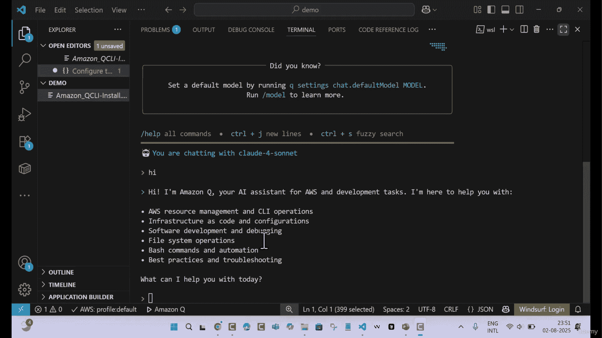
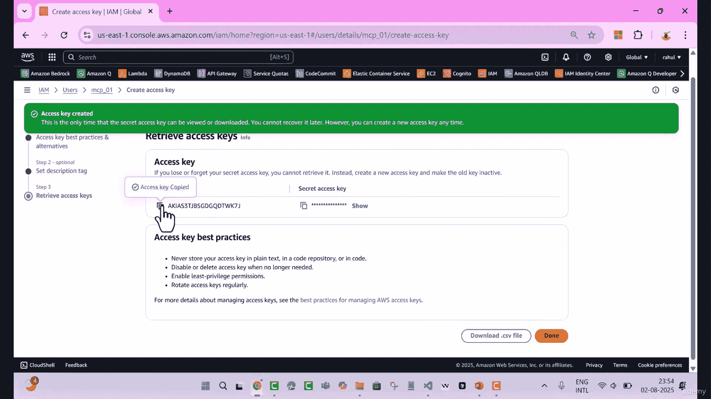
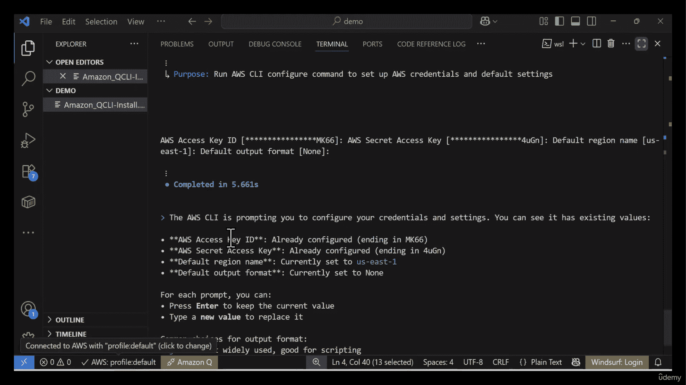

## 🚀 AWS生成式AI实战：第77-79讲：安装AWS CLI前置条件

在本节课中，我们将要学习如何为AWS CLI准备IAM用户、创建访问密钥，并用`aws configure`把CLI配置好。整个流程的核心概念可以概括为：`AWS CLI 可用配置 = IAM 用户 + Access Key + Secret Key + Region + Output 格式`。初学者可以把IAM用户理解成AWS里的身份，把访问密钥理解成给命令行工具使用的账号密码，只有这几样信息准备齐全，后面的CLI命令才能正常调用AWS服务。原文开头提到第一件事是为CLI准备IAM角色，实际操作中我们先创建IAM用户并生成访问密钥，用这套凭据让CLI获得调用权限。

在正式配置CLI之前，需要先把身份和权限准备好，下面从创建IAM用户开始。

### 🧑‍💻 AWS生成式AI实战：第77讲：创建IAM用户



创建IAM用户是整个前置条件里的第一步，目的是让命令行工具有一个可以使用的AWS身份。你需要进入AWS账号，在控制台里搜索`IAM`，然后点击进入IAM服务，接着点击`Users`，再点击`Create user`。在用户名处可以先写`MCP user`，然后点击`Next`；如果界面提示这个用户已经存在，就改成`MCP_01`，再点击`Next`。接下来选择直接附加策略，也就是`Attach policy directly`，并附加管理员访问权限`admin access`，向下滚动后点击`Next`，最后点击`Create user`完成创建。这里为了演示使用管理员权限，实际生产环境中应按最小权限原则分配权限。

为了把IAM用户创建出来，以下是需要依次执行的操作：

- 在AWS控制台搜索`IAM`，点击进入IAM服务

- 点击`Users`，再点击`Create user`

- 用户名先填写`MCP user`，点击`Next`

- 如果提示用户已存在，就把用户名改成`MCP_01`，再点击`Next`

- 选择`Attach policy directly`，附加`admin access`，向下滚动后点击`Next`

- 点击`Create user`完成用户创建

上一节我们创建好了IAM用户，本节中我们来看看如何为这个用户生成访问密钥。

### 🔑 AWS生成式AI实战：第78讲：创建访问密钥

现在用户已经创建完成，接下来要点击`MCP_01`这个用户，进入用户详情页，再点击`Security credentials`，然后点击`Create access key`。这个访问密钥就是给CLI使用的，所以在用途选项里选择`CLI`，勾选确认后点击`Next`，再点击`Create access key`。创建完成后，页面会显示访问密钥和秘密密钥，你可以从这里复制这两项信息，后面配置CLI时要用到。

为了生成CLI要用的访问密钥，以下是操作步骤：

- 点击`MCP_01`用户，进入用户详情页



- 点击`Security credentials`，再点击`Create access key`

- 用途选择`CLI`，勾选确认后点击`Next`

- 点击`Create access key`

- 复制页面显示的Access Key和Secret Key

上一节我们拿到了访问密钥，本节中我们来看看如何把访问密钥配置到AWS CLI里。

### ⚙️ AWS生成式AI实战：第79讲：配置AWS CLI

拿到访问密钥后，就可以在终端里运行下面的命令，把凭据写入AWS CLI：

```bash
aws configure
```

运行`aws configure`后，它会询问是否允许运行这条命令来配置AWS CLI与IAM用户。可选答案有`yes`、`no`和`trust`；如果选择`trust`，后续命令也会继续运行；如果选择`yes`，只运行当前这一条命令。这里选择`yes`。随后输入区域可能看不到显示内容，点击输入位置粘贴Access Key并按回车，再返回查看Secret Key，复制后粘贴并按回车。接着提供区域，输入`us-east-1`并按回车；最后询问数据输出格式，留空后直接按回车即可。配置过程中界面会显示当前CLI已经附加了一个IAM角色；如果你本来就有，它会沿用同一个；如果没有，就按上面展示的步骤操作，CLI也会完成配置。

为了把凭据写入AWS CLI，以下是`aws configure`会依次询问并需要填写的内容：

- 是否允许运行配置命令：选择`yes`

- Access Key：粘贴刚才复制的访问密钥

- Secret Key：粘贴刚才复制的秘密密钥

- Region：输入`us-east-1`

- Output format：留空并回车

上一节我们完成了密钥和区域配置，本节中我们来看看配置成功后界面会显示什么。

### ✅ AWS生成式AI实战：第79讲补充：验证AWS CLI配置

当你提供完配置详情后，在VS Code底部应该能看到类似`AWS profile default`的提示。如果你创建的是不同名称的profile，显示不同名称也没有问题，只要CLI能识别到这个配置即可。原文最后说明本节课内容到此基本结束，下节课再见；到这里，前置条件里的IAM用户、访问密钥和CLI配置都已经走完。

为了确认配置生效，以下是配置完成后可以检查的地方：

- VS Code底部显示`AWS profile default`

- 如果创建了不同名称的profile，显示对应名称也可以

- CLI已经能识别当前配置，后续命令可以继续使用

到这里核心步骤已经走完，下面把整节课的内容收拢一下。

### 📚 AWS生成式AI实战：第77-79讲：课程总结



本节课中我们一起学习了如何为AWS CLI准备前置条件：先在IAM里创建用户并附加权限，再为该用户创建CLI访问密钥，然后用`aws configure`填写Access Key、Secret Key、区域`us-east-1`和输出格式，最后在VS Code底部确认`AWS profile default`已经出现。整个流程的关键公式是`AWS CLI 可用配置 = IAM 用户 + Access Key + Secret Key + Region + Output 格式`。完成这些步骤后，CLI就配置好了，下节课再见。

