# Generative AI on AWS：第78节：构建Coding Agent（AWS MCP CloudFormation Server与Amazon Q CLI动手实践） 🚀

在本节课中，我们将学习如何在AWS环境中构建一个Coding Agent。具体来说，我们会使用Amazon Q CLI作为客户端，VS Code作为宿主，来安装和配置AWS MCP CloudFormation Server。我们会一步步演示如何通过自然语言命令让Q CLI帮我们安装MCP服务器、配置它，然后使用它来创建S3存储桶以及部署CloudFormation模板。最后我们还会清理资源，确保不产生不必要的费用。整个过程非常直观，即使是初学者也能跟上。

## 一、安装MCP服务器 🔧

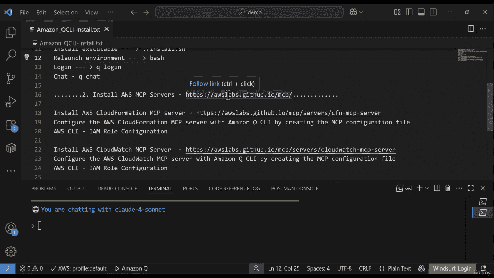

首先，我们需要安装MCP服务器。MCP（Model Context Protocol）是一种协议，它允许AI模型与外部工具进行交互。AWS提供了多个MCP服务器，我们需要找到它们并安装。

### 查找AWS MCP服务器

打开浏览器，访问这个链接，或者直接在Google中搜索“AWS MCP servers”。你会看到很多相关的链接。点击进入AWS MCP server的主页。需要注意的是，这个URL可能会发生变化，因为AWS在不断地更新这些服务器和网页，所以你要仔细查看，确保自己找到的是正确的地址。一旦进入AWS MCP servers页面，我们就可以查看其中的几个服务器了。

### 查看CloudFormation MCP服务器

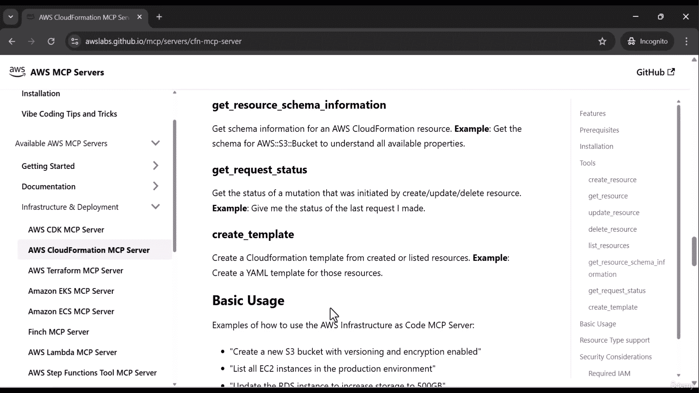

在AWS MCP servers页面中，我们可以看看有哪些可用的服务器。我们重点来看CloudFormation服务器。在页面中找到“Infrastructure Deployment”部分，点击进入。你会看到“AWS CloudFormation MCP server”的条目。点击它，就能看到所有详细信息。

以下是这个服务器的一些主要特性：

- **资源创建**：比如创建S3存储桶、Lambda函数等。
- **资源读取**：获取特定资源的详细信息，例如EC2实例的配置。
- **资源更新**：修改现有资源。
- **资源删除**：删除不再需要的资源。
- **资源列表**：列出所有资源。

这些功能都是MCP服务器对外暴露的工具能力。我们将在后面的实战中尝试使用其中的一些功能。在页面上还会看到一些前置条件（prerequisites），告诉你如何使用VS Code或Cursor进行安装，以及配置文件的内容。最后，页面还会列出这个服务器可用的所有工具。

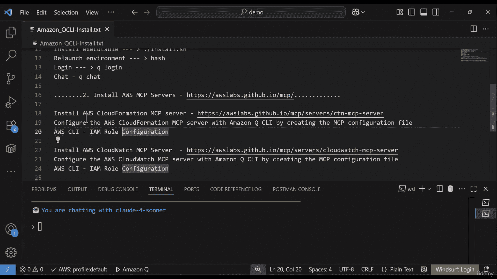

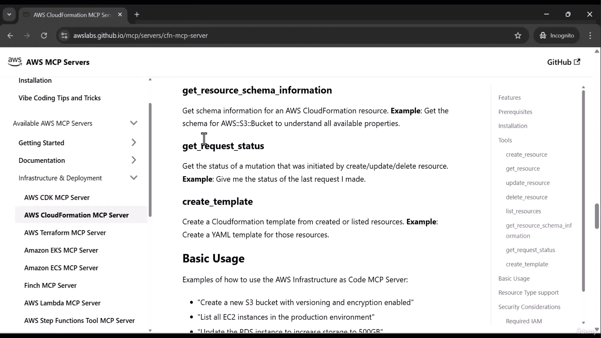

## 二、在VS Code中准备安装步骤 📝

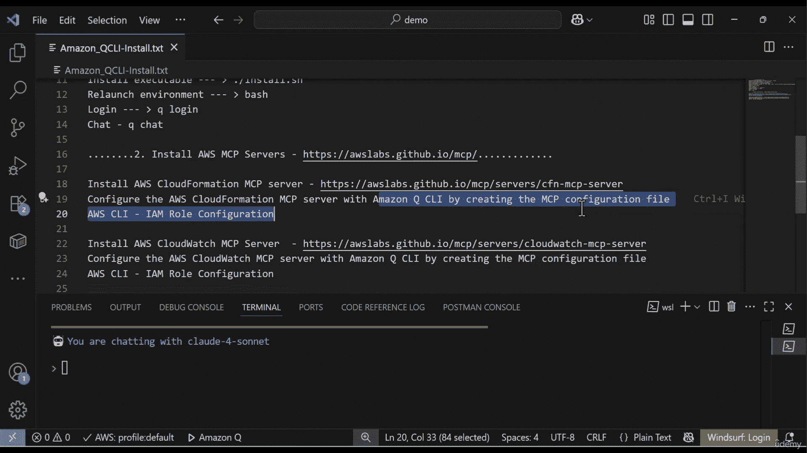

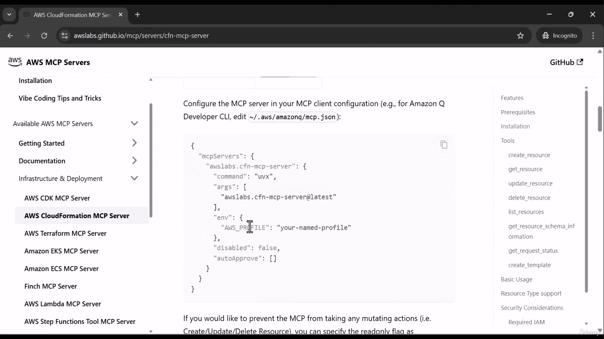

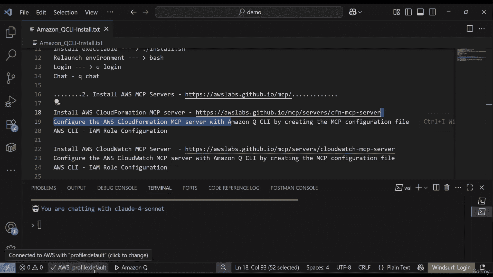

现在，我们回到VS Code。我之前已经写下了一些步骤，说明我们需要做什么。以下是需要完成的三项主要任务：

1. **安装CloudFormation MCP服务器**：我们需要安装AWS CloudFormation MCP服务器。我复制了一个链接，把它粘贴到Q CLI中。
2. **配置CloudFormation MCP服务器**：我们需要通过创建一个配置文件来配置Amazon Q CLI。这个配置文件就是前面在页面上看到的那个。
3. **确保AWS CLI配置正确**：你需要确保你的AWS CLI配置了正确的IAM角色。如果设置了IAM角色，大多数情况下默认配置文件就是“default”。

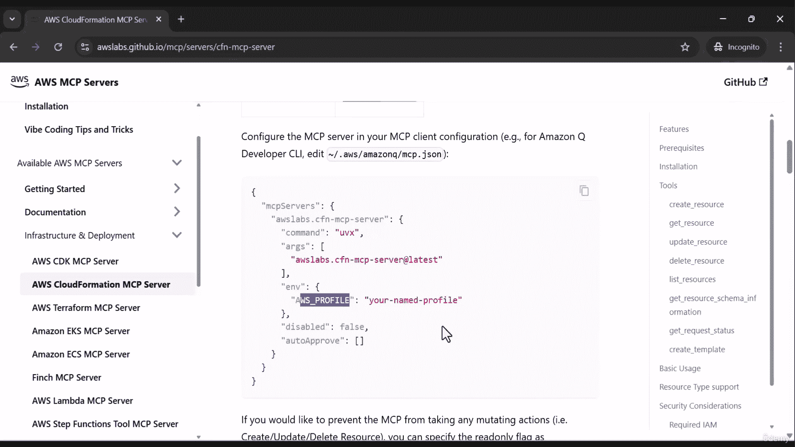

所有这些安装和配置操作，我们都会通过向Q CLI输入自然语言命令来完成。Q CLI可以理解这些命令并自动执行。

## 三、使用Amazon Q CLI安装CloudFormation MCP服务器 🖥️

现在，让我们开始实际操作。我把VS Code全屏显示。在Q CLI中输入以下命令：

```
install AWS CloudFormation server
```

同时，我会把这个URL提供给它。即使不提供URL，它也应该能安装，但提供URL会更方便、更快。输入后按回车。

可以看到，Q CLI正在使用“execute bash”工具，并且提示要克隆这个特定的URL。它会询问你是否信任这个操作。如果你输入“T”，表示信任，它会运行所有需要执行的命令；如果你输入“Y”，则只运行当前这一条命令。这里我们输入“yes”，表示信任。

接下来，Q CLI开始克隆这个MCP服务器。然后它要求输入用户名，但你不知道用户名，所以直接按回车。它会显示认证失败，然后自动寻找其他方式来克隆这个仓库。这次我们再次选择信任。

Q CLI会读取这个目录，然后自动运行一系列命令。它似乎正在安装Python相关的工具。之后，它安装了pipx，并说“现在让我安装CloudFormation MCP服务器”。然后它安装了AWS Lambda CfN MCP服务器，并继续做其他事情。

## 四、配置MCP服务器 ⚙️

安装完成后，Q CLI会提示需要创建MCP配置文件。它说“我需要创建MCP配置文件了”。它已经完成了AWS CloudFormation MCP服务器的安装，现在需要用CloudFormation MCP服务器来配置Amazon Q CLI。为此，它需要定义这个MCP配置文件。

在我的情况下，它显示已经创建好了这个配置文件。但在你的情况下，当你提供提示时，可能不会自动创建，因为每次它的处理方式可能不同。所以，如果它没有配置这个MCP配置文件，你需要确保提供相应的提示，让Q CLI完成全部三个任务。

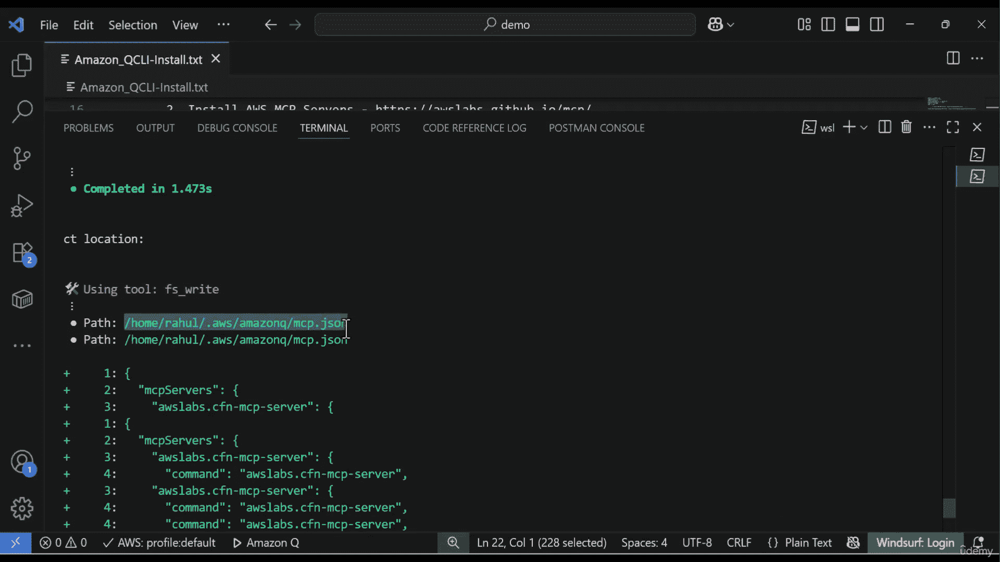

我们回到Q CLI，看看它进行到哪一步了。它现在说想要配置这个“Amazon Q MCP Json”文件。这个文件就是配置文件，用于将Q CLI与MCP服务器对接。

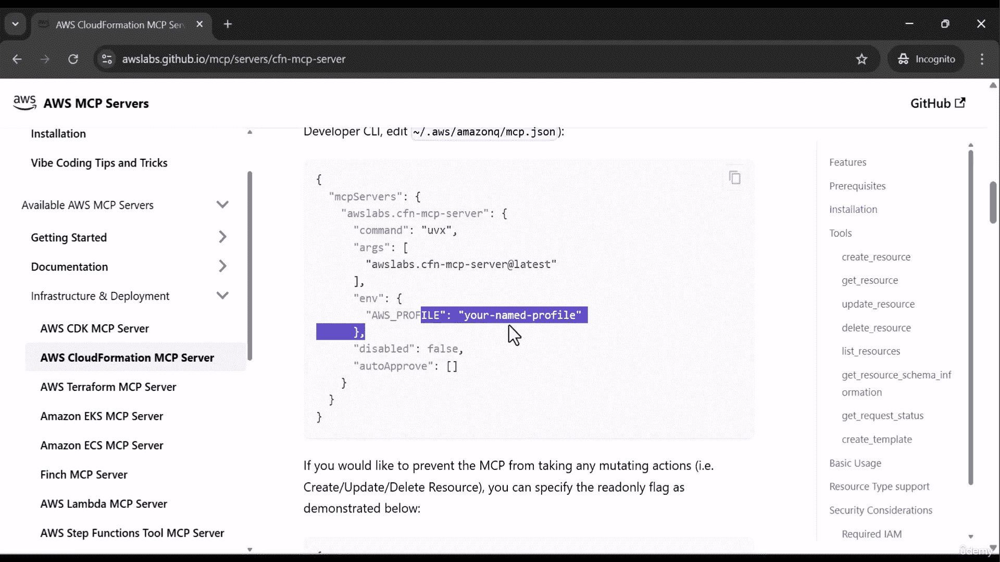

以下是配置文件的大致内容：

```json
{
  "mcpServers": {
    "cloudformation": {
      "command": "aws-cfn-mcp-server",
      "args": [],
      "env": {
        "AWS_PROFILE": "default"
      }
    }
  }
}
```

在我的情况下，这里的“AWS_PROFILE”是“default”，这与我在CLI中设置的配置文件一致。然后Q CLI说“使用这个CloudFormation服务器创建MCP配置文件”，并且要求你确认信任。读取这个配置文件后，它会检查AWS凭据和区域是否正确配置。

## 五、测试MCP服务器并重启Q CLI ✅

Q CLI会测试MCP服务器。它显示“服务器启动成功”，然后说“测试CloudFormation MCP服务器执行，服务器启动成功”。

接下来，它报告AWS CloudFormation MCP服务器已经成功安装并配置。以下是它的配置摘要：

- 安装的包：`aws-cfn-mcp-server`，版本1.0.6。
- 它创建了一个全局命令。
- 配置文件路径已指定。
- 使用的是AWS配置文件的“default”配置文件。
- 还设置了区域。

它还展示了这个CloudFormation MCP服务器可用的功能，并提示你重启Q CLI以加载MCP配置，然后就可以提问了。所以，我们重启Q CLI。输入：

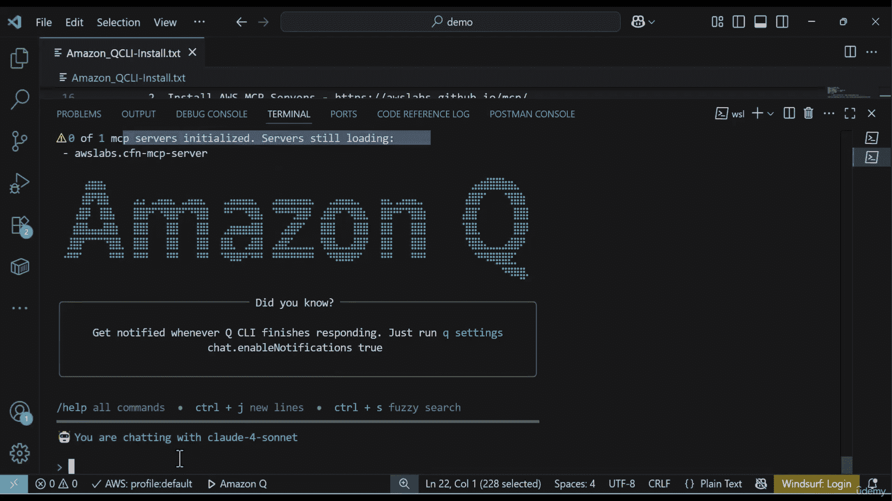

```
/quit
```

然后重新启动Q CLI，输入：

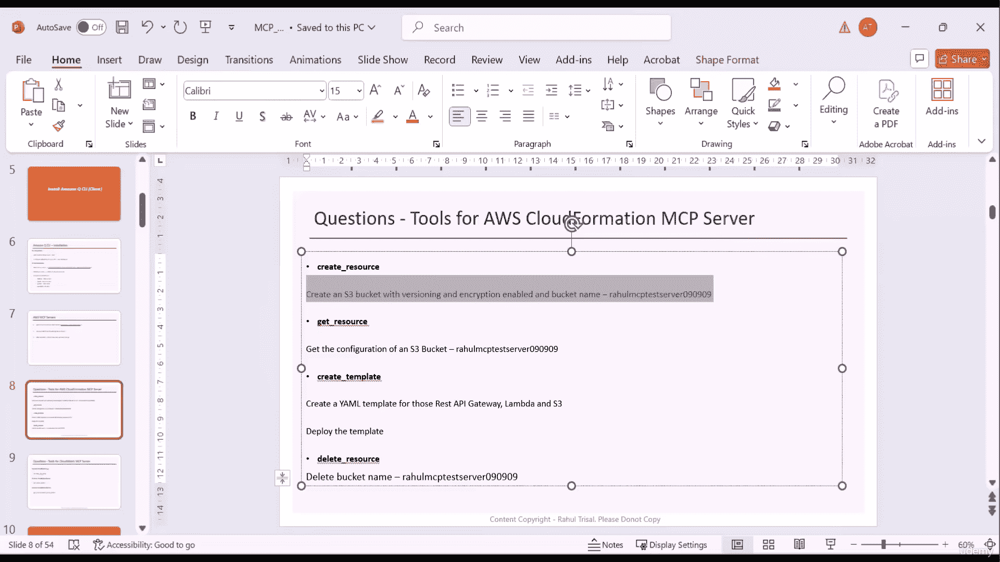

```
q chat
```

可以看到，它正在加载MCP服务器。

## 六、实战：使用MCP服务器创建S3存储桶 🪣

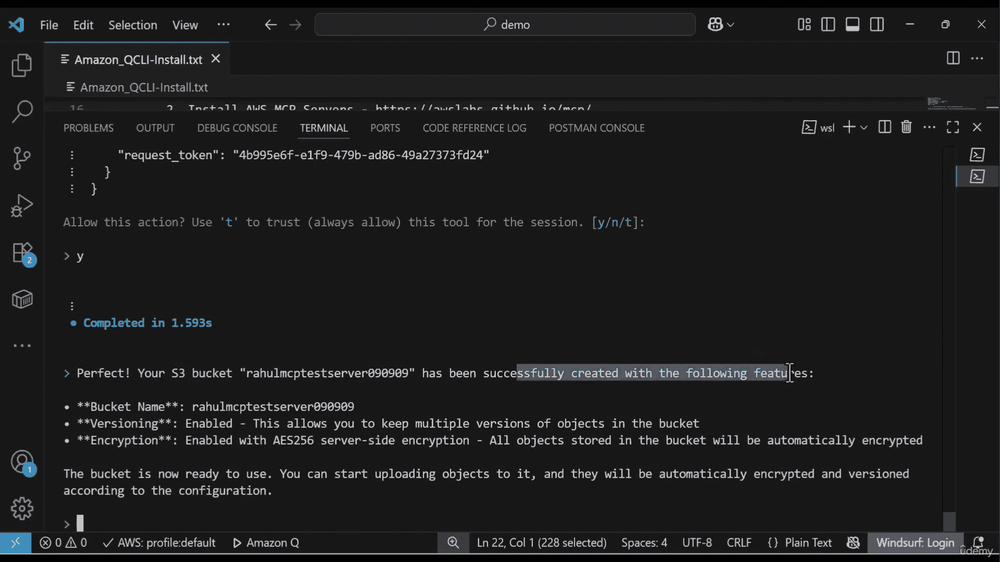

现在我们的MCP服务器已经准备好了。我们之前看过这个MCP服务器提供的一些工具，比如创建资源、获取资源、更新资源等。现在我们来尝试一些。

我们先创建一个启用了版本控制和加密的S3存储桶。存储桶名称是“rahul-mcp-test-server”。因为S3存储桶名称需要全局唯一，所以我给了一个随机名称。

回到Q CLI，粘贴这个问题，按回车。Q CLI说“我将创建一个名为……的S3存储桶”，然后显示它将创建的配置。它为我们创建了CloudFormation模板（JSON格式），以及我们指定的存储桶名称。它询问是否执行，我们回答“yes”。

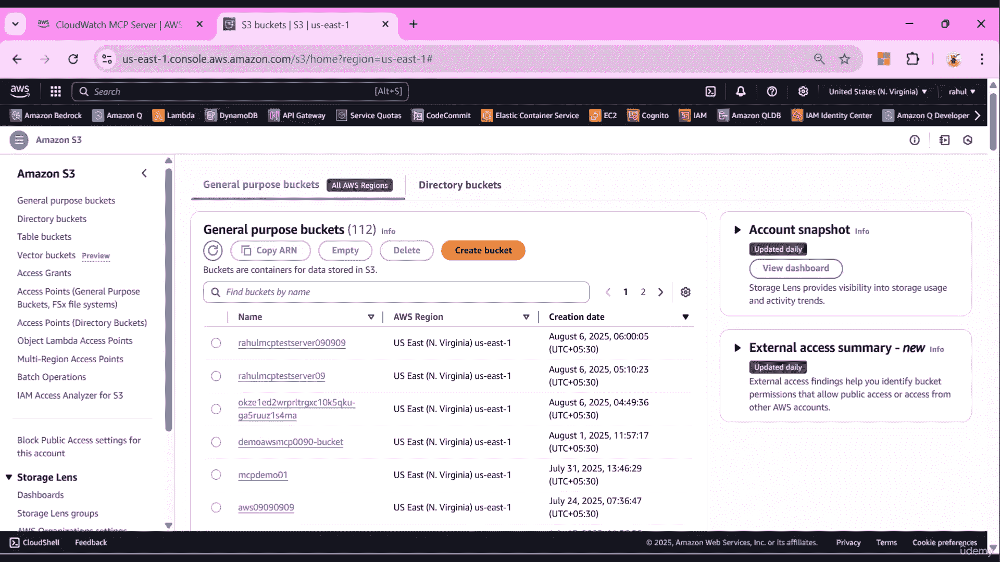

然后它显示“S3存储桶创建正在进行中”，并说“让我检查状态并确认成功”。我们再次说“yes”。完美，你的S3存储桶“rahul-mcp-test-server”已经成功创建，并且启用了版本控制和加密。

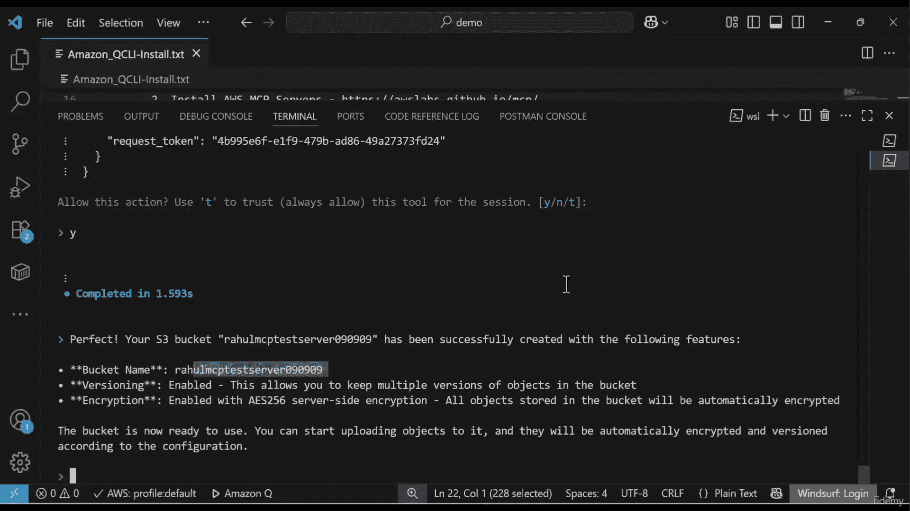

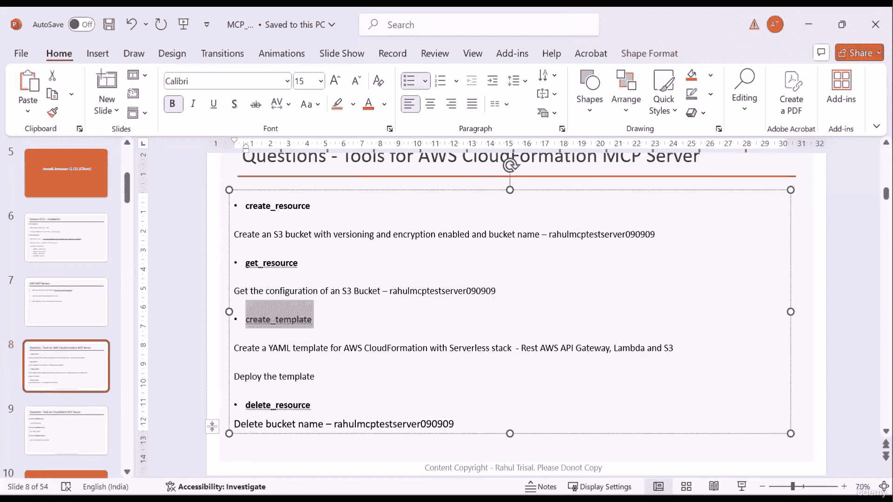

为了验证，我们进入AWS控制台，搜索“S3”。进入S3存储桶页面后，按创建日期排序，可以看到我们的存储桶“rahul-mcp-test-server”已经通过刚才的命令创建出来了。

## 七、实战：创建并部署CloudFormation模板 🏗️

接下来，我们做点更有意义的事情。我们要求Q CLI创建一个CloudFormation模板，包含REST API Gateway、Lambda和S3，然后让它部署这个模板。

我们复制这个问题，回到Q CLI。我先清空终端。然后粘贴问题：

```
create a yaml template for AWS CloudFormation stack with REST API Gateway, Lambda and S3
```

按回车。Q CLI说“我将为无服务器堆栈创建一个全面的CloudFormation模板，包含API Gateway、Lambda和S3”。这需要几分钟时间。

过了一会儿，它创建了CloudFormation模板。模板内容相当长。在模板的存储位置显示出来后，它询问是否执行，我们回答“yes”。

Q CLI然后总结了模板包含的内容：

- 一个S3存储桶，带有特定配置。
- S3事件通知触发Lambda。
- 公共S3块设置为安全。
- Lambda函数处理API请求，带有几个端点。
- 还有处理器Lambda。
- IAM角色。
- API Gateway（REST API Gateway）以及IAM安全设置。
- 还有其他特性，比如CloudWatch日志组等。

它说这个模板是生产就绪的，具有适当的安全配置和错误处理。

接下来，我们让它部署这个模板。输入：

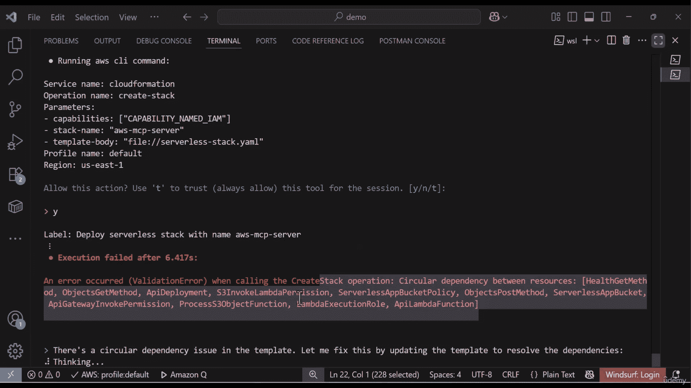

```
deploy this template with stack name AWS MCP server
```

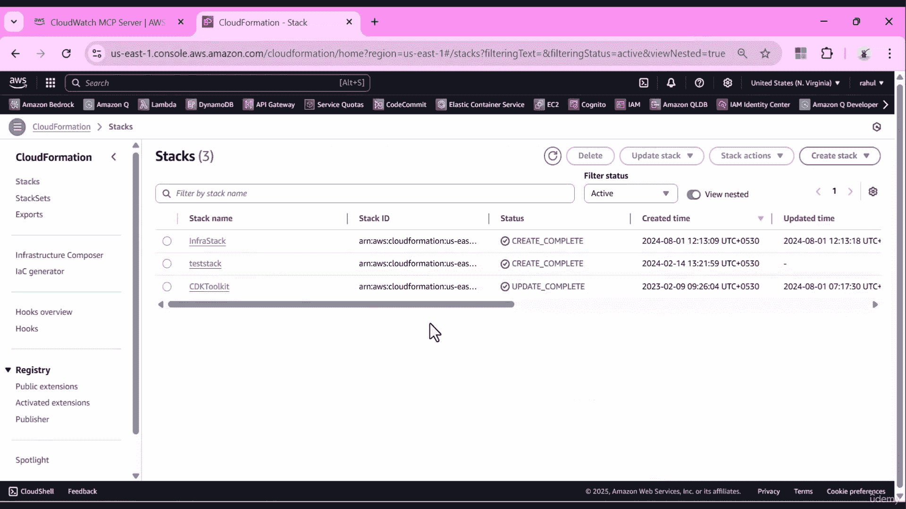

Q CLI会把这个堆栈部署到AWS CloudFormation服务上。它询问是否部署，我们回答“yes”。

但是，它发现了一个错误：“验证错误：调用创建堆栈操作时出错”，存在循环依赖。Q CLI会根据这个错误自动修复模板。

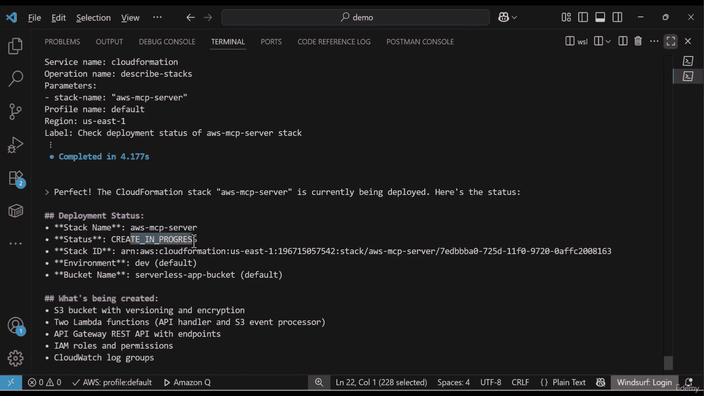

与此同时，我们去看一下CloudFormation服务。从控制台搜索“CloudFormation”。刷新页面，目前堆栈还没有部署。我们看看发生了什么。

Q CLI说它修复了循环依赖。我们再次选择“trust”。它说“现在让我部署修复后的模板”，然后再次尝试部署。现在它正在部署无服务器堆栈，名为“AWS MCP server”。状态显示“创建进行中”。

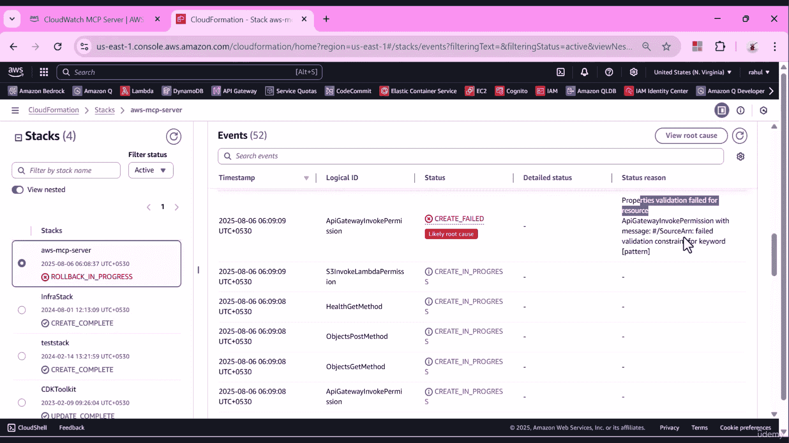

我们再次去CloudFormation服务刷新。可以看到“AWS MCP server”正在创建中。点击进去，查看“事件”选项卡。发现有一个事件失败了：“API Gateway调用权限的属性验证失败”。Q CLI会自己修复这个问题。

回到Q CLI，它说部署正在进行中。我们选择信任。不久后，它意识到堆栈失败了。它再次修复堆栈，然后重新部署。现在它说“我看到堆栈正在回滚，让我通过查看堆栈事件来检查出了什么问题”。它找出了问题所在，然后准备再次部署。它说“让我创建更正后的模板”。回到控制台，可以看到它找到了根本原因。它说“让我等待回滚完成，然后部署修复后的模板”。

等回滚完成后，它会删除失败的堆栈，然后部署一个新的堆栈。从控制台可以看到，这个“AWS MCP server”的删除已经完成。接着它会部署新的堆栈。

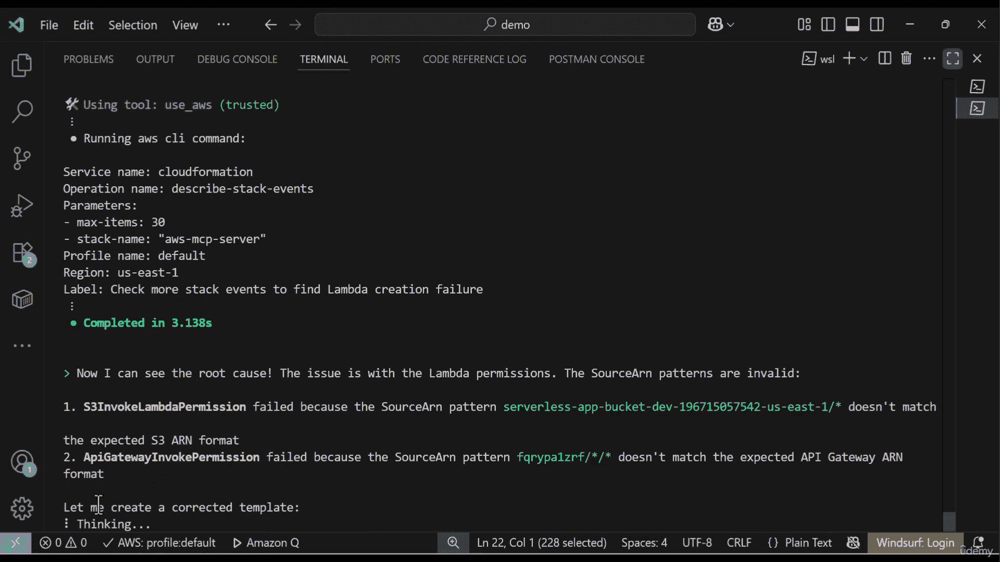

大约五分钟后，Q CLI终于成功创建了CloudFormation模板并部署了它。我们可以看到堆栈“AWS MCP server”状态为“创建完成”。刷新页面，可以看到这个堆栈已经创建好了。点击“资源”选项卡，可以看到它创建的所有资源：Lambda函数、日志组、API Gateway、资源方法、IAM角色、S3存储桶等等。

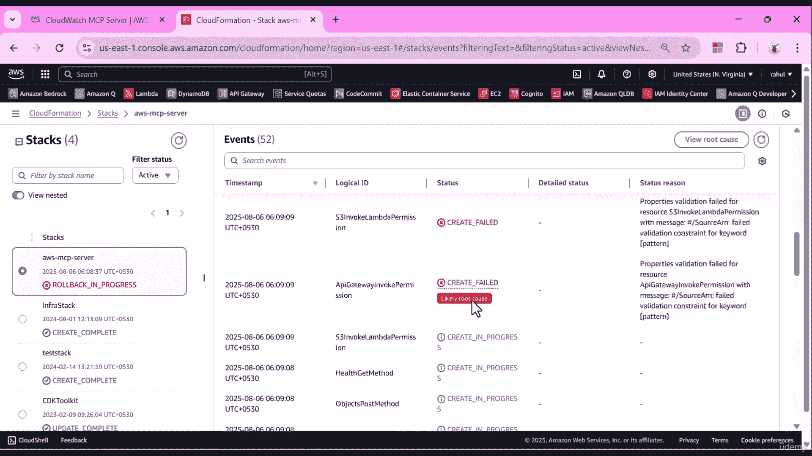

这就是使用Amazon Q CLI作为客户端、VS Code作为宿主来创建AWS MCP CloudFormation服务器的完整流程。

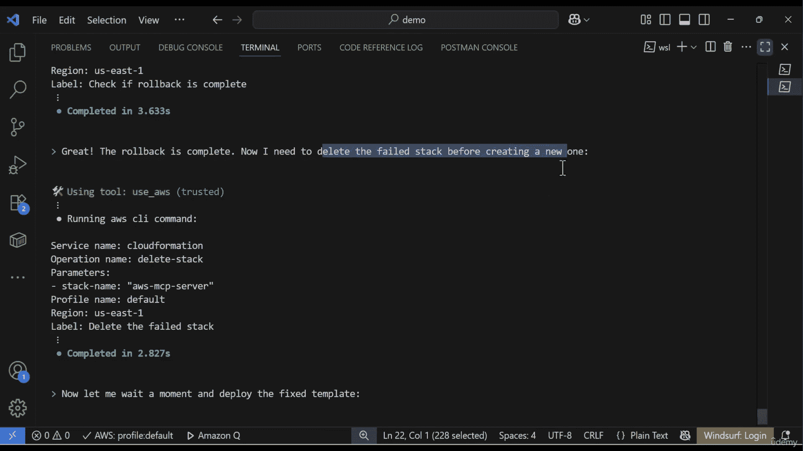

## 八、清理资源 🧹

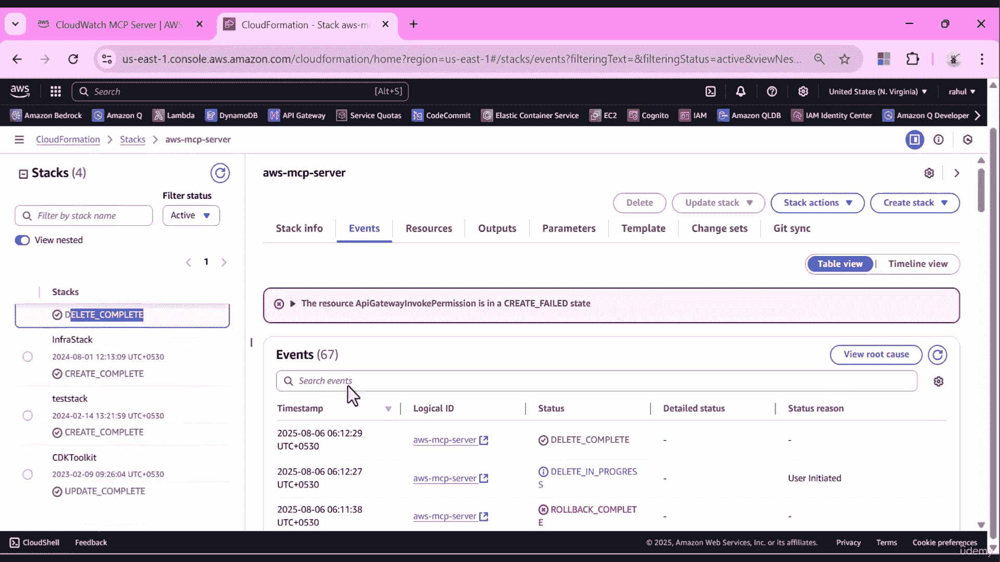

在结束本节课之前，请务必删除这个堆栈。虽然它是无服务器的，但最好还是删除资源以避免产生费用。

在CloudFormation控制台中，选中“AWS MCP server”堆栈，点击“删除”，然后确认删除。注意，有些资源可能不会被自动删除，比如S3存储桶。在这种情况下，你可以去S3服务中手动删除它。

现在可以看到删除正在进行中。大多数服务已经被删除了。这样，我们的资源就清理干净了。

## 总结 📖

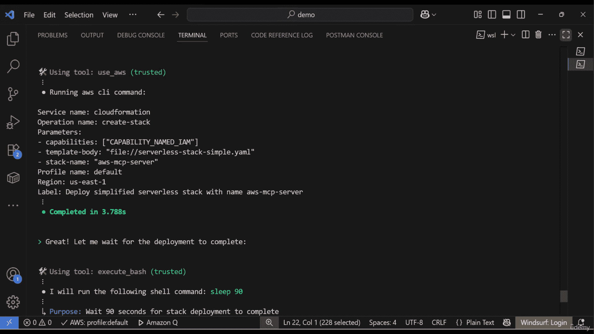

本节课中，我们一起学习了如何构建一个Coding Agent，具体来说，我们完成了以下工作：

- 查找并查看了AWS MCP服务器，重点了解了CloudFormation MCP服务器的功能和工具。
- 在VS Code中准备了安装步骤，明确了三个主要任务：安装、配置、验证。
- 使用Amazon Q CLI，通过自然语言命令安装了AWS CloudFormation MCP服务器。
- 配置了MCP配置文件，将Amazon Q CLI与MCP服务器对接。
- 测试了MCP服务器，并重启了Q CLI。
- 通过实际提问，使用MCP服务器创建了一个启用了版本控制和加密的S3存储桶。
- 创建了一个包含API Gateway、Lambda和S3的CloudFormation模板，并成功部署了它。过程中Q CLI自动修复了循环依赖和属性验证错误。
- 最后，我们清理了资源，删除了堆栈。

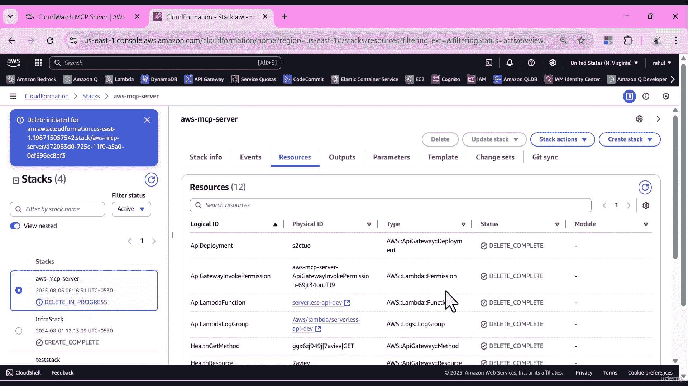

通过这个动手实践，你应该对如何利用Amazon Q CLI和MCP服务器来自动化AWS资源管理有了清晰的理解。希望这节课对你有所帮助，我们下节课再见。
