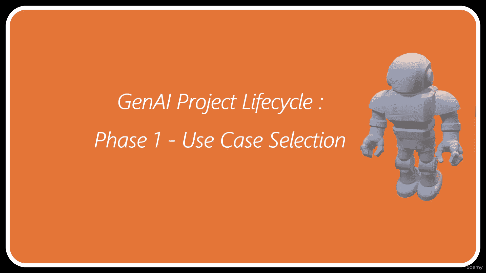
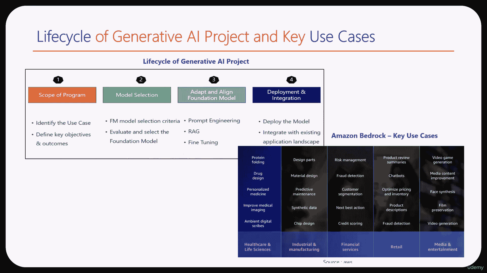

## 🚀 生成式AI on AWS：Amazon Bedrock、RAG与KIRO [2026]：第79–81讲：生成式AI项目生命周期与用例识别概览

在本节课中，我们将要学习生成式AI项目生命周期的各个阶段。简单说，就是先弄清楚一个生成式AI项目从开始到落地会经历哪些大阶段，再把注意力放到第一阶段：怎样为所在行业选择一个合适的用例。为了不让初学者一开始就陷入细节，本节会先看整体路线，再进入第一个关键步骤。

以下是本节要处理的核心内容，先用一个列表把学习路线说清楚：

- 了解生成式AI项目生命周期的各个阶段。
- 从阶段1开始，学习如何为所在行业选择合适用例。
- 先认识生成式AI项目生命周期中的四个阶段，并整体概览所有阶段。
- 然后为所在行业识别合适用例。

把整体路线看清之后，本节会用一句话概括生命周期，方便初学者先建立一个直观印象。核心概念可以用下面的公式表示，其中阶段2到阶段4只是表示后面还有阶段，具体名称本节不展开：

```text
生成式AI项目生命周期 = 阶段1 + 阶段2 + 阶段3 + 阶段4
```

上面的公式说明，一个生成式AI项目不是只做一步就结束，而是由多个阶段组成。本节先不深入每个阶段的细节，而是先做整体概览，让后续学习有一个清晰地图。地图看清后，本节把重点放在阶段1，也就是为行业选择合适用例。

上一段我们看了整体生命周期，本节继续看阶段1的核心动作。阶段1可以理解成先判断“这个行业里的什么问题适合用生成式AI解决”，再用伪代码帮助理解：

```text
阶段1：适合行业的用例 = 选择(行业需求, 生成式AI能力)
```

这段伪代码表达的思路很直白：先看行业需求，再看生成式AI能做什么，然后从中选出合适用例。以下是原内容安排的学习节奏，按这个节奏推进就不会乱：

- 先讲生成式AI项目生命周期中的四个阶段，并概览所有阶段。
- 再为所在行业识别合适用例。
- 然后正式进入后续学习。



到这里，本节的学习路线已经清楚。现在开始，下节课见，谢谢。

> 现在开始，下节课见，谢谢。



本节课中我们一起学习了生成式AI项目生命周期的四个阶段概览，也学习了阶段1的核心任务：为所在行业选择合适用例。整体思路是先看全局，再进入第一个阶段，把“行业需求”和“生成式AI能力”对应起来，为后续深入学习打好基础。

