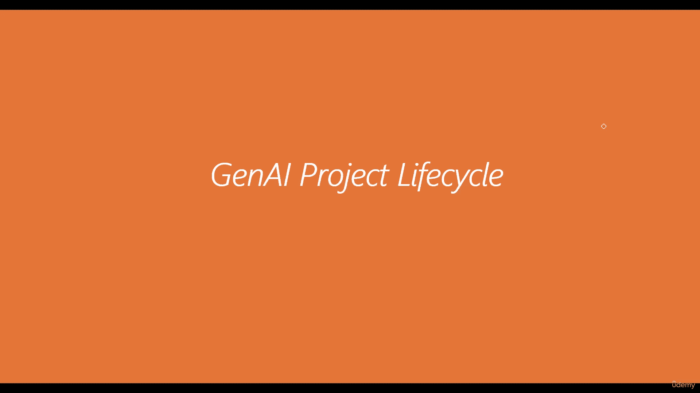
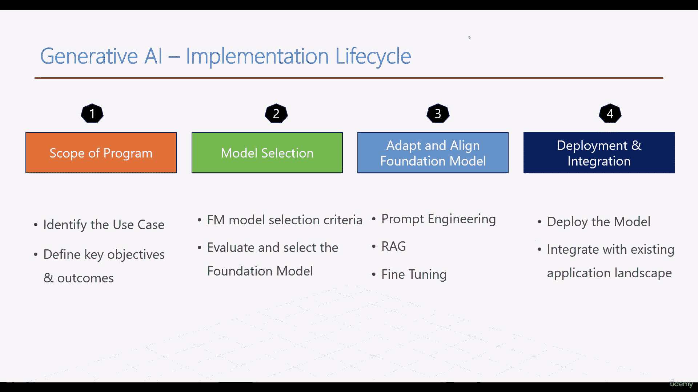

# 🧭 生成式AI on AWS：第80–82讲：生成式AI项目生命周期概览

在本节课中我们将要学习生成式AI项目生命周期。本节讨论生成式AI项目的生命周期，总体而言，生成式AI用例落地可以分成四个阶段，这四个阶段合在一起就是一条从明确想法到上线运行的完整路径。先建立整体印象很重要，因为后面每一步的选择都会受到前一步的影响。为了先看清全貌，以下是四个阶段的概览：

```text
生成式AI项目生命周期 = 定义范围 -> 基础模型选择 -> 适配与对齐 -> 部署与集成
```



这四个阶段不是孤立的，而是前后衔接的。可以把它们理解成一条流水线：先把问题想清楚，再选合适的模型，然后让模型贴合业务，最后把模型部署并接入现有系统。上一段给出了整体框架，接下来我们按顺序展开。首先看第一阶段，定义项目范围。

## 🎯 生成式AI on AWS：第80–82讲-01：定义项目范围

第一阶段从定义项目范围开始。在定义范围时，需要识别具体用例。如果回顾之前看过的媒体和娱乐行业例子，我们当时看了电影制作的多个阶段，并在这些阶段中识别出了可用用例。这个回顾说明，用例往往来自业务流程中的具体环节，而不是凭空想出来的。识别出用例后，下一步是明确实施的关键目标和预期成果。这些目标可以包括提升客户体验，也可以包括降低成本。目标和成果定义清楚后，等实现完成，就可以衡量这些成果是否达成。以下是第一阶段要完成的关键动作：

- 定义项目范围，并在范围内识别生成式AI用例。
- 明确实施的关键目标和预期成果，例如改善客户体验、降低成本。
- 在实现完成后，用前面定义的目标和成果来衡量实际效果。

完成范围定义后，项目就有了方向和衡量标准。上一节我们说明了第一阶段，本节我们来看看第二阶段，也就是基础模型选择。

## 🧠 生成式AI on AWS：第80–82讲-02：基础模型选择

基础模型选择是生成式AI用例成功落地的一个关键环节。这里不存在“一刀切”的万能模型，选择会随着用例不同、目标不同而变化。模型选择的第一步是识别各种选择参数，同时也要先确定模型选择标准。未来课程中会看到很多这类参数。确定选择标准后，就可以评估市场上大量可用的基础模型，并从中选出最适合当前用例的模型。以下是模型选择阶段要关注的主要步骤和原则：

- 认识到基础模型选择对用例成功落地很关键。
- 理解没有一种模型能适合所有场景，选择要依据用例和目标变化。
- 先识别模型选择参数，并确定模型选择标准。
- 后续课程会展开很多选择参数。
- 基于标准评估市场上大量可用的基础模型。
- 选出与当前用例匹配的模型。

可以把模型选择理解成一个匹配过程，核心公式可以写成下面这样：

```text
不存在“一刀切”的基础模型
模型选择 = f(用例, 选择标准, 候选模型评估结果)
```

模型选好之后，还不一定直接适合领域场景。上一节我们完成了模型选择，本节我们来看看第三步，如何让模型适配并对齐业务要求。

## 🛠️ 生成式AI on AWS：第80–82讲-03：适配与对齐基础模型

在识别出基础模型之后，可以按照领域特定要求对基础模型进行适配和对齐。实现这件事有多种方式。第一种是提示工程（Prompt Engineering），也就是通过组织提示词来引导模型输出。第二种是RAG，也就是检索增强生成（Retrieval-Augmented Generation），可以理解为先找相关资料再让模型基于资料回答。第三种是微调（Fine-tuning），也就是用领域数据继续训练模型，让它更贴合特定任务。可以使用这三种技术来让基础模型满足需求。以下是三种常见的适配与对齐方式：

- 提示工程（Prompt Engineering）：通过设计提示词来引导模型。
- RAG（检索增强生成）：结合检索到的资料来增强生成结果。
- 微调（Fine-tuning）：基于领域需求继续训练模型。

这三种方式可以组合使用，核心关系可以用下面的式子表示：

```text
适配与对齐 = 提示工程（Prompt Engineering）
            + 检索增强生成（RAG）
            + 微调（Fine-tuning）
```

模型完成适配和对齐后，就进入最后落地环节。上一节我们介绍了适配模型的方法，本节我们来看看第四步，部署与集成。

## 🚀 生成式AI on AWS：第80–82讲-04：部署与集成

最后一步是部署和集成。需要先部署基础模型，然后把它与现有应用环境集成起来。这个集成后的能力还可以成为更大业务流程工作流的一部分。以下是部署与集成阶段要做的事情：

- 部署选好并适配过的基础模型。
- 将模型集成到现有应用格局中。
- 让生成式AI能力融入更大的业务流程工作流。

部署与集成可以理解为从“模型可用”走向“业务可用”，其核心关系如下：

```text
最终落地 = 部署基础模型 + 集成现有应用 + 融入业务流程
```

到这里，四个阶段的整体链路已经讲完。希望上述内容已经讲清楚。下一讲将更详细地讨论如何识别项目范围。上一节我们完成了生命周期四个阶段的说明，本节我们做一个收束总结。

## 🧾 生成式AI on AWS：第80–82讲-05：总结



本节课中我们一起学习了生成式AI项目生命周期的四个阶段。这四个阶段分别是定义项目范围、基础模型选择、适配与对齐、部署与集成。在定义范围阶段，要识别用例、明确目标和预期成果，并在完成后衡量结果。在模型选择阶段，要认识到没有万能模型，先确定选择标准和参数，再评估市场上的候选模型。在适配与对齐阶段，可以使用提示工程、RAG和微调三种技术。在部署与集成阶段，要部署基础模型，把它集成到现有应用中，并接入更大的业务流程工作流。下一讲将详细讨论如何识别项目范围。感谢观看，下一讲见。
