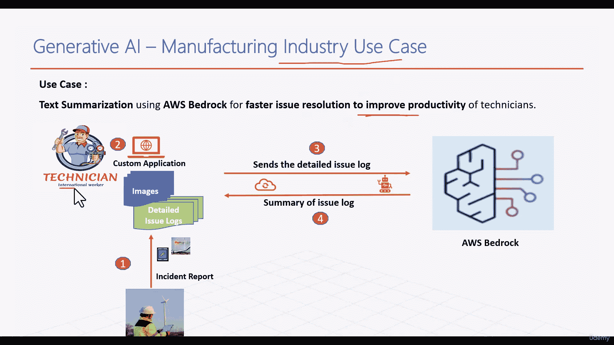
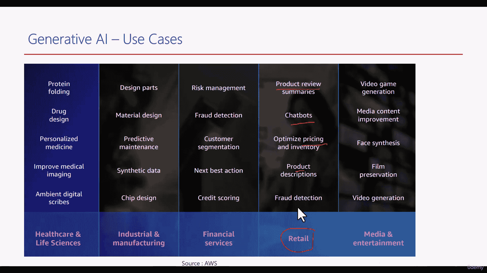
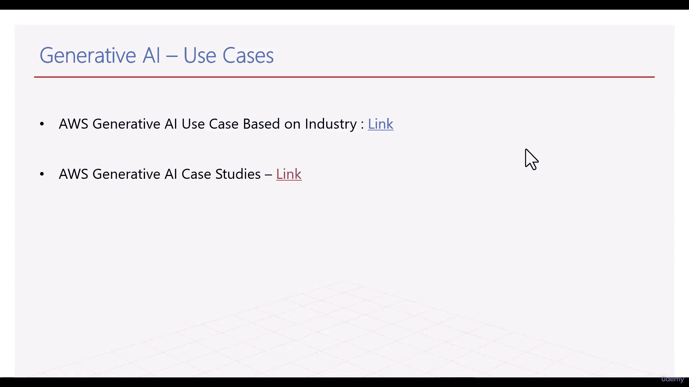

# 🚀 AWS生成式AI实战：1.0：生成式AI用例识别方法

在本节课中我们将要学习生成式AI项目实施的第一阶段，也就是确定项目范围，并重点了解如何识别适合生成式AI落地的用例。对初学者来说，可以先这样理解：用例就是“把生成式AI用在哪个具体业务场景里”。选对场景往往比急着写代码更重要。本节课会回顾已有案例、查看AWS提供的行业用例工具，并介绍客户案例研究资源。

## 🧭 AWS生成式AI实战：1.1：从业务价值流里找候选用例

上一节概述了本节课的目标，本节中我们来看看如何从业务流程中寻找生成式AI用例。在之前的章节中，我们在媒体和娱乐行业实现过一个用例，这是一种可行的方法：先识别一条业务价值流，再识别这条价值流中的每个步骤，然后判断每个步骤里有哪些生成式AI可能用例。

为了更直白地理解，可以把用例识别过程写成公式：

```text
候选用例 = 业务价值流 × 流程步骤 × 生成式AI能力
```

实际思考时，也可以把它写成类似下面的伪代码：

```python
for 步骤 in 业务价值流:
    候选用例列表 += 识别生成式AI可帮助的环节(步骤)
```



下面列出讲座回顾的两个已有案例线索，帮助初学者建立直观印象。

- 在媒体和娱乐行业，可以沿着业务价值流拆解步骤，再寻找每个步骤中的生成式AI用例。
- 在制造业，讲座详细讨论了如何通过实施生成式AI用例来提高技术员的生产力。

这两个例子说明，找用例不能只看技术本身，而要先看业务是怎么运转的。理解了业务价值流的方法后，下一节我们来看看AWS提供的领域图表和零售行业示例。

## 🗺️ AWS生成式AI实战：1.2：用AWS领域图表看零售用例

上一节我们介绍了从业务价值流拆解用例的方法，本节中我们来看看AWS按不同领域整理的用例图表。AWS提供了一张图表，可以从不同领域观察生成式AI用例。以零售领域为例，下面是讲座提到的一些零售用例方向。

- 提升生产力，或用于聊天机器人。
- 优化定价和库存。
- 撰写产品描述。
- 欺诈检测等。



这些例子只是启发，并不是完整清单。讲座最后还提供了几个链接，这些链接在识别你所在行业的合适用例方面非常有帮助。接下来打开链接看看具体工具。

## 🔎 AWS生成式AI实战：1.3：用AI Use Case Explorer筛选用例

上一节我们看了AWS领域图表中的零售用例，本节中我们来看看AWS的AI用例探索工具。打开链接后可以看到，这个工具叫AI Explorer，来自AWS AI Use Case Explorer。这个工具允许选择行业，例如选择零售。

可以用一个简单公式表示它的推荐思路：

```text
推荐用例 = f(行业, 业务功能, 业务成果, 技术)
```

在工具里，可以按以下维度进行筛选，这也是初学者快速缩小范围的方法。

- 选择行业，例如零售。
- 选择业务功能。
- 选择希望实现的业务成果，例如降低成本、提高质量等。
- 选择技术。
- 点击“探索”（Explore）。

筛选之后，工具会提供以下内容，方便进一步研究落地机会。

- 非常详细的业务用例。
- 每个业务用例下的子用例。
- 成功故事。
- 解决方案。

例如，可以看到“用生成式AI增强客户体验”的用例，也可以看到另一个“用生成式AI提升员工生产力”的用例。下面是该方向下的一些子用例介绍。

- 员工支持与内容生成。
- 自动报告生成。

这些内容还会提供各种解决方案和成功故事的细节。点击这些内容后，可以看到服务名称，以及这些服务在这个特定用例场景中如何提供帮助。理解了工具怎么用之后，下一节我们来看看客户案例研究。

## 📚 AWS生成式AI实战：1.4：参考客户案例研究

上一节我们介绍了AI Use Case Explorer的筛选方式，本节中我们来看看客户案例研究。最后要展示一些案例研究，相关链接已经提供在课程资料中。下面是案例研究资源的作用。

- 这些案例研究展示生成式AI，尤其是Amazon Bedrock，如何被这些客户实施并带来收益。
- 案例研究链接见课程资料。

> 资源：AWS AI Use Case Explorer 与案例研究链接（见课程资料）。

案例研究能帮助初学者看到真实客户如何把生成式AI用到业务中，也能帮助判断哪些收益是可预期的。看完这些资源后，本节进入收尾。

## ✅ AWS生成式AI实战：1.5：本节收尾与小结

本节到此结束。我不希望在识别用例上花更多时间，因为这件事非常依赖具体领域。你可以查看AWS提供的这些链接，判断哪类用例可能适合你的行业。希望本节课有用，下节课见，感谢观看。



本节课中我们一起学习了生成式AI项目实施的第一阶段，也就是确定项目范围，并学习了如何识别合适用例。我们回顾了从业务价值流和流程步骤寻找用例的方法，看了AWS领域图表中的零售示例，了解了AWS AI Use Case Explorer的筛选维度，也介绍了客户案例研究资源。对初学者来说，先理解业务、再筛选用例、最后参考真实案例，是更稳妥的学习路径。

