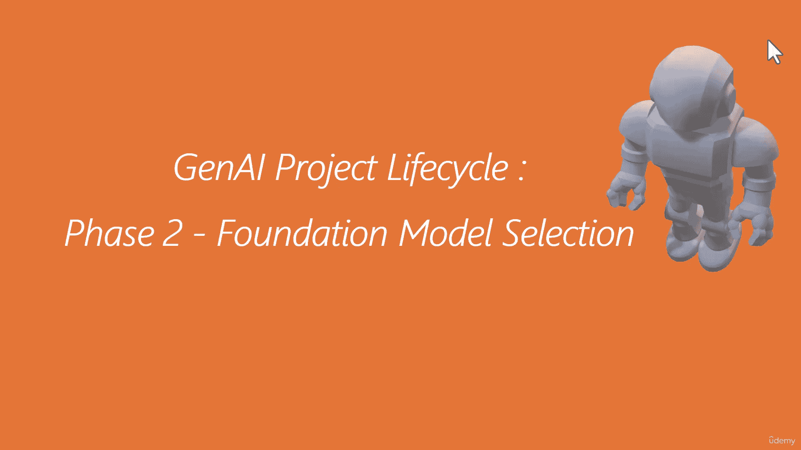
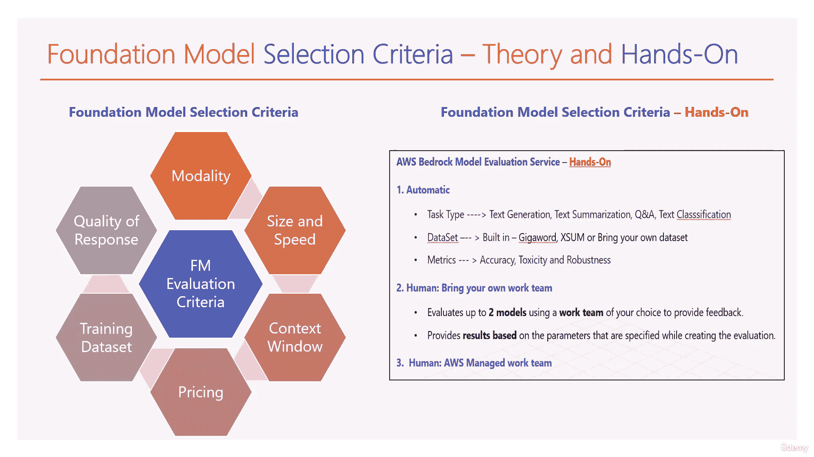

# 🚀 AWS生成式AI实战：第2章：为用例选择基础模型

在本节课中，我们将要学习生成式AI项目生命周期的第二阶段，也就是如何为具体用例选择合适的基础模型。上一节已经介绍第一阶段“用例识别”，本节把重点转到第二阶段“基础模型选择”。这个阶段很关键，因为同一个生成式AI任务往往有多个候选模型，不同模型在效果、速度、成本、上下文长度和合规能力上会有差异；选对模型能让后续开发和上线更顺畅。接下来会先说明选择基础模型时可以评估哪些参数，再做动手实践，展示如何使用AWS Bedrock模型评估服务来帮助选出适合用例的基础模型。

## 🔁 AWS生成式AI实战：第2.1节：回顾上一阶段与本节目标

上一节我们讨论了生成式AI项目生命周期的第一阶段，也就是用例识别，它的目标是先明确要解决什么问题、服务什么用户、达成什么效果。本节中我们来看看生命周期的第二阶段，也就是如何为已经识别出的用例选择合适的基础模型。可以把第二阶段理解成“给任务配一个合适的模型”，需要考虑模型能不能完成任务、响应是否够快、费用是否可接受、是否满足安全和合规要求等因素。为了让初学者更容易理解，可以用一个简单公式来描述模型选择的核心思路。

```text
合适基础模型 = argmax_{m ∈ M} Score(m, 用例需求U)
```

这个公式的意思是：在候选模型集合M中，选择一个对当前用例需求U得分最高的模型m。公式只是帮助理解，实际选择时还要结合业务约束和评估结果。以下是本节后续会覆盖的内容。

- 回顾第一阶段用例识别的目标。
- 说明第二阶段的核心任务是选择合适的基础模型。
- 引出选择基础模型时可以评估的参数。
- 为后续AWS Bedrock动手实践做准备。

## 🧩 AWS生成式AI实战：第2.2节：选择基础模型时可评估的参数

在明确第二阶段的目标后，本节先来看选择基础模型时可以评估哪些参数。原文强调，本节会从“选择合适基础模型时可以评估的参数”开始讲起；用大白话说，就是不要凭感觉选模型，而是先列出判断标准，再用这些标准比较候选模型。常见评估维度包括任务效果、响应延迟、调用成本、上下文长度、安全与合规、稳定性以及生态支持等；这些参数不是每个项目都必须全部使用，而是要根据用例需求挑重点。以下是选择基础模型时常见的评估参数示例。

- **任务效果**：模型能否准确完成当前用例要求的任务，例如问答、总结、分类或生成。
- **响应延迟**：模型返回结果需要多长时间，是否满足用户对交互速度的期待。
- **调用成本**：每次请求或每个token的费用是否在预算范围内。
- **上下文长度**：模型一次能处理多少输入内容，是否适合长文档或长对话。
- **安全与合规**：模型输出是否符合业务安全要求、数据合规要求和内容政策。
- **稳定性与可用性**：服务是否稳定，是否适合生产环境持续调用。
- **生态与集成**：模型是否容易与现有AWS服务和开发流程集成。

这些参数可以整理成一个简单的评估代码框架，帮助初学者理解“先列指标，再算得分”的过程。下面是一个伪代码示例。

```python
candidates = ["model_a", "model_b", "model_c"]
weights = {
    "accuracy": 0.4,
    "latency": 0.2,
    "cost": 0.2,
    "context_length": 0.1,
    "compliance": 0.1
}

def score_model(model, use_case):
    # 根据用例需求评估模型各项指标
    metrics = evaluate(model, use_case)
    return weighted_sum(metrics, weights)

best_model = max(candidates, key=lambda m: score_model(m, use_case))
```

上面的代码表达的核心意思是：准备候选模型列表，确定各项评估参数的权重，然后对每个模型打分，最后选出得分最高的模型。实际使用AWS Bedrock模型评估服务时，评估过程和指标会更完整，但基本思路仍然是先明确用例需求，再比较候选模型。

## 🛠️ AWS生成式AI实战：第2.3节：使用AWS Bedrock模型评估服务动手实践

了解了评估参数后，接下来进入动手实践环节。原文说明，本节会做一些动手操作，并展示如何使用AWS Bedrock模型评估服务来选择适合用例的基础模型。用大白话说，就是不仅要知道“看哪些指标”，还要在AWS环境中实际跑一轮评估，让评估结果帮助做选择。以下是动手实践部分会涉及的关键步骤。

- 明确当前用例的需求和评估目标。
- 准备需要比较的候选基础模型。
- 使用AWS Bedrock模型评估服务发起评估。
- 查看评估结果并比较不同模型的表现。
- 结合业务约束选择合适的基础模型。

为了帮助初学者建立直观印象，可以用下面的伪代码表示Bedrock模型评估服务的使用流程。

```python
# 伪代码：使用AWS Bedrock模型评估服务选择基础模型
use_case = define_use_case_requirements()
candidate_models = list_candidate_foundation_models()
evaluation_job = bedrock_model_evaluation.create_job(
    use_case=use_case,
    models=candidate_models,
    metrics=["quality", "latency", "cost", "safety"]
)
results = evaluation_job.get_results()
best_model = select_best_model(results, business_constraints)
```



这段伪代码展示的流程是：先定义用例需求，再列出候选基础模型，然后创建模型评估任务，获取评估结果，最后结合业务约束选出合适模型。实际界面和参数会以AWS Bedrock的当前功能为准，但学习重点是理解“用评估服务辅助模型选择”的方法。



## ✅ AWS生成式AI实战：第2.4节：本节总结与下一步

到这里，本节内容就整理完了。本节中我们一起学习了生成式AI项目生命周期的第二阶段，也就是为用例选择合适的基础模型；我们回顾了上一节的用例识别，说明了选择基础模型时可以评估的参数，并介绍了使用AWS Bedrock模型评估服务进行动手实践的思路。现在可以开始进入后续内容，下节课再见，谢谢。

