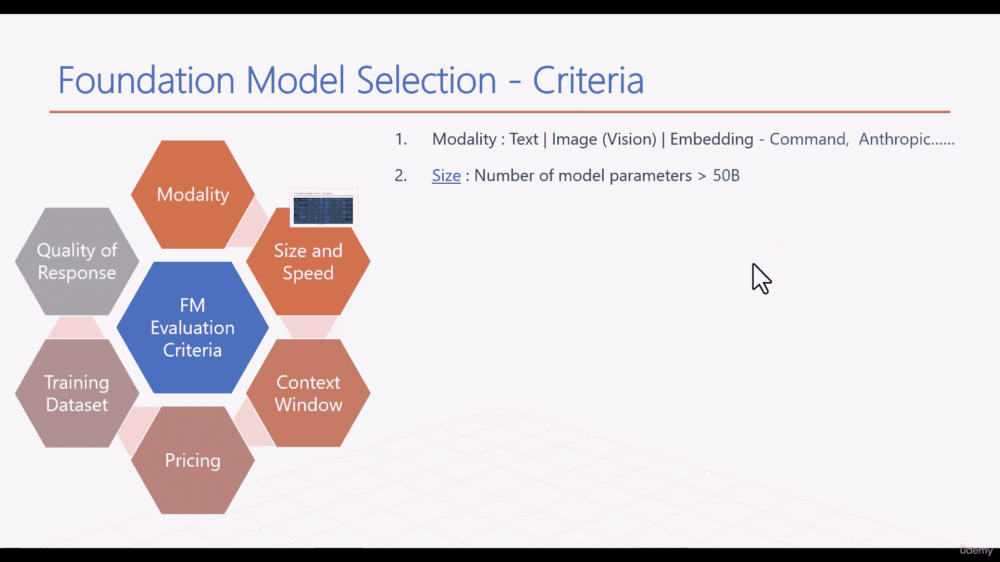
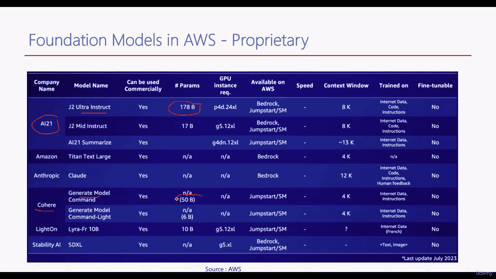
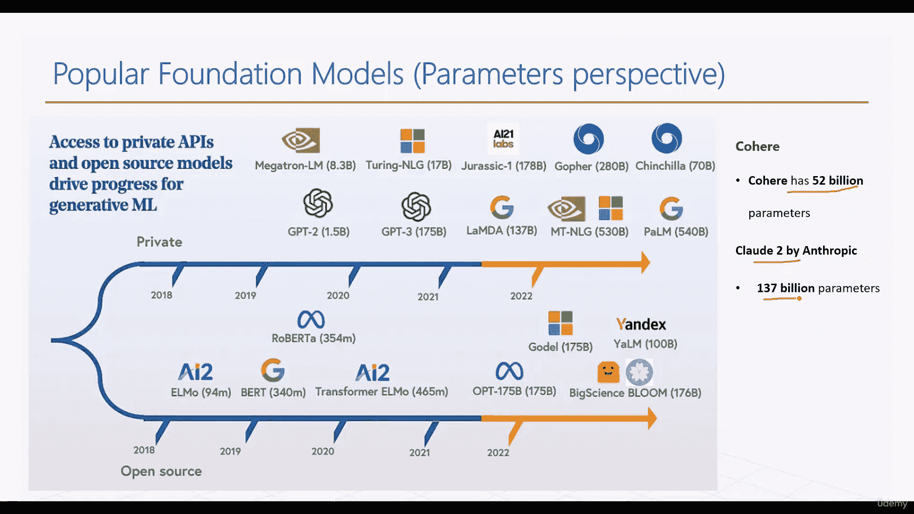
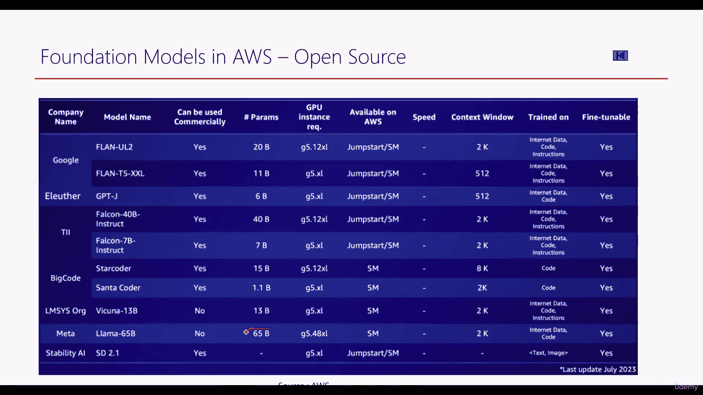
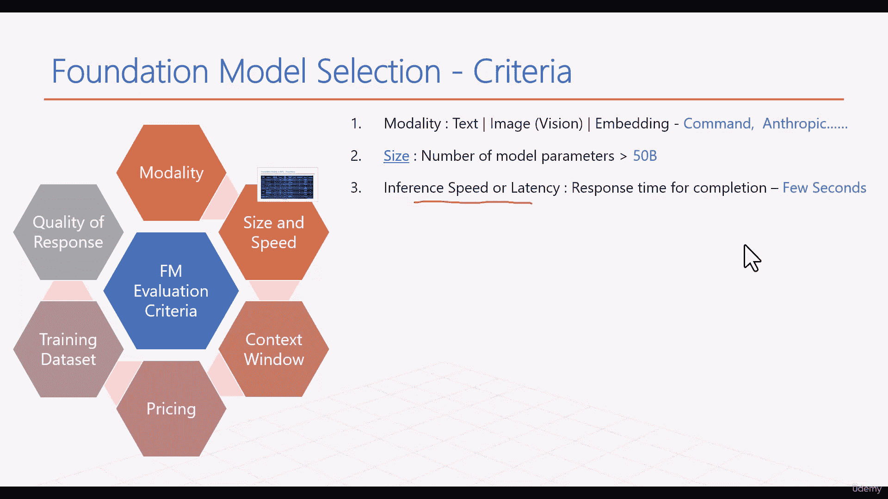

# 🚀 生成式AI on AWS - Amazon Bedrock、RAG与KIRO [2026]：第83-85讲：基础模型选择标准理论（第1部分）

在本节课中我们将要学习如何为具体用例选择合适的基础模型，重点看三个标准：模态、模型尺寸/参数数量、推理速度/延迟。为了让选择过程更贴近真实项目，我们会拿之前实现过的“文本摘要”用例来一步步筛选候选模型，先缩小范围，再比较参数规模，最后权衡速度与效果。整个过程用大白话讲，就是把“模型市场”当成一个工具箱，先按任务类型拿对工具，再看工具大小，最后看干活快不快。

> 选择基础模型不是拍脑袋，而是按标准逐项筛选。

在开始逐项筛选之前，先看本节要反复用到的参数清单。以下是选择基础模型时要考虑的核心参数，后面每一节都会围绕其中一项展开：

- 模态：用例聚焦文本、图像还是嵌入（embedding）
- 模型尺寸：也就是模型参数数量
- 推理速度或延迟：模型响应要等多久

上一段我们列出了整体参数清单，本节中我们来看看第一个标准：模态。模态决定候选模型的大方向，方向错了，后面参数再漂亮也不合适。

## 🧭 生成式AI on AWS - Amazon Bedrock、RAG与KIRO [2026]：第83-85讲：整体思路与参数清单

在本讲中，我将展示如何为你的用例选择合适的基础模型。我会展示大量会影响“基于用例选择合适基础模型”这一决策的参数。为了让模型选择过程更贴近实际，我们将采用之前某个章节实现过的一个具体用例，主要任务是文本摘要。现在来看这些参数，看看哪个基础模型可能适合实现这个用例。以下是选择基础模型时要考虑的一些参数。

> 先用真实用例把选择过程落地，再逐项排除不合适的模型。

整体思路并不复杂：先看任务属于什么模态，再看模型够不够大，最后看响应够不够快。下面进入第一个筛选维度，也就是模态。

### 🧩 生成式AI on AWS - Amazon Bedrock、RAG与KIRO [2026]：第83-85讲：模态筛选

第一个是模态。模态指用例聚焦文本、图像还是嵌入（embedding）；我们会基于AWS Bedrock中可用的各种基础模型来评估这个用例。现在进入控制台。我已经在Amazon Bedrock控制台，在左侧点击Base models，再点这里。可以看到Modality；点击后基本有三类：embeddings、image、text。我们的用例是文本摘要，聚焦文本方向，因此可以排除聚焦embeddings和image的基础模型。

这里可以用一段很小的代码表达筛选逻辑，核心概念就是“任务模态和模型模态要对上”：

```python
if use_case.modality == "text":
    candidates = [m for m in bedrock_models if m.modality == "text"]
```

这里可以看到多个聚焦文本的基础模型：Jurassic、Anthropic的Claude、Cohere Command和Meta的Llama 2。这就是这里要强调的内容。这些是当前可能的基础模型；这里没有把无关的调节项和命令纳入候选，Anthropic的模型也保留在候选中。以下是经过模态筛选后仍然值得继续比较的文本模型候选：

- Jurassic
- Anthropic Claude
- Cohere Command
- Meta Llama 2

模态筛选完成后，候选模型范围已经缩小到文本模型。上一节我们介绍了模态筛选，本节中我们来看看第二个标准：模型尺寸与参数数量。

### 📏 生成式AI on AWS - Amazon Bedrock、RAG与KIRO [2026]：第83-85讲：模型尺寸与参数数量

第二个标准是尺寸，也就是模型参数数量；之前章节学过基础模型参数是什么。浏览常见工业文献会看到：基础模型少于500亿参数时，可能难以完成复杂任务；达到500亿参数及以上时，基本能完成大多数任务；多数情况下参数越多，执行各类复杂任务的表现越好。现在看看Bedrock内一些基础模型的参数，点击这里。

参数阈值可以用下面这段公式来理解，大白话就是“参数太少可能干不动复杂活，参数够多通常更能打”：



```text
params < 50B   -> 复杂任务可能吃力
params >= 50B  -> 基本能完成大多数任务
参数数量 ↑     -> 复杂任务表现通常更好
```

这里是AWS图表；看模型参数：AI21 Ultra Instruct约1780亿参数；Cohere Command通用模型约500亿参数；轻量版约60亿参数；Cohere约520亿参数；Anthropic Claude约1370亿参数；还有一些其他模型如Llama约650亿参数。以下是AWS图表中几个模型的参数规模，用大白话说就是看每个模型“有多少亿个参数”：

- AI21 Ultra Instruct：约1780亿参数
- Cohere Command：约500亿参数
- Cohere轻量版：约60亿参数
- Cohere：约520亿参数
- Anthropic Claude：约1370亿参数
- Meta Llama：约650亿参数

看完参数规模后，还要注意一个现实问题：模型不是越大越一定适合，因为大模型往往响应更慢。上一节我们介绍了模型尺寸，本节中我们来看看第三个标准：推理速度与延迟。

### ⚡ 生成式AI on AWS - Amazon Bedrock、RAG与KIRO [2026]：第83-85讲：推理速度与延迟

第三个参数是推理速度或延迟。记得实现用例并运行Lambda函数测试事件时，会让我们等三四秒才响应。推理速度或延迟是另一个重要因素，尤其实现聊天机器人时，不希望客户等五秒才得到响应；但我们的用例是制造业文本摘要，几秒延迟可能可以接受，所以要根据用例考虑延迟有多重要。尺寸和延迟之间有取舍，因为普遍接受的原则是：基础模型尺寸很大时，推理速度更慢或延迟更高。这是需要做的决策，因为尺寸和推理速度/延迟成反比。





这种取舍可以用下面公式表示，核心概念是“模型越大，通常越慢”：



```text
模型参数量 ↑  =>  推理延迟 ↑
模型参数量 ↑  =>  推理速度 ↓
```

> 延迟不是越小越好，而是要与用例匹配。

以下是判断延迟重要性时要考虑的点，用来决定你更看重“效果”还是“响应速度”：

- 聊天机器人：延迟要低，客户不希望等五秒才得到响应
- 制造业文本摘要：几秒延迟可能可以接受
- 模型尺寸与延迟：尺寸越大，延迟通常越高
- 最终决策：在模型效果和推理速度之间做取舍

到这里，三个核心筛选标准已经串起来了：先按模态排除不相关模型，再按参数规模判断能力，最后按延迟判断体验。下面做一个小结。

## ✅ 生成式AI on AWS - Amazon Bedrock、RAG与KIRO [2026]：第83-85讲：总结



本节课中我们一起学习了如何为具体用例选择合适的基础模型，并用文本摘要用例演示了筛选过程。我们先把用例定位到文本模态，排除embeddings和image模型；再观察模型参数数量，理解“少于500亿可能吃力、500亿及以上基本能完成大多数任务、参数越多通常越擅长复杂任务”；最后讨论推理速度或延迟，明白模型尺寸和延迟之间通常要做取舍，聊天机器人更在意低延迟，而制造业文本摘要可以接受几秒延迟。整套方法可以概括为：先看模态，再看尺寸，最后看延迟，逐项缩小候选范围。

