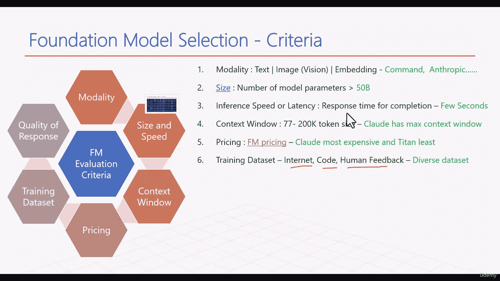
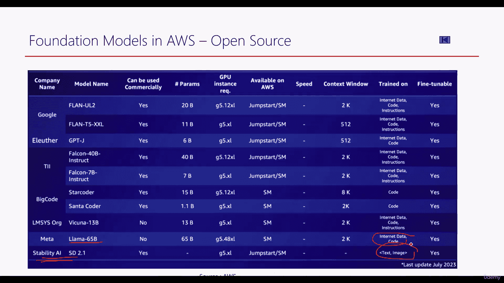
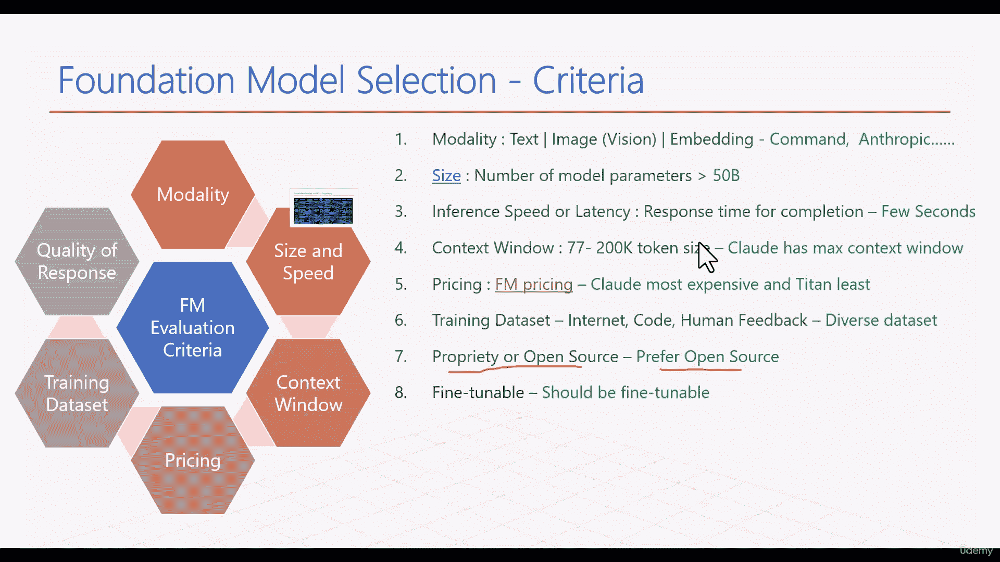
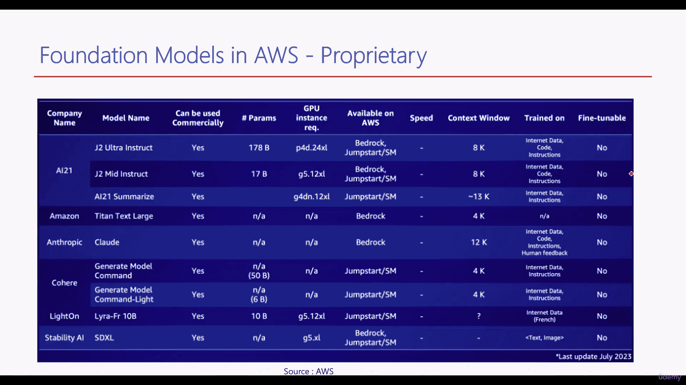
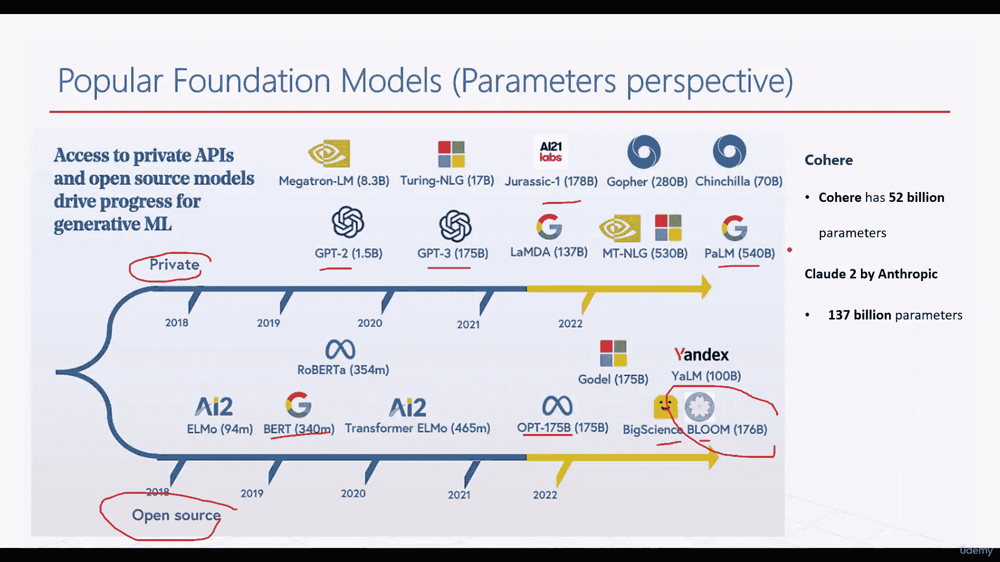
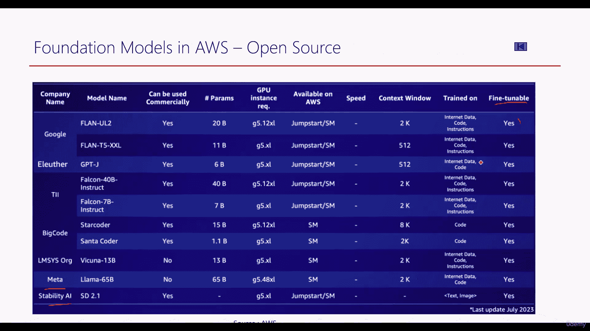
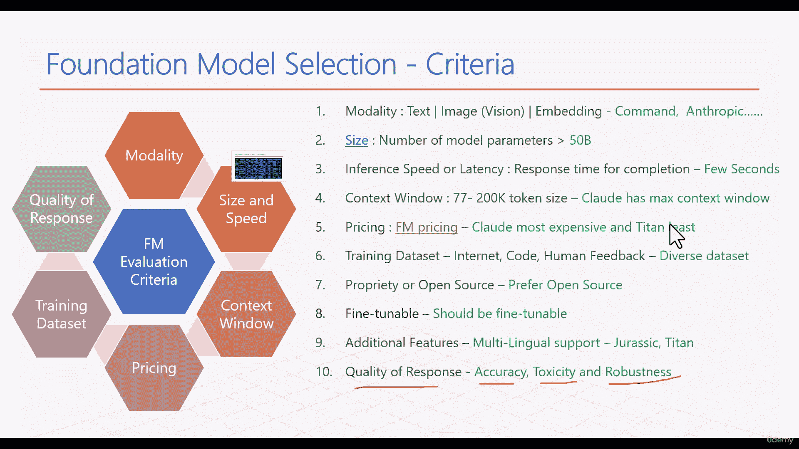

# 生成式AI on AWS：Part 1 p84-86：基础模型选择标准（下）🧭

在本节课中我们将要学习基础模型选择标准的下半部分。上一部分已经讨论过一些选择维度，本讲继续围绕上下文窗口、定价、训练数据、开源与专有、可微调性、多语言支持和响应质量这些因素，把“到底怎么选基础模型”讲清楚。下面尽量用大白话解释，并保留原文中的估算口径和例子。

## 生成式AI on AWS：01：上下文窗口 📏

上一节我们介绍了基础模型选择标准的前半部分，本节中我们来看看第一个关键因素：上下文窗口。上下文窗口决定你在同一时间、一次性可以喂给基础模型多长的提示词或输入内容。这个大小会直接影响你能否把长文档、长对话或大段资料塞进一次请求里。

原文提到，上下文窗口大致可以在 77 到 200k token 之间变化。原文还给出了 token 与英文词数的近似换算，并提到“约 100k tokens 对应 75 个词”这一口径；后文实际又按“100 tokens 约等于 75 个词”来乘 0.75 做估算。这里保留原文的近似思路，用公式表示就是：

```text
估算词数 ≈ token 数 × 0.75
```

接下来需要根据你的用例判断：多大的上下文窗口才适合你。原文建议到控制台查看一些基础模型的最大 token 大小。以下是原文在控制台和示例中提到的上下文窗口情况：

- 以嵌入或图像为重点的模态，最大 token 数通常会更小。
- Jurassic Ultra 的文本模型大约有 8191 个 token。
- Claude 的上下文窗口为 200k token，原文形容它非常大。
- Cohere 的 Command 基础模型大约 4000 个 token；按 0.75 估算，一次大约可输入 3000 个词。
- Anthropic 的模型为 200k token；按 0.75 估算，大约相当于 150000 个词。

原文继续强调，你需要根据自己的用例确定所需上下文窗口大小：一次最多 3000 个词是否够用，还是确实需要 Anthropic 基础模型那种约 150000 个词的窗口。以下是原文给出的判断例子：

- 如果用例是文本摘要，可能 3000 个词就够用，可以选择 Cohere 的 Command。
- 如果要摘要的是 50 页、100 页甚至 500 页的法律文档，就可能需要上下文窗口大得多的基础模型，例如 Anthropic 的 Claude。

上面我们看了上下文窗口如何影响输入长度，本节接下来看看第二个因素：基础模型定价。

## 生成式AI on AWS：02：基础模型定价 💰

上一节我们介绍了上下文窗口，本节中我们来看看基础模型的价格。原文指出，基础模型的定价可能差异非常大，因此选模型时不能只看能力，也要看成本。

原文建议直接查看定价页面。以下是原文列出的每 1000 个输入 token 的价格示例：

- Jurassic Ultra 约为 0.0188。
- Amazon Titan Text Express 约为 0.0008，原文形容它非常便宜。
- Anthropic Claude 约为 0.008。

原文把 Bedrock 上可用模型的每 1000 个输入 token 价格写在一起后，可以看到价格差异巨大。可以用一个简单公式理解这种差距：

```text
价格倍数 ≈ 较贵模型单价 ÷ 较便宜模型单价
```

原文举例说，Claude 和 Titan 之间的价格差几乎达到 10 倍。也就是说，对 Titan Text Express 发起 10 次 API 请求，成本大约等于对 Claude 发起 1 次请求。类似地，Cohere 和 Claude 之间大约相差 4 倍，Llama 2 也有类似的价格差异。以下是原文给出的成本判断思路：

- 如果上下文窗口、模型参数量等参数对你的用例不是关键因素，那么从价格角度看，可以选择便宜得多的模型。
- 如果某些能力对你很关键，就不能只看价格，还要综合其他标准。

价格讲完后，下面进入训练数据集这个维度，看看模型“吃过什么数据”为什么重要。

## 生成式AI on AWS：03：训练数据集 📚

上一节我们介绍了定价，本节中我们来看看基础模型的训练数据集。原文指出，这些基础模型可能是在多种数据的组合上训练出来的，数据来源可能包括互联网数据、代码、人类反馈；可能是三者都有，也可能只包含其中两种。

因此，很重要的一点是查看基础模型到底经过什么样的训练数据。原文认为，训练数据集越多样，尤其当它包含人类反馈、代码等元素时，模型更有可能获得更好的准确率；因为大多数模型都会使用互联网数据，所以额外的高质量数据来源会成为差异点。可以用一个集合表达式表示：

```text
训练数据 ≈ 互联网数据 ∪ 代码数据 ∪ 人类反馈数据
```

原文点击了一个 AWS 图表，用来展示基础模型训练数据。以下是图表中提到的例子：

- AI21（原文写作 A 2）的训练数据包括互联网数据、代码和指令。
- Anthropic Claude 的训练数据包括互联网数据、代码、指令，以及人类反馈。
- Llama 和 Stability AI 训练于互联网数据和代码。
- Stability AI 如预期那样训练了文本和图像数据。

训练数据讲完后，接下来看一个经常被拿来比较的问题：到底选专有模型还是开源模型。

## 生成式AI on AWS：04：专有模型还是开源模型 🔓

上一节我们介绍了训练数据集，本节中我们来看看模型是专有还是开源。原文说，通常会更偏好开源模型，因为你能拥有更多控制权，也能接触到源代码。这个偏好不是绝对的，但对需要掌控力和可定制性的团队来说很重要。

原文回到一张之前看过的图表，其中列出了一些开源基础模型。以下是原文提到的开源模型例子：

- Google 和另一家（原文此处写作 them）提供的开源模型。
- Meta 的 PT（原文如此）以及 BLOOM 大尺寸版本等。
- BLOOM 的规模很大，约有 1760 亿个参数。

原文同时列出了专有或私有模型，例如 GPT、GPT-3、PaLM、Jurassic-1 等。因此，原文强调：选择专有模型还是开源模型，是另一个重要考虑因素。可以用一个简单判断式表示：





```text
选择倾向 = 控制权与可定制性 ↑ → 更偏向开源
选择倾向 = 托管便利与商业支持 ↑ → 可考虑专有
```

开源与专有讲完后，下面看模型能不能用你自己的数据做微调，这是很多企业落地的关键。

## 生成式AI on AWS：05：模型是否可微调 🛠️

上一节我们介绍了开源与专有模型，本节中我们来看看模型是否可微调。原文指出，模型应该能够微调，也就是说，你应该能够用自己领域特定的数据集来微调模型。这样模型才能更贴合你的业务数据、行业术语和特定任务。

原文还强调，基础模型本身应该能够告诉你某个模型是否可微调。原文回到图表中说明：有些基础模型不可微调；而 Stability 和 Meta 的某些模型（原文写作 et）是可微调的。以下是原文给出的要点：

- 选择模型时要确认它是否支持微调。
- 可微调能力在后续章节中会被证明非常关键。
- 原文预告后续会讨论如何微调基础模型。

微调能力讲完后，接下来看看一些用例还会提出的额外要求，例如多语言支持。

## 生成式AI on AWS：06：多语言支持与附加能力 🌐

上一节我们介绍了可微调性，本节中我们来看看多语言支持等额外要求。原文指出，你的用例可能还有一些附加需求，例如多语言支持。因此你需要查看基础模型，确认它是否支持多语言，或者是否支持你可能需要的其他附加功能。

原文在 Bedrock 的 providers 页面点击具体基础模型后，可以查看它支持哪些语言。以下是原文举的例子：



- AI21 支持多种语言，例如英语、西班牙语、德语等。
- Amazon Titan 也支持不少语言，例如英语、阿拉伯语、中文等。
- Cohere 只支持英语。







原文提醒，这些语言支持情况需要根据你的用例额外查看。多语言讲完后，最后也是最重要的一个因素，就是模型回答的质量。

## 生成式AI on AWS：07：响应质量 ✅

上一节我们介绍了多语言支持，本节中我们来看看原文认为可能最重要的因素：基础模型响应的质量。原文指出，可以从三个不同参数来衡量基础模型响应的质量：准确性、毒性和鲁棒性。可以用一个三元组表示：

```text
响应质量 = (准确性, 毒性, 鲁棒性)
```

原文预告，下一讲会介绍如何通过 AWS 服务来评估响应质量。以下是原文对这三个维度的概括：

- 准确性：回答是否正确、是否符合事实和任务要求。
- 毒性：回答是否包含有害、冒犯或不安全内容。
- 鲁棒性：模型在面对不同输入、边界情况或扰动时是否稳定可靠。

到这里，本讲关于基础模型选择标准的因素就讲完了。原文最后表示希望本讲对你有用，并约定下一讲再见。

## 生成式AI on AWS：08：本讲总结 🧾



本节课中我们一起学习了基础模型选择标准（下）的主要内容：上下文窗口决定一次能输入多少 token；定价差异可能达到数倍甚至约 10 倍；训练数据集要看是否包含互联网数据、代码、指令和人类反馈；开源与专有模型各有取舍；模型是否可微调非常关键；多语言支持和附加能力要按用例确认；最后要用准确性、毒性和鲁棒性衡量响应质量。下一讲将继续看如何通过 AWS 服务评估模型响应质量。希望本讲对你有用，下一讲见。

