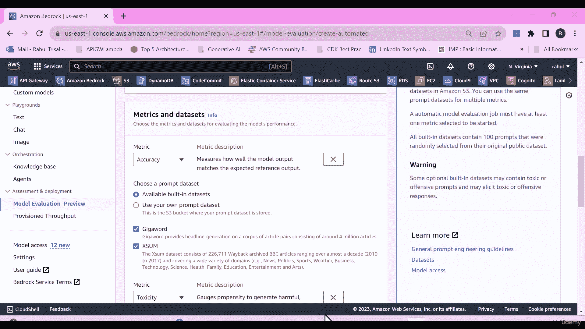
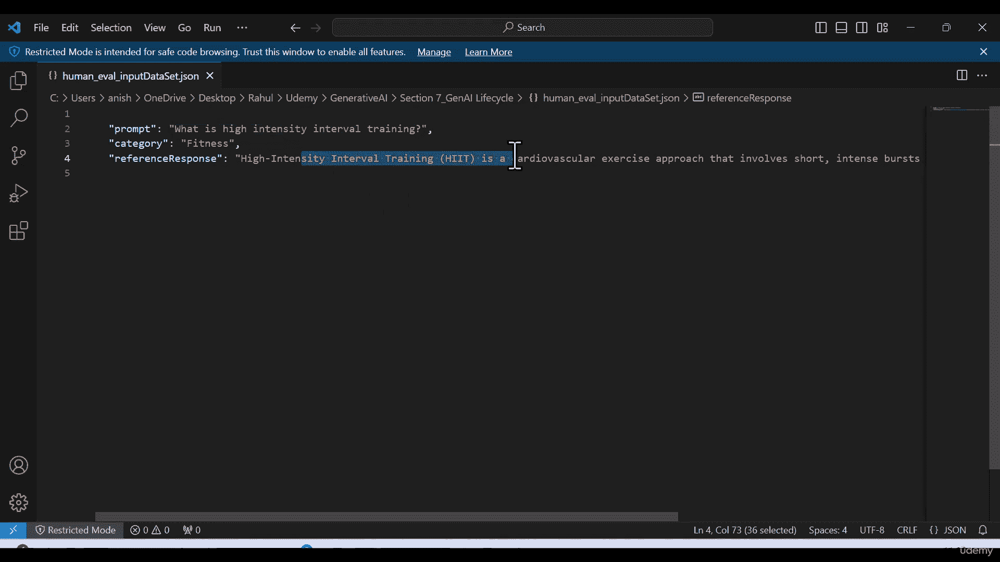
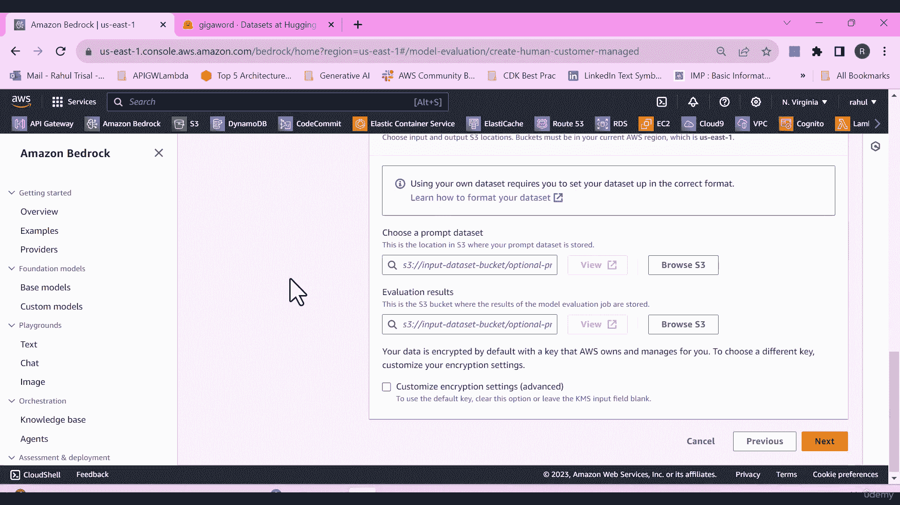
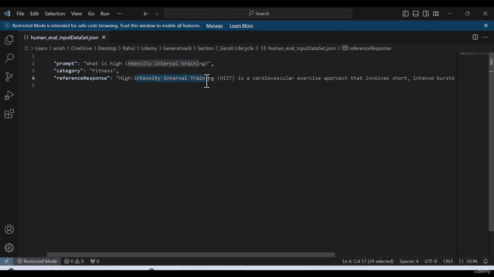
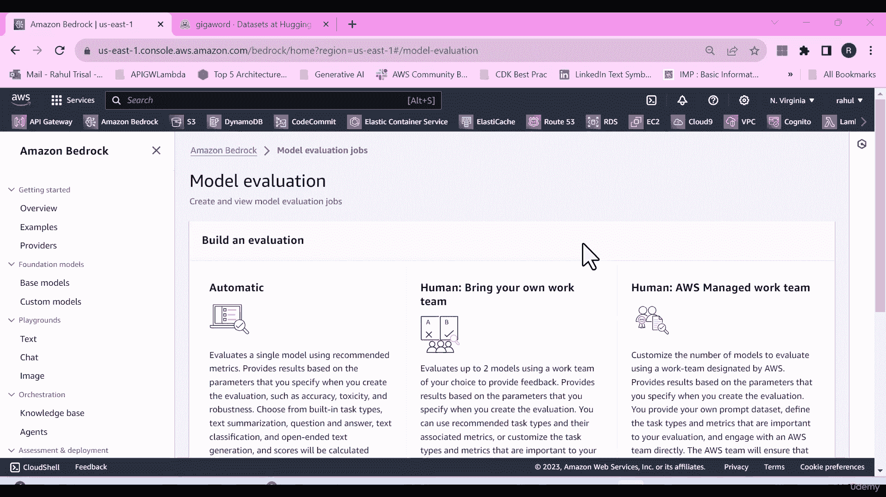

# 🧪 AWS生成式AI实战：第85-87讲：基础模型评估服务实操

在本节课中我们将要学习如何使用 AWS Bedrock 的模型评估服务，按照已经定义好的标准来评估基础模型，或者按照设定好的标准比较两个不同的基础模型。上一讲我们看过一些会影响基础模型选择的参数，这一讲把视角落到实操上：不再只凭感觉挑模型，而是把任务类型、数据集、评估指标和评分方式组合起来，得到可比较、可复现的评估结果。对初学者来说，可以把这件事理解成给模型安排一场考试，考试题目、评分标准和阅卷方式都要提前定好。

## 🗺️ AWS生成式AI实战：第1节：课程回顾与本节目标

上一讲我们介绍了影响基础模型选择的一些参数，本节先明确本讲要解决的问题。AWS Bedrock 模型评估服务可以帮助我们根据自己定义的标准评估基础模型，也可以根据自己设定的标准比较两个不同的基础模型。它的价值在于把“模型好不好用”这种偏主观的判断，拆成任务、数据、指标和结果这几个可以记录的部分。

从整体上看，Bedrock 模型评估服务有三种可能的使用方式。为了先建立全局认识，以下是三种评估方式的简要说明。

- 第一种是自动评估，也就是由服务自动完成评估流程。

- 第二种是人工评估，由使用者带上自己的团队来完成评估。

- 第三种是人工评估中的 AWS 管理团队模式，也就是联系 AWS 并雇用 AWS 的工作人员来执行评估任务。

这三种方式的核心区别在于谁来评估、能选多少指标、能比较几个模型，以及操作成本和费用如何。理解这个全局之后，下一节我们进一步展开三种方式的具体差异。

## 🧰 AWS生成式AI实战：第2节：Bedrock模型评估的三种方式

上一节我们列出了三种评估方式，本节来看看每一种方式具体要设置什么。先看自动评估。在自动评估中，使用者需要指定任务类型，任务类型可以是文本生成、文本摘要、问答等。任务类型确定后，再选择数据集，数据集可以是内置数据集，也可以带入自己的数据集。

自动评估可用的内置数据集主要有两个。以下是内置数据集的基本情况。

- 第一个是 Gigaword，大约有 400 万篇文章，并且可以在 Hugging Face 上找到。

- 第二个是 XSum，大约包含 20 万篇由英国广播公司 BBC 归档的文章；原文提到时间范围是 2010 年至 2070 年，实际使用时应以控制台说明为准。

选择数据集之后，还要选择评估指标。自动评估中可以使用三个指标，分别是准确率、毒性和鲁棒性。选定一个基础模型后，服务会基于这些设置给出评估结果。可以用下面的公式来理解自动评估的输入和输出关系。

```text
自动评估结果 = Evaluate(task_type, dataset, metric, base_model)
Accuracy = 与参考输出匹配的样本数 / 总样本数
Toxicity = 有害、冒犯、不当内容倾向评分
Robustness = 语义保持型细微变化对模型输出影响程度评分
```

自动评估讲完后，再看人工评估中的“自带团队”方式。这种方式需要使用者带上自己的团队，最多可以评估两个模型，优势是相比自动评估可以选择更多指标类型。最后是“AWS 管理团队”方式，使用者可以联系 AWS，雇用 AWS 的工作人员来执行模型评估任务；流程同样包括选择任务类型、带入自己的数据集、定义指标，并且相比自动评估的三个指标可以设置更多指标。

这三种方式理解后，下一节进入控制台，先走一遍自动评估的实际操作流程。

## 🖥️ AWS生成式AI实战：第3节：自动评估实操

上一节我们介绍了三种评估方式，本节看看自动评估在 AWS 控制台里怎么操作。进入 AWS 控制台后，左侧可以看到“模型评估”入口，点击后能看到三种方式：自动评估、自带团队的人工评估、AWS 管理团队的人工评估。这里选择创建自动评估。

创建自动评估时，首先要给评估起一个名称。为了表示这是自动评估，我把名称设为 `FM-Auto`。描述可以不填，标签也可以按需填写。模型选择部分只能选择一个模型，不能在这里直接比较两个模型，选择后服务会给出该模型的评估结果。以下是自动评估创建时的主要设置项。

- 评估名称：示例使用 `FM-Auto`。

- 描述：可以不提供。





- 标签：按需提供。

- 基础模型：只能选择一个，示例选择 Cohere 的 Command Light。

- 任务类型：可选通用文本生成、文本摘要、文本分类、问答等，示例选择文本摘要。

- 评估指标：可选准确率、毒性、鲁棒性。

- 数据集：可选内置数据集，也可选择自己放在 S3 桶里的数据集并提供路径。

- 输出位置：指定模型评估服务上传最终结果的 S3 位置。

- IAM 角色：选择允许 Amazon Bedrock 访问该 S3 桶的角色。

指标部分需要解释得更直白。准确率衡量模型输出与预期参考输出匹配的程度。为了演示，我创建了一个示例数据集，里面有提示词和参考响应。提示词示例是“什么是高强度间歇训练”，参考响应大意是“HIIT 是一种心血管锻炼方法，包含短时间高强度爆发等”。当提示词发送给基础模型后，模型会生成响应，这个响应会与每个提示词对应的参考响应进行比较，从而衡量准确率。也就是说，准确率不是看回答“像不像人话”，而是看回答与给定参考答案的匹配程度。

选择数据集时，可以使用内置数据集，也可以使用自己的数据集。使用自己的数据集时，需要把数据放到 S3 桶中，并提供对应路径。AWS 中已经有两个数据集可用，一个是前面提到的 Gigaword，大约 400 万篇文章；另一个是 XSum，大约 20 万篇 BBC 文章，原文称覆盖 2010 年至 2070 年。搜索 Gigaword 并打开后，可以看到数据集中的文章和摘要示例，例如一条关于澳大利亚经常账户赤字创纪录缩减的文章及其摘要。这个数据集就是评估时会使用的数据。

接下来看另外两个指标。毒性指标衡量模型生成有害、冒犯或不当内容的倾向。鲁棒性指标评估保持语义的细微变化对模型输出造成的影响程度。毒性评估和鲁棒性评估同样可以使用 Gigaword 或 XSum，也可以使用自己的数据集。设置完指标和数据后，还要指定 S3 输出位置，模型评估服务会把最终结果上传到这个位置。

实操中，我先搜索并选择已经创建的 S3 桶，桶名示例为 `model-evaluation-output`，并且需要在桶里创建 `output` 文件夹，否则服务不会允许继续。然后选择允许 Amazon Bedrock 访问该 S3 桶的 IAM 角色，再点击创建。创建时出现了报错，判断是名称必须全部小写，于是调整名称，例如改成全小写并加后缀后重新创建。创建成功后，可以看到评估正在进行中。

这里需要特别提醒成本问题。以下引用块是原文中特别强调的费用警告。

> 强烈建议不要在自己的账号里随意尝试这个自动评估流程，因为它真的会产生费用。原文反复提醒，不要在自己的环境中随意运行这个评估，因为会产生实际成本。

自动评估流程走完后，下一节我们转向人工评估中的“自带团队”方式。

## 👥 AWS生成式AI实战：第4节：人工自带团队评估实操

上一节我们完成了自动评估的界面流程，本节看看人工评估中“自带团队”的方式。点击人工自带团队后，可以填写评估名称，示例设为 `FM-Human`，也可以填写描述，然后点击下一步。在这里可以选择评估一个基础模型，也可以选择评估两个基础模型。示例中选择 Meta 的模型，界面可以继续添加另一个模型，但演示中只评估一个模型。

接着选择任务类型，示例选择通用文本生成。然后选择评估指标。与自动评估相比，这里的指标数量更多，以下是人工评估中可以见到的部分指标示例。

- 准确率。

- 一致性。

- 相关性。

- 正确性。

- 以及其他可用指标。

选择指标后，还要选择评级方法。界面提供多种评级方法，例如对响应给出“点赞”或“点踩”，也可以使用李克特五点量表，也就是从 1 到 5 打分，1 表示强烈不同意，5 表示强烈同意。示例中选择“点赞/点踩”的评级方法。完成评分设置后，需要上传数据，并且数据要符合特定格式。人工评估输入数据的基本结构如下。





```json
{
  "prompt": "提示词或问题",
  "category": "分类",
  "referenceResponse": "参考响应"
}
```

这个格式的含义很直接：提供提示词，提供分类，再提供参考响应。参考响应会作为基准，用来评估基础模型针对同一个提示词生成的响应。换句话说，人工评估人员不是凭空打分，而是拿着参考答案和评分标准来判断模型回答的质量。

数据上传部分，示例选择已有的输入 S3 桶和数据集，然后选择输出 S3 位置。输出位置仍然需要创建一个空白 S3 桶，选择后点击下一步。接下来要提供 IAM 角色。以下是这一步需要配置的两个角色。

- 第一个 IAM 角色提供给 Amazon Bedrock，使 Bedrock 能够访问 S3 桶。

- 第二个 IAM 角色提供给执行人工评估的人员，使其能够访问 S3 桶。

然后选择团队。示例中创建一个新的工作团队，团队名设为 `demo`，并提供工作人员的邮箱地址，例如 `demo1@example.com`；填写团队名称和邮箱地址，工作人员数量最多可以设置为 3，示例保持为 1，然后点击下一步。接下来界面会显示将发送给团队成员的操作说明。说明会描述需要查看哪些评估参数、使用什么评分尺度，例如李克特量表还是点赞/点踩；还会说明基准，也就是参考响应是什么。继续点击下一步后，可以审核前面填写的全部细节，然后点击创建。演示中没有点击创建，因为这一步同样会产生费用。

人工自带团队讲完后，下一节看看第三种方式，也就是由 AWS 管理团队来执行评估。

## ☁️ AWS生成式AI实战：第5节：AWS管理团队评估实操

上一节我们介绍了自带团队的人工评估，本节看看 AWS 管理团队模式。前面的人工评估是我们自己带团队来做评估，而这里可以请求 AWS 带上他们的团队来评估基础模型。点击进入后，可以填写评估名称和描述，然后进入 AWS 管理团队相关设置。

这种方式需要提供自己的邮箱地址，AWS 团队会联系使用者。还需要提供姓名、姓氏和电话号码，然后选择希望评估的任务类型，以及希望 AWS 顾问具备的专业水平。以下是专业水平选择时可以关注的示例方向。

- 教育学位相关背景。

- 编码能力。

- 创意写作能力。

- 其他与评估任务相关的专业经验。

完成设置并点击创建后，AWS 代表会打电话联系，随后评估会被执行。这个方式适合希望把评估工作交给 AWS 管理团队、同时又能提出任务类型和专业能力要求的场景。到这里，三种评估方式都介绍完了，下一节对整讲内容做总结。

## ✅ AWS生成式AI实战：第6节：本讲总结

上一节我们介绍了 AWS 管理团队评估方式，本节对整讲内容做总结。本节课中我们一起学习了 AWS Bedrock 模型评估服务的三种使用方式：自动评估、人工自带团队评估、AWS 管理团队评估。自动评估需要选择任务类型、数据集、指标和基础模型，常用指标包括准确率、毒性和鲁棒性；人工自带团队评估最多可以评估两个模型，并且可以选择更多指标和评级方法；AWS 管理团队评估则把执行团队交给 AWS，通过提供联系方式、任务类型和专业能力要求来发起评估。



从实操角度看，自动评估的流程包括命名、选模型、选任务、选指标、选数据集、指定 S3 输出位置和 IAM 角色。人工自带团队评估还需要准备符合格式的输入数据、配置 Bedrock 和人工评估者使用的 IAM 角色、创建工作团队并设置工作人员数量。AWS 管理团队评估则需要提供联系方式和评估要求。最后再次提醒，模型评估会产生费用，原文明确建议不要在账号中随意尝试完整评估流程。希望本讲能帮助理解如何评估基础模型，下一讲再见，谢谢。
