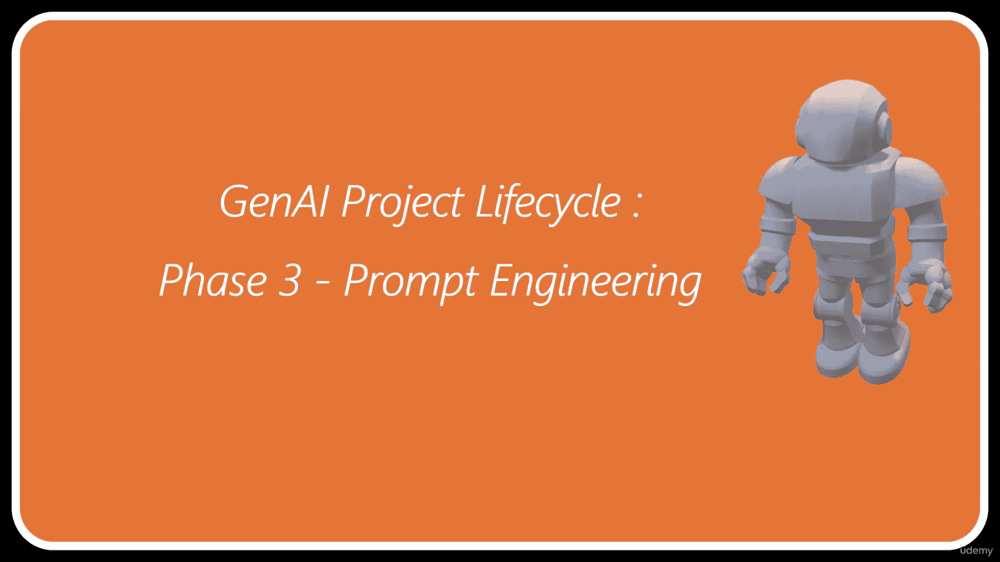
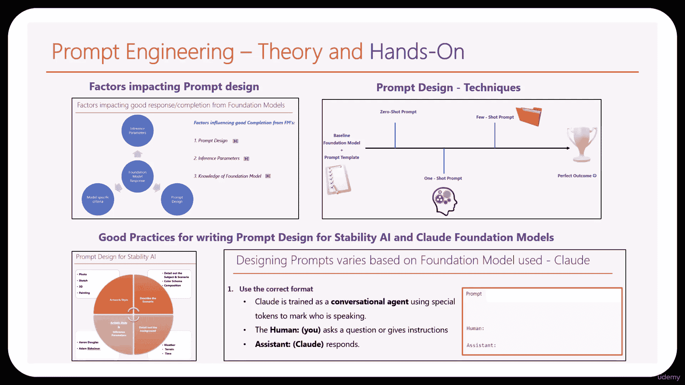

# 🧭 Udemy - Generative AI on AWS - Amazon Bedrock, RAG & KIRO [2026]：第86-88讲：提示工程章节概览

在本节课中我们将要学习提示工程章节概览。欢迎来到提示工程这一节，这是生成式AI项目生命周期的第3阶段。提示工程可以理解为把任务、背景、输出要求和示例组织成模型能理解的指令，帮助我们从基础模型得到期望结果。对初学者来说，先不用纠结复杂术语，抓住“说清楚任务”这个核心即可。接下来会看到本节目标、影响提示设计的因素、常见提示技术和跨模型实践，最后做总结。

## 🎯 Udemy - Generative AI on AWS - Amazon Bedrock, RAG & KIRO [2026]：第86-88讲：本节目标

上一段我们说明了提示工程在项目生命周期中的位置，本节中我们来看看这一节的具体目标。这一节的目标是帮助你学会如何编写好的提示，以便在这一节中从基础模型获得期望结果。换句话讲，目标不是背模板，而是理解为什么同一个模型在不同提示下表现不同，并掌握可复用的写法。下面列出本节要覆盖的学习内容，方便你建立整体地图。

- 学习影响良好提示设计的因素。
- 学习各种提示设计技术，例如零样本提示、单样本提示和少样本提示。
- 学习为不同基础模型编写好提示的良好实践，包括来自 Stability 的 Stable Diffusion、来自 Anthropic 的 Claude，以及来自 Amazon 的 Titan。

## 🧩 Udemy - Generative AI on AWS - Amazon Bedrock, RAG & KIRO [2026]：第86-88讲：影响提示设计的因素

在了解目标之后，本节中我们来看看哪些因素会影响提示设计。原文提出要学习影响良好提示设计的因素，这里用大白话解释：提示写得好不好，通常不只看一句话是否通顺，还要看任务是否清楚、背景是否足够、输出格式是否明确、示例是否合适，以及目标模型本身的特点。可以用一个简单公式帮助记忆。

**好提示 = 清晰任务 + 必要背景 + 明确输出要求 + 合适示例 + 模型特性**

公式不是死规则，而是检查清单。初学者可以先按这个清单逐项补齐，再根据模型反馈调整。好提示通常需要反复试，不是一次写成就结束。

## 🛠️ Udemy - Generative AI on AWS - Amazon Bedrock, RAG & KIRO [2026]：第86-88讲：提示设计技术

上一节我们梳理了影响因素，本节中我们来看看原文提到的提示设计技术。原文要求学习零样本提示、单样本提示和少样本提示。这里的“样本”可以理解为给模型看的示例；示例数量不同，提示方式就不同。下面用伪代码描述三种技术的区别，便于快速对照。

```text
零样本提示 = 任务说明 + 输入
单样本提示 = 任务说明 + 1 个示例 + 输入
少样本提示 = 任务说明 + 多个示例 + 输入
```

从代码可以看出，零样本提示不提供示例，单样本提示提供一个示例，少样本提示提供多个示例。示例的作用是让模型模仿输入到输出的对应关系，所以示例质量会影响结果。初学者可以先从零样本提示开始，如果结果不稳定，再加入一个或多个示例。

## 🌍 Udemy - Generative AI on AWS - Amazon Bedrock, RAG & KIRO [2026]：第86-88讲：不同基础模型的提示实践

在掌握基本技术后，本节中我们来看看针对不同基础模型的提示实践。原文提到要学习为不同基础模型编写好提示的良好实践，包括来自 Stability 的 Stable Diffusion、来自 Anthropic 的 Claude，以及来自 Amazon 的 Titan。不同模型的训练方式、输入格式和擅长任务不完全一样，所以同一套提示思路需要结合模型特点做调整。对初学者来说，先记住“先看模型文档，再用示例验证”这个习惯即可。以下是原文列出的模型范围。

- Stable Diffusion：来自 Stability。
- Claude：来自 Anthropic。
- Titan：来自 Amazon。

这些模型覆盖图像生成和文本生成等不同场景，因此提示写法不会完全一样。后续学习时，可以把模型特性当成提示设计的一个变量，而不是把所有模型都当成同一种工具。



## ✅ Udemy - Generative AI on AWS - Amazon Bedrock, RAG & KIRO [2026]：第86-88讲：本节总结



本节课中我们一起学习了提示工程章节概览。我们确认了这是生成式AI项目生命周期的第3阶段，明确了本节目标是学会编写好提示，从基础模型获得期望结果。我们梳理了影响提示设计的因素，认识了零样本提示、单样本提示和少样本提示，并了解了针对 Stable Diffusion、Claude 和 Titan 等不同基础模型编写提示的良好实践范围。现在，我们正式深入这一节。下节课再见。谢谢。

