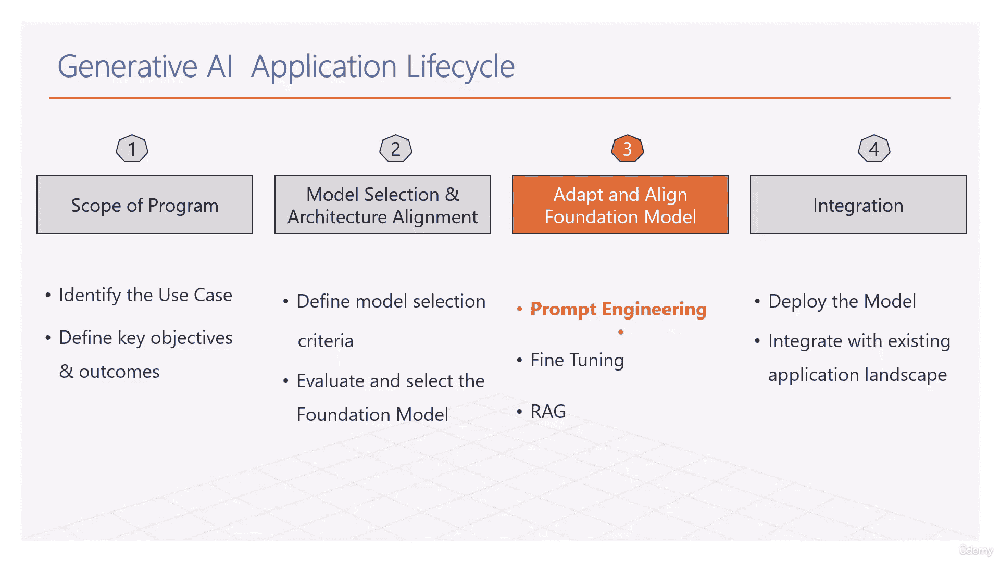
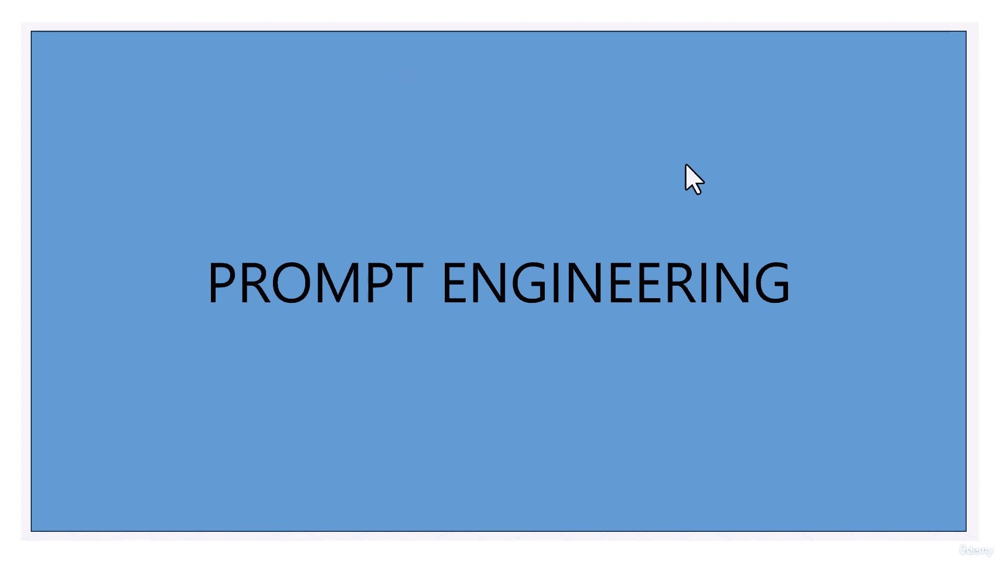
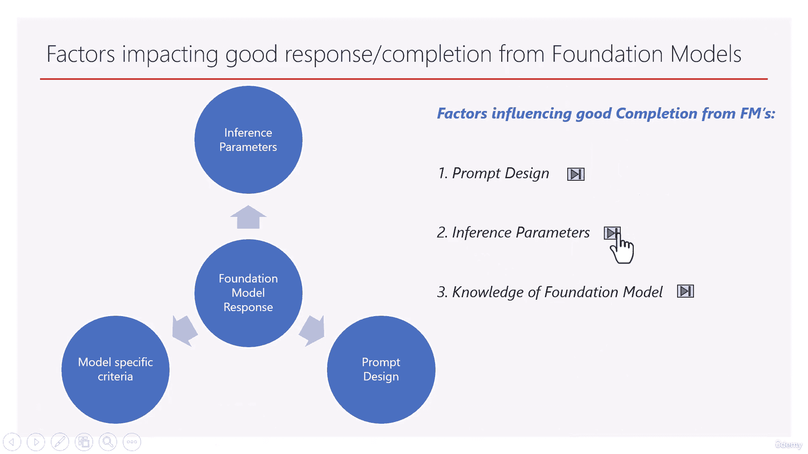
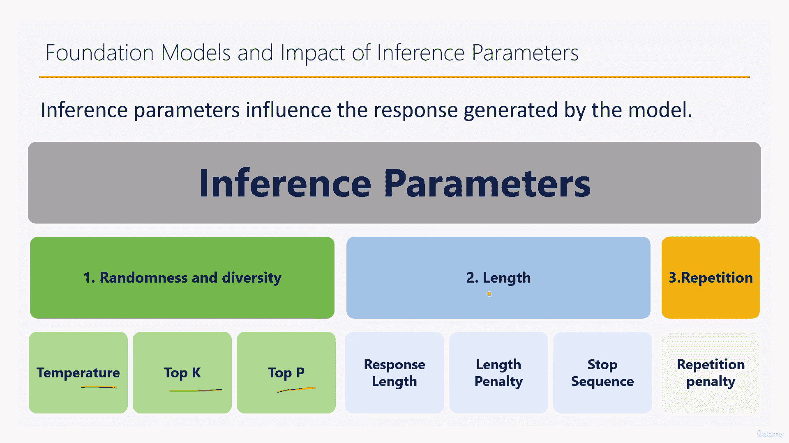
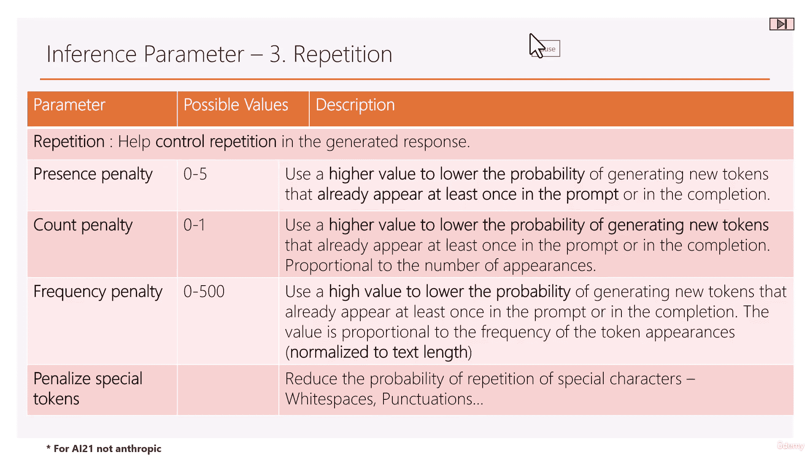

## 🧭 生成式AI应用生命周期：01：提示工程基础与提示设计


在本节课中我们将要学习生成式AI应用生命周期第三阶段中的一个重要主题，也就是通过提示工程来适配和对齐基础模型。原文属于“Prompt Engineering 1”的内容，重点覆盖三个问题：什么是提示工程、哪些因素会影响提示工程、以及写好提示的一些最佳实践。下面我们按顺序展开，先把概念讲清楚，再结合例子说明怎么做。


### 🧩 生成式AI应用生命周期：01.1：什么是提示与提示工程


上一节我们多次提到提示质量会影响最终效果，本节中我们来看看提示本身到底是什么，以及提示工程为什么重要。






在生成式AI应用生命周期的第三阶段，有一个环节叫**适配和对齐基础模型**。完成这个环节可以通过多种方式，本讲讨论的方式是**提示工程**。我们先从“什么是提示工程”开始，再看影响提示工程的各种因素，最后看编写提示的一些最佳实践。提示这个概念前面已经多次讨论过，简单说，**提示是提供给基础模型的输入，用来引发模型响应**。提示的质量会决定基础模型响应的质量；如果想提高响应质量，就需要提供更高质量的提示。提示工程正是在这里发挥作用，它帮助我们设计更好的输入，让模型更稳定地给出符合预期的输出。理解这一点后，接下来我们看看影响基础模型给出良好补全结果的因素。


### 🎯 生成式AI应用生命周期：01.2：影响补全质量的三个因素


上一节我们说明了提示质量与响应质量之间的关系，本节中我们来看看影响基础模型补全质量的三个关键因素。


以下是影响基础模型给出良好补全结果的三个因素。


- **提示设计**：提示怎么写，直接决定模型能否理解任务和上下文。

- **推理参数**：包括温度、Top K、Top P 等参数，前面已经多次讨论过。

- **所选基础模型的知识**：你为具体用例选择的基础模型本身具备什么知识，也会影响结果。

核心关系可以用下面的公式概括。


```text
补全质量 ≈ f(提示设计, 推理参数, 基础模型知识)
```


这三个因素里，提示设计最贴近日常开发工作，也最容易被忽视。下面我们先深入提示设计，并用一个制造场景的例子来说明怎么写好提示。


### 🧑‍🤝‍🧑 生成式AI应用生命周期：01.3：把基础模型当成朋友来写提示


上一节我们列出了三个影响因素，本节中我们重点看提示设计，并用“把基础模型当成朋友”的方式来理解好提示应该包含什么。


这里继续使用前面用过的制造用例。写良好提示的一种方法，是把基础模型当成你在组织里可以咨询问题的朋友：你想向朋友咨询某个问题，或者想让他给出更多细节。假设你拿到一份日志，正在寻找某个问题的解决方案，你直接把这份日志复制下来，通过 Teams 发给朋友。你没有告诉他这份日志是什么，没有说明这是风轮机的问题，也没有说明这是从手册里翻到的问题；你没有提供任何上下文，也没有说明你需要什么帮助，比如你想让他回答这个问题、总结内容，还是补充内容。没有上下文时，朋友无法给出有效回应；如果你强迫他回应，他可能给出随机回应。更理想的发送方式是补充必要信息，让朋友更好地帮助你。你可以先给上下文，告诉他这是加州一台风轮机故障的现场日志报告，这样他就知道这是一份关于加州风轮机故障的报告。然后你可以补充你期望的帮助类型，例如请他把这 段文本总结成两行。把日志、上下文和期望帮助一起发过去，朋友就既知道文本是什么，也知道你要什么。写提示时就应该这样思考。下面是一个可以直接参考的提示示例。


> 这是加州一台风轮机故障的现场日志报告。  
> 请把这段文本总结成两行。


这个例子说明，提示不是把文本丢给模型就结束，而是要把背景、任务和输出要求说清楚。理解了这个思路后，接下来我们看看一个好提示设计通常由哪些元素组成。


### 🧱 生成式AI应用生命周期：01.4：好提示设计的组成元素


上一节我们用朋友沟通的比喻说明了上下文和任务说明的重要性，本节中我们来看看一个好提示设计包含哪些具体元素。


下面是一个用于摘要任务的提示设计示例。第一步，给基础模型提供与任务有关的上下文信息，例如告诉它这是对 2022 年卡塔尔世界杯的评论。第二步，粘贴完整文本，这段文本谈论卡塔尔世界杯决赛、梅西打进两球等内容，这就是基础模型需要处理的输入文本。第三步，在末尾告诉基础模型你期望它完成的任务，例如总结、生成文本或回答问题。第四步，给出输出规格，例如要求总结成两行、四行或一行。把这些元素组合起来，就形成了一个比较完整的好提示设计。以下是好提示设计中常见的四个元素。


- **提供上下文**：先说明材料背景，让模型知道自己在处理什么。

- **提供清晰简洁的指令**：用直白的话告诉模型要遵守什么要求。

- **在末尾提供要完成的任务**：明确让模型做总结、生成或回答等任务。

- **提供输出规格**：说明输出长度、格式等要求，例如两行、四行或一行。

核心结构可以用下面的代码描述。


```text
高质量提示 = 任务上下文 + 清晰简洁的指令 + 明确的任务 + 输出规格
```


到这里，提示设计的基本轮廓已经清楚。接下来我们看第二个关键因素，也就是推理参数，以及它为什么需要反复试验。


### ⚙️ 生成式AI应用生命周期：01.5：推理参数与试错


上一节我们介绍了提示设计的组成元素，本节中我们来看看推理参数如何影响模型响应，以及为什么调整参数往往需要试错。


推理参数是下一个关键因素。前面的章节已经详细讨论过推理参数，包括随机性和多样性，以及围绕随机性和多样性的温度、Top K、Top P 等子主题。我们也讨论过长度和重复问题：温度较低时，模型更容易选择高概率词；温度较高时，模型更容易选择低概率词。我们还讨论了 Top K 和 Top P。随后讨论了长度，也就是基础模型的最大长度，以及长度超过该模型可支持范围时会发生什么，答案是响应会被截断。我们还看了停止序列，以及如何避免补全结果中重复词语。实际应用中，你可以修改推理参数，观察是否能得到更好的响应，因此这更多是一种试错方法。下面用代码形式概括温度对词选择的影响。






```text
temperature 低 → 更可能选择高概率词
temperature 高 → 更可能选择低概率词
```


推理参数不是背下来就够，实际项目里需要结合提示和模型反复试验。理解这些参数后，接下来我们还要看还有哪些因素会影响参数设计，并在最后做一个小结。


### 🧭 生成式AI应用生命周期：01.6：其他影响因素与总结


上一节我们讨论了推理参数和试错方法，本节中我们来看看原文最后提到的其他影响因素，并对本节课内容做总结。




原文最后提出，接下来还要看还有哪些其他因素会影响参数设计。这个方向说明提示工程不是只盯着一个提示文本，还要把提示设计、推理参数和基础模型知识放在一起考虑。本节课中我们一起学习了生成式AI应用生命周期第三阶段中的提示工程基础：提示是提供给基础模型、用来引发响应的输入；提示质量决定响应质量；影响补全质量的三个因素是提示设计、推理参数和基础模型知识；好提示设计需要上下文、清晰简洁的指令、明确任务和输出规格；推理参数中的温度、Top K、Top P、最大长度、停止序列和重复控制都需要结合实际应用进行试错调整。

