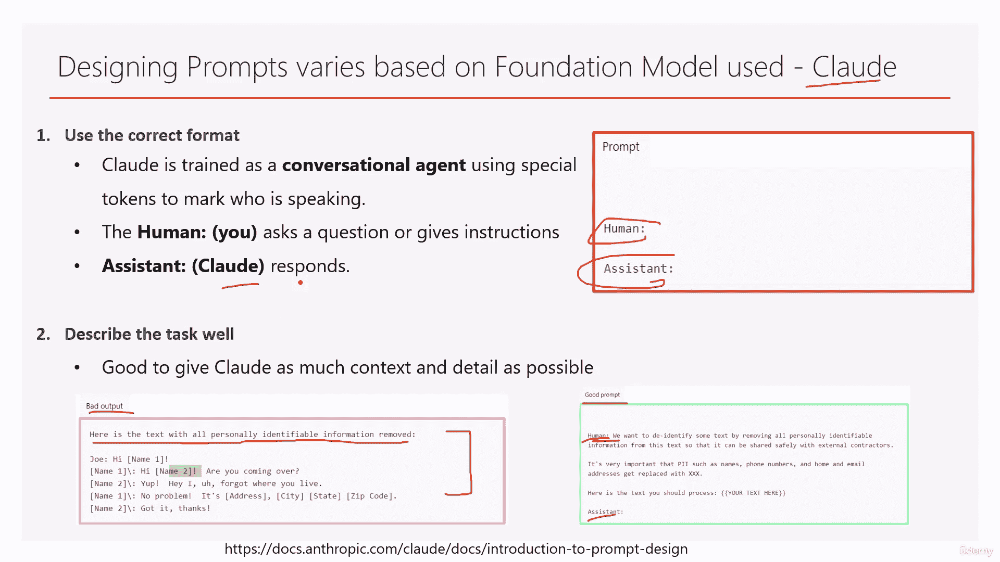
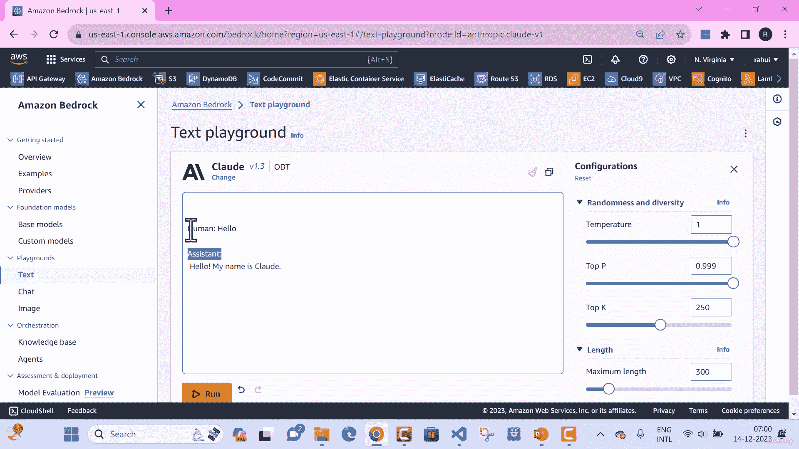
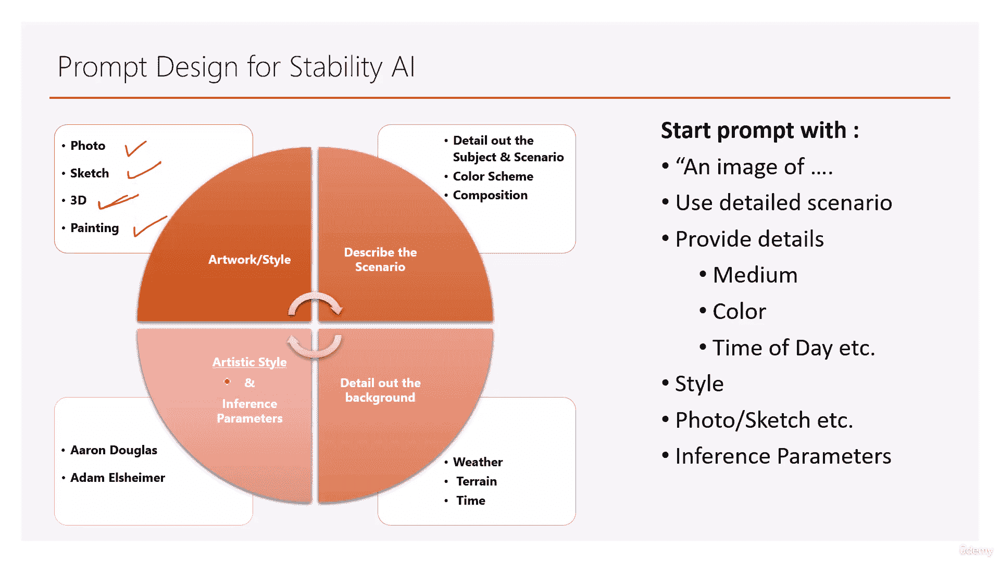
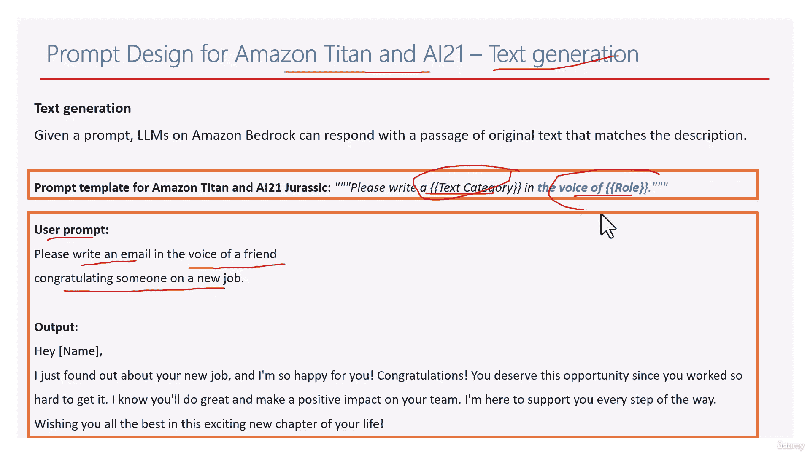

## 生成式AI on AWS：00：📌 课程概述

在本节课中我们将要学习提示工程第二部分的内容，重点讨论提示词设计中的几个关键因素，尤其是基础模型本身的知识、不同模型的提示词格式、如何让模型减少幻觉，以及图像生成和文本生成场景下的提示词写法。提示工程不是背一套万能模板，而是要根据具体基础模型的训练方式来调整提示词，这样才能让模型更稳定地输出符合要求的结果。下面我们先从第三个关键因素开始看，也就是基础模型的知识。

## 生成式AI on AWS：01：🧠 基础模型知识

上一节我们进入了提示工程第二部分，本节中我们来看看第三个关键因素，也就是基础模型的知识。每个基础模型在训练时采用的方法都不一样，因此针对某一个特定基础模型，提示词的写法会有专门需要考虑的地方。换句话说，提示词写得好不好，不只取决于你写了什么，还取决于你写的格式是否适合这个模型。

可以用一个简单公式来理解：

```text
提示词适配度 = f(基础模型训练方式)
```

这意味着，同一个提示词给不同模型使用，效果可能差别很大。理解模型训练方式后，我们接下来看看 Anthropic Claude 模型的提示词示例。

## 生成式AI on AWS：02：💬 Claude提示格式

上一节我们说明了基础模型知识的重要性，本节中我们来看看 Anthropic Claude 模型的提示词写法。Claude 是作为一个对话代理训练出来的，它使用特殊标记来标明当前是谁在说话。因此你需要告诉 Claude，谁在提问，也就是人类一方；或者告诉它当前是谁在提供任务。然后模型的响应应该以助手身份出现。如果你不提供这种区分，基础模型对要完成的任务就会缺乏清晰度。

以下是 Claude 提示格式中需要记住的几个点。

- 需要明确标识谁在提问，也就是 `Human` 一方。

- 模型回复通常以 `Assistant` 身份出现。

- 如果不做这种区分，模型可能不清楚任务结构，回复质量可能下降。



Claude 的提示格式可以概括为下面这种代码结构：

```text
Human: 这里写用户的问题或任务

Assistant: 这里写模型应给出的回复
```

原文给了一个不好的提示词示例：提示词直接进入背景细节，例如“Here is the text with all personally identifiable information removed”，但没有按照人类和助手的格式来组织。对于 Anthropic Claude 来说，如果你这样写提示词，响应可能不会那么好。原文也给了一个好提示词示例：先标明谁在提问，也就是人类，然后从助手那里获得响应，而助手在这里就是 Claude 基础模型。Claude 就是这样训练的，因此无论你是在控制台访问它，还是通过 API 访问它，都需要遵循这个流程。

在 AWS 控制台里，你进入文本 playground，选择模型，点击 Anthropic，然后点击应用。你输入“hello”并运行，可以看到控制台会自动把提示词改成 `Human` 和 `Assistant` 的格式，其中助手回复类似“hello, my name is Claude”。也就是说，在控制台里这个格式会自动完成；但在企业应用中，你需要自己遵循这个提示词格式，才能获得最好的结果。理解 Claude 的对话格式后，我们接下来看看如何设计提示词来减少幻觉。

## 生成式AI on AWS：03：🛡️ 避免幻觉的提示设计



上一节我们介绍了 Claude 的对话格式，本节中我们来看看如何设计提示词来避免幻觉。Anthropic 的说法是，如果你想让 Claude 基础模型避免幻觉，你需要给它一个“退路”。这里的“退路”就是告诉模型：如果你不知道答案，就明确说不知道，不要强行编造。

原文的例子是：给一个背景，然后问它“有记录以来最重的河马是哪一只”。如果模型并不知道最重的河马是哪一只，它就可能产生幻觉，生成事实上不正确的内容，比如回答说有记录以来最重的河马是一头名叫 Hobert 的公河马，体重约 5000 公斤。我们知道这是不正确的。那么怎样确保模型在不知道某个答案时不去幻觉呢？方法就是给它一个出口。

以下是一个好的提示词做法。

```text
回答下面的问题。只有在你确实知道答案，或者能够做出有充分依据的推测时才回答。
否则，请告诉我你不知道。
```

然后再问同一个问题，响应就会变成：“对不起，我不知道有记录以来最重的河马的准确体重。这似乎是非常具体且冷门的信息。”这是另一种避免幻觉、改善基础模型响应的方法。学会给模型退路后，我们接下来看看 Stability AI 图像模型的提示词怎么写。

## 生成式AI on AWS：04：🎨 Stability AI图像提示词

上一节我们讨论了如何通过给模型退路来减少幻觉，本节中我们来看看如何为 Stability AI 基础模型写出好的提示词。图像生成和文本生成不太一样，它需要你把画面描述得足够具体，模型才能生成更真实、更符合预期的图像。

以下是写图像提示词时可以遵循的步骤。

- 提示词以 `an image of` 开头，明确告诉模型你要生成一张图像。

- 提供主体的详细场景，说明主体是谁、处在什么环境中、发生了什么。

- 描述环境细节，例如主体所在的国家、周围有哪些人、背景里有什么建筑或设施。

- 定义色彩方案、一天中的时间以及天气条件。

- 告诉模型你希望的作品类型或风格，例如照片、素描、3D 图像或绘画。

- 最后定义艺术风格，Stability Diffusion 提供了多种艺术风格可选。

原文的例子中，提示词描述了一个间谍在敌对国家行动，周围有很多人跟随，背景是购物中心，并提到一些希腊建筑元素；时间是一天中的日落时分，太阳落在山后；最后说明图像应该是照片，并指定 Aaron Jason 之类的艺术风格。Stability Diffusion 里面可以选择 AJ K 等艺术风格，选择 AJ K 会得到相应风格的图像影响；继续向下滚动，还能看到很多不同的艺术风格可以使用。

图像提示词的结构可以概括为下面的代码：




```text
an image of [主体] + [详细场景] + [环境/建筑/人物] + [色彩/时间/天气] + [作品类型：照片/素描/3D/绘画] + [艺术风格]
```

原文中使用的示例提示词也遵循这个思路：以图像开头，说明主体是一个间谍，然后给出大量场景细节，包括敌对国家、购物中心背景、希腊建筑、日落山后，最后说明图像应为照片，并指定艺术风格。理解图像提示词结构后，我们接下来看看 Amazon Titan 和 AI21 的文本生成提示词设计。

## 生成式AI on AWS：05：✍️ Titan与AI21文本生成提示词

上一节我们介绍了 Stability AI 的图像提示词写法，本节中我们来看看 Amazon Titan 和 AI21 在文本生成场景下的提示词设计。如果你使用 Amazon Titan 和 AI21 进行文本生成，有几件事需要记住。第一，你要提供文本类别和主题，也就是你希望围绕什么内容生成文本；第二，你要定义角色声音，也就是 `voice of the role`。

可以用一个简单公式表达：

```text
输出质量 = f(主题, 角色声音)
```

原文的例子是写一封邮件，祝贺某人获得新工作。这封邮件可以用不同声音来写，它可以是经理写的，可以是同事写的，也可以是朋友写的。每种角色在写这封祝贺邮件时都会有不同语气。如果你能定义角色声音，基础模型就会更清楚应该用什么语气来写这封邮件。示例中指定了朋友的声音，基础模型就能基于朋友的声音生成输出。因此，做文本生成时，定义好将要消费这些信息的角色声音，对获得更高质量的输出非常重要。

以下是文本生成提示词需要包含的要素。

- 文本类别或主题：说明你要生成什么类型的文本、围绕什么主题。

- 角色声音：说明这封邮件或这段文本是以谁的口吻写的。

- 语气目标：让模型知道应该用经理、同事、朋友等哪种语气来表达。

- 输出用途：帮助模型理解这段文本最终给谁看、用于什么场景。

## 生成式AI on AWS：06：✅ 课程总结



本节课中我们一起学习了提示工程第二部分的核心内容。我们首先了解了基础模型知识为什么重要，因为每个基础模型的训练方式不同，提示词格式也要随之调整。接着我们看了 Claude 的对话提示格式，需要使用 `Human` 和 `Assistant` 来标明说话者，控制台会自动处理，但企业应用和 API 调用需要自己遵循格式。然后我们学习了如何通过给模型“退路”来减少幻觉，让模型在不知道答案时明确说不知道。之后我们介绍了 Stability AI 的图像提示词写法，包括主体、场景、环境、天气、作品类型和艺术风格。最后我们了解了 Amazon Titan 和 AI21 文本生成提示词中的主题和角色声音。掌握这些内容后，你就可以根据具体基础模型来设计更合适的提示词，让生成结果更稳定、更符合预期。
