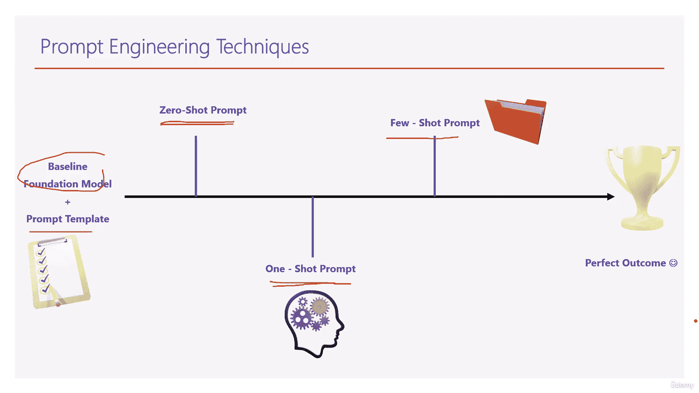
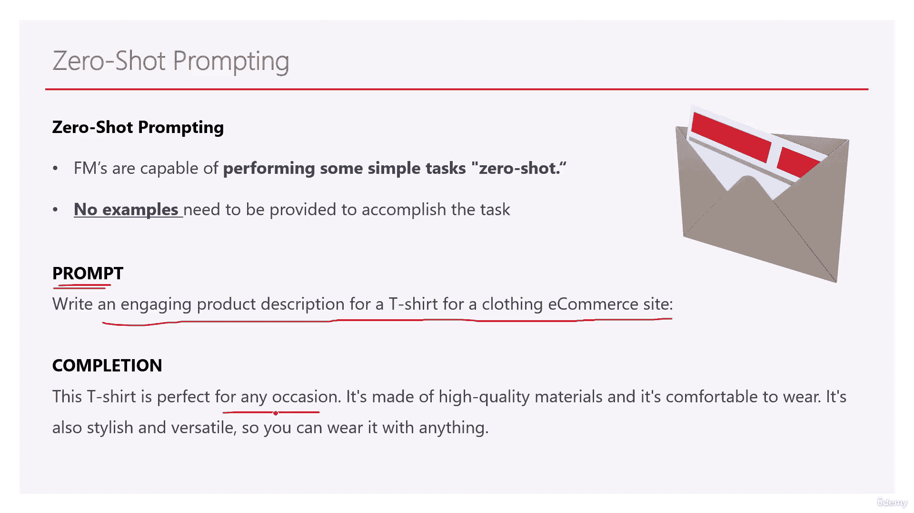
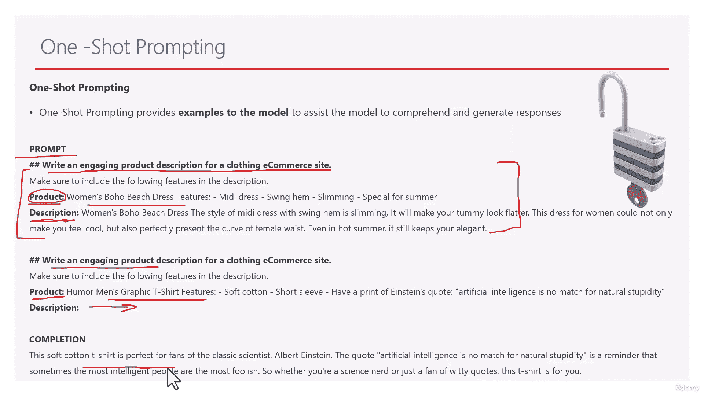
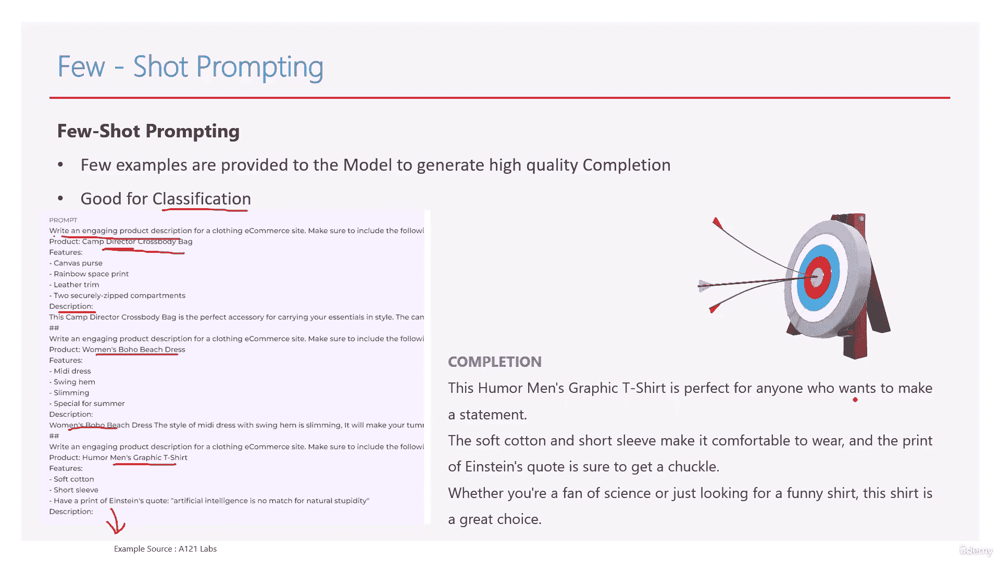

# 生成式AI on AWS（Amazon Bedrock、RAG与KIRO）：第89-91讲：🧭 提示工程技巧

## 生成式AI on AWS（Amazon Bedrock、RAG与KIRO）：第89-91讲：📌 课程概述

在本节课中我们将要学习不同的提示工程技巧。提示工程可以先用大白话理解成：把任务说清楚、给出合适样例，让基础模型更容易输出你想要的结果。原文先说明，你可以使用不同的提示工程技巧来改善基础模型的输出效果。整体思路是从一个基线基础模型开始，然后根据你的需求定义提示模板，而提示模板具体怎么写，取决于你正在使用哪一种基础模型。

从学习路径看，这样安排能让初学者先知道输入是怎么来的，再逐步增加示例数量，避免一开始就陷入复杂概念。以下是本节要走的整体路线，先建立整体印象。

- 先准备一个基线基础模型，把它当作起点。

- 根据实际需求定义提示模板，模板形式要结合所用基础模型来定。

- 第一种技巧是零样本提示（zero-shot prompt）。

- 如果零样本效果不好，就使用单样本提示（one-shot prompt）。

- 如果单样本仍然不能给出满意响应，就使用少样本提示（few-shot prompt）。

- 目标是希望这些方法能帮你得到理想的响应结果。

上一段我们建立了整体路线，本节中我们先把基线和提示模板讲清楚，因为后面的零样本、单样本和少样本都建立在这个起点上。

## 生成式AI on AWS（Amazon Bedrock、RAG与KIRO）：第89-91讲：🧱 基线与提示模板

上一节我们介绍了整体路线，本节中我们来看看基线基础模型和提示模板。原文说，你先从一个基线基础模型开始，然后根据你的需求定义提示模板，提示模板取决于你使用的是什么类型的基础模型。这里可以把基线模型理解成“还没加特殊提示技巧的原始模型”，而提示模板就是“提前写好的任务说明格式”。对于初学者来说，不必把提示模板想得太复杂，它就是把常用要求固定下来，方便反复使用。

核心关系可以用下面的公式表示：

```text
基线基础模型 + 提示模板 = 初始提示输入
```

后面的技巧不是完全推翻这个起点，而是在这个起点上逐步增加示例。本节中我们先把起点讲清楚，接下来看看第一种技巧：零样本提示。



## 生成式AI on AWS（Amazon Bedrock、RAG与KIRO）：第89-91讲：0️⃣ 零样本提示

上一节我们介绍了基线与提示模板，本节中我们来看看零样本提示。原文说，第一种技巧叫零样本提示（zero-shot prompting）。它的含义是：基础模型已经在大量互联网数据上训练过，因此它们有能力在没有额外指导的情况下完成一些简单任务，这就是零样本提示。换句话说，你不给基础模型提供任何“这个任务应该怎么做”的示例。

零样本提示的核心形式可以写成：

```text
零样本：Prompt -> Foundation Model -> Output
```

以下是零样本提示的关键点，用大白话说明就是只给任务、不给样例。

- 基础模型已经见过大量互联网数据。

- 模型有能力在没有指导的情况下完成一些简单任务。

- 你不提供任何关于任务如何完成的示例。

- 你只给出一个提示，然后期待模型直接输出结果。

原文给了一个例子：你向基础模型提供一个提示，这是一个文本生成用例，提示内容是“为服装电商网站写一段有吸引力的T恤产品描述”。这里没有提供示例，只是给出提示，基础模型就直接给出响应。这个做法很直接，对于某些简单任务，它可能给出相当不错的结果。零样本提示讲完后，接下来我们看看单样本提示，它会在提示中加入一个示例。

## 生成式AI on AWS（Amazon Bedrock、RAG与KIRO）：第89-91讲：1️⃣ 单样本提示

上一节我们介绍了零样本提示，本节中我们来看看单样本提示。原文说，第二种技巧是单样本提示（one-shot prompting）。在单样本提示中，我们给基础模型提供一个“如何完成某个任务”的示例，然后在同一个提示中再给它另一个任务，让基础模型去完成。这里的关键是“只给一个示例”，让模型照着一个样例来学习任务形式。



单样本提示的核心形式可以写成：

```text
单样本：1 个示例 + 新任务 -> Foundation Model -> Output
```

以下是单样本提示里通常会包含的内容，先给一个样例，再让模型做新任务。

- 先提供一个示例，说明任务应该怎么完成。

- 然后在同一个提示中给出另一个新任务。

- 基础模型根据这个示例进行学习，并生成新任务的响应。

原文的例子是这样的：先要求基础模型为服装电商网站写一段有吸引力的产品描述，然后告诉它产品是海滩裙，并生成这个产品的描述；这些细节都会提供给基础模型。随后在同一个提示中再给第二个例子，再次要求它写一段有吸引力的产品描述，这次产品是男士图形T恤。基础模型会根据前面的示例生成描述，你可以看到它给出的完成内容。总结一下：单样本提示提供一个示例，基础模型从示例中学习，然后根据第一个示例的学习结果生成响应。单样本之后，如果还需要更多示例来帮助模型理解，就要用到少样本提示。

## 生成式AI on AWS（Amazon Bedrock、RAG与KIRO）：第89-91讲：🔢 少样本提示

上一节我们介绍了单样本提示，本节中我们来看看少样本提示。原文说，最后一种技巧是少样本提示（few-shot prompting）。在少样本提示中，我们给基础模型提供几个“任务需要如何完成”的示例，然后给它一个任务，期待基础模型根据前面示例中的学习来完成这个任务。它特别适合分类问题，例如情感分析。



少样本提示的核心形式可以写成：

```text
少样本：多个示例（通常 n ≥ 2） + 新任务 -> Foundation Model -> Output
```

以下是少样本提示用于分类任务的典型流程，用大白话理解就是“先给模型看几个例子，再让它判断新例子”。

- 告诉基础模型什么是正面情感。

- 告诉基础模型什么是负面情感。

- 给它一些情感分类示例。

- 再让它完成一个任务，判断某条陈述是正面情感还是负面情感。

原文还给了一个延续前面产品描述例子的少样本例子：要求基础模型写一段有吸引力的产品描述，先给第一个例子，讨论斜挎包并给出描述；然后给第二个例子，讨论女士海滩裙，并说明描述应该怎么写；最后给出另一个产品，也就是男士图形T恤，期待基础模型完成这段描述。通过这种方式，模型可以从多个示例中学习，再完成新的产品描述任务。提示工程技巧到这里就基本讲完了，接下来我们做一个小结。

## 生成式AI on AWS（Amazon Bedrock、RAG与KIRO）：第89-91讲：✅ 课程总结

本节课中我们一起学习了提示工程技巧，包括零样本提示、单样本提示和少样本提示。简单回顾一下：零样本提示只给任务、不给示例，适合一些简单任务；单样本提示给一个示例，让模型照着示例完成新任务；少样本提示给多个示例，适合分类等问题，也能帮助模型更稳定地理解任务形式。原文还说明，如果零样本效果不好，可以尝试单样本；如果单样本仍然不能给出满意响应，可以尝试少样本，希望最终能得到理想的响应结果。

以下是选择提示技巧时可以记住的简单顺序，先简单后复杂，逐步增加示例。

- 先尝试零样本提示。

- 零样本效果不好时，尝试单样本提示。

- 单样本仍不满意时，尝试少样本提示。

- 根据输出效果选择合适的方法。



这就是提示工程技巧的主要内容，希望本节课对你有所帮助，下节课再见，谢谢。

