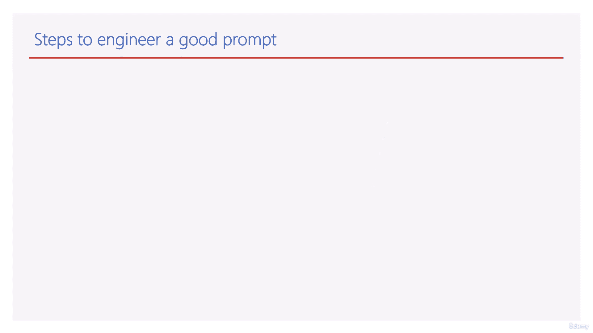
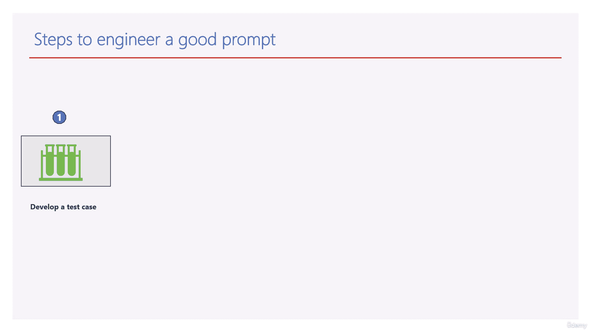
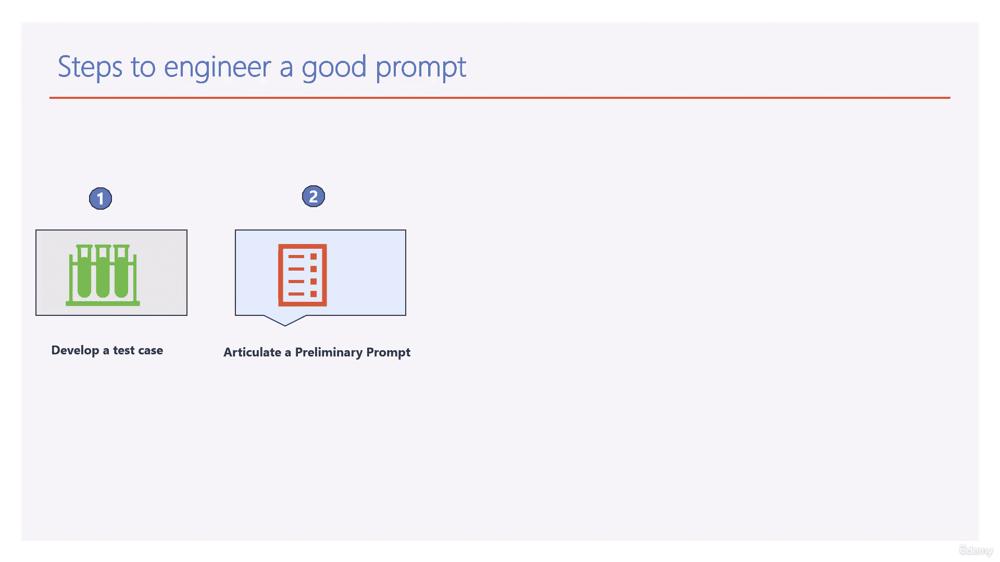
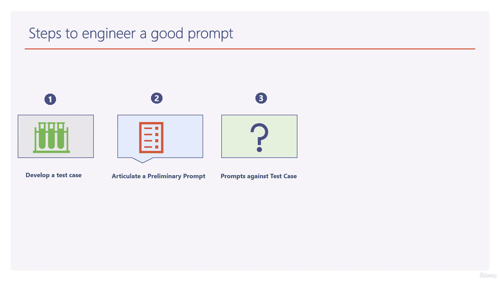
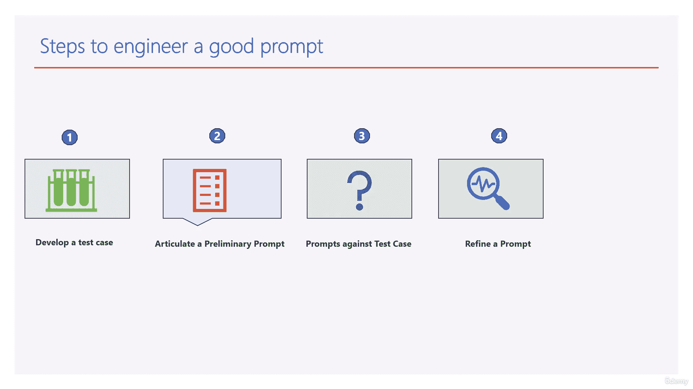
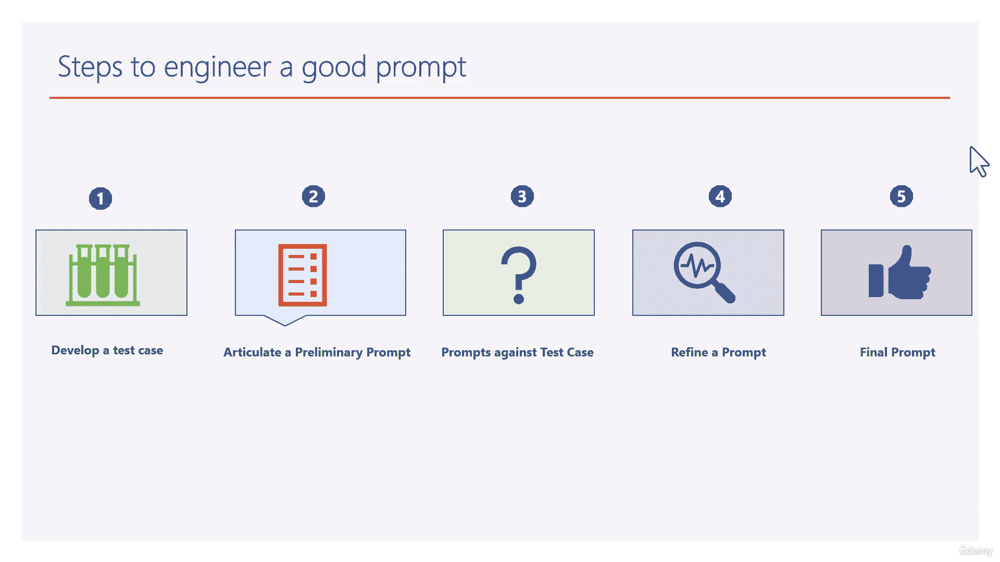

## 生成式AI on AWS：第90-92节：编写优质提示词的工程步骤 🛠️

在本节课中，我们将要学习如何一步步工程化地编写一个优质提示词，从而让基础模型给出更好的回答。提示词写得好不好，会直接影响模型输出的质量，所以这套流程值得初学者认真理解。下面会用一个尽量直白的方式来解释，把每个步骤都说清楚，让你知道为什么这样做、具体又该怎么做。

## 生成式AI on AWS：第90-92节：核心思想 💡

上一节概述了本节课的目标，本节中我们来看看这套方法背后的核心思想。提示词工程对于从基础模型获得良好响应非常关键。我们可以采用一种与 DevOps 中测试驱动开发非常相似的方法。下面解释这套做法是什么意思。

```text
测试用例 = 场景 + 预期响应 + 边界情况
提示词优化流程 = 创建初稿 → 对照测试 → 验收评估 → 迭代优化
```

用大白话来说，就是不要一上来就凭感觉反复改提示词，而是先想清楚“什么样才算好回答”，再拿这个标准去检验提示词。也就是说，你先写好像考试题一样的测试用例，再让提示词去“答题”，最后看它有没有达到验收标准。这样改提示词就不是碰运气，而是像做小实验一样，有场景、有标准、有对照、有结论。

## 生成式AI on AWS：第90-92节：具体工程步骤 🧪

理解了“先写测试再改提示词”的思路后，本节来看看落地时应该按什么顺序做。以下是编写优质提示词时可以遵循的具体步骤，每一步都对应一个清晰的动作，方便初学者照着执行。

1. 首先开发测试用例，在测试用例中写清楚场景和预期响应。

2. 然后，在开发完这些测试用例后，还要把所有边界情况也包含进去。

3. 接着，为不同场景创建初步的提示词。

4. 再拿这些提示词去测试前面已经识别出来的测试用例。

5. 然后评估这些提示词是否通过了对应测试用例的验收标准。



6. 下一步，根据你的使用场景不断优化提示词，直到得到期望的结果。



7. 再下一步，继续优化提示词，直到得到业务期望的响应。





这张清单看起来步骤不少，但核心逻辑很清楚：先定义什么是好结果，再创建提示词，再用测试用例检验，最后根据检验结果反复优化。初学者可以把这套流程理解成“写题、答题、判卷、改答案”的循环。其中“继续优化”很重要，因为提示词往往不是一次就能写好，而是要通过多轮测试和调整，逐步接近业务真正想要的响应。



## 生成式AI on AWS：第90-92节：关键理解 ✅

完成上面的步骤后，本节来补充几个关键理解，帮助你把这套流程真正用起来。测试用例不是随便写的，它要包含具体场景和预期响应，这样后面测试提示词时才有判断依据。边界情况也不能漏掉，因为很多问题往往出现在不常见、不典型的输入上。验收标准则像一把尺子，用来判断提示词有没有通过测试。迭代优化是整套方法的核心动作，你要根据使用场景不断调整提示词，直到模型输出满足业务期望为止。

## 生成式AI on AWS：第90-92节：总结 🧾



本节课中我们一起学习了编写优质提示词的工程步骤：先开发包含场景、预期响应和边界情况的测试用例，再为不同场景创建初步提示词，然后用测试用例进行测试和验收评估，最后反复优化提示词，直到得到符合使用场景和业务期望的响应。希望上述内容清楚，也希望你喜欢本讲，下讲见，谢谢。

