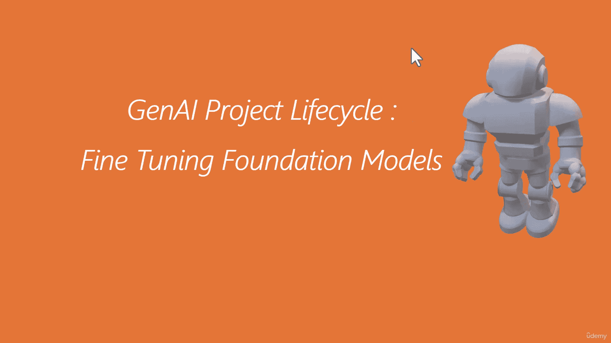
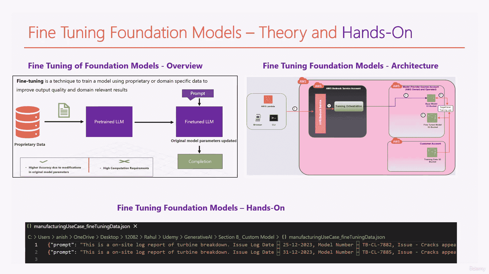

# Udemy - Generative AI on AWS - Amazon Bedrock, RAG & KIRO [2026] part1：p91-93：基础模型微调章节概览 🎯

欢迎来到基础模型微调这一节。在本节课中，我们将要学习基础模型微调这一主题，并围绕“为什么需要微调”和“如何在 Amazon Bedrock 中动手微调”展开。本节的目标是帮助理解为什么需要对基础模型做微调，同时展示在 AWS Bedrock 中微调基础模型的实际操作方式。为了让学习路径更清楚，内容会先从概念入手，再看整体架构，最后进入使用自定义数据的动手实践，这种顺序对初学者比较友好，因为先知道为什么，再看结构，最后操作，不容易迷路。下面先看本节目标。

本节目标可以拆成下面两点，先理解原因，再进入动手实践：

- 理解为什么需要微调基础模型。
- 在 AWS Bedrock 中动手微调基础模型。

明确目标之后，我们先从最基础的概念开始，把“微调”到底是什么意思讲清楚。

## 🧠 什么是基础模型微调

上一节我们明确了本节目标和学习路线，本节中我们来看看基础模型微调的含义。首先需要学习基础模型微调到底指什么。用大白话说，微调就是拿一个已经训练好的基础模型，再用自己的数据继续训练一段时间，让模型更贴合特定任务、特定领域或特定表达习惯。核心概念可以用下面的公式描述：

\[
\theta_{\text{fine-tuned}} = \operatorname{Train}\left(\theta_{\text{pre-trained}}, D_{\text{custom}}\right)
\]

这里的 \(\theta_{\text{pre-trained}}\) 是基础模型原本的参数，\(D_{\text{custom}}\) 是自定义数据，\(\theta_{\text{fine-tuned}}\) 是微调后得到的模型参数。这个公式表达的意思很直接：微调不是从零开始训练模型，而是在已有基础模型的基础上，用自定义数据继续训练，得到更符合自己需求的模型。为了把概念落到初学者能理解的点上，可以记住下面几项：

- 微调不是从零训练一个新模型，而是基于已有的基础模型继续训练。
- 微调依赖自定义数据，数据质量会影响微调后的效果。
- 微调的目标是让基础模型更适合自己的任务和场景。

概念清楚之后，下一步需要看微调基础模型的整体架构，理解数据、模型和训练任务之间如何配合。

## 🏗️ 微调基础模型的架构

上一节我们介绍了微调的含义，本节中我们来看看微调基础模型的架构。架构可以先用一个简化流程来表示，这个流程把基础模型、自定义数据和微调任务串起来：

```text
基础模型
  -> 准备自定义数据
  -> 选择微调方式与参数
  -> 在 Amazon Bedrock 中提交微调任务
  -> 生成微调后的基础模型
  -> 评估、部署、使用
```

这个流程说明，微调不是单独的一步操作，而是从数据准备到模型产出的完整链路。围绕这个流程，可以拆成下面几项来理解：

- 基础模型是起点，提供已经具备通用能力的模型参数。
- 自定义数据是微调的关键输入，用来告诉模型需要适配什么内容。
- 微调任务负责把基础模型和自定义数据结合起来进行训练。
- 微调后的模型需要评估和部署，才能进入实际使用。

架构理解之后，就进入动手部分，看看如何在 AWS Bedrock 中使用自定义数据微调基础模型。

## 🛠️ 使用自定义数据在 Amazon Bedrock 中动手微调

上一节我们梳理了微调基础模型的架构，本节中我们来看看在 Amazon Bedrock 中如何动手微调基础模型。在 AWS Bedrock 中，本节会展示如何使用自定义数据完成基础模型微调。为了让操作思路更清楚，可以按下面的步骤来组织：

- 准备自己的自定义数据，并确认数据格式和内容符合微调要求。
- 在 Amazon Bedrock 中选择要微调的基础模型。
- 配置微调任务，把基础模型和自定义数据关联起来。
- 提交微调任务，等待训练完成并得到微调后的模型。
- 对微调后的模型进行评估，再决定是否部署和使用。



这些步骤把概念和架构落到了实际操作上，重点始终是使用自定义数据让基础模型更贴合自己的需求。完成动手实践后，本节内容就进入了收尾阶段。



## ✅ 总结

到这里，本节内容已经完整走过了从概念到架构再到动手实践的过程。在本节课中，我们一起学习了基础模型微调的含义、为什么需要微调、微调基础模型的架构，以及在 AWS Bedrock 中使用自定义数据动手微调基础模型的整体思路。现在我们就进入本节内容，继续深入学习。下一讲见，谢谢。
